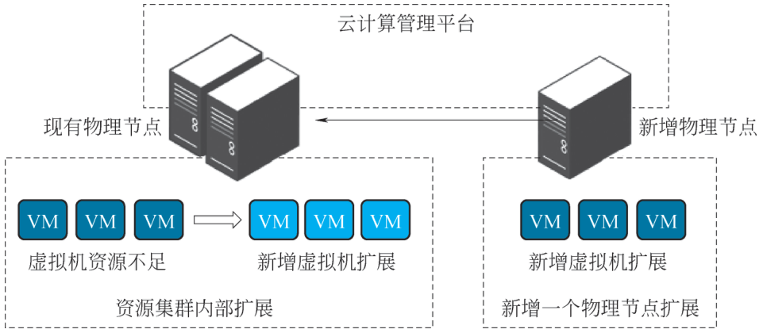
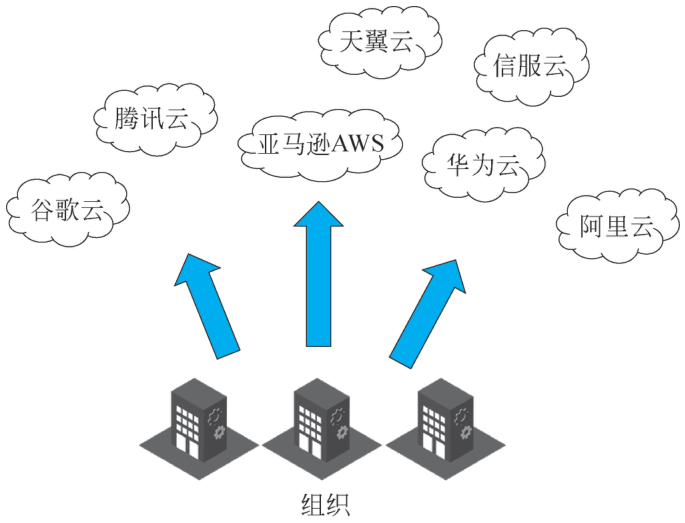
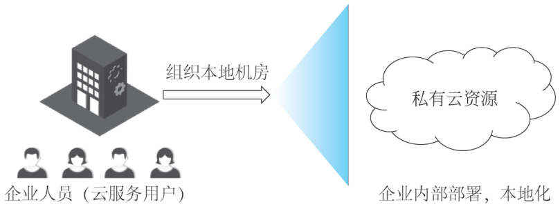
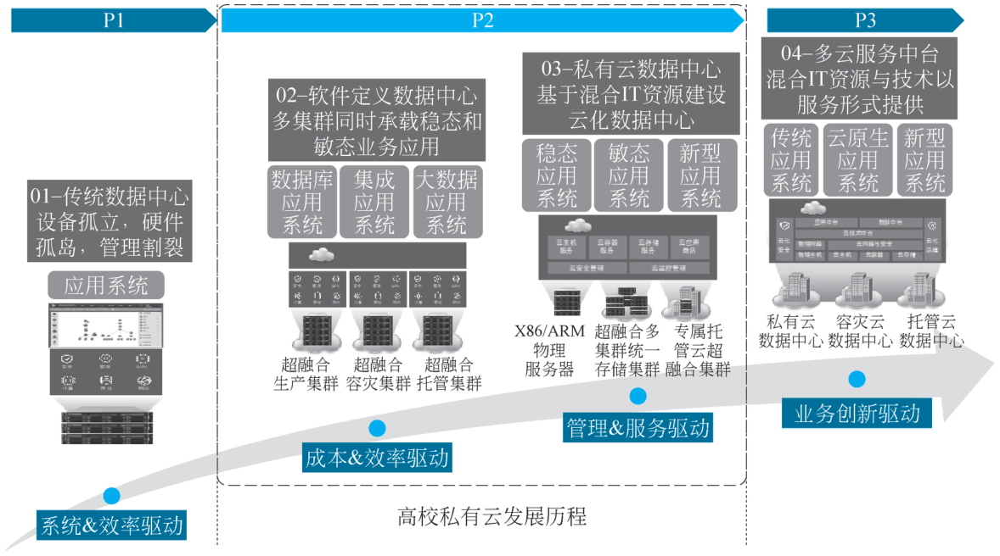
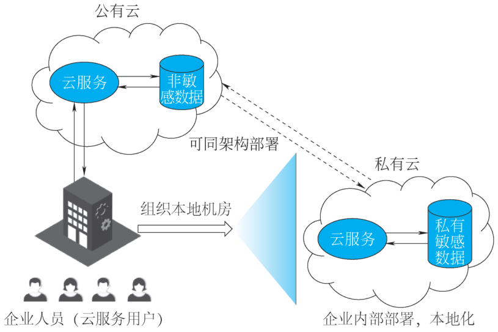
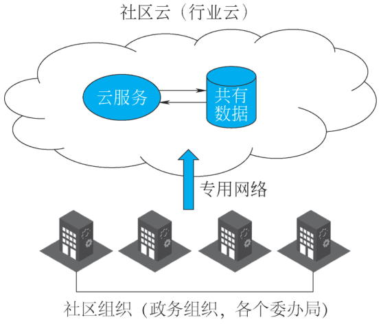
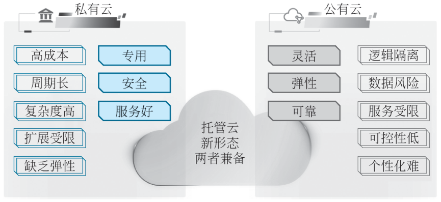
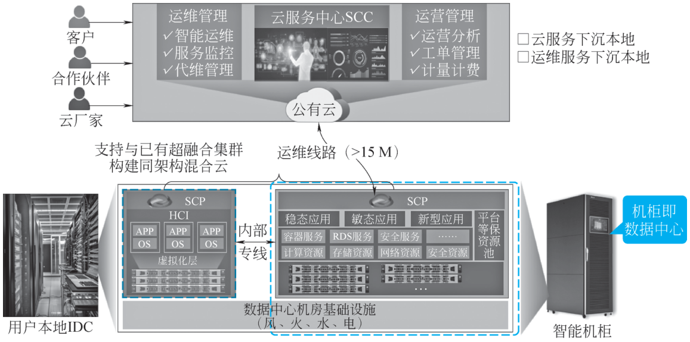

# 1.1 云计算概述 {#11}

!!! info "学前导读"

    先想一想家里的用电：我们不用自己建发电厂，插上插头就有电，月底按电表读数交电费。云计算做的是同一件事，只是“电”换成了计算、存储和网络。企业不再自己买服务器、建机房，而是通过网络向云服务商“按需取用、按量付费”。

    本节内容较多，建议分三次学完：

    1. **是什么**（1.1.1）：云计算的定义、5 个主要特点和 3 个新特点；
    2. **靠什么**（1.1.2）：虚拟化、分布式计算、资源调度这三项核心技术，第 2 章还会细讲；
    3. **怎么用**（1.1.3～1.1.5）：IaaS、PaaS、SaaS 三种服务模式，公有云、私有云、混合云、社区云四种部署模式，以及在政务、电商、教育、医疗、金融中的应用。

    学完后，你应当能看着一项云服务说出它属于哪种服务模式、哪种部署模式。

## 1.1.1 云计算的定义与特点 {#111}

### 1.1.1.1 云计算的定义 {#1111}

近年来，云计算不仅重塑了传统的信息技术（information technology，IT）架构，更以前所未有的灵活性与扩展性，为个人、企业乃至整个社会组织的运营模式带来翻天覆地的变革。从最初的概念萌芽到如今的广泛应用，云计算的演进之路与信息技术发展的脉络紧密交织，每一步都刻着技术革新与需求变迁的轨迹。

全球著名咨询机构 Gartner 对云计算有着独到的见解，Gartner 公司在其报告中将云计算置于战略技术领域的前沿位置，进一步说明了云计算作为行业发展趋势的必然性。报告中，Gartner 公司对云计算技术做出了定义：云计算是一种计算模式，借助互联网（Internet）技术将具备可扩展性与弹性的 IT 能力以服务的形式提供给外部用户。这一定义彰显了云计算在满足企业多样化需求、提升资源利用率、加速业务创新等方面蕴含的巨大潜力。通过将 IT 能力封装成服务，云计算能够实现资源的灵活调配与共享，极大地降低企业的运营成本，使企业可以将更多的精力与资源聚焦于核心业务的拓展与深耕。

2009 年，美国国家标准与技术研究院（National Institute of Standards and Technology，NIST）发布了云计算的定义，后续于 2011 年 9 月，在综合进一步评审意见及企业反馈后，推出了修订版定义：云计算是一种模型，能够实现用户在任意时间、任意地点，便捷且按需地从可配置的计算资源共享池中获取所需资源（如网络、服务器、存储、应用程序及服务）的需求，并且资源能够快速供给和释放，从而将管理工作量及服务提供商的介入程度降至最低。

本书给出一个更为简洁的云计算定义：云计算是分布式计算的一种特有形式，能够融入效用模型来远程提供可扩展且可测量的资源。这一简化定义与此前云计算行业其他组织所发布的定义相契合。

云计算的运作模式是将计算任务分配到由大量计算机组成的资源池中，如此一来，各种应用系统便可依据自身所需的处理能力、存储空间及软件服务来获取资源。云资源具备自我维护和管理的特性，一般表现为大型服务器集群，涉及计算服务器、存储服务器、宽带资源服务器等。

!!! tip "小贴士"

    本书在讲解云计算时会涉及多个相关角色定义，NIST 云计算参考架构定义了 5 种主要角色，具体如下。

    云服务提供者（cloud provider）：负责向相关方提供服务的个人、组织或实体，主要是提供基于云的 IT 资源的组织机构。

    云服务消费者（cloud consumer）：与云服务提供者保持业务关系并使用其服务的个人或组织，也称为云用户。

    云审计员（cloud auditor）：能够对云服务、信息系统运行、性能和云实现的安全性进行独立评估的人员。

    云服务代理（cloud broker）：管理云服务的使用、性能和交付，并在云服务提供者和云服务消费者之间协商关系的实体。

    云运营商（cloud carrier）：连接云服务提供者和云服务消费者的中介，提供云服务，这个角色通常由网络和电信运营商担任。

### 1.1.1.2 云计算的特点 {#1112}

云计算通常通过互联网来提供动态易扩展且虚拟化的资源。云是网络、互联网的一种比喻说法。过去往往用云来表示电信网，后来也用来表示互联网和底层基础设施。用户通过计算机、手机等方式接入数据中心，按自己的需求进行运算。根据 NIST 给出的云计算定义，云计算模型包含以下 5 个基本特点。

（1）宽带网络连接：云计算服务通过互联网提供，因此需要高带宽通信链路来确保用户能够通过各种设备，如笔记本计算机、手机、平板电脑等，迅速连接至云服务。这一特性使云计算成为企业内部数据中心的有力竞争者。许多组织采用三层架构（接入层交换机、汇聚层交换机、核心层路由器与交换机），将计算平台连接到局域网中。这种架构能够有效地保障数据的快速传输和处理，提高网络的稳定性和可靠性。

（2）按需自助服务：云计算服务提供商通过精细的技术手段，对用户所使用的资源量进行精准的监控、统计与分析，并依据实际使用量进行计费。用户可以清晰地看到自己在一定时期内消耗的计算资源、存储空间以及网络带宽等各项资源的具体数值，从而合理地规划资源的使用策略，优化成本支出，避免资源的浪费。例如，用户可以根据自己的业务需求，随时调整虚拟机的配置，或者动态扩展存储容量。

（3）资源池的灵活性与位置无关性：云计算依赖大规模、动态的共享资源池，以满足用户需求并优化应用程序的资源分配。云计算资源的位置对用户而言是透明的，用户虽无法掌控资源的具体物理位置，但可在较高抽象层面指定资源的大致位置，如国家、省或数据中心。资源虚拟化还能屏蔽不同资源的差异，使用户在申请存储空间时，无须关注其对应的是机械硬盘、固态硬盘，还是两者兼有对应。这种资源整合的方式不仅提高了资源的利用率，还降低了企业的硬件投资成本。

（4）具有弹性扩展能力：云计算具备根据需求快速扩展或收缩资源的能力，确保用户能按需获取或释放资源，如图 1-1 所示。这种弹性使用户在资源需求增加时能迅速获取更多资源，保障应用的高效运行；在需求减少时能及时释放资源，降低使用成本。云计算服务提供商需设计松耦合服务，确保各服务的伸缩能力相互独立。例如，一个电商平台在促销活动期间，可能会面临流量的迅速增加，这时可以快速扩展云计算资源来应对，活动结束后再将资源释放。

（5）服务可被测量：云计算系统能监测、控制和报告资源的使用情况，使服务提供商和用户均能掌握资源使用细节。用户可依据实际使用的资源量进行付费，付费模式包括预付和后付，后付模式又可分为预设限额和无限额使用。若预设限额，当用户达到限额时，系统将拒绝新的使用请求。用户可根据需求购买相应服务，并清晰了解服务的使用状况。

{ loading=lazy }

图 1-1 云资源弹性扩展示意图
{ .fig-caption }

用户在计费时可以选择使用前支付或使用后支付，后一种支付类型又分为预定义限值和无限制使用。如果设定了限值，它们通常以配额形式出现。当超出配额时，计费管理系统可以拒绝云用户的使用请求。假设某用户存储容量的配额是 2 TB，一旦用户在云计算系统中的存储容量达到 2 TB，新的存储请求将被拒绝。用户可以根据需求来购买相应数量的服务，并可以很清晰地看到自己所购买服务的使用情况。对于合约用户，通常在合约中规定了使用产品类型、服务质量要求、单位时间的费用或每个服务请求的费用等，如华为弹性云服务器实例的计价标准，不同配置的虚拟机服务器实例是按月计价的。

随着信息技术的应用创新及新兴技术的发展，除了上述特点，基于应用场景和环境要求，云计算还有以下特点。

（1）支持异构基础资源：云计算可以在不同的基础平台之上构建，即可以有效兼容各种不同种类的硬件和软件基础资源。硬件基础资源主要包括网络环境下的 3 类设备，即计算设备（服务器）、存储设备和网络设备（交换机、路由器等）；软件基础资源则包括单机操作系统、中间件、数据库等。

在信息技术国产化背景下，组织机构需要用到：国产芯片，如飞腾、鲲鹏、海光、兆芯等；国产数据库，如达梦数据库、人大金仓数据库等；国产中间件，如东方通中间件、中创中间件、金蝶中间件等。这些资源已在金融、能源、电信等关键领域被广泛应用，助力实现信息技术国产化，推动国产技术的发展。

▶ 配套微课 V1-1《国产化云技术介绍》（纸质书中为二维码，网络版视频待上线）

（2）支持异构多业务体系：在云计算平台上，可以同时运行多个不同类型的业务。异构表示该业务既不是相同的，也不是已有的或事先定义好的，而是用户自己创建并定义的。

（3）通算与智算统一管理：随着大语言模型的发展与广泛开源，越来越多的单位都在考虑建设本地化算力中心，目前算力中心建设呈现出智能化、规模化、集群化的发展趋势，智能算力需求与现有的通用算力统一管理的需求越来越迫切。云计算的分布式架构能够助力算力中心构建广泛节点网络，分散任务负载，提升整体性能和可靠性。

**动手看看 · 按需付费与弹性伸缩**

“弹性扩展”和“按需付费”是云计算最直观的两个特点。下面的动画模拟一家网店一天的访问量：拖动滑块改变促销高峰的大小，比较“自建机房按高峰买服务器”和“上云后随访问量自动增减服务器”两种做法的服务器数量和费用。

<iframe class="sim-frame" src="../../sims/elastic-billing/main.html" height="520" loading="lazy" title="按需付费与弹性伸缩"></iframe>

拖动“高峰访问量”滑块，看两条曲线和两笔费用怎么变；勾选“突发流量”，看自建机房什么时候会“扛不住”。[全屏打开](../../sims/elastic-billing/main.html){ target=_blank } · [教学说明](../../sims/elastic-billing/index.md)
{ .sim-caption }

## 1.1.2 云计算的核心概念 {#112}

### 1.1.2.1 虚拟化 {#1121}

虚拟化是将物理 IT 资源抽象、转换为虚拟资源的过程，大多数 IT 资源都能被虚拟化。虚拟化具体包括以下几种类型。

（1）服务器虚拟化（也称为计算虚拟化）：通过虚拟化技术，将物理服务器抽象为多个虚拟服务器，每个虚拟服务器都可以独立运行不同的操作系统和应用程序，就像独立的物理服务器一样。这种虚拟化方式极大地提高了服务器资源的利用率，简化了服务器的部署和管理。

（2）存储虚拟化：将物理存储设备抽象为一个或多个虚拟存储设备或虚拟磁盘。它可以在多个物理存储设备上创建统一的存储池，使存储资源的分配和管理更加灵活高效，便于扩展存储容量，提高数据备份与恢复的效率。

（3）网络虚拟化：在一个物理网络上模拟出多个逻辑网络。其通过引入集群化、持久化等技术提供高可用性保障；借助无状态设计、外置缓存等技术方案，有效提升网络数据处理性能，并赋予网络灵活的扩展能力。通过网络虚拟化技术，能够在一台物理网络设备上创建多个隔离的虚拟网络环境，提高了网络资源的利用率和灵活性，简化了网络的配置和管理。目前主流云计算技术的网络虚拟化支持“所画即所得”功能，通过虚拟化设备画出拓扑图就可以直接搭建出真实的网络环境。

▶ 配套微课 V1-2《“所画即所得”演示》（纸质书中为二维码，网络版视频待上线）

（4）安全虚拟化：利用虚拟化技术将安全设备的功能虚拟化。例如，可以通过虚拟机的方式部署防火墙、日志审计系统等安全设备，对虚拟化环境中的流量进行监控和过滤。安全虚拟化能够提供隔离虚拟资源、保护数据和应用程序等功能，为在虚拟化环境中运行的各种业务和服务提供可靠的安全保障。

用虚拟化软件创建新的虚拟服务器时，应首先分配物理环境资源，然后安装操作系统。虚拟服务器使用独立的用户操作系统，它独立于创建虚拟服务器的操作系统。在虚拟服务器上运行的用户操作系统和应用软件都不会感知到虚拟化的过程，也就是说，这些虚拟化 IT 资源就好像是在独立的物理服务器上安装执行一样。这样程序在物理环境系统上执行和在虚拟系统上执行都是一样的，这种执行上的一致性是虚拟化的关键特性。

### 1.1.2.2 分布式计算 {#1122}

分布式计算是指利用分散在不同位置的多台计算机通过消息传递（计算机间通信）协同工作以完成计算任务的方法和过程。这些计算节点既可以是位于同一个物理位置的多台计算机，也可以是地理上分散的集群。当这些节点被统一调度、协同管理并形成完整的运行环境时，便构成了分布式计算系统，其主要目标是通过协同工作提高计算效率、扩展性和容错能力。

分布式计算系统由多个关键组成部分构成，这些组成部分共同协作以实现高效和可靠的计算。以下是分布式计算系统的主要组成部分。

#### 1. 计算节点

计算节点是分布式计算系统中执行任务的基本单位。计算节点可以是物理服务器、虚拟机或容器。计算节点的性能和数量直接影响系统的计算能力和扩展性。

#### 2. 节点通信架构

节点通信架构并不是单一拓扑或协议，而是角色关系（中心/P2P / 混合）、三段路径（节点内/节点间/客户端）、抽象层（消息模型、发现、可靠性）的组合；胖树（Fat-Tree）只是“节点间”这一段可选的拓扑之一，其用于在 AI/HPC 场景下提供无收敛、高基数的横向扩展能力，是一种常用的高性能数据中心网络拓扑结构，具有高带宽、低延迟的特点。通过多层交换机和大量冗余链路，胖树结构能够提供高可靠性和高性能的网络连接。在大型数据中心中，核心交换机通常配置 100 Gbps 光纤链路，以满足高速数据传输的需求。

#### 3. 任务调度引擎

任务调度引擎（task scheduling engine）是一套负责把“任务”映射到“资源”并在时序上编排其执行顺序的软件中间层。其核心目标是：在满足优先级、依赖、资源配额、SLA 等约束的前提下，最小化整体完成时间；在节点失效、网络抖动、负载变化等动态环境下，自动重试、重调度或弹性扩缩，保持系统高可用；部分应用情况如下：

MapReduce: 在处理大规模数据时，MapReduce 模型将任务切分为多个子任务并行处理。Spark: 一种高性能的分布式计算框架，支持内存计算和多阶段任务调度。在处理复杂数据与任务时，Spark 能够通过有向无环图（directed acyclic graph，DAG）调度算法，优化任务执行计划，提高任务执行效率。

任务调度引擎在生活中应用广泛，具体可以如下说明：

**说明**

1. 医疗影像分析系统：设置急诊病例任务优先调度，响应速度提升 70%。通过优先级队列，系统能够确保紧急任务优先处理，提高医疗诊断的效率。

2. 灾害预警系统：优先级队列用于处理紧急预警信息，确保关键预警信息能够及时传达给相关部门和公众。

#### 4. 数据存储体系

（1）分区策略。

Cassandra: 一种高性能的分布式 NoSQL 数据库，采用一致性哈希算法将数据均匀分布到多个物理节点上。

Sharding Sphere: 一种数据库分片解决方案，支持水平分片和垂直分片。在处理大规模数据时，Sharding Sphere 能够将数据分布到多个数据库实例中，提高数据库的性能和可扩展性。

（2）副本机制。

HDFS：Hadoop 分布式文件系统，采用多副本机制确保数据的高可用性和可靠性。默认情况下，HDFS 为每个数据块存储 3 个副本。在某气象数据中心，HDFS 实现了 99.99% 的数据可用性，确保气象数据的可靠存储和访问。

（3）缓存层。

Redis: 一种高性能的分布式缓存系统，广泛应用于电商、社交网络等领域。

Memcached: 一种轻量级的分布式缓存系统，适合处理高并发的读写操作。在内容分发网络（content delivery network，CDN）中，Memcached 用于缓存热点内容，提高内容分发的效率和响应速度。

!!! tip "小贴士"

    在某大型电商平台上，Redis 集群被广泛用于缓存热点商品信息，这一策略在电商大促期间显著减轻了数据库的负载。通过将热门商品的详情、库存信息等数据缓存到 Redis 集群中，平台成功将数据库的查询请求数从平时的 55 万次大幅降至 800 次，极大地缓解了数据库的压力。这不仅提升了数据读取速度，还保障了用户在抢购高峰期的流畅购物体验，同时显著提高了系统的响应速度和稳定性。

#### 5. 容错控制机制

（1）心跳监测。

Consul: 一种服务网络解决方案，提供健康检查和心跳监测功能。在微服务架构中，Consul 通过心跳监测机制确保服务的可用性和可靠性。

Spark Streaming: 一种实时流处理框架，支持 Checkpointing 机制。在某实时数据处理平台中，Spark Streaming 每 30 秒将流处理状态持久化到 S3，确保数据的可靠性和容错性。

Flink: 一种高性能的流处理框架，支持 Exactly-once 语义的 Checkpointing 机制。在金融交易系统中，Flink 通过 Checkpointing 确保交易数据的可靠性和一致性。

（2）故障转移。

Kubernetes: 一种容器编排系统，支持自动故障转移机制。在某大型互联网公司中，Kubernetes 在 Pod 异常时自动将服务迁移到健康节点，服务中断时间小于 200 毫秒，确保服务的高可用性。

容错控制机制确保系统在部分节点失败的情况下仍能正常运行，提高系统的可靠性和可用性。常见的容错技术包括数据复制、任务重试和故障监测。

#### 6. 负载均衡策略

Nginx: 一种高性能的反向代理服务器，支持动态权重负载均衡策略。

LVS：一种高性能的负载均衡解决方案，支持多种负载均衡算法。在高并发场景中，LVS 通过动态权重算法合理分配流量，提高系统的性能和可靠性。

!!! tip "小贴士"

    在某大型互联网公司中，Nginx 通过实时监控各节点的 CPU 使用率，动态调整流量分配策略。具体来说，Nginx 会根据预设的算法和阈值，将流入的请求合理分配到不同的后端服务器节点上。当某个节点的 CPU 使用率升高时，Nginx 会自动减少分配到该节点的流量；反之，当 CPU 使用率降低时，则适当增加流量。这种智能的流量调度机制，使得整个系统的负载偏差始终控制在小于 15% 的范围内。

#### 7. 中间件

中间件提供了节点之间的通信和协调机制，简化了开发者的工作。它通常包括消息队列（如 RabbitMQ、Kafka）和远程过程调用（remote procedure call，RPC）框架，帮助不同服务和组件之间进行有效的交互。

（1）消息队列。

RabbitMQ：在某大型电商平台中，采用 RabbitMQ 实现异步通信，日均处理 22 亿条订单状态更新消息。RabbitMQ 提供了高可靠性和高性能的消息传递服务，确保订单状态更新的及时性和准确性。

Kafka: 在处理高并发、大数据量的场景中表现出色。例如，在实时数据处理平台中，Kafka 每秒可以处理数百万条消息，延迟低至毫秒级。

（2）远程过程调用。

远程过程调用框架是一种屏蔽网络细节、让本地代码像调用本地函数一样调用远程服务的通信中间件。其目标是：简化分布式系统中跨进程、跨主机的服务协作，使开发者无须关心数据序列化、网络传输、连接管理、超时重试等底层细节，即可实现“像写单机程序一样写分布式应用”。

#### 8. 安全控制体系

安全控制体系是分布式计算系统的重要组成部分，涉及双向认证、细粒度权限和审计追踪等。确保数据在传输和存储过程中的安全性是防止数据泄露的关键。

（1）双向认证。

mTLS（mutual transport layer security，相互传输层安全）协议：一种双向认证机制，广泛应用于 Kubernetes 集群内部通信。

SSL（secure sockets layer，安全套接字层）/ TLS（transport layer security，传输层安全）协议：一种安全通信协议，广泛应用于 Web 服务和数据传输。

（2）细粒度权限。

RBAC（role-based access control，基于角色的权限控制）模型：一种基于角色的访问控制机制，广泛应用于 Hadoop 集群管理。

ACL（access control list，访问控制表）：一种访问控制列表机制，可实现资源访问权限的细粒度控制。在分布式文件系统中，ACL 能确保用户对文件和目录的访问权限符合安全策略。

（3）审计追踪。

Elasticsearch: 一种高性能搜索引擎，广泛用于日志管理和审计追踪。

Splunk: 一种大数据分析平台，支持日志管理和审计追踪功能。在企业安全管理系统中，Splunk 通过分析日志数据发现潜在的安全威胁，提高系统的安全性和可靠性。

!!! tip "小贴士"

    某大型数据平台基于 RBAC 模型划分了 6 级数据敏感度，确保数据访问的安全性。具体来说，该平台将数据敏感度从低到高分为 6 个级别，每个级别对应不同的访问权限和控制策略。

    （1）公开数据（Level 1）：可被所有授权用户访问，无需特殊权限。

    （2）内部数据（Level 2）：仅限公司内部员工访问，需要基本权限。

    （3）机密数据（Level 3）：仅限特定部门或项目组访问，需要中等权限。

    （4）高度机密数据（Level 4）：仅限高级管理人员和特定授权人员访问，需要高级权限。

    （5）核心数据（Level 5）：仅限最高管理层和关键岗位人员访问，需要最高权限。

    （6）绝密数据（Level 6）：仅限特定授权的高级管理人员访问，需要特殊审批和最高权限。

    通过这种细致的权限划分，平台能够有效控制数据访问，确保不同敏感级别的数据只能被授权人员访问，从而最大限度地降低数据泄露和滥用的风险，满足组织单位的合规性要求。

#### 9. 监控体系

监控体系用于实时跟踪各个节点的状态、性能指标和任务执行情况。有效的监控工具（如 Prometheus、Zabbix）可以帮助管理员及时发现和解决问题，优化系统性能。

（1）指标采集。

Prometheus: 一种开源的监控系统，支持多维度指标采集和存储。在某大型互联网公司中，Prometheus 每 15 秒抓取节点 CPU 和内存指标，存储周期为 30 天，为系统监控和故障诊断提供数据支持。

Zabbix: 一种企业级的开源监控解决方案，支持多种监控指标和告警机制。在数据中心监控中，Zabbix 提供全面的硬件和软件监控功能，确保系统的稳定运行。

（2）链路追踪。

Jaeger: 一种分布式链路追踪系统，支持微服务架构中的调用链追踪。

（3）容量预警。

Grafana: 一种开源的可视化监控平台，支持多种数据源和可视化面板。在某大型数据中心中，Grafana 仪表盘设置了 80% 资源使用率红线，提前 2 小时触发扩容操作，确保系统稳定运行。

Datadog: 一种云监控平台，提供全面的监控和分析功能。在云原生环境中，Datadog 通过实时监控和预警机制，帮助用户及时发现和解决潜在问题。

**典型应用场景**

跨国物流公司全球运单系统：某跨国物流公司通过上述组件构建全球运单系统，日均处理 3 000 万票货物追踪，跨 8 个时区保持数据一致性，系统可用性达 99.95%。该系统采用分布式计算架构，通过消息队列、RPC 框架、任务调度引擎等组件，确保数据的高效处理和传输；利用一致性协议和容错机制，保证数据的一致性和可靠性；通过动态注册、健康检查和 DNS 集成等服务发现机制，确保系统的高可用性和稳定性。

### 1.1.2.3 资源调度 {#1123}

资源调度是云计算环境中对计算资源（如 CPU、内存、GPU、存储、网络带宽等）进行分配和管理的过程。它根据用户的请求、业务负载和资源的可用性等因素，合理地分配资源，以确保系统的高效运行和用户的满意度。例如，云计算平台的资源调度会根据用户申请的资源类型和数量，从资源池中选择合适的资源分配给用户。

#### 1. 提高资源利用率

资源调度可以根据业务负载动态调整资源分配。例如，在业务繁忙时，将更多的资源分配给高优先级的任务；在业务空闲时，回收闲置资源，分配给其他需要的任务，从而避免资源的浪费。

#### 2. 保证服务质量

通过合理的资源调度，可以确保每个用户都能获得满足其需求的服务质量。例如，对于实时性要求高的应用（如视频会议），资源调度可以优先分配足够的带宽和计算资源，以保证视频会议的流畅性。

#### 3. 实现弹性扩展

资源调度是实现云计算弹性扩展的关键环节。当用户业务负载增加时，资源调度可以快速从资源池中分配更多的资源；当负载减少时，资源调度可以回收多余资源，以实现资源的动态调整。虚拟化技术、分布式计算和资源调度相互配合，共同支撑云计算的高效运行。虚拟化技术实现资源的抽象和隔离，分布式计算提供强大的计算能力，资源调度则确保资源的合理分配和高效利用。

**动手看看 · 资源调度装箱**

资源调度要回答的问题是：一批大小不同的虚拟机，应当放到哪台物理服务器上？放得好，机器少开几台、电费少交一些；放得不好，有的机器挤满，有的机器空转。下面的动画让你亲手“装箱”，再和两种常见的自动调度策略比一比。

<iframe class="sim-frame" src="../../sims/bin-packing/main.html" height="560" loading="lazy" title="资源调度装箱"></iframe>

点击左边的虚拟机，再点击一台物理服务器把它放进去；放完后点“首次适应”或“最佳适应”，比较用了几台服务器、资源利用率是多少。[全屏打开](../../sims/bin-packing/main.html){ target=_blank } · [教学说明](../../sims/bin-packing/index.md)
{ .sim-caption }

## 1.1.3 云计算的服务模式 {#113}

云计算的服务模式是云服务提供者提供的具体的、事先打包好的 IT 资源组合。三种常见的云计算的服务模式如下：

（1）基础设施即服务（infrastructure as a service，IaaS）；

（2）平台即服务（platform as a service，PaaS）；

（3）软件即服务（software as a service，SaaS）。

云计算的这三种常见的模式（IaaS、PaaS、SaaS）是互相关联的，一个的范围可以包含另一个，层层递进、相互嵌套，IaaS 之上可构建 PaaS，PaaS 之上又可承载 SaaS，形成自下而上的完整服务链。

!!! tip "小贴士"

    目前已经出现了许多基本云计算服务模式的变种，每种都是由不同的 IT 资源组合构成的。例如：

    （1）桌面即服务（desktop as a service，DaaS）；

    （2）集成即服务（integration as a service，IaaS）；

    （3）处理即服务（process as a service，PaaS）；

    （4）模型即服务（model as a service，MaaS）。

    每个模式都是一种不同类型的云服务。随着云计算技术的发展，还会有更多的模式被创造出来。

**动手看看 · 服务模式责任分层**

IaaS、PaaS、SaaS 的区别，归根到底是“哪些层由云服务商管，哪些层由用户自己管”。读下面三种模式之前，先在动画里切换四种方式，看每一层归谁负责。

<iframe class="sim-frame" src="../../sims/service-layers/main.html" height="560" loading="lazy" title="服务模式责任分层"></iframe>

点“本地部署 / IaaS / PaaS / SaaS”切换，蓝色是云服务商负责的层，橙色是用户自己负责的层；再点“比萨的比喻”看同一件事的生活版本。[全屏打开](../../sims/service-layers/main.html){ target=_blank } · [教学说明](../../sims/service-layers/index.md)
{ .sim-caption }

### 1.1.3.1 基础设施即服务（IaaS） {#1131}

基础设施即服务（IaaS）是云计算服务模式的一种，云服务提供商为用户交付计算、存储、网络等基础计算资源。用户利用这些资源部署和运行自定义的应用程序，而无须自行购买和管理物理服务器、软件及网络设备，甚至可减少对本地数据中心的依赖。用户不能控制底层的基础设施，但是可以根据云服务商提供的选项来配置这些资源，并定义这些资源的运行逻辑，如虚拟机的操作系统影像、CPU/GPU 的配置、内存的大小、存储设备是否需要加密、密钥管理的模式以及防火墙的设置等。

#### 1. IaaS 的基本功能

（1）计算能力。计算能力的核心是虚拟机，每一个虚拟机又由处理器、内存、外部存储及操作系统软件构成。在处理器方面，云服务商一般都会提供 CPU、GPU 以及机器学习专用的张量处理单元（tensor processing unit，TPU）等，内存一般是可以高速动态存取的动态随机存储器（dynamic random access memory，DRAM）。

（2）存储能力。IaaS 一般为云用户提供高度可缩放的存储服务，用来方便地存储文件及任何数据包。为实现高可用性，IaaS 一般会把每个文件拷贝多份，分别放在不同的计算中心，以支持灾难恢复。目前存储服务有热存储和冷存储两种。热存储里的数据是可以实时提取的，而冷存储的数据在提取之前需要事先预约，热存储比冷存储要昂贵一些。

（3）网络服务能力。网络服务既可以让用户连接云计算资源和本地的基础结构，也可以让用户充分利用云服务自身的高容量、高性能网络主干来支持自己数据传输的需要。

大型的云服务往往会搭建自己的高速网络，并用这些网络在自己的数据中心之间或不同服务之间快速安全地传递数据。这些云服务的用户可以充分利用云服务本身的网络系统，就近获取信息。

（4）安全防护能力。体系化的安全防护是云服务必须具备的功能。安全服务包括保护数据、应用和基础设施服务，可以确保数据安全、应用安全、网络安全。云服务商在安全方面可以投入很多资源，并且拥有大量的网络攻击数据，能最早看到新的攻击，在不断快速变化的威胁环境下可以做到快速感知、快速响应。

#### 2. IaaS 的优势与不足

在企业 IT 基础设施的建设过程中，IaaS 的优势说明如下。

与本地部署的私有化资源相比，IaaS 展现出显著的敏捷性和扩展性优势。在本地计算中心，部署一台新虚拟机通常要花费数天甚至一周以上的时间，涉及烦琐的硬件配置和软件安装过程。而借助 IaaS，整个流程大幅简化，从而极大提升项目开发和部署的效率。

IaaS 的灵活性在云计算服务模式中首屈一指，为用户提供了极大的自由度。用户能通过应用程序接口（application programming interface，API）细致地调整服务的各项参数，实现对基础架构的全面掌控。

此外，IaaS 具备弹性伸缩功能，可根据资源使用率自动调整资源分配。在使用高峰时，系统自动扩展资源以满足需求；而在空闲时，系统则自动释放闲置资源。这种机制不仅提高了整体资源利用率，还帮助用户有效降低成本。

IaaS 的主要不足如下：

IaaS 的部署相当于是使用者换一个“机房”的概念，硬件基础设施用户自己不能全面掌控，根据云安全—NIST SP 500-292 中安全责任共担模式分析，租户（云服务使用者）承担的安全责任比较大，同时在投入上固定成本转化为可变成本，但运营复杂度相对于其他两种服务模式来说会显著上升。

#### 3. 主要的 IaaS 产品

（1）百度智能云。百度智能云的 IaaS 产品以强大的人工智能（artificial intelligence，AI）能力为特色，其 AI 计算平台“百舸”为用户提供了高效能的计算服务，适用于深度学习、自然语言处理等复杂的人工智能任务。存储服务采用先进的存储架构，确保数据的快速读写和高可用性，同时注重数据安全与隐私保护，提供完善的数据加密和访问控制功能。在网络服务方面，百度智能云构建了低延迟、高带宽的网络基础设施，保障用户业务的顺畅运转。此外，百度智能云在智能交通、工业互联网等领域积极布局，为传统行业的数字化转型提供有力支持。

（2）阿里云。阿里云成立于 2009 年，是全球领先的云计算服务提供商之一，其 IaaS 产品丰富，包括弹性计算服务、对象存储服务、云数据库和专有网络等，为企业提供强大的计算、存储和网络资源，以满足不同业务需求。在安全方面，阿里云提供完善的安全产品线，如云防火墙、日志审计、证书服务等，以保障企业数据和应用安全。此外，阿里云在全球拥有多个数据中心，提供低延迟和高可用的服务，并持续进行技术创新，推出新产品和服务，如 AI 计算平台 PAI、MaaS 平台百炼等，助力企业数字化转型。

（3）其他 IaaS 平台。其他 IaaS 平台还有 Azure、GCP（Google Cloud Platform）、Digital Ocean、Rackspace 等。值得一提的是，开源的 OpenStack 云计算平台标准中定义了计算、网络、存储等 IaaS 服务标准。Rackspace 和美国国家航空航天局是 OpenStack 项目的发起者，之后有 500 多家公司或机构加入这个开源项目，并用这一标准构建了公有或私有云平台。

#### 4. IaaS 服务安全责任

根据云计算安全责任模型，IaaS 服务提供者控制了底层的物理和虚拟资源；用户控制了访问和使用 IaaS 服务的用户数据（如用户证书、账号等）、工具（如 Web 浏览器、客户端软件等）或系统（如承载客户业务处理、应用、中间件和相关基础设施的企业系统），同时控制了使用物理和虚拟资源的操作系统、存储及部署的应用。

因此除租户虚拟资源私有空间内服务层的安全由租户负责外，其他安全责任都归属 IaaS 层，包括用户层安全、访问层安全、资源层安全、安全管理及公共的安全服务。

IaaS 层的安全风险既有传统数据中心边界网络的安全风险与内部网络的安全威胁，也有云计算多租户架构带来的新风险。对于管理员而言，主要存在以下风险和威胁：

（1）虚拟管理层成为新的高危区域。云计算系统通过虚拟化技术为大量用户提供计算资源，虚拟管理层成为新的高危区域。

（2）恶意用户难以被追踪和隔离。总体来说，对计算资源的控制范围决定了安全责任的边界。在云计算环境中通常有两个或两个以上安全责任主体，各安全责任主体根据管理范围划分安全责任边界。IaaS 服务模式安全责任见表 1-1。

表 1-1 IaaS 服务模式安全责任
{ .tab-caption }

| 云计算服务模式 | 云服务商责任 | 云用户责任 |
|---|---|---|
| IaaS | 负责底层基础设施（物理服务器、网络设备等）的安全，包括物理安全、虚拟化层安全、硬件维护等。提供虚拟机、存储、网络等资源的安全配置和管理工具。保障基础设施的稳定运行，防止未经授权的访问和攻击 | 负责虚拟机内部的操作系统、应用程序、数据等的安全。管理虚拟机的访问控制、防火墙规则、安全补丁更新等。进行数据备份、加密，保障业务应用的安全运行 |

### 1.1.3.2 平台即服务（PaaS） {#1132}

平台即服务（PaaS）是一种提供运算平台与解决方案的云计算服务模式。PaaS 比 IaaS 要高一层，PaaS 能把多个基础设施组织在一起，为用户提供常用的系统架构组成部分，如托管的数据库管理系统、信息总线、容器管理、网站环境等。用户不需要管理与控制云端基础设施（包含网络、服务器、操作系统或存储的运行、备份、升级等操作），只需要设置这些服务并在其上部署应用程序和数据。

PaaS 都是多用户共享的，因此用户只能根据服务商提供的选项来设置服务的运行方式，而不能根据自己的需要来修改服务的功能。

#### 1. PaaS 的基本功能

PaaS 也是基于服务器、存储空间和网络等基础结构的云计算服务模式，但它侧重于事先为用户将这些基础结构（还可能加上中间件、开发工具、商业智能服务和数据库管理系统等）组织好，来支持用户常见应用程序的生成、测试、管理和更新。

PaaS 让用户无须购买和管理软件许可，也无须管理底层基础结构，从而避免了应用开发的复杂性。用户可以专注管理自己开发的应用程序和服务，剩余事项则由云服务商负责。PaaS 服务有以下几类：

（1）由云平台来托管的基础服务。系统架构中一些常用的部件，如数据库、消息总线、服务总线、工作流、容器平台等，可以用传统的方式由用户来运行、安装，并负责软件的运营与维护。PaaS 服务可以让用户不再花精力来管理这些基础设施，而是专注于开发自己的应用。

（2）支持特定模板的开发及运行环境。对于使用广泛的开发框架，PaaS 提供了一个托管的平台，开发人员可以在其基础上开发或自定义所需要的应用程序。PaaS 服务具有可扩展性和高可用性，从而减少了用户在底层维护方面所需要的花费，既缩短了开发周期，又提高了系统性能。

（3）常用的商业功能模块服务。数据分析和商业智能可以用 PaaS 的形式呈现在云平台上，由用户来调用，以此分析和挖掘数据、发现商业趋势、预测结果，从而促进产品设计决策、投资方向及其他业务决策的制定。现在常用的机器学习、聊天机器人等功能也已经以 PaaS 的方式呈现在一些云平台上。

#### 2. PaaS 的优势与不足

PaaS 通过将基础设施抽象为可编程接口，重构了数字生产力的组织方式，成为企业数字化转型的加速引擎。PaaS 具有以下优势：

（1）加速应用开发与部署。PaaS 提供了集成化的开发与运行环境，涵盖从编码、测试、调试到部署和运维的全流程支持。开发者可以使用 PaaS 平台提供的丰富工具和库，快速构建、测试和部署应用程序，大大缩短应用开发周期，提高开发效率。开发者无须从头搭建服务器环境、配置开发工具等，可以直接在 PaaS 平台上进行开发工作，快速迭代应用，及时响应市场变化和用户需求。

（2）提高资源利用效率。PaaS 平台通过资源池化和自动化管理，实现了计算、存储和网络资源的高效利用。多个用户可以共享底层基础设施资源，且各自的资源隔离和安全能够得到有效保障。平台会根据用户应用的实际需求自动分配和调整资源，避免了资源的闲置和浪费，使用户能够以更少的资源投入获得更高的计算能力和服务水平，降低了企业的 IT 成本。

（3）降低运营维护成本。PaaS 服务提供商负责管理底层的基础设施和中间件等软件系统，承担服务器、操作系统、数据库管理系统等的维护、更新和安全防护等工作。用户无须自行投入大量的人力、物力进行系统维护和管理，降低了运营维护的复杂性和成本。此外，PaaS 平台通常提供自动化备份、恢复和监控等功能，进一步保障了应用的稳定运行，减少了人工干预和故障处理的时间与成本。

（4）提高创新能力，增强业务敏捷性。PaaS 平台提供了丰富的 API 和开发框架，支持多种编程语言和应用类型，鼓励开发者进行创新，尝试新的技术方案。开发者可以更专注于核心业务逻辑的实现，快速将创意转化为实际应用，推动业务创新。同时，PaaS 的弹性伸缩和自动化部署功能使得企业能够快速响应市场变化和业务需求的波动，及时调整应用的资源配置和服务规模，增强企业的业务敏捷性和竞争力。

**说明**

近年来，随着生成式人工智能的发展，AI PaaS 平台作为先进工具，为开发者提供了一站式环境，涵盖从编码到部署的全流程支持，提升了工作效率，缩短了开发周期。其模块化设计和预训练模型，能够满足多样化的业务需求，加速应用落地；强大的计算能力和优化能力，保障性能并推动持续创新。该平台推动了 AI 技术的普及，促进了技术应用与产业升级，助力我国自主创新，为建设科技强国和经济社会发展贡献力量。

通过 AI PaaS 平台中预置的检索增强生成（retrieval-augmented generation，RAG）工作流模板，提供白盒化 RAG 过程，用户能够直观地看到每个环节的优化效果。AI PaaS 平台支持对每一类问题分别提供不同的优化方案，包括更改配置内容、配置调整方式等。

PaaS 的不足：PaaS 在日常的使用中，一句话表达就是相当于换“运维”，由服务提供者提供，这样的不足主要是语言/框架锁定，也就是租户使用的语言、版本、调优等由 PaaS 平台提供，如果出现故障只能等官方排期解决。

#### 3. 主要的 PaaS 产品

PaaS 平台类型丰富多样，通用型平台提供全面的基础设施和开发工具，低代码/无代码平台降低开发门槛，行业垂直型平台深耕特定领域，专业领域平台聚焦前沿技术。通用型 PaaS 平台是云计算领域的“全能选手”，为开发者提供了一站式的应用开发、部署和运行环境。这类平台通常具备强大的基础设施抽象能力，将底层硬件资源（如服务器、存储、网络）进行池化管理，通过虚拟化技术构建出弹性可扩展的计算环境。开发者无须关心底层硬件的细节，只需专注于业务逻辑的实现。低代码/无代码 PaaS 平台是数字化浪潮中的“效率革命者”，它们通过可视化编程技术大幅降低应用开发门槛，让业务人员也能成为“开发者”。这类平台通常采用拖拽式组件设计，将复杂的代码逻辑封装为可视化的功能模块，如表单设计器、流程引擎、报表工具等，用户只需通过简单的鼠标操作即可完成应用搭建。常见的 PaaS 产品如下：

（1）磐基 PaaS 平台（中国移动）。

组件服务：提供数据库、中间件、Web 应用服务、容器管理、运维管理等多种云原生组件服务，支持租户灵活组装。

一体化交付平台：利用可视化持续流水线，实现从源码到发布的一键式部署，提供标准化、流程化、自动化的持续集成管理工具。

智能运维：实现从硬件管理、分布式存储、集群服务到虚拟资源的全面监控和告警服务，具备完备的日志管理和告警自动化处理能力，支持自定义业务指标、监控周期及监控结果的多图形化展示。该产品属于通用型平台。

（2）腾讯云 PaaS 平台（TCS）。

腾讯云云开发：整合了腾讯云的核心基础能力，提供一站式 Serverless 开发平台，涵盖从开发、调试、部署到运维的完整工具链，支持多端低代码开发，适配多种主流开发框架。

腾讯云微服务引擎：提供全托管的微服务开发、部署、治理平台，集成 Tencent OS、服务网格等能力，兼容 Spring Cloud、Dubbo 等主流开源框架，支持全生命周期管理，具备高可用性和弹性伸缩能力。

腾讯云 TDSQL-C：金融级云原生数据库，支持跨可用区容灾、秒级自动扩缩容等功能，满足金融等行业的高合规性和高可用性需求，助力企业快速构建云上数据库服务。该产品属于通用型平台。

（3）阿里云 PaaS 平台。

阿里云应用引擎（App Engine）：全托管的应用运行平台，支持 Java、Python、PHP 等多种编程语言，自动弹性伸缩，简化应用部署和运维。

阿里云函数计算：事件驱动的无服务器计算服务，用户无须管理服务器，按需付费，集成阿里云多种服务。

阿里云容器服务 for Kubernetes: 提供高性能可伸缩的容器应用管理服务，支持 Docker 和 Kubernetes，简化容器集群的部署和管理。该产品属于通用型平台。

（4）金蝶云·苍穹。

金蝶云·苍穹作为企业级 AI 原生低代码平台，将金蝶在企业管理软件领域多年的经验沉淀为可复用的业务模型，不仅支持财务、供应链、生产制造等复杂业务场景，还通过 AI 智能助手为开发者提供代码生成、智能推荐等服务，进一步提升开发效率，例如，在构建一个大型制造企业的生产计划系统时，平台可依据历史数据智能生成生产排程建议，助力企业实现精细化运营。该产品属于低代码/无代码 PaaS 平台。

（5）明道云 PaaS 平台。

明道云 PaaS（APaaS）是一款面向企业的“零代码+可视化”应用搭建平台：前端通过拖拽式表单、流程和仪表盘设计器即可拼装业务模块；后端采用微服务+容器化架构（K8s 一键 Helm 发布），内置 MySQL、MongoDB、Redis、Kafka、ES 等组件，支持私有化与公有云两种部署，单集群可横向扩展至数千并发。平台提供标准化连接器（钉钉、企微、飞书、SAP、用友等）和开放 API/Webhook，10 分钟完成单点登录、消息待办同步；同时允许在流程节点嵌入 JS/Python 代码，实现复杂逻辑扩展。典型场景 30 分钟落地———HR 招聘、CRM 客户管理、项目甘特图、财务费控均可零代码上线，适用于政企、制造、金融、医疗等需要快速迭代且对数据隔离有高要求的组织。该产品属于低代码/无代码 PaaS 平台。

#### 4. PaaS 服务安全责任

根据云计算安全责任模型，PaaS 服务提供商负责包括网络、主机、软件平台在内的 PaaS 平台安全，同时为 PaaS 租户提供一个安全的虚拟资源空间。该虚拟资源空间的控制权为 PaaS 租户所有，虚拟资源私有空间内的安全由租户负责。例如，云数据库作为 PaaS 的资源，其 Admin 账号需要由租户管理。

PaaS 模式除了有 IaaS 模式的风险，还有其他风险。具体风险如下。

（1）互操作性：由于操作系统由云服务商负责管理和更新，所以当环境调整时，云用户的软件可能不能正常工作。

（2）后门：因为云用户可以在云环境中安装任何软件并通过远程访问，所以可能留下后门。后门如果被发现，可被用作攻击的媒介。

（3）虚拟化：大多数 PaaS 产品都使用虚拟化操作系统，因此必须考虑与虚拟化相关的威胁和风险。

（4）资源共享：云资源使用者会与其他云资源使用者共享相同的设备，有时设备甚至会同时运行，因此必须考虑信息泄露和侧信道攻击的风险。

根据安全责任边界模型，PaaS 服务安全责任见表 1-2。

表 1-2 PaaS 服务安全责任
{ .tab-caption }

| 云计算服务模式 | 云服务商责任 | 云用户责任 |
|---|---|---|
| PaaS | 负责底层基础设施和平台软件（操作系统、中间件等）的安全。提供开发和运行环境的安全配置，保障平台的稳定性和安全性。管理和维护平台软件的安全更新和漏洞修复。保障基础设施的稳定运行，防止未经授权的访问和攻击 | 负责自身开发和部署的应用程序及数据的安全。管理应用的访问控制、安全配置、日志记录与审计等。确保应用符合相关安全标准和法规要求 |

### 1.1.3.3 软件即服务（SaaS） {#1133}

SaaS 是一种通过 Internet 向最终用户提供软件产品和服务（包括各种应用软件的安装、管理和运营服务等）的模式。在该模式下，SaaS 提供商将软件统一部署在自有服务器上，用户依据自身需求，通过互联网向提供商订购所需软件服务，并按服务用量及时间付费。用户无须自行维护软件，也无须关注底层基础架构及开发部署等问题。SaaS 提供商全权负责软件的管理和维护，同时提供基于互联网的应用服务，并支持软件的离线操作和本地数据存储，使用户能随时随地使用所订购的软件和服务。

SaaS 模式随着互联网技术和应用软件的成熟而兴起，是一种创新的软件应用方式。它与按需软件、应用服务提供商和托管软件等概念相似。相比传统软件服务模式，SaaS 具有显著优势（如成本低、迭代快速、具有丰富的软件种类等）。

#### 1. SaaS 的基本功能

SaaS 是一种基于互联网提供软件应用的服务模式。用户无须购买和维护软件，而是通过网络按需使用和支付相应的资源和服务费用。一方面，企业可以按需增减使用账号；另一方面，企业可以按实际使用账号和实际使用时间付费。由于降低了成本，SaaS 的租赁费用相较传统软件许可模式更加低廉。用一句话描述就是把软件变成像水电一样的在线服务，使用账号密码一登录就能用，后台升级、算力、安全、灾备全部由软件公司兜底，所以 SaaS 的基本功能清单见表 1-3。

表 1-3 SaaS 基本功能清单
{ .tab-caption }

| 序号 | 功能维度 | 基本功能点 | 使用体验感 |
|---|---|---|---|
| 1 | 租户管理 | 注册、开户、关户、角色权限、多租户隔离 | 快速开通试用 |
| 2 | 订阅计费 | 按需套餐、弹性升/降级、用量阶梯、优惠码、发票 | 随买随用，下月可停 |
| 3 | 单点登录 | 账号密码、短信验证码、OAuth2、SSO、钉钉/企微/飞书扫码 | 一套密码走遍所有应用 |
| 4 | 数据安全 | 传输 HTTPS/TLS1.3、静态 AES-256 加密、RBAC、审计日志、等保/国密 | 页面带锁标志 |
| 5 | 在线升级 | 灰度发布、热补丁、版本回滚、API 向下兼容 | 凌晨自动升级，零感知 |
| 6 | 自助运维 | 监控大屏、用量报表、性能指标、工单系统、知识库 | 用量超标前收到提醒 |

SaaS 同时具备以下几个特点：

（1）多租户架构。

在 SaaS 平台中，多租户架构是一种常见的设计模式，它允许多个客户（“租户”）共享同一套软件应用和基础设施。例如，一个 SaaS 办公软件可能会有成千上万的企业用户，但每个企业都有自己独立的工作空间和数据。

这种架构的优势在于资源利用率高，成本相对较低，因为软件开发、维护和基础设施的成本可以由众多租户共同分担。同时，每个租户的数据和配置都是隔离的，保障了数据的安全性和隐私性。

（2）按需付费。

SaaS 服务通常采用订阅模式，用户可以根据自己的实际需求选择不同的服务套餐。比如，一个在线设计工具可能会提供基础版、专业版和企业版等不同级别的服务，用户根据所需功能和使用人数来选择合适的套餐。付费方式灵活多样，可以按月、按季度或按年付费。这种模式使得企业能够更好地控制成本，尤其是对于中小企业来说，可以避免一次性投入大量资金购买软件许可证。

（3）自动更新和维护。

SaaS 提供商负责软件的更新和维护工作，包括修复漏洞、优化性能、添加新功能等。用户无须手动更新软件，也无须担心软件版本过时。

以电子邮件服务为例，用户无须自行安装和更新邮件客户端软件，邮件服务提供商会在后台自动完成所有更新工作，确保用户始终使用的是最新版本的软件。

（4）高可用性和灾难恢复。

SaaS 提供商通常会采取一系列措施来确保服务的高可用性，如采用冗余的服务器、存储设备和网络设施，以及实施备份和恢复策略。在遇到自然灾害、硬件故障或其他意外情况时，SaaS 提供商能够迅速恢复服务，减少对企业业务的影响。例如，数据可能会被备份到多个不同的数据中心，当一个数据中心出现问题时，可以快速切换到其他数据中心继续提供服务。

（5）协作工具。

许多 SaaS 应用提供了丰富的协作工具，如在线文档编辑、实时聊天、视频会议、任务分配和共享日历等。这些工具促进了团队成员之间的沟通和协作，提高了工作效率。

例如，一个团队可以通过 SaaS 办公软件实时协作编辑一份文档，每个成员的修改都会实时同步到云端，其他成员可以立即看到更新内容。如腾讯文档、石墨文档等应用。

#### 2. SaaS 的优势与不足

对于企业来说，SaaS 的优势如下。

（1）技术方面。SaaS 是简单的部署，不需要购买任何硬件，刚开始只需要简单注册即可。企业无须配备专业技术人员，即可获取最新的技术应用，满足信息管理需求。

（2）投资方面。企业只需要以成本相对低廉的“月租”方式投资，不用一次性投资到位，且不用考虑成本折旧问题，从而缓解了企业资金不足的压力。

（3）维护和管理方面。由于采取租用的方式进行业务管理，企业不需要专门的维护和管理人员，也不需要为维护和管理人员支付额外费用，可在很大程度上缓解人力、财力上的压力，能够集中资金用于核心业务的运营。此外，SaaS 能使用户随时随地访问一个完全独立的系统，只要用户连接到网络，就可以访问系统。

SaaS 的主要不足如下：

SaaS 在应用的过程中，用一句话说相当于换“软件”，直接使用商业化软件服务，但是数据模型、功能路径、升级节奏全由 SaaS 平台定，软件的功能调整及字段修改都需要平台来调整，不能快速实现个性化调整，另外就是数据安全性不足，在对于数据安全要求比较高的行业不适用。

#### 3. 主要的 SaaS 产品

（1）通用型 SaaS 产品。

①客户关系管理：如 Salesforce、Microsoft Dynamics 365、HubSpot、Zoho CRM 等，帮助企业管理客户信息（包括销售线索管理、客户联系信息存储、销售流程跟踪、客户支持管理等），提升客户满意度和销售效率，适用于各类行业企业。

②办公软件套件：以 Microsoft Office 365 和 Google Workspace（原 G Suite）为代表，提供了包括文字处理、电子表格、演示文稿、邮件客户端等多种常用办公软件的在线服务，支持多人协作和实时编辑，方便企业员工随时随地开展工作。

③项目管理工具：如 Asana、Trello、Monday. com、Jira 等，协助团队进行项目规划、任务分配、进度跟踪和团队协作管理，通过可视化界面和灵活的组织方式，提高项目执行效率和团队协作效果，适用于不同规模的团队和各类项目场景。

④设计和创意工具：如 Adobe Creative Cloud，涵盖 Photoshop、InDesign 等众多专业设计软件的在线服务，为设计专业人士和创意团队提供了强大的设计工具，支持跨设备使用和文件共享，满足图像处理、图形设计、网页设计等多种创意工作需求。

⑤财务管理软件：如 Xero、FreshBooks、Zoho Books、Sage 50 和 QuickBooks 等，为企业提供财务会计、记账、报表生成、发票管理、税务处理等财务管理功能，帮助企业规范财务流程，提高财务数据的准确性和管理效率，满足企业的各种财务需求。

⑥人力资源管理：如北森、Moka 等，帮助企业进行员工信息管理、招聘管理、绩效考核、薪酬福利管理、培训与发展等人力资源相关工作，优化人力资源配置，提升员工管理水平。

（2）行业型 SaaS 产品。

①餐饮行业：如美团收银智能版和美味不用等，为餐饮企业提供餐厅管理、点餐系统、库存管理、供应链管理、会员管理等功能，满足餐饮行业的特殊业务需求，助力餐饮企业提高运营效率和服务质量。

②电商行业：如金蝶云·星空和聚水潭，针对电商平台卖家提供订单管理、库存管理、物流配送管理、营销推广、数据分析等电商运营全流程功能支持，帮助电商企业实现高效的商品管理和订单处理，提升电商运营效益。

③教育行业：如网易云课堂和小鹅通，服务于教育培训机构，涵盖课程管理、学员管理、在线教学、招生管理、财务收费等功能，满足教育行业的教学和运营管理需求，推动教育机构的数字化转型。

④房地产行业：如明源云，为房地产企业提供项目开发管理、销售管理、物业管理、客户关系管理等房地产行业专属的功能模块，助力房地产企业实现业务流程的标准化和智能化，提升企业的竞争力。

#### 4. SaaS 服务安全责任

在 SaaS 环境下，云计算技术提供者、SaaS 提供者及用户的数据安全面临诸多挑战，需采取有效措施确保数据安全。

（1）租户间数据隔离与保护。多租户 SaaS 供应商为降低成本，常将多用户数据存储于同一位置，若租户间的数据隔离不当，易引发数据泄露。供应商应从应用体系结构和数据模型设计层面保障租户间数据隔离。当 SaaS 程序部署于第三方公有云时，同样需确保第三方供应商具备足够的安全防护能力，通过大模型技术强化对第三方公有云环境的监测与评估，及时发现潜在风险。

（2）SaaS 软件的漏洞。软件的提供者可以称为供应商，供应商安全至关重要。由于 SaaS 应用的集中式部署特点，黑客一旦突破供应商防护，将危及所有租户数据。供应商应加强软件开发生命周期管理，注重代码审查和安全测试。

**说明**

在软件供应链中，华为通过严格的供应商管理和代码审查机制，确保软件的安全性和可靠性。例如，华为的 HarmonyOS 在开发过程中，对所有的第三方库和组件进行严格的安全审查，确保其来源可靠且无安全漏洞。此外，华为还实施多层次的加密和身份验证机制，防止未经授权的访问和数据泄露。通过这些措施，华为有效地保障了其软件产品的安全性和供应链的稳定性，为用户提供了值得信赖的产品和服务。

（3）API 安全。SaaS 应用通常提供丰富的 API 接口，用于与其他系统和服务集成。然而，API 接口也可能成为攻击的目标。供应商应加强 API 安全管理（包括身份验证、授权、速率限制和监控等措施），防止 API 滥用和数据泄露；通过大模型技术，实时监测 API 调用行为，识别和阻止异常调用，确保 API 接口的安全性。

（4）合规性检查与审计。供应商需确保 SaaS 服务符合相关法律法规和行业标准（如《通用数据保护条例》、等级保护 2.0 云计算扩展要求等），定期进行安全审计和合规性检查，及时发现和纠正潜在问题。

根据安全责任边界模型，SaaS 服务模式安全责任见表 1-4。

表 1-4 SaaS 服务模式安全责任
{ .tab-caption }

| 云计算服务模式 | 云服务商责任 | 云用户责任 |
|---|---|---|
| SaaS | 负责整个软件应用的安全，包括底层基础设施、平台、应用代码等。进行软件的开发、维护、更新以及安全防护措施的实施。保障软件服务的可用性、完整性和保密性，防止数据被泄露和篡改 | 负责自身数据的访问控制和使用安全，合理设置用户权限。监督管理用户对软件的使用情况，防止违规操作。根据业务需求，配合云服务商进行安全配置和策略调整 |

## 1.1.4 云计算的部署模式 {#114}

云计算的部署模式根据所有权、规模和访问方式的不同，可分为 4 种主要类型，每种类型对基础设施的要求不同。这 4 种部署模式分别是公有云、私有云、混合云和社区云。随着技术的发展，其他类型的云计算部署模式相继产生，如托管云、驻地云等。接下来将对 4 种主要云计算部署模式进行详细介绍。

### 1.1.4.1 公有云 {#1141}

公有云（public cloud）是由第三方云服务提供商拥有和管理的、面向公众开放的云计算环境。用户可以通过互联网访问这些资源，并根据实际使用情况或订阅模式获得服务。该模式通常采用按需付费的方式进行结算。该模式不仅使企业能够灵活扩展其 IT 基础设施，还降低了前期资本投入的成本。

在公有云中，所有基础设施（包括服务器、存储设备、网络资源等）均由云服务提供商负责维护与管理。这使得用户无须自行购置硬件设备或搭建数据中心即可快速部署应用程序和服务。同时，由于多个组织共享同一平台，但彼此隔离运行，因此必须实施严格的安全策略及访问控制机制以保障数据隐私性和系统稳定性。为了满足大规模并发请求以及多样化业务需求，公有云平台往往具备高度可伸缩性与弹性计算能力，可以根据工作负载动态调整资源配置。此外，它也利用规模效应显著降低了单位成本，从而为企业带来更高的经济效益。

典型的公有云服务实例包括阿里云、腾讯云、华为云、天翼云、亚马逊 AWS（Amazon Web Services）、微软 Azure、谷歌云平台（Google Cloud Platform，GCP）及 Salesforce 等知名服务商提供的各种解决方案，如图 1-2 所示。它们广泛应用于网站托管、大数据分析、人工智能训练等多个领域。

{ loading=lazy }

图 1-2 作为云用户的组织访问不同云提供者提供的云服务和 IT 资源
{ .fig-caption }

总之，公有云以其便捷性、灵活性及经济优势成为现代数字转型过程中不可或缺的重要组成部分，对于希望快速响应市场变化并优化运营效率的企业来说尤为关键。

### 1.1.4.2 私有云 {#1142}

私有云是由单一组织单独拥有和使用的云计算环境。该组织可以根据自身需求定制基础设施、平台和应用程序，并对其具有完全的控制权。私有云的使用会改变组织内部的信任边界定义和管理方式，因为它在提供灵活性和扩展性的同时，也带来了新的安全与治理挑战。

私有云的主要优势在于其高度的安全性和对资源的独占性。由于服务和数据主要在组织内部进行管理与存储，外界无法随意访问，这在很大程度上降低了数据泄露的风险，满足了组织对信息保密性的严格要求。此外，私有云允许组织根据自身业务需求灵活定制云环境，更好地契合组织的运营模式与工作流程。

然而，私有云也存在一些局限性。首先，其资源规模相对有限，当面临突发的高并发访问或大规模资源需求时，私有云可能难以迅速扩展。其次，私有云的初期建设和长期维护成本较高，需要组织投入大量的人力、物力和财力来构建和管理基础设施。最后，技术更新换代迅速，组织可能面临技术选型和升级的压力，需要不断地投入资源以保持云平台的先进性和高效性。

在实际应用中，私有云的部署方式可以更多样化。一些组织选择在本地数据中心构建私有云（见图 1-3），以实现对硬件资源和网络环境的全面掌控；而另一些组织可能将私有云部署在远程的数据中心，借助专业服务提供商的设施和专业知识来降低运营风险并提高服务质量。无论采用何种部署方式，私有云都能确保组织对数据和资源的管控能力，同时提供灵活的云服务，以支持组织的业务发展和创新活动。

{ loading=lazy }

图 1-3 企业内部环境中的私有云中云服务
{ .fig-caption }

随着应用系统的不断新建与上线，私有云的应用越来越多，越来越复杂，需要进一步提高管理效率。云管理平台（解决流程与管理的问题）、云安全体系（解决后顾之忧与合规的问题）、云运维体系（降低基础工作量）、容器云平台及多数据中心资源池的构建是重点。

（1）构建云管理平台，包含异构管理、自助服务、流程审批、计量计费等。

（2）构建云安全体系，包含云等保、平台安全、安全联动、云内生安全等。

（3）构建云运维体系。

（4）初步构建容器云平台，提升应用商店的业务发布效率。

（5）构建多数据中心资源池，可以实现资源池弹性伸缩、跨数据中心灾备能力。

例如，高校在数字化转型的过程中，分阶段建设数据中心云化路径，如图 1-4 所示。

{ loading=lazy }

图 1-4 高校分阶段建设数据中心云化路径
{ .fig-caption }

在私有云的建设中，可以通过超融合的部署逐步完善私有云平台，特别是在企业市场中，大多数内部的云平台还没有管理、计费、租户等功能需求，通过超融合结合简单的云管理平台就可以满足需求。

### 1.1.4.3 混合云 {#1143}

混合云是由两种或更多不同类型的云部署模式组合而成的一种云环境。用户可以将涉及敏感数据的应用部署在私有云上，而将其他非敏感业务部署在公有云上。通过结合公有云和私有云的优势，混合云通常具备更高的灵活性和扩展性。此外，跨多个公有云构建的混合云架构也日益受到关注。

在混合云架构中，通常会有一个统一的接口或管理平台，使得不同类型的云计算服务能够以一致的方式提供给最终用户。业界典型的混合云架构通常是公有云和私有云的结合，公有云的数据备份到本地云平台，当资源不够时，私有云可以利用公有云资源解决“潮汐应用”对资源临时弹性扩展的需求，如图 1-5 所示。面对不断变化的业务需求，混合云因其灵活的特性而展现出明显的优势。

然而，由于各类云之间存在差异，再加上私有云和公有云的管理责任由不同的提供方承担，因此构建和维护一个混合云架构可能会面临一定的风险和挑战。

{ loading=lazy }

图 1-5 私有云和公有云组成的混合云架构
{ .fig-caption }

### 1.1.4.4 社区云 {#1144}

社区云是一种面向具有共同目标和利益的用户群体提供的云计算服务部署模式。在国内，它也被称为团体云或行业云。这种云平台通常由一些具有共同需求、特定安全要求或一致发展目标的组织共建共享，云中的数据和应用只对这些成员开放，其他外部机构无法访问，如图 1-6 所示。

{ loading=lazy }

图 1-6 由多个组织组成的社区访问社区云中资源的示例
{ .fig-caption }

社区云与公有云存在明显差异，社区云的目的性更强，其发起者多为具有共同目的和利益的机构，这也使得社区云的规模一般小于公有云。在国内，交通领域的长三角智慧交通云由江苏、浙江、上海三地交通部门共建，整合了跨省高速公路监控、ETC 结算、危化品运输监管等系统，日均处理数据量超过 2 PB。

另外，政务云是社区云的典型应用场景。以北京市政务云为例，该平台由北京市经济和信息化局统筹建设，采用“1+16+N”（1 个市级云平台、16 个区级节点、N 个委办局专属云）架构，承载着全市 2 000 余个政务系统。阿里云参与建设的“浙江政务一朵云”已接入全省 85 个省级单位，实现政务服务事项 100% 上云，支撑“浙里办”App 日均办理业务超 300 万件。

这类云平台的建设运营呈现多元化模式：既有政府主导型（如广东省数字政府政务云由数字广东网络建设有限公司运营），也有企业联合型（如上海汽车集团股份有限公司牵头搭建的汽车产业链协同云），还有政企合作型（腾讯云与深圳市共建的智慧城市云）。在技术架构上，云平台普遍采用混合云模式，如国信政务云采用“本地专属资源池+公有云弹性扩展”模式，既满足数据不出政务专网的要求，又能应对突发业务流量。

4 种云计算部署模式对比见表 1-5。

表 1-5 4 种云计算部署模式对比
{ .tab-caption }

| 公有云 | 私有云 | 混合云 | 社区云 |
|---|---|---|---|
| 1. 基于互联网向企业外部用户提供服务。 2. 需要对用户实施严格的访问控制机制。 3. 一般由云服务运营商搭建，是面向公众的云计算类型 | 1. 建设、运管和使用都在某个组织或企业内完成。 2. 对外没有公开接口，最大限度保证了信息的安全性。 3. 拥有公有云的弹性与服务提供的特点，将数据、应用软件、网络等纳入组织内部统一管理。 4. 规模有限 | 1. 两种或多种云部署模式的组合。 2. 通过对公有云及私有云的优点进行整合，往往具有更高的灵活性和可扩展性。 3. 在应对需求的快速变化时有无可比拟的优势。 4. 相互可以作为备份数据点 | 1. 针对拥有共同目标、利益的用户群体提供云计算服务的部署模式。 2. 与公有云的区别在于其具备更强的目的性。 3. 规模往往比公有云小，比单个组织的私有云大 |

### 1.1.4.5 其他部署模式 {#1145}

此外，还存在上述 4 种主要云计算部署模式的变种。

（1）托管云。托管云也称为专有云或虚拟私有云，这种模式是由一个公有云提供者托管的、自我包含的云环境，仅对一个云用户可用。托管云的架构形态如图 1-7 所示。

托管云是一种由云服务提供者管理的云服务模式，企业采取托管云模式可专注于自身业务应用。云服务提供者负责基础设施（包括硬件、网络和虚拟化层）的维护和管理，企业通过互联网访问计算、存储和网络资源。托管云结合公有云的灵活性与私有云的安全性优势，支持资源弹性扩展，企业能根据需求快速扩展或缩减资源，按实际用量付费，降低成本。同时托管云可以提供多种安全措施，如防火墙、云主机安全、日志审计和数据加密等，保护数据安全，满足企业安全需求。其管理界面直观，便于企业轻松管理云资源。此外，托管云具备混合云架构，可与私有云或本地数据中心集成，打通大二层网络，灵活部署业务应用。

{ loading=lazy }

图 1-7 托管云的架构形态
{ .fig-caption }

（2）互联云。互联云是指将两个或两个以上具备独立计算、存储与服务能力的云环境，通过标准化的网络协议、API 接口及数据交互机制，实现深度连接与协同联动，形成一个逻辑上统一、物理上分散的一体化云资源体系。

▶ 配套微课 V1-3《托管云服务介绍》（纸质书中为二维码，网络版视频待上线）

（3）驻地云。云服务提供商可以利用虚拟化技术等手段，将资源在云用户机房进行本地化部署，实现类似于公有云的弹性计算、动态资源分配等功能，同时又保持对硬件和数据的直接物理控制。由于驻地云的基础设施和数据都存储在用户本地，用户可以完全掌控物理访问权限。例如，企业可以规定只有经过严格授权的内部人员才能进入机房接触服务器等设备，从而有效防止外部人员对数据和系统的物理攻击或非法访问。

驻地云可以很容易地与企业现有的本地应用程序、数据库和业务系统进行集成。对于企业的客户关系管理系统和企业资源规划系统，驻地云可以与这些系统无缝对接。因为它们都位于本地环境，共享相同的网络架构和数据接口，方便企业进行数据交互和业务流程整合。驻地云架构如图 1-8 所示。

{ loading=lazy }

图 1-8 驻地云架构
{ .fig-caption }

## 1.1.5 云计算的应用场景 {#115}

云计算在电商、教育、医疗、金融等多个领域都有广泛的应用场景。以下是简单介绍，详细会在 4.2 节详细介绍。

#### 1. 政务领域

政务云是专门为政府机构打造的一种云计算服务模式，旨在满足政府部门在信息化建设过程中的特殊需求。它强调资源整合、数据共享、业务协同及高效的政务处理能力，标志着电子政务发展进入了一个更加成熟和高水平的阶段，成为推动政府信息化发展的关键力量。

从本质上看，政务云是由政府主导建设、运营或管理的云计算平台，主要面向各级政府部门，提供包括计算、存储、网络、安全在内的基础设施资源，同时还支持多样化的应用服务和数据服务。与普通商业云服务相比，政务云在数据安全、隐私保护和系统稳定性方面有着更高的要求和更强的保障能力，满足了政府部门对信息敏感度高的需求以及服务高可靠性的严格标准。

#### 2. 电商领域

电商领域的企业通过云计算的弹性扩展能力，能够在促销活动期间快速增加计算资源，从容应对流量高峰。例如，在“双 11”大促、“6·18”大促、情人节、母亲节等期间，企业可以迅速扩展云服务器，确保网站流畅运行，避免拥堵和卡顿。在日常运营中，企业可以根据业务需求灵活调整资源配置，优化成本结构，提高资源利用效率。

云计算推动了电商企业业务创新，催生了社交电商、跨境电商等新模式。社交电商通过整合社交平台资源，实现社交互动与购物的无缝衔接，提升用户购物体验和参与度。跨境电商则借助云计算的全球网络基础设施和多语言、多币种支持，将业务拓展至国际市场，突破地域限制，实现全球化布局。

#### 3. 教育领域

云计算为在线教育平台提供了强大的技术支持。通过云计算，教育机构可以快速搭建和部署在线教育平台，无须自行购买和维护大量的硬件设备。平台可以根据用户数量和流量需求自动扩展资源，确保稳定的教学体验。同时，云计算还支持多种教学形式，如直播教学、录播课程、在线答疑等，为学生提供丰富多样的学习方式。教育资源共享：教育机构可以将各种教育资源（如课件、教材、视频、音频等）存储在云端，方便教师和学生随时访问和共享。学生可以根据自己的学习进度和需求，自主选择和获取相应的学习资源，提高学习效果。

#### 4. 医疗领域

云计算平台可以为医院提供安全、可靠的电子病历存储和管理服务。医院可以将患者的病历信息存储在云端，方便医生在不同科室、不同医院之间快速查询和共享患者的病历资料，提高医疗诊断的准确性和效率。同时，云计算平台还可以对电子病历进行加密和备份，确保病历信息的安全性和完整性。借助云计算技术和网络技术（如 5G、Wi-Fi7 等技术），远程医疗得以实现。患者可以通过视频、音频等方式与远程的医生进行交流和咨询，医生可以查看患者的病历、检查报告等医疗记录，为患者提供诊断和治疗建议。对于一些偏远地区或医疗资源匮乏的地区，远程医疗可以有效缓解医疗资源不足的问题，提高医疗服务的可及性。云计算平台可以提供强大的计算能力和存储空间，对医疗影像进行快速处理和分析。医生可以通过云端的影像处理软件，对影像进行放大、旋转、增强等操作，更准确地观察病变部位。

#### 5. 金融领域

云计算为金融机构提供了强大的技术支持，推动了金融服务的创新。例如，通过云计算，金融机构可以快速开发和推出新的金融产品和服务，如移动支付、数字货币、智能投顾等。这些创新的金融服务可以更好地满足客户多样化的需求，提升客户体验，增强金融机构的竞争力。

云计算在这些领域的应用，不仅提高了各行业的信息化水平和运营效率，还推动了行业的创新发展和转型升级。随着云计算技术的不断发展和成熟，其应用场景将更加广泛和深入。

## 随堂小测

**1.** 某公司每到“双 11”访问量会涨到平时的 10 倍，活动结束后又回落。云计算的哪个特点最能帮它节省成本？（　　）

- A. 支持异构基础资源
- B. 资源池的位置无关性
- C. 弹性扩展能力与按量计费
- D. 宽带网络连接

??? tip "答案与解析"
    **答案：C**

    解析：高峰时临时多开资源、高峰过后释放并停止计费，靠的是弹性扩展和服务可被测量（按量计费）。A、B、D 也是云计算的特点，但和“高峰来了又走”这个问题关系不大。

    考查：云计算的特点 · 认知层次：应用 · [回看 1.1.1](#111)
    { .quiz-meta }

**2.** 开发人员只需要上传自己写的代码，不用管服务器、操作系统和运行环境，这属于哪种服务模式？（　　）

- A. IaaS
- B. PaaS
- C. SaaS
- D. 本地部署

??? tip "答案与解析"
    **答案：B**

    解析：PaaS 把操作系统、运行环境、中间件都管好了，用户只管应用和数据。IaaS 用户还要自己装系统、配环境；SaaS 则连应用都是现成的，用户直接使用软件。

    考查：云计算的服务模式 · 认知层次：理解 · [回看 1.1.3](#113)
    { .quiz-meta }

**3.** 混合云就是同时购买两家公有云厂商的服务。（　　）

- √
- ×

??? tip "答案与解析"
    **答案：×**

    解析：混合云是由两种或更多**不同类型**的部署模式组合而成的，最常见的是“私有云 + 公有云”，敏感数据放私有云，访问量大、要弹性的业务放公有云。只用两家公有云，部署模式仍然都是公有云，通常叫“多云”。

    考查：云计算的部署模式 · 认知层次：理解 · [回看 1.1.4](#114)
    { .quiz-meta }
