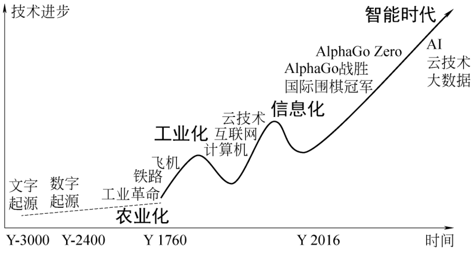
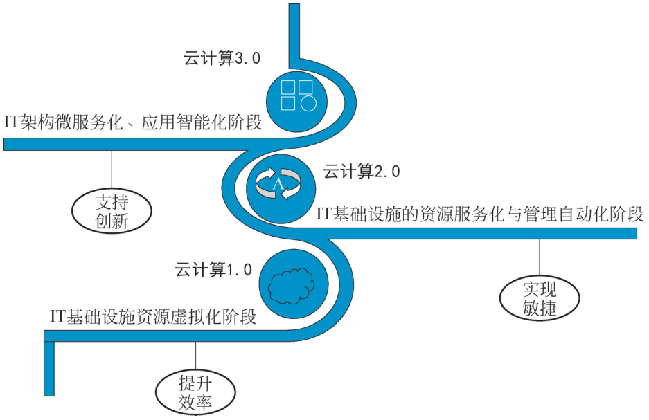

# 1.2 云计算的发展 {#12}

!!! info "学前导读"

    云计算不是某一天突然“发明”出来的。从 1961 年有人提出“像用水用电一样用计算”，到 2006 年亚马逊把它做成生意，再到今天大模型跑在云上，中间走了半个多世纪。

    本节分两部分：

    1. **从哪里来、往哪里去**（1.2.1）：云计算的历史、1.0／2.0／3.0 三个阶段，以及“终端轻盈化”“云 + 大数据 + 人工智能”两个趋势；
    2. **有哪些云可选**（1.2.2）：阿里云、腾讯云、华为云、信服云，以及亚马逊 AWS、微软 Azure、谷歌云的特点对比。

    不必背年份。记住几个“转折点”就够了：虚拟化、亚马逊 EC2／S3、Docker 和 Kubernetes，以及大模型。

## 1.2.1 云计算的历史、演进历程与发展趋势 {#121}

### 1.2.1.1 云计算的历史 {#1211}

回顾历史，自 18 世纪中期以来，人类经历了三次重大的工业革命。第一次工业革命（18 世纪 60 年代至 19 世纪中期）以蒸汽机的发明为标志，开启了“蒸汽时代”，推动人类社会从农耕文明向工业文明转型。第二次工业革命（19 世纪中后期至 20 世纪初）以电力的广泛应用为特征，带来“电气时代”，极大提升了生产力，促进全球政治、经济交流，形成初步的全球化体系。第三次工业革命（20 世纪中期至今）以信息技术的突破为代表，进入“信息时代”，计算机与互联网技术的飞速发展使信息传播更加快捷，全球联系更加紧密，人类文明发展达到新的高度。

当下，我们正站在第四次工业革命的浪潮之巅。这一次，物联网、云计算、大数据、人工智能等新兴技术正在重塑世界。而大语言模型作为人工智能领域的重要突破，更是为这场变革注入了强大动力。大语言模型基于深度学习技术构建，能够理解和生成自然语言文本，处理海量数据，挖掘信息价值。它们在智能客服、内容创作、语言翻译等多领域广泛应用，助力企业提升效率、优化服务，推动经济社会向更高质量发展迈进，标志着人类社会向智能化新时代迈出关键步伐。

人类文明的发展历程如图 1-9 所示。

{ loading=lazy }

图 1-9 人类文明的发展历程
{ .fig-caption }

云计算是技术进步、需求驱动和商业模式创新共同推动的成果，在智能时代中扮演着核心角色。其发展历史可追溯至 20 世纪 60 年代的虚拟化技术。1961 年，计算机科学家约翰·麦卡锡（John McCarthy）提出了“效用计算”的概念，即按资源使用量付费，预见了计算资源像公共服务一样被使用的未来。

到了 20 世纪 90 年代中期，互联网应用如搜索引擎、电子邮件和社交媒体平台的普及，使人们逐渐熟悉了基于互联网的计算模式，这些应用的成功验证了云计算的核心理念，即随时随地共享计算资源。

进入 20 世纪 90 年代后期，大型企业如戴尔、亚马逊、谷歌和 IBM 等开始实施大规模数据中心和分布式计算项目，为云计算的基础设施建设奠定了基础。与此同时，Salesforce 等企业成功推广了 SaaS 产品，进一步加速了云计算的商业化进程。2006 年，“云计算”一词正式进入商业领域，标志着云计算时代的到来。

2009 年，美国国家标准与技术研究院发布了对云计算的原始定义，并在 2011 年 9 月经过进一步评审和企业反馈后，发布了修订版定义：云计算是一种模型，可以实现随时随地便捷、按需地从可配置计算资源共享池中获取所需的资源（如网络、服务器、存储、应用程序及服务），资源可以快速供给和释放，使管理的工作量和服务提供者的介入降至最少。这一定义准确地描述了云计算的本质特征，得到了业界的广泛认可和应用。云计算通过提供按需获取的计算资源，极大地降低了企业的 IT 成本，提高了资源利用效率，促进了信息技术的普及和应用，成为推动智能时代发展的重要力量。

### 1.2.1.2 云计算的演进历程 {#1212}

云计算理念从诞生到被应用于各行各业，其应用与价值挖掘已全面渗透到企业 IT 信息化及转型变革的方方面面。云计算的演进历程（见图 1-10）可总结为以下 3 个阶段。

{ loading=lazy }

图 1-10 云计算的演进历程
{ .fig-caption }

#### 1. 云计算 1.0：IT 基础设施资源虚拟化阶段

云计算 1.0 阶段主要表现为通过计算虚拟化技术的引入，将企业 IT 应用与底层的基础设施彻底解耦，将企业应用部署在虚拟机上，减少服务器节点数量，从而实现资源利用效率的提升。

#### 2. 云计算 2.0：IT 基础设施的资源服务化与管理自动化阶段

云计算 2.0 阶段主要表现为随着软件定义存储和软件定义网络技术的发展，借助基础设施的资源调度自动化软件及管理平台，将原本需要通过数据中心管理员人工干预的基础设施资源复杂低效的申请、释放与配置过程，转变为用户可以通过云服务门户自助申请资源发放的过程。该转变大幅提升了企业 IT 应用所需的基础设施资源的快速敏捷发放能力，有效支撑其核心业务走向敏捷，为企业更好地应对瞬息万变的业务竞争与发展环境奠定了基础。该阶段面向云租户的基础设施资源服务供给，基本是 IaaS 层面服务，如虚拟机、存储、网络服务，尚不涉及 PaaS 层面的应用中间件、数据库服务等。

#### 3. 云计算 3.0：IT 架构微服务化、应用智能化阶段

云计算 3.0 阶段主要表现为企业 IT 自身的应用架构逐步从传统商业数据库和中间件商业套件转向开源增强的数据库及中间件，从烟囱式的、有状态的纵向扩展应用分层架构体系转向更轻量化解耦、数据与应用逻辑彻底分离的分布式无状态化架构，从而逐步利用云原生技术构建和运行弹性可扩展的应用。云原生技术通常包括微服务、容器、无服务器、服务网格、不可变基础设施、声明式 API 等。通过构建容错性好、松耦合、弹性敏捷的云原生应用，企业 IT 可以在支撑企业业务敏捷化、智能化以及资源利用效率提升方面迈上一个新的高度和台阶，并为企业创新业务的快速迭代开发铺平道路。

云计算演进历程中的一些重大事件见表 1-6。

表 1-6 云计算演进历程中的一些重大事件
{ .tab-caption }

| 时间 | 事件 | 简要描述 |
|---|---|---|
| 20 世纪 60 年代 | 云计算概念首次被提出 | 当时人们开始探讨如何将计算资源集中起来以实现更高效的数据处理，为后来的云计算奠定了基础 |
| 1972 年 | 虚拟化与虚拟机概念走红 | IBM 推广虚拟化技术。一台宿主机可运行多个相互独立的虚拟机，为后来的云多租户模型奠定了基础 |
| 1983 年 | Sun 公司提出“网络就是计算机”的口号 | 用于描述分布式计算技术带来的新世界，恰好描绘了今天云计算的工作方式 |
| 1999 年 | Salesforce 推出首个基于互联网的客户关系管理系统 | 标志软件即服务（SaaS）模式的落地 |
| 2003 年 | 美国国家科学基金会 | 投资 830 万美元支持由七所顶尖院校提出的“网格虚拟化和云计算 VGrADS”项目，正式启动了云计算的研发序幕 |
| 2006 年 | 亚马逊推出弹性计算云（EC2）和简单存储服务（S3） | 正式将云计算作为商业服务推广，标志着现代公有云的起点 |
| 2008 年 | Google App Engine 发布 | 是谷歌管理的数据中心中用于 Web 应用程序的开发和托管的平台 |
| 2008 年 | 微软发布 Windows Azure Platform | 拉开微软的云计算大幕 |
| 2010 年 | Rackspace Hosting 和美国国家航空航天局联合推出 OpenStack 开源云软件计划 | 推动了私有云和混合云的发展 |
| 2013 年 | Docker 项目正式发布 | 革新了软件开发和部署方式，推动了云计算向更加灵活、弹性、高效的云原生架构演进 |
| 2013 年 | 谷歌推出 Google Compute Engine 正式版 | 与 AWS、Azure 形成三足鼎立之势，加剧云计算市场竞争 |
| 2014 年 | Kubernetes 项目开源 | 成为容器编排技术的核心，推动了容器编排技术的发展和普及 |
| 2014 年 | 亚马逊推出 Lambda | 允许在 AWS 中运行代码而无须配置或管理服务器，FaaS/Serverless 模式开始兴起 |
| 2015 年 | CNCF 成立 | 推动了云原生技术的开源和推广，成为云计算领域重要的技术推动力量 |
| 2018 年 | Kubernetes 成为 CNCF 毕业项目 | 确立其在容器编排领域的主导地位，推动了云原生应用架构的落地和普及 |
| 2022 年 | 钉钉宣布“全面 PaaS 化” | 下连云计算基础设施，上连企业关键应用，进一步带动企业客户用云量，引导企业上钉、上云 |
| 2022 年 | “东数西算”工程正式全面启动 | 推动算力资源跨域调配及基础设施更广泛布局，旨在服务实体经济数字化 |
| 2023 年 | 腾讯云正式发布大数据品牌“腾讯云数据仓库” | 打造企业级存算分离湖仓平台，助力企业构建分层解耦的数据湖仓架构，加速企业数据价值释放 |
| 2023 年 | 中国信息通信研究院发布《云计算白皮书（2023 年）》 | 预计 2025 年我国云计算整体市场规模将超万亿元 |
| 2023 年 | 华为云发布云海存储 | 云海存储全面面向中小企业客户，以“统一数据管理，多场景融合”为设计理念，助力中小企业实现数据的全生命周期管理 |
| 2023 年 | 华为云发布盘古大模型 3.0 | 盘古大模型 3.0 定位为“AI 原生的行业生产力模型”，主要面向企业客户，聚焦行业场景，为企业提供更高效、更智能的 AI 解决方案 |
| 2025 年 | 2025 中国移动云智算大会召开 | 中国移动提出从“云计算”到“云智算”的蜕变，实现从“云服务提供者”到“数智生态构建者”的战略跃迁 |

**动手看看 · 云计算发展时间线**

表 1-6 的事件很多，下面的动画把它们排在一条时间线上，并按“概念与虚拟化”“公有云商业化”“云原生”“国内与智算”四种颜色分类。点击任意一个事件看说明，也可以只看某一类。

<iframe class="sim-frame" src="../../sims/cloud-timeline/main.html" height="520" loading="lazy" title="云计算发展时间线"></iframe>

点击时间线上的圆点看事件详情，点上方的分类按钮筛选；“考考你”会随机给出一个事件，让你判断它属于云计算 1.0、2.0 还是 3.0 阶段。[全屏打开](../../sims/cloud-timeline/main.html){ target=_blank } · [教学说明](../../sims/cloud-timeline/index.md)
{ .sim-caption }

### 1.2.1.3 云计算的发展趋势 {#1213}

云计算越来越被我国政府及企业重视，成为企业发展壮大的重要推动力，而在移动互联网高速发展的背景下，云计算应用需求及应用场景势必越来越多，云计算将被广泛地应用于各行各业，推动互联网发展迈向下一个阶段。可以预见，未来云计算有以下发展趋势。

#### 1. 终端轻盈化

前端的硬件将越来越趋于真正的“零终端”———终端将更加注重“展现”，承载越来越少的计算任务，复杂的计算与分析将部署在云端。5G 网络建立在后端强大的计算与分析能力的基础上。可以预见，随着云端处理能力的不断发展，终端会越来越轻、越来越便宜，用户无须安装任何软件，即可享受诸多服务，包括各种类别的应用、存储、安全及分析服务。

云端也将更加互联，城市范围内的各种设备都可接入云端，这不仅为人们的生活带来便利，同时也将在云端形成广泛的数据沉淀，为政府及企业提供更多创新机会。例如，芝加哥是美国首批全市范围内使用安全传感器来永久测量空气质量、光强度、音量、热量、降水、风和交通的城市之一，在云端，通过对传感器产生的多种数据进行分析，并对公众开放，使得政府、企业可以实现许多创新性的方法，改善城市生活及工作效率。

#### 2.“云+大数据+人工智能”充分结合

云计算是大数据和人工智能的最佳载体，云平台为大数据与人工智能提供了一个开放、广泛的智能平台。

未来，大数据分析将渗透到社会的方方面面：政府及国家大数据资源的共享可以加快国家基础信息资源体系的建立；公共服务大数据的建设可以帮助建立全民健康医疗服务大数据体系，加速医疗服务体系的变革；工业及新兴产业的大数据工程可深化工业 4.0 的应用落地；农业产业大数据建设将进一步提高农业生产效率，改善食品安全保障体系等。

## 1.2.2 国内外主流云平台的比较 {#122}

### 1.2.2.1 国内云平台 {#1221}

目前，国内云平台经过多年发展，公有云平台已形成阿里云、腾讯云、华为云、信服云等多家竞争的格局，各个云平台在技术、服务和市场份额等方面各有优势，推动了国内云计算市场的快速发展，助力众多行业实现数字化转型。国内主流云平台对比见表 1-7。

表 1-7 国内主流云平台对比
{ .tab-caption }

| 服务提供商 | 服务特点 | 价格特点 | 用户评价 |
|---|---|---|---|
| 阿里云 | 1. 服务全面：提供从 IaaS 到 SaaS 的全方位服务，涵盖计算、存储、数据库、人工智能等。 2. 技术领先：在 AI 和大数据领域有深厚积累。 3. 全球布局：拥有广泛的数据中心 | 1. 定价灵活：提供按需计费、包年包月、预付费等多种计费方式。 2. 优惠活动多：新用户有折扣，老用户续费也有优惠 | 1. 稳定性高：作为最早布局云计算的厂商之一，稳定性得到广泛认可。 2. 用户体验好：丰富的 API 接口和开发工具便于二次开发。 3. 部分用户反馈官网控制台不够友好 |
| 腾讯云 | 1. 高性能计算：在游戏、视频等领域表现突出，网络带宽和计算能力优异。 2. 多媒体服务强：视频、多媒体类的产品和服务很突出 | 1. 价格亲民：部分产品价格较低，活动时有较大折扣。 2. 计费灵活：提供按需付费与包年、包月等多种选择 | 1. 用户体验好：线下服务体验较好，技术和服务支持较好。 2. 性能表现稳定：在业务高峰期也能保持较好的性能 |
| 华为云 | 1. 技术实力强：自研芯片、操作系统等技术，提供高性能服务。 2. 安全性高：严格遵循国际标准，提供多层防护机制。 3. 生态丰富：在智能制造、智慧城市等领域有定制化解决方案 | 1. 价格中高端：整体价格定位中规中矩，高端配置价格相对较高。 2. 性价比高：在某些配置下性价比较高，如 3 年期价格优势明显 | 1. 稳定性好：容灾备份机制获得高评价，确保业务连续性。 2. 服务可靠：提供 24 小时技术支持。 3. 适合政企客户：在政企市场和混合云领域有深厚积累 |
| 信服云 | 1. 技术领先：拥有自研超融合等核心技术。 2. 安全可靠：内建安全体系。 3. 自主可信：100% 专属资源，数据本地化存储，支持物理隔离，确保数据主权。 4. 生态开放：兼容多种软硬件生态。 5. 贴身服务：配备专属管家，24 小时全天候服务，最快 5 分钟响应，提供业务迁移、巡检、代维等专业服务 | 1. 价格亲民：提供多种套餐和服务模式，如计算型、通用型、存储型云主机等，价格相对合理，针对不同用户需求有不同定价。 2. 灵活计费：支持按年、按月等计费方式，用户可根据自身需求和预算选择合适的方案。 3. 增值服务收费合理：可以赠送主机安全服务，保障主机资源的安全问题 | 1. 性能稳定：用户普遍认为其性能卓越，运行稳定，能够满足高并发、高性能需求。 2. 安全性高：安全性能保障和数据保护能力突出，内建安全体系和等保服务让用户更安心。 3. 服务优质：贴身服务模式受好评，专属管家和快速响应机制大大提升了用户体验。 4. 易用性好：界面友好，操作便捷，提供丰富的文档和技术支持，易于上手和管理。 5. 性价比高：价格合理，服务内容丰富，性价比高于其他同类产品 |

### 1.2.2.2 国外云平台 {#1222}

国外云平台由亚马逊 AWS、微软 Azure、谷歌云等主导，这些云平台在云计算领域技术成熟、服务广泛，尤其在 AI 融合、边缘计算等前沿技术方面投入大、发展快，引领了全球云计算技术和市场的发展。国外主流云平台对比见表 1-8。

表 1-8 国外主流云平台对比
{ .tab-caption }

| 服务提供商 | 服务特点 | 价格特点 | 用户评价 |
|---|---|---|---|
| 亚马逊 AWS | 1. 全球领先：作为云计算的开创者，技术成熟度高。 2. 服务丰富：提供从基础设施到高级应用的广泛服务。 3. 性能强劲：在高性能计算和可扩展性方面表现出色 | 1. 价格模型复杂：新用户有优惠，长期合同有折扣。 2. 计费方式灵活：支持多种计费方式，用户可按需选择 | 1. 稳定性高：具有完备的容灾机制和较强的故障恢复能力。 2. 安全性强：具有健全的安全防护体系，通过多项合规认证。 3. 用户反馈良好：在国际市场上，尤其是在企业级应用中口碑较好 |
| 微软 Azure | 1. 企业级服务出色：在企业级应用和混合云方面有优势。 2. 与微软生态集成：与 Windows、Office 等产品深度集成。 3. AI 和大数据支持：在 AI 和大数据领域有较强的技术支持 | 1. 定价灵活：提供按需付费和预留实例等多种计费方式。 2. 优惠活动多：新用户和长期用户都有优惠 | 1. 用户体验好：与微软生态的集成使得使用体验较好。 2. 技术可靠：在企业级应用中表现出色，稳定性高。 3. 适合企业客户：尤其适合使用微软产品的用户 |
| 谷歌云 | 1. AI 和大数据领域领先：在 AI 和大数据领域有深厚的技术积累。 2. 计算性能高：适合进行复杂的高性能计算和数据分析。 3. 拥有全球数据中心：拥有广泛的数据中心，支持国际化业务 | 1. 价格灵活：提供按需付费和预留实例等多种选择。 2. 优惠活动多：新用户有优惠，长期用户有折扣 | 1. 技术先进：在 AI 和大数据领域表现突出。 2. 用户体验好：丰富的 API 接口便于二次开发。 3. 适合技术驱动型用户：尤其适合需要高性能计算和数据分析的用户 |

各个云平台总结如下。

（1）阿里云：适合对综合服务能力和国际化布局有需求的企业，价格灵活且有较多优惠活动。

（2）腾讯云：适合对高性能计算和多媒体服务有需求的企业或个人，价格亲民且活动优惠力度大。

（3）华为云：适合对技术实力、安全性和稳定性有较高要求的政企用户。

▶ 配套微课 V1-4《信服云平台介绍》（纸质书中为二维码，网络版视频待上线）

（4）信服云：具备技术领先、安全可靠、自主可信、生态开放和贴身服务等特点，采用自研的超融合等核心技术，构建了领先的内建安全体系，广泛兼容国内软硬件生态。

（5）亚马逊 AWS：适合对全球布局和企业级服务有需求的用户，技术成熟且服务丰富。

（6）微软 Azure: 适合使用微软生态的企业用户，技术可靠且与微软产品集成度高。

（7）谷歌云：适合需要高性能计算和 AI、大数据服务的用户，技术先进且用户体验好。

## 随堂小测

**1.** 通常把哪一件事看作现代公有云商业化的起点？（　　）

- A. 1961 年约翰·麦卡锡提出“效用计算”
- B. 2006 年亚马逊推出 EC2 和 S3
- C. 2013 年 Docker 发布
- D. 2014 年 Kubernetes 开源

??? tip "答案与解析"
    **答案：B**

    解析：2006 年亚马逊把弹性计算云（EC2）和简单存储服务（S3）作为收费的商业服务推出，标志着现代公有云的起点。A 只是提出了概念；C、D 属于后来的云原生阶段。

    考查：云计算的历史 · 认知层次：记忆 · [回看 1.2.1](#121)
    { .quiz-meta }

**2.** 企业把应用拆成许多小服务，用容器部署，让应用能快速迭代、智能运维。这对应云计算演进的哪个阶段？（　　）

- A. 云计算 1.0：资源虚拟化
- B. 云计算 2.0：资源服务化与管理自动化
- C. 云计算 3.0：架构微服务化、应用智能化
- D. 还没有进入云计算阶段

??? tip "答案与解析"
    **答案：C**

    解析：1.0 把应用搬上虚拟机，2.0 让资源能自助申请、自动分配，3.0 则改造应用自身的架构，走向微服务、容器和智能化。题目说的是“改造应用”，所以是 3.0。

    考查：云计算的演进历程 · 认知层次：理解 · [回看 1.2.1](#121)
    { .quiz-meta }

**3.** 一家对安全性和稳定性要求很高的政企单位选择云平台时，华为云是本节表格中比较推荐的选项之一。（　　）

- √
- ×

??? tip "答案与解析"
    **答案：√**

    解析：根据本节对国内云平台的比较，华为云“适合对技术实力、安全性和稳定性有较高要求的政企用户”。实际选型时还要结合价格、已有系统和当地服务能力综合考虑。

    考查：国内外主流云平台的比较 · 认知层次：应用 · [回看 1.2.2](#122)
    { .quiz-meta }
