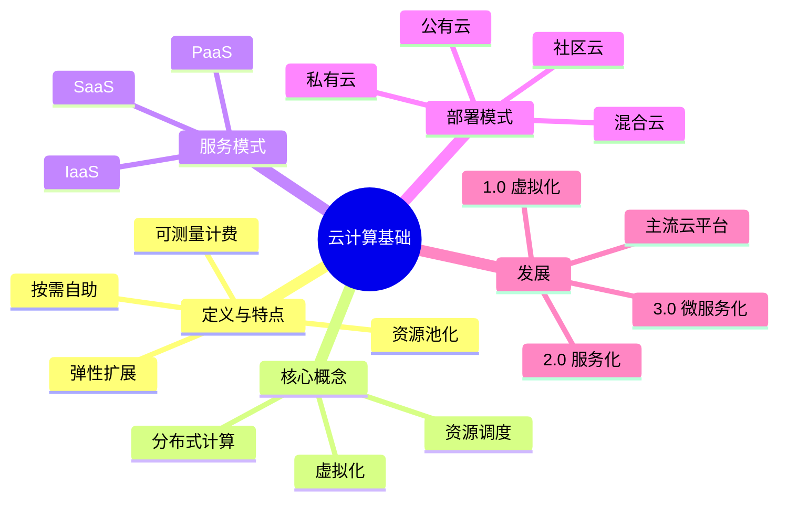

# 第 1 章 本章小结与练习

## 本章关键词

云计算的定义、虚拟化技术、分布式计算、云计算的服务模式等。

## 本章小结

本章主要讲解了云计算的定义与特点（宽带网络连接、按需自助服务、资源池的灵活性与位置无关性、具有弹性扩展能力等），云计算的核心概念（虚拟化技术、分布式计算、资源调度等），云计算的服务模式（IaaS、PaaS、SaaS），云计算的部署模式（公有云、私有云、混合云、社区云等），云计算的应用场景（政务、电商、教育、医疗领域等），云计算的历史、演进历程与发展趋势，并对国内外主流云平台（阿里云、腾讯云、华为云、信服云、亚马逊 AWS、微软 Azure、谷歌云）进行比较。

把本章压缩成 6 句话：

1. **云计算**是通过网络按需获取可配置的计算资源、按使用量付费的模式，就像用水用电。
2. 它的主要特点是宽带网络连接、按需自助服务、资源池化且与位置无关、弹性扩展、服务可被测量；新特点是支持异构资源、支持异构多业务、通算与智算统一管理。
3. 支撑云计算的三项核心技术是**虚拟化**（把一台物理机“切”成多台虚拟机）、**分布式计算**（把一个大任务分给很多台机器）和**资源调度**（决定资源给谁、放在哪里）。
4. 按“用户自己管多少”分三种服务模式：**IaaS** 管到操作系统以上，**PaaS** 只管应用和数据，**SaaS** 直接用软件。
5. 按“谁拥有、谁使用”分四种部署模式：**公有云**、**私有云**、**混合云**、**社区云**，另有托管云、互联云、驻地云等变种。
6. 云计算经历了 1.0 虚拟化、2.0 服务化与自动化、3.0 微服务化与智能化三个阶段；国内主流平台有阿里云、腾讯云、华为云、信服云，国外有 AWS、Azure、谷歌云。

**下一章预告**：第 2 章打开云计算的“发动机舱”，逐一讲解虚拟化、容器、云存储、分布式计算、云网络与安全、桌面云这几项核心技术，并在 Docker 里动手跑起第一个容器。

## 参考文献

**教材与专著**

1. 埃尔. 云计算：概念、技术与架构[M]. 龚奕利，贺莲，胡创，译. 北京：机械工业出版社，2014. 本章云计算定义、NIST 五种角色、服务模式与部署模式的主要参考，对应 1.1 节。
2. 汤兵勇，徐亭，章瑞. 云图·云途：云计算技术演进及应用[M]. 北京：机械工业出版社，2021. 云计算的演进历程与行业应用，对应 1.1.5 节和 1.2.1 节。
3. 崔升广. 云计算技术应用基础：微课版[M]. 北京：人民邮电出版社，2023. 面向高职学生的云计算入门教材，可作为本章的平行读物。

**标准与论文**

4. MELL P, GRANCE T. The NIST definition of cloud computing: NIST Special Publication 800-145[R]. Gaithersburg: National Institute of Standards and Technology, 2011. NIST 的云计算定义原文，五个基本特点、三种服务模式、四种部署模式都出自这份文件，对应 1.1.1 节。
5. ARMBRUST M, FOX A, GRIFFITH R, et al. A view of cloud computing[J]. Communications of the ACM, 2010, 53(4): 50-58. 伯克利大学对云计算经济性和挑战的经典分析，“按需付费”“弹性”的论证可延伸阅读。

**在线资源与政策文件**

6. 国务院. “十四五”数字经济发展规划：国发〔2021〕29 号[EB/OL]. (2022-01-12)[2026-11-01]. https://www.gov.cn/zhengce/content/2022-01/12/content_5667817.htm. 本章导语中“上云用数赋智”的出处。
7. 中国信息通信研究院. 云计算白皮书（2023 年）[R]. 北京：中国信息通信研究院，2023. 国内云计算市场规模与发展趋势，对应表 1-6 和 1.2.1.3 节。
8. 阿里云. 云服务器 ECS 产品文档[EB/OL]. [2026-11-01]. https://help.aliyun.com/zh/ecs/. 实验 1-1 所用的 ECS 购买页、付费方式说明。

## 课后练习

**一、单项选择题**

**1.** 按照 NIST 的定义，下面哪一项**不是**云计算的基本特点？（　　）

- A. 用户必须自己采购服务器硬件
- B. 按需自助服务
- C. 资源池化
- D. 服务可被测量

??? tip "答案与解析"
    **答案：A**

    解析：云计算的意义正是让用户不必自己采购硬件，而是通过网络从资源池中按需取用。B、C、D 都是 NIST 定义的基本特点。

    考查：云计算的特点 · 认知层次：记忆 · [回看 1.1.1](1-1.md#111)
    { .quiz-meta }

**2.** 把一台物理服务器抽象成多台虚拟服务器，每台都能运行自己的操作系统，这是（　　）。

- A. 网络虚拟化
- B. 存储虚拟化
- C. 安全虚拟化
- D. 服务器虚拟化

??? tip "答案与解析"
    **答案：D**

    解析：服务器虚拟化（也叫计算虚拟化）把一台物理服务器“切”成多台虚拟机。存储虚拟化针对磁盘，网络虚拟化针对网络，安全虚拟化把防火墙等安全设备做成虚拟机。

    考查：虚拟化的类型 · 认知层次：理解 · [回看 1.1.2](1-1.md#1121)
    { .quiz-meta }

**3.** 分布式计算中，负责把一个大任务拆分、分配给各个计算节点，并跟踪执行进度的是（　　）。

- A. 数据存储体系
- B. 任务调度引擎
- C. 监控体系
- D. 安全控制体系

??? tip "答案与解析"
    **答案：B**

    解析：任务调度引擎决定“哪个任务交给哪个节点做”。数据存储体系管数据放在哪里；监控体系负责观察运行状态；安全控制体系负责身份认证和访问控制。

    考查：分布式计算的组成 · 认知层次：理解 · [回看 1.1.2](1-1.md#1122)
    { .quiz-meta }

**4.** 某公司在阿里云上租用虚拟机，自己安装操作系统补丁、部署 Java 运行环境和网站程序。它使用的是（　　）。

- A. SaaS
- B. PaaS
- C. IaaS
- D. 私有云

??? tip "答案与解析"
    **答案：C**

    解析：用户要自己管操作系统和运行环境，说明云服务商只提供了计算、存储、网络等基础设施，属于 IaaS。D 是部署模式，不是服务模式。

    考查：IaaS · 认知层次：应用 · [回看 1.1.3](1-1.md#1131)
    { .quiz-meta }

**5.** 使用 SaaS 时，下列哪一项仍然主要由**用户自己**负责？（　　）

- A. 账号权限和自己录入的业务数据
- B. 服务器硬件维护
- C. 操作系统打补丁
- D. 应用软件版本升级

??? tip "答案与解析"
    **答案：A**

    解析：SaaS 中硬件、操作系统、应用软件都由云服务商管理，但谁能登录、数据录得对不对、密码有没有泄露，仍然是用户的责任。这就是“安全责任共担”。

    考查：SaaS 服务安全责任 · 认知层次：理解 · [回看 1.1.3](1-1.md#1133)
    { .quiz-meta }

**6.** 一家医院希望病历数据只放在自己可控的机房里，同时又能像公有云一样自助申请资源。最合适的部署模式是（　　）。

- A. 公有云
- B. 私有云
- C. 社区云
- D. 互联云

??? tip "答案与解析"
    **答案：B**

    解析：私有云由单一组织拥有和使用，数据留在自己掌控的环境里，安全性和独占性高，适合敏感数据。公有云面向公众；社区云面向多个组织；互联云是把多个云连起来。

    考查：私有云 · 认知层次：应用 · [回看 1.1.4](1-1.md#1142)
    { .quiz-meta }

**7.** 云服务提供商把云平台部署到用户自己的机房里，由提供商负责运维，让用户在本地享受类似公有云的弹性服务。这种模式叫（　　）。

- A. 托管云
- B. 互联云
- C. 驻地云
- D. 社区云

??? tip "答案与解析"
    **答案：C**

    解析：驻地云的关键词是“部署在用户机房、本地化”。托管云是在提供商那里为一个用户单独划出的环境；互联云是把多个独立的云环境连起来。

    考查：其他部署模式 · 认知层次：理解 · [回看 1.1.4](1-1.md#1145)
    { .quiz-meta }

**8.** 下面哪个事件与“云原生”关系最密切？（　　）

- A. 1972 年 IBM 推广虚拟化技术
- B. 1999 年 Salesforce 推出在线客户关系管理系统
- C. 2006 年亚马逊推出 EC2
- D. 2014 年 Kubernetes 开源

??? tip "答案与解析"
    **答案：D**

    解析：云原生以容器、容器编排和微服务为代表，Kubernetes 是容器编排的事实标准。A 属于虚拟化，B 是 SaaS 的落地，C 是公有云商业化的起点。

    考查：云计算的演进历程 · 认知层次：理解 · [回看 1.2.1](1-2.md#1212)
    { .quiz-meta }

**二、多项选择题**

**9.** 下列属于云计算服务模式的有（　　）。

- A. IaaS
- B. PaaS
- C. SaaS
- D. 混合云

??? tip "答案与解析"
    **答案：ABC**

    解析：IaaS、PaaS、SaaS 是三种基本服务模式。混合云是部署模式，回答的是“云在哪里、归谁”，不是“提供什么服务”。

    考查：服务模式与部署模式的区别 · 认知层次：记忆 · [回看 1.1.3](1-1.md#113)
    { .quiz-meta }

**10.** 资源调度在云计算中的作用包括（　　）。

- A. 提高资源利用率
- B. 保证服务质量
- C. 让用户不再需要网络
- D. 实现弹性扩展

??? tip "答案与解析"
    **答案：ABD**

    解析：本书把资源调度的作用归纳为提高资源利用率、保证服务质量、实现弹性扩展三点。云计算离不开网络，C 错误。

    考查：资源调度 · 认知层次：记忆 · [回看 1.1.2](1-1.md#1123)
    { .quiz-meta }

**11.** 下列关于公有云的说法，正确的有（　　）。

- A. 基础设施由第三方云服务提供商拥有和维护
- B. 只能由一个组织独占使用
- C. 用户通过互联网访问，通常按使用量付费
- D. 阿里云、腾讯云、亚马逊 AWS 都提供公有云服务

??? tip "答案与解析"
    **答案：ACD**

    解析：公有云面向公众开放，多个用户共享基础设施。“只能由一个组织独占”是私有云的特点。

    考查：公有云 · 认知层次：理解 · [回看 1.1.4](1-1.md#1141)
    { .quiz-meta }

**12.** 在“双 11”大促中，电商企业利用云计算可以（　　）。

- A. 活动前临时增加服务器
- B. 活动后释放多余的服务器，停止计费
- C. 利用负载均衡把访问分摊到多台服务器上
- D. 根据访问量自动扩缩容

??? tip "答案与解析"
    **答案：ABCD**

    解析：四项都是云计算在电商领域的典型用法，核心都是弹性扩展和按需付费。

    考查：云计算的应用场景 · 认知层次：应用 · [回看 1.1.5](1-1.md#115)
    { .quiz-meta }

**三、判断题**

**13.** 使用了云计算，用户就完全不用操心安全问题，一切由云服务商负责。（　　）

- √
- ×

??? tip "答案与解析"
    **答案：×**

    解析：云计算实行安全责任共担。服务商负责它管理的那几层，用户仍要负责自己的账号、数据，以及 IaaS 中的操作系统和应用。

    考查：服务安全责任 · 认知层次：理解 · [回看 1.1.3](1-1.md#1131)
    { .quiz-meta }

**14.** 社区云在国内也称为团体云或行业云，政务云是它的典型应用。（　　）

- √
- ×

??? tip "答案与解析"
    **答案：√**

    解析：社区云面向有共同目标和利益的用户群体，各级政府部门共用的政务云就是典型例子。

    考查：社区云 · 认知层次：记忆 · [回看 1.1.4](1-1.md#1144)
    { .quiz-meta }

**15.** 云计算的资源在哪个城市、哪个机房，用户在使用时必须精确知道。（　　）

- √
- ×

??? tip "答案与解析"
    **答案：×**

    解析：资源池具有位置无关性，用户一般不需要知道资源具体在哪台机器上，最多选择“地域”和“可用区”这样的大致范围。

    考查：云计算的特点 · 认知层次：理解 · [回看 1.1.1](1-1.md#1112)
    { .quiz-meta }

**16.** 云计算 2.0 阶段的主要标志是资源可以自助申请、自动分配，减少了管理员的人工干预。（　　）

- √
- ×

??? tip "答案与解析"
    **答案：√**

    解析：2.0 阶段借助软件定义存储、软件定义网络和资源调度自动化软件，实现了基础设施的资源服务化与管理自动化。

    考查：云计算的演进历程 · 认知层次：记忆 · [回看 1.2.1](1-2.md#1212)
    { .quiz-meta }

**17.** “终端轻盈化”是指以后手机、电脑会越来越重，承担越来越多的计算任务。（　　）

- √
- ×

??? tip "答案与解析"
    **答案：×**

    解析：恰好相反。终端轻盈化指终端更注重“展现”，复杂的计算和分析交给云端。

    考查：云计算的发展趋势 · 认知层次：理解 · [回看 1.2.1](1-2.md#1213)
    { .quiz-meta }

**四、简答题**

**18.** 用自己的话说明 IaaS、PaaS、SaaS 的区别，并各举一个例子。

??? tip "参考答案"
    三者的区别在于云服务商替用户管到哪一层。IaaS 只提供计算、存储、网络等基础设施，用户自己装操作系统和软件，例如租一台阿里云 ECS；PaaS 再加上操作系统、运行环境和中间件，用户只管写代码和放数据，例如云数据库 RDS、应用托管平台；SaaS 连软件都是现成的，用户注册即用，例如钉钉、在线文档。

    评分要点：说清“管到哪一层”（2 分），三个例子各 1 分。

**19.** 某高校想把教务系统、财务系统搬上云，又担心学生成绩和财务数据外泄；每年选课时访问量又特别大。你会推荐哪种部署模式？说明理由。

??? tip "参考答案"
    推荐混合云：成绩、财务等敏感数据和系统部署在学校自建的私有云中，满足安全和合规要求；选课系统的前端页面放到公有云上，选课高峰时弹性扩容，高峰过后释放资源，节省成本。两部分通过统一的管理平台和专线或 VPN 连接。

    评分要点：选出混合云（1 分）；说明敏感数据放私有云（2 分）；说明高峰业务放公有云并利用弹性（2 分）。

**20.** 云计算的演进分为哪三个阶段？每个阶段各用一句话概括。

??? tip "参考答案"
    云计算 1.0 是 IT 基础设施资源虚拟化阶段，用虚拟机把应用和硬件解耦，提高资源利用率；云计算 2.0 是资源服务化与管理自动化阶段，资源可以自助申请、自动调度；云计算 3.0 是 IT 架构微服务化、应用智能化阶段，应用本身改造为微服务、容器化，并与大数据、人工智能结合。

**五、实操题**

**21.** 在阿里云、腾讯云或华为云中任选一家，用价格计算器分别查出“2 核 4 GB 云服务器”按量付费和包年包月的价格，计算一台服务器每天用 6 小时、连续用一个月时，哪种付费方式更省钱，写出计算过程。

??? tip "参考思路"
    按量付费月费用 = 每小时价格 × 6 × 30；包年包月月费用直接读页面价格。两者比较，较小者更省钱。一般来说，每天只用几个小时时按量付费更省，全天候运行时包年包月更省。具体数字以页面实际价格为准，写清楚平台、地域、配置和查询日期。
