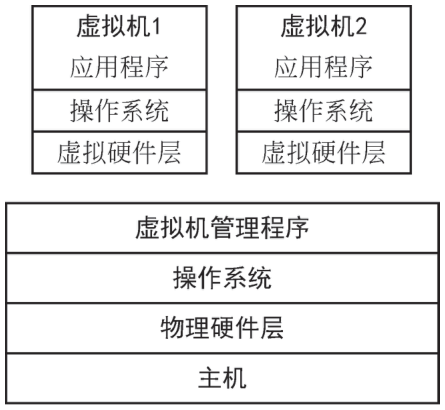
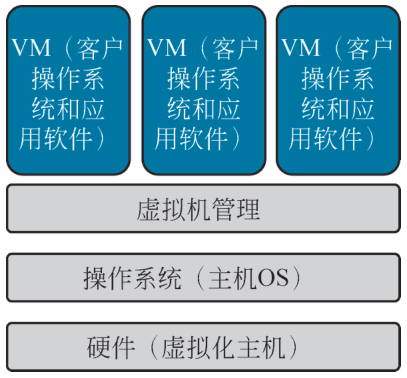
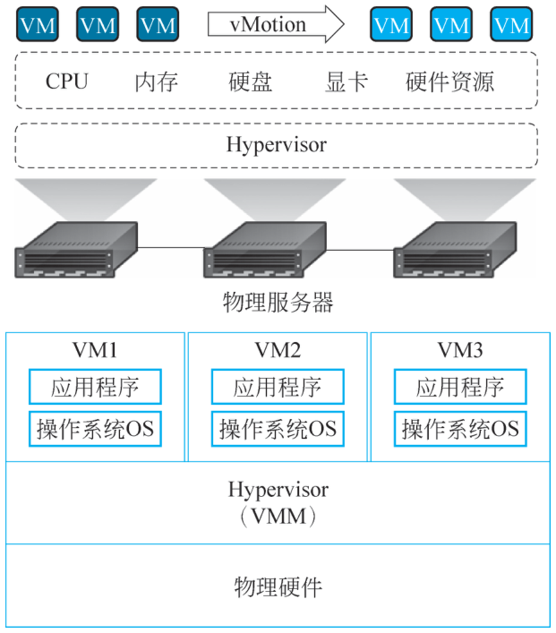
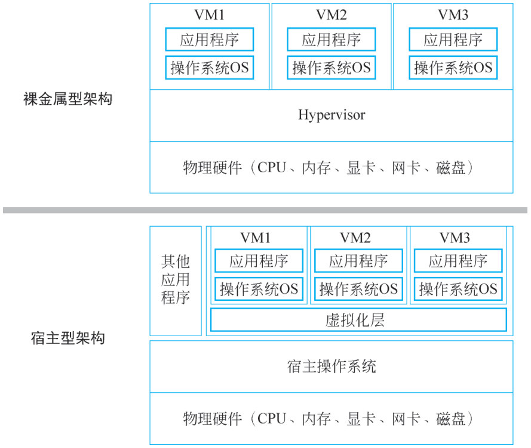
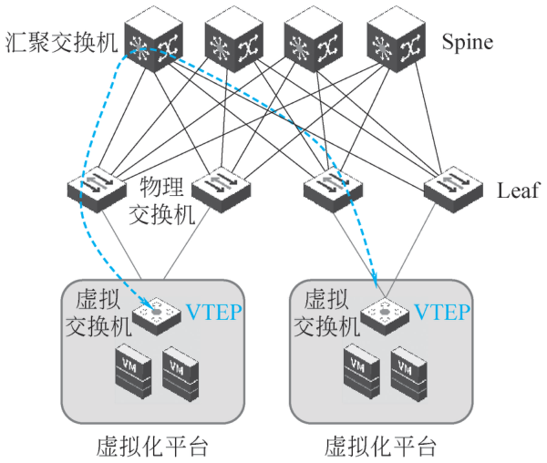
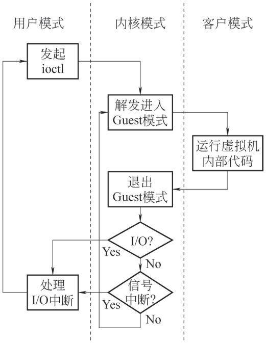
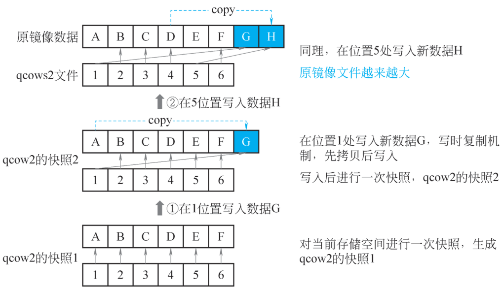

# 2.1 虚拟化技术 {#21}

!!! info "学前导读"

    第 1 章说过，虚拟化是云计算的地基。打个比方：一栋大楼（物理服务器）可以隔成很多套公寓（虚拟机），每套都有自己的门锁、水电表，住户互不干扰；物业（虚拟机管理程序 Hypervisor）负责分配和管理。[容器](../../appendix/glossary.md#g-容器 "共享宿主机操作系统内核、把应用及其依赖打包在一起运行的轻量级隔离环境"){ .term }则更像酒店的房间：共用大楼的水电系统（操作系统内核），拎包入住，开房退房都很快。

    本节分三部分：

    1. **虚拟化怎么搭起来**（2.1.1）：主机、虚拟机、Hypervisor，全虚拟化与半虚拟化，计算／网络／存储／桌面四类虚拟化；
    2. **三种代表产品**（2.1.2）：VMware、Docker、KVM，重点理解虚拟机和容器的区别；
    3. **怎么用**（2.1.3）：创建虚拟机、打[快照](../../appendix/glossary.md#g-快照 "记录某一时刻虚拟机或磁盘的状态，以便日后回滚到这一时刻"){ .term }、迁移虚拟机。

    本节的动手内容在[实验 2-1](labs.md#2-1)（云服务器与快照）和[实验 2-2](labs.md#2-2)（用 Docker 跑一个网站）。

## 2.1.1 虚拟化的体系结构与类型 {#211}

### 2.1.1.1 虚拟化的体系结构 {#2111}

虚拟化主要通过软件实现。常见的虚拟化体系结构如图 2-1 所示，表示一个直接在物理机上运行虚拟机管理程序的虚拟化系统。在 X86 平台虚拟化技术中，虚拟机管理程序通常被称为[虚拟机监视器](../../appendix/glossary.md#g-虚拟机监视器 "运行在硬件和虚拟机之间、负责创建和管理虚拟机的软件层"){ .term }（virtual machine monitor，VMM/Hypervisor），它是运行在物理机和虚拟机之间的软件层，物理机被称为主机，虚拟机被称为客户端。

{ loading=lazy }

图 2-1 常见的虚拟化体系结构
{ .fig-caption }

#### 1. 主机

主机一般是指物理存在的计算机，又称宿主计算机。当虚拟机嵌套时，运行虚拟机的虚拟机也是宿主计算机，但不是物理机。主机操作系统是指宿主计算机的操作系统，在主机操作系统中安装的虚拟机软件可以在计算机中模拟出一台或多台虚拟机。

#### 2. 虚拟机

虚拟机是指在物理机上运行的操作系统中模拟的计算机，又称客户端。虚拟机在理论上完全等同于实体物理机。每个虚拟机都可以安装自己的操作系统或应用程序，并连接网络。运行在虚拟机上的操作系统称为客户操作系统。Hypervisor 基于主机的硬件资源给虚拟机提供了一个虚拟的操作平台并管理每个虚拟机的运行，每个虚拟机独立运行并共享主机的所有硬件资源。

{ loading=lazy }

图 2-1 常见的虚拟化体系结构
{ .fig-caption }

{ loading=lazy }

图 2-1 常见的虚拟化体系结构
{ .fig-caption }

{ loading=lazy }

图 2-1 常见的虚拟化体系结构
{ .fig-caption }

{ loading=lazy }

图 2-1 常见的虚拟化体系结构
{ .fig-caption }

{ loading=lazy }

图 2-1 常见的虚拟化体系结构
{ .fig-caption }

{ loading=lazy }

图 2-1 常见的虚拟化体系结构
{ .fig-caption }

{ loading=lazy }

图 2-1 常见的虚拟化体系结构
{ .fig-caption }

{ loading=lazy }

图 2-1 常见的虚拟化体系结构
{ .fig-caption }

{ loading=lazy }

图 2-1 常见的虚拟化体系结构
{ .fig-caption }

{ loading=lazy }

图 2-1 常见的虚拟化体系结构
{ .fig-caption }

Hypervisor 就是提供虚拟机硬件模拟的专门软件，可分为两类：原生（native）型和宿主（hosted）型。

（1）原生型：原生型又称为裸机型。Hypervisor 作为一个精简的操作系统（操作系统也是软件，只不过是比较特殊的软件），直接运行在硬件上以控制硬件资源并管理虚拟机。比较常见的原生型 Hypervisor 有 VMware 公司的 ESXi、微软公司的 Hyper-V 等。

（2）宿主型：宿主型又称为托管型。Hypervisor 运行在传统的操作系统上，同样可以模拟出一整套虚拟硬件平台。比较常见的宿主型 Hypervisor 有 VMware Workstation、Oracle VM VirtualBox 等。

### 2.1.1.2 虚拟化技术分类 {#2112}

#### 1. 全虚拟化技术与半虚拟化技术

根据虚拟化实现技术的不同，虚拟化技术可分为全虚拟化技术和半虚拟化技术两种。其中，全虚拟化技术将是未来虚拟化的主流。

（1）全虚拟化（Full Virtualization）技术，也称为原始虚拟化技术。用全虚拟化技术模拟的虚拟机的操作系统是与底层的硬件完全隔离的。虚拟机中所有的硬件资源都通过虚拟化软件来模拟，包括处理器、内存等外部设备，支持运行任何理论上可在真实物理平台上运行的操作系统，为虚拟机的配置提供了较大的灵活性。在客户操作系统看来，完全虚拟化的虚拟平台和现实平台是一样的，客户操作系统察觉不到程序是运行在一个虚拟平台上的。

（2）半虚拟化（Para Virtualization）技术是一种类似于全虚拟化的技术，需要修改虚拟机中的操作系统来集成一些虚拟化的代码，以减少虚拟化软件的负载。半虚拟化技术模拟的虚拟机整体性能会更好一些，因为修改后的虚拟机操作系统承载了部分虚拟化软件的工作。不足之处是，由于要修改虚拟机的操作系统，用户会感知到使用的环境是虚拟化环境，且兼容性比较差，用户使用起来比较麻烦，需要获得集成虚拟化代码的操作系统。

#### 2. 基于操作系统的虚拟化技术

基于操作系统的虚拟化技术是指在一个已存在的操作系统上安装虚拟化软件的技术，这个已存在的操作系统被称为宿主操作系统。比如，一个用户安装了某款 Windows 操作系统，现在想生成虚拟服务器，于是就在宿主操作系统上安装了虚拟化软件。该用户需要利用这个应用软件生成并运行一个或多个虚拟服务器，并对生成的虚拟服务器进行直接访问。由于宿主操作系统可以提供对硬件设备的必要支持，因此即使虚拟化软件不能使用硬件驱动程序，操作系统虚拟化也可以解决硬件兼容问题。虚拟化技术系统架构如图 2-2 所示。

{ loading=lazy }

图 2-2 虚拟化技术系统架构
{ .fig-caption }

虚拟化软件可以将需要特殊操作软件的硬件 IT 资源转换为兼容多个操作系统的虚拟 IT 资源。由于宿主操作系统自身就是一个完整的操作系统，因此，许多用来作为管理工具的基于操作系统的服务可以被用来管理物理主机。

这些服务包括：

（1）备份和恢复。

（2）集成目录服务。

（3）安全管理。

基于操作系统的虚拟化会产生与性能开销相关的以下需求和问题：

（1）宿主操作系统消耗 CPU、内存和其他硬件 IT 资源。

（2）来自用户操作系统的硬件相关调用需要穿越多个层次。

（3）宿主操作系统通常需要许可证，而其每个用户操作系统也需要一个独立的许可证。基于操作系统的虚拟化技术还有一个关注重点是运行虚拟化软件和宿主操作系统所需的处理开销。缺少一个虚拟化层会对系统整体性能产生负面影响。

#### 3. 基于硬件的虚拟化技术

基于硬件的虚拟化技术是指将虚拟化软件直接安装在物理主机硬件上，从而绕过宿主操作系统的技术。由于虚拟服务器与硬件的交互不再需要来自宿主操作系统的中间环节，因此，基于硬件的虚拟化技术通常更高效。

在这种情况下，虚拟化软件一般是指虚拟机管理程序，它具有简单的用户接口，需要的存储空间可以忽略不计。它由处理硬件管理功能的软件构成，形成了虚拟化管理层。虽然没有实现许多标准操作系统的功能，但是为了供给虚拟服务器，这种虚拟化系统优化了设备驱动程序和系统服务，主要优化协调所带来的性能开销，这种协调使得多个虚拟服务器可以与同一个硬件平台进行交互。在硬件的虚拟化架构中，虚拟化管理层直接运行在主机硬件之上，负责管理硬件资源。因此，虚拟化管理层必须提供对硬件设备的驱动支持，或者通过兼容层实现对硬件设备的访问，而不依赖宿主操作系统。操作系统可以加载并使用硬件设备驱动程序，但这并不意味着虚拟化管理层也能直接使用这些驱动程序。虚拟化管理层通常需要独立的驱动模型或兼容层。此外，操作系统提供的高级功能（如用户界面、网络协议栈、文件系统等）在虚拟化管理层中通常并不完整或不存在，因为虚拟化管理层的设计目标是资源隔离与虚拟机管理，而非通用计算。

### 2.1.1.3 常见的虚拟化类型 {#2113}

在云计算平台的建设中，常见的虚拟化类型包括计算虚拟化、网络虚拟化、存储虚拟化和桌面虚拟化。计算虚拟化可以通过虚拟机监视器将物理服务器分割成多个虚拟机，提高硬件利用率和运行效率；网络虚拟化则整合物理网络资源，创建多个虚拟网络，以支持高效网络管理、流量控制和资源灵活配置，常用于[软件定义网络](../../appendix/glossary.md#g-软件定义网络 "把网络的控制平面和数据转发平面分离，用软件集中控制网络"){ .term }和云数据中心建设场景；存储虚拟化整合多个存储设备为统一存储池，便于数据备份和恢复，同时提高存储资源的灵活调配能力；桌面虚拟化允许用户通过网络访问虚拟桌面环境，便于统一管理和资源分配。这些虚拟化技术在云计算、数据中心及企业 IT 架构中发挥了关键作用，能够优化资源利用率、降低硬件成本并增强系统的灵活性和扩展性。

#### 1. 计算虚拟化

计算虚拟化一般特指服务器虚拟化，主要是 CPU、内存等计算资源的虚拟化，可理解为通过使用 VMM，在一台物理机上虚拟出来并运行一个或多个虚拟系统，从而提高计算机硬件资源的利用率，提升 IT 支撑效率。在新业务环境中，越来越多的 GPU 虚拟化也属于计算虚拟化的一部分。在一台计算机上同时运行多台逻辑计算机，每台逻辑计算机可运行不同的操作系统，并且应用程序都可以在相互独立的空间内运行而互不影响，从而显著提高计算机的工作效率。

计算虚拟化使用软件的方法重新定义、划分 IT 资源，可以实现 IT 资源的动态分配、灵活调度、跨域共享，提高 IT 资源利用率，使 IT 资源能够真正成为社会基础设施，满足各行各业中灵活多变的应用需求。

虚拟化技术的核心是运行在硬件服务器上的 Hypervisor 软件。Hypervisor 是一种运行在物理服务器和操作系统之间的中间软件层，其允许多个操作系统和应用共享一套基础物理硬件，因此也可以看作虚拟环境中的“元”操作系统，它可以协调访问服务器上的所有物理设备和虚拟机，也叫作虚拟机监视器（Virtual Machine Monitor），具体如图 2-3 所示。

Hypervisor 是所有虚拟化技术的核心，非中断地支持多工作负载迁移的能力是 Hypervisor 的基本功能。当服务器启动并执行 Hypervisor 时，它会给每一台虚拟机分配适量的内存、CPU、网络和磁盘，并加载所有虚拟机的客户操作系统。VMM（virtual machine monitor）对物理资源的虚拟化可以划分为三个部分：CPU 虚拟化、内存虚拟化和 I/O 设备虚拟化，其中以 CPU 的虚拟化最为关键。

从业界主要厂家的实现方式来看，主要选择宿主型和裸金属型两种虚拟化技术，并且以裸金属型为当前主流。裸金属型即基于硬件虚拟化扩展（如 Intel VT）的修改版，如图 2-4 所示。

{ loading=lazy }

图 2-3 Hypervisor 架构
{ .fig-caption }

{ loading=lazy }

图 2-4 Hypervisor 架构分类
{ .fig-caption }

（1）裸金属型：指 VMM 直接运作在裸机上，使用和管理底层的硬件资源，Guest OS 对真实硬件资源的访问都要通过 VMM 来完成，作为底层硬件的直接操作者，VMM 拥有硬件的驱动程序。裸金属虚拟化中 Hypervisor 直接管理调用硬件资源，不需要底层操作系统，也可以理解为 Hypervisor 被做成一个很“薄”的操作系统。这种方案的性能处于主机虚拟化与操作系统虚拟化之间。

裸金属型代表：VMware ESXI Server、Citrix Xen Server、Microsoft Hyper-V、Linux KVM。

（2）宿主型：指 VMM 之下还有一层宿主机操作系统（Host OS），由于 Guest OS 对硬件的访问必须经过宿主操作系统，因而带来了额外的性能开销，但可充分利用宿主操作系统提供的设备驱动和底层服务进行内存管理、进程调度和资源管理等。主机虚拟化中 VM 的应用程序调用硬件资源时需要先经过 VM 内核（Guest OS 内核），再到 Hypervisor，最后到达主机内核（Host OS 内核）。所以，宿主型主机虚拟化性能是两种虚拟化技术中较差的。

宿主机虚拟化技术代表：VMware Server（GSX）、VMware Workstation、Microsoft Virtual PC、Virtual Server 等。

随着国产化及信息技术的发展，计算虚拟化技术日趋成熟，通过虚拟化软件将物理计算资源抽象为多个虚拟计算环境，以提高资源利用率、增强系统灵活性和扩展性。

我国主要采用国产自主研发的虚拟化技术，如基于鲲鹏、飞腾等国产处理器的虚拟化平台，以及银河麒麟、统信 UOS 等国产操作系统的虚拟化应用。这些技术具备服务器整合、资源动态分配、故障隔离等功能，为数据中心提供基础支撑，能够满足政务、金融等关键行业的安全、自主和高效需求。

#### 2. 网络虚拟化

网络虚拟化（见图 2-5）负责集群虚拟网络的配置管理和数据转发等工作，控制虚拟化资源之间的通信。在架构设计上，网络虚拟化遵循广义软件定义网络（software defined network，SDN）准则，属于基于主机叠加网络的软 SDN 架构，能力范围在虚拟网络层面。

{ loading=lazy }

图 2-5 网络虚拟化示意图
{ .fig-caption }

网络虚拟化设计的整体思路是管控分离、横向扩展，网络架构主要分为管理面、控制面、数据面。网络虚拟化通过引入集群化、持久化等技术构建了高可用能力；通过无状态、外置缓存等技术，提升了性能与扩展能力。

#### 3. 存储虚拟化

随着存储需求的不断增长，企业对存储服务器与磁盘的需求也随之快速攀升。面对这种存储管理困境，存储虚拟化是一种切实可行的解决方案。

存储虚拟化技术的实现手段是通过将底层存储设备进行抽象化统一管理，屏蔽底层硬件的异构性、特殊性等，只保留服务器层统一的逻辑特性，从而实现存储系统资源的集中，提供方便、统一的管理。存储虚拟化可以使管理员将不同的存储资源作为单个集合的资源进行识别、配置和管理，存储资源的调度、存储设备的增减对用户来说都是透明的。

相较于传统存储，存储虚拟化的最大优势在于磁盘的利用率很高，可以把传统的存储磁盘利用率从 30% ~70% 提高到 70% ~90%。在存储的灵活性上，存储虚拟化可以把不同厂商的异构存储平台整合起来，提高资源存储管理的灵活性。此外，存储虚拟化具有便于管理的优势，它提供了一个大容量存储系统集中管理的手段，避免了由存储设备扩充所带来的管理方面的麻烦。同时，存储虚拟化具有优良的性能，其系统可以很好地进行负载均衡，把每一次数据访问所需的带宽合理地分配到各个存储模块上，提高系统的整体访问带宽。

存储虚拟化可根据在 I/O 路径中实现虚拟化位置的不同，分为 3 种实现技术———基于主机的存储虚拟化技术、基于网络的存储虚拟化技术及基于存储设备的存储虚拟化技术，见表 2-1。

表 2-1 存储虚拟化技术
{ .tab-caption }

| 分类 | 技术实现 | 优势 | 缺点 | 常见品牌 |
|---|---|---|---|---|
| 基于主机的存储虚拟化技术 | 增加一个运行在操作系统下的逻辑卷管理软件，其功能是将磁盘上的物理块号映射成逻辑卷号，并以此把多个物理磁盘阵列映射成一个统一的虚拟的逻辑存储空间（逻辑块），从而实现存储虚拟化的控制和管理 | 不需要额外的硬件支持，便于部署，只通过软件即可实现对不同存储资源的存储管理 | 软件的部署和应用影响了主机性能；各种与存储相关的应用通过同一个主机，存在越权访问的数据安全隐患；通过软件控制不同厂家的存储设备存在额外的资源开销，进而降低了系统的可操作性与灵活性 | 微软 Hyper - V、红帽、华三、深信服 aSAN |
| 基于网络的存储虚拟化技术 | 在存储区域网中增加虚拟化引擎实现存储资源的集中管理，其具体实施一般通过具有虚拟化支持能力的路由器或交换机实现；可以分为带内虚拟化与带外虚拟化两类，带内虚拟化使用同一数据通道传送存储数据和控制信号，而带外虚拟化使用不同的通道传送数据和命令信息 | 架构合理，不占用主机和设备资源 | 其存储阵列中设备的兼容性需要严格验证；网络中存储设备的控制功能被虚拟化引擎接管，导致存储设备自带的高级存储功能不能使用 | IBM 的 SAN Volume Controller（SVC） |
| 基于存储设备的存储虚拟化技术 | 依赖于提供相关功能的存储设备的阵列控制器模块，常见于高端存储设备；其主要应用针对异构的存储区域网络（storage area network，SAN）存储架构 | 不占主机资源，技术成熟度高，容易实施 | 核心存储设备必须具有此类功能；消耗存储控制器的资源不同；厂家设备的控制功能被主控设备的存储控制器接管，导致其高级存储功能不能使用 | 日立、戴尔和 HPE |

#### 4. 桌面虚拟化

桌面虚拟化是将传统物理 PC 的完整计算环境（操作系统、应用程序、用户配置与数据）集中到后端数据中心的服务器上，通过虚拟化平台生成可远程交付的虚拟桌面；用户终端仅负责输入输出与画面解码，实际运行在服务器端虚拟机内，并借助远程显示协议（如 RDP、PCoIP、Blast）实现局域网或广域网访问。桌面虚拟化支持集中模板管理、快速派发、快照回滚、热迁移、GPU 直通/虚拟化，兼顾移动办公、数据不落地、运维自动化与能耗降低，但对网络质量、后端资源规划及外设兼容性要求较高。

随着桌面虚拟化技术的发展和更新，目前产业应用中，VDI（virtual desktop infrastructure）是其主流实现形式，即在服务器侧通过 Hypervisor 生成虚拟机，每台 VM 对应一个用户桌面，通过网络以 RDP、PCoIP、Blast 等协议推送到瘦客户端、PC、平板或手机。

## 2.1.2 虚拟机与容器的对比 {#212}

**动手看看 · 虚拟机与容器对比**

本小节依次介绍 VMware、Docker、KVM。先用下面的动画建立一个整体印象：同样在一台服务器上跑 3 个应用，用虚拟机和用容器有什么不同？

<iframe class="sim-frame" src="../../sims/vm-vs-container/main.html" height="560" loading="lazy" title="虚拟机与容器对比"></iframe>

点“启动 3 个应用”，比较两边的启动时间和占用；点任意一层，看它是什么。[全屏打开](../../sims/vm-vs-container/main.html){ target=_blank } · [教学说明](../../sims/vm-vs-container/index.md)
{ .sim-caption }

### 2.1.2.1 VMware {#2121}

VMware 成立于 1998 年，是全球领先的虚拟化解决方案提供商。VMware 在 1998 年就开发了二进制翻译技术，使得 VMM 运行在 ring 0 以达到隔离和性能的要求，并将操作系统转移到比应用程序所在 ring 3 权限高，但比虚拟机监控器所在 ring 0 权限低的用户级。2001 年，VMware 发布了首个针对 X86 服务器的虚拟化产品。

VMware ESXi 是其底层虚拟化管理程序，目前最新版本为 ESXi 6。它采用一种裸金属虚拟化架构，直接安装在物理服务器上，并将物理服务器划分成多个虚拟机。

VMware ESXi 具有以下特性。

（1）安全性高：ESXi 支持内存加固、内核模块完整性校验、可信平台模块。

（2）磁盘 footprint 占用空间小。

（3）可以安装在硬盘、SAN 设备 LUN、USB 设备、SD 卡、无磁盘主机上。

VMware 虚拟化层为每个虚拟机实现虚拟机硬件抽象，并负责运行用户操作系统，通过分割和共享 CPU、内存和 I/O 设备等来实现系统的虚拟化，同时负责主机服务器的资源共享。

与其他虚拟化管理程序不同，其所有管理功能都可以通过远程管理工具实现。VMware ESXi 采用无代理方法，通过一种基于 API 的合作伙伴集成模型进行硬件监控和系统管理。管理任务通过 vSphere Command Line Interface（vCLI）和 PowerCLI 提供的远程命令行执行，而 PowerCLI 使用 Windows PowerShell Cmdlet 和脚本实现自动化管理。

由于没有底层操作系统和任何服务控制台，VMware ESXi 非常轻量，安装空间低至 144 MB。有些制造商直接将 ESXi 集成到服务器内部存储、USB Key 或 SD 卡上。VMware ESXi 的轻量性也极大地缩小了恶意软件和网络威胁的攻击面，从而提高了可靠性和安全性。

VMware 一直致力于和一些领头的技术厂商合作定义虚拟化的开放标准。对于任何一个行业，开放接口和格式都被证明是推动产品广泛应用的关键保障，虚拟化也不例外。VMware 通过推动标准制定，带动虚拟化的增长，加速用户解决方案的交付，最终推进虚拟化技术的广泛采用。虚拟化用户可以使用的不同虚拟化方案的产品数量在不断地增加，只要虚拟化解决方案兼容，用户就可以进行更大范围的访问从而受益。开放接口和格式对业界的好处是，它能促进虚拟化生态系统中厂商的合作和创新，并扩大了市场。

### 2.1.2.2 Docker {#2122}

随着互联网与信息技术的不断进步，分布式应用变得日益普及。应用提供商希望无论用户数量多少、使用何种设备，应用程序都能随时随地可用。对于应用程序本身而言，它们需要具备高度的弹性、良好的互操作性，并能够支持大规模扩展。同时，越来越多的应用提供商不仅关注当前的需求，更希望构建复杂且具备广泛适用性的下一代应用系统。首先要解决的问题就是封装和分发，若没有一致的封装方法，将同一个软件部署在各类不同的操作系统、设备、数据中心，必然会产生大量不稳定因素。

#### 1. Docker 架构

Docker Daemon: 作为服务端的核心组件，部署在每台主机上，负责管理主机上的所有容器资源，包括容器的创建、启动、停止和删除等操作。它始终在后台运行，等待来自 Docker 客户端的指令。

Docker 客户端：用户与 Docker 交互的主要工具，提供了一系列命令行指令和 API 接口。用户通过 Docker 客户端发送请求，客户端将这些请求转发给 Docker Daemon，然后将 Docker Daemon 的响应结果反馈给用户。客户端和 Docker Daemon 可在同一主机或不同主机上，通过 Socket 或 RESTful API 进行通信。

#### 2. Docker 主要部件

Docker 镜像：构建容器的基础，相当于一个只读模板。它包含操作系统、运行环境、应用程序及其依赖库等。例如，一个 Docker 镜像可以是一个预装了 Apache 和 Web 应用的 Ubuntu 操作系统镜像。用户既可基于现有镜像创建新镜像，也可从 Docker Registry 下载镜像。Docker 镜像采用分层结构，每层代表镜像构建过程中的一个步骤，这种设计便于镜像的更新、复用和传输，同时减少了存储空间和网络带宽的占用。

Docker Registry: 存储和管理 Docker 镜像的仓库，分为公共和私有两类。公共 Registry 如 Docker Hub，存储了海量已构建好的镜像，涵盖各种操作系统、编程语言环境、数据库系统等。用户可免费注册账号，上传、下载和分享镜像。

Docker 容器：镜像的运行实例，相当于一个轻量级的、可移植的、自包含的软件运行环境。Docker 容器包含了运行应用程序所需的所有依赖和配置，确保应用程序在不同环境中的一致性。Docker 容器与宿主机及其他容器相互隔离，拥有独立的文件系统、网络空间和进程空间，保障了应用运行的安全性和稳定性。用户可以对 Docker 容器进行启动、停止、删除等操作，并且可以在运行中的容器内实时监控应用程序的状态和性能。

#### 3. Docker 的技术创新

Docker 的成功得益于对联合文件系统（Union File System）的引入。联合文件系统通过创建镜像层，将具有不同文件结构的镜像层进行叠加挂载，使它们看上去像一个完整的文件系统。这种技术使得 Docker 镜像具有以下优势。

（1）轻量性：由于多个镜像层可以共享基础层，因此镜像占用的存储空间相对较小。

（2）高效性：在创建和启动容器时，只需加载必要的镜像层，大大提高了容器的启动速度。

（3）易于更新和维护：可以通过更新特定的镜像层来快速更新应用程序或修复漏洞，而无须重新构建整个镜像。

联合文件系统为 Docker 容器的快速复制、重建及更新提供了技术基础，尤其适合大规模部署场景，显著提升了容器管理的效率和灵活性。同时，联合文件系统的分层结构使得镜像的共享和重用变得更加容易，用户可以基于已有的镜像层构建新的镜像，避免重复工作，加快开发和部署的进程。

### 2.1.2.3 KVM {#2123}

KVM（kernel-based virtual machine）是当前常用的虚拟化技术，最初用于虚拟桌面基础架构（VDI）产品。KVM 的独特之处在于它并非从头开发新的 Hypervisor，而是借助 Linux 内核的能力，通过加载特定的内核模块，将 Linux 内核转化为 Hypervisor。

KVM 基于裸金属架构（bare-metal architecture），直接在物理硬件上运行，并完全依托 Linux 内核实现。在 KVM 架构中，虚拟机的运行依赖于快速模拟器（quick emulator，QEMU）和 KVM 的协作。QEMU 负责模拟虚拟机所需的硬件环境，包括 I/O 设备等；KVM 则专注于 CPU 和内存的虚拟化。每个虚拟机都对应一个 QEMU 进程，该进程通过 KVM 接口与底层硬件资源进行交互。

在 KVM 架构里，每个虚拟 CPU（vCPU）都会表现为一个普通用户空间进程的线程。这些线程由 Linux 标准调度器进行调度，如同调度普通 Linux 进程一样。这种设计使 KVM 能够深度融入 Linux 系统，充分利用内核已有的调度和内存管理功能，从而实现对虚拟机资源的高效管理和调度。

设备模拟通过一个修改后的 QEMU 提供，包括对 BIOS、PCI 总线、USB 总线，以及标准设备如 IDE、SCSI 磁盘控制器和网卡等的模拟。

通过 KVM 提供的操作如下：

（1）创建虚拟机。

（2）为虚拟机分配内存。

（3）读写虚拟 CPU 寄存器。

（4）向虚拟 CPU 注入中断。

（5）运行虚拟机。

KVM 采用硬件辅助虚拟化技术，CPU 运行时有 3 种模式：用户模式、内核模式和客户模式。

客户操作流程如图 2-6 所示。

{ loading=lazy }

图 2-6 客户操作流程
{ .fig-caption }

客户操作流程如下。

（1）在最外层，用户态程序（如 QEMU）通过 ioctl（Input/Output Control）系统调用与内核中的 KVM 模块交互，触发 CPU 进入客户模式（Guest Mode），开始执行客户机（Guest）代码。这种执行状态会持续到遇到 I/O 指令或者外部事件（如网络包到达、定时器超时等）发生。对于 CPU 来说，这些外部事件通常以中断的形式体现。

（2）在内核层，KVM 负责将硬件设置为进入客户模式的状态。当由于某些原因（如外部中断、影子页表缺失、EPT 缺页等）导致 CPU 退出客户模式时，控制权会返回 KVM 内核模块进行处理。如果退出的原因是 I/O 操作或需要用户态协助的事件（如队列中断信号），则 KVM 会通过 ioctl 返回用户态，由用户态程序继续处理。

（3）在最内层，CPU 在客户模式下运行客户机指令，直到因异常、中断或其他退出条件触发，从而离开客户模式，转而执行主机（Host）侧的处理逻辑。

KVM 基于 Linux 内核实现虚拟机管理模块。它充分利用原生 Linux 的 CPU 调度和内存管理机制，因此具有轻量级的特性。同时，随着 Linux 内核机制的发展，KVM 也能从中受益。借助最新的硬件辅助虚拟化技术（如 Intel VT-x 和 EPT 技术），KVM 具备了高效的虚拟化性能，被广泛应用于现代虚拟化场景中。

虚拟机与容器的对比见表 2-2。

表 2-2 虚拟机与容器的对比
{ .tab-caption }

| 序号 | 对比维度 | 虚拟机（如 VMware、KVM） | Docker 容器 |
|---|---|---|---|
| 1 | 虚拟化类型 | 硬件级虚拟化 | 操作系统级虚拟化 |
| 2 | 基础架构 | 基于 Hypervisor（如 VMware ESXi、KVM）虚拟化硬件，每个虚拟机都包含完整的 Guest OS | 基于容器化技术，共享宿主机的操作系统内核 |
| 3 | 资源占用 | 重量级，需为每个虚拟机分配独立资源（CPU、内存、磁盘），包含完整 OS，资源消耗高 | 轻量级，仅包含应用及依赖库，共享内核，资源消耗低 |
| 4 | 启动速度 | 分钟级启动（需启动完整的 Guest OS） | 秒级启动（直接运行在宿主机内核上） |
| 5 | 性能 | 有 Hypervisor 虚拟化层开销，性能略低于原生性能 | 无虚拟化层开销，性能接近原生性能 |
| 6 | 隔离性 | 硬件级隔离，安全性更高 | 进程级隔离，安全性依赖宿主机内核 |
| 7 | 跨平台支持 | 支持跨平台（如 Windows 宿主机运行 Linux 虚拟机） | 依赖宿主机内核，Linux 容器无法直接在 Windows 上运行（需使用 Linux 虚拟机或 WSL） |
| 8 | 镜像体积 | 镜像大（通常为 GB 级），包含完整 OS 和虚拟硬件 | 镜像小（通常为 MB 级），仅包含应用和运行环境 |
| 9 | 部署与迁移 | VM 先装操作系统再装应用，启动分钟级，迁移把整机 CPU、内存、磁盘一起搬，网络存储要跟上 | Docker 直接打包应用和依赖，启动秒级，迁移把镜像推仓库，同硬件架构即可，层缓存让增量只传改动，真正实现“一次构建，到处运行” |
| 10 | 适用场景 | 传统单体应用、需要强隔离、物理资源丰富的场景 | 微服务、云原生应用、CI/CD 流水线、高密度部署的场景 |
| 11 | 资源利用率 | 低（每个虚拟机独占分配资源） | 高（多个容器共享宿主机资源） |
| 12 | 安全性 | 强隔离性（虚拟机之间互不影响） | 共享内核存在安全风险（内核漏洞可能影响所有容器） |
| 13 | 热迁移能力 | 支持热迁移（如 VMware vMotion） | 支持直接热迁移（需借助集群化工具如 Kubernetes） |

## 2.1.3 虚拟化技术的实际应用 {#213}

### 2.1.3.1 虚拟机的创建 {#2131}

虚拟机的创建是一个相对复杂的过程，包含多个步骤和配置选项。

#### 1. 虚拟机创建的基础内容

（1）确定虚拟机需求。用途：确定虚拟机的用途，如开发测试、生产环境等。操作系统：选择合适的操作系统，如 Windows、Linux 等。资源分配：根据需求分配 CPU、内存、磁盘等资源。（2）准备虚拟化平台。安装虚拟化软件：如 VMware vSphere、Hyper-V 等。配置虚拟化平台：设置网络、存储等基础资源。（3）创建虚拟机。选择虚拟机类型：根据需求和虚拟化平台支持的类型选择。分配资源：为虚拟机分配 CPU、内存、磁盘等资源。安装操作系统：通过 ISO 文件或网络安装操作系统。（4）配置虚拟机。网络配置：配置虚拟机的网络设置，如 IP 地址、网关等。存储配置：配置虚拟机的存储设置，如磁盘大小、挂载点等。安装虚拟化工具：如 VMware Tools，以提高虚拟机性能。

#### 2. 虚拟机创建的具体步骤

（1）安装虚拟化平台。①下载并安装虚拟化软件，如 VMware vSphere、Hyper-V 等。②配置虚拟化平台的基本设置，如网络、存储等。（2）创建虚拟机。①在虚拟化平台上选择创建新虚拟机。

②选择虚拟机的类型和操作系统。

③分配 CPU、内存、磁盘等资源。

（3）安装操作系统。

①选择操作系统安装方式，如 ISO 文件或网络安装。

②安装操作系统并进行基本配置。

（4）配置虚拟机。

①配置虚拟机的网络设置，如 IP 地址、网关等。

②配置虚拟机的存储设置，如磁盘大小、挂载点等。

③安装虚拟化工具，如 VMware Tools。

（5）测试和优化。

①测试虚拟机的性能和稳定性。

②根据测试结果进行优化调整。

#### 3. 虚拟机的分类

（1）按用途分类。

开发测试虚拟机：用于开发和测试环境。

生产环境虚拟机：用于生产环境，要求高可用性和安全性。

（2）按操作系统分类。

Windows 虚拟机：运行 Windows 操作系统的虚拟机。

Linux 虚拟机：运行 Linux 操作系统的虚拟机。

（3）按资源分配分类。

高性能虚拟机：分配大量 CPU、内存等资源，用于高性能计算。

低资源虚拟机：分配较少资源，用于轻量级应用。

虚拟机的具体操作和配置可能会因虚拟化平台和应用场景的不同而有所差异。

### 2.1.3.2 虚拟机快照 {#2132}

全球网络存储工业协会（Storage Networking Industry Association，SNIA）对快照（Snapshot）的定义是：关于指定数据集合的一个完全可用拷贝，该拷贝包括相应数据在某个时间点（拷贝开始的时间点）的映像。快照既可以是其所表示的数据的一个副本，也可以是数据的一个复制品。按照 SNIA 的定义，快照有全量快照和增量快照两种类型，两种类型又各自使用了不同的快照技术。

（1）全量快照：镜像分离（split mirror）。

（2）增量快照：写时拷贝（copy-on-write，COW）、写时重定向（redirect-on-write，ROW）。

一般虚拟化平台会提供基于 qcow2 镜像文件的虚拟机快照功能，当对虚拟机使用该功能时，能够记录下快照时刻的磁盘文件数据；管理员可以通过回滚快照的方式，把数据恢复到快照时刻的状态。

qcow2 镜像文件具有一系列特征，新镜像可秒级派生自旧镜像，后续只记录差异，占用的存储空间更小（支持稀疏特性，不会预先分配指定 Size 的存储空间），还提供可选的 AES 加密及 zlib 压缩等功能。qcow2 镜像格式是 QEMU-KVM 支持的磁盘镜像格式之一，其表现形式为在一个系统文件中模拟一个具有一定 Size 的块设备。

一个 qcow2 镜像能够用于保存其他 qcow2 镜像（模板镜像）的变化，这样是为了能够保证原有镜像的内容不被修改，这就是增量镜像。增量镜像就像一个独立的镜像文件，其所有数据都是从模板镜像中获取的。仅当增量镜像中 cluster 的内容与模板镜像对应的 cluster 不一样时，这些 clusters 才会被保存到增量镜像中。当要从增量镜像中读取一个 cluster 时，QEMU 会先检查这个 cluster 在增量镜像中有没有被分配新的数据（数据改变了），如果没有，则会读取模板镜像中对应位置。

qcow2 采用写时拷贝的增量镜像快照方式创建虚拟机快照。在不关闭虚拟机的情况下，复制虚拟机在运行状态下的镜像，并将复制出的原始镜像作为模板镜像。同时，系统生成一个增量镜像。增量镜像只记录保存模板镜像的变化部分，每一个增量镜像都引用同一个模板镜像。模板镜像必须保持为只读，增量镜像则可读可写。从原理上来说，一个增量镜像就相当于模板镜像的一个快照。当虚拟机出现故障时，系统只需要读取数据较小的快照文件，再自动调用相应的模板镜像，二者结合即可还原虚拟机，实现快速高效的恢复机制。同时，qcow2 格式镜像快照文件内容很少，占用的虚拟磁盘空间不大，每次快照过程都可在一分钟以内完成，主备镜像中所有数据仅存在这一分钟的差异，这样就可以保持主备机状态的高一致性，基本可实现主备虚拟机应用及硬盘数据的同步。

计算机虚拟化的快照流程（见图 2-7）如下。

{ loading=lazy }

图 2-7 快照流程
{ .fig-caption }

（1）生成快照 1，快照 1 记录所有数据的位置。

（2）写指令：“1”的位置数据内容改为“G”。

（3）原位置的数据“A”不会修改，而是拷贝一份到新位置，写为“G”。

（4）将位置“1”指向“G”。

qcow2 的快照 1 记录了原来的位置，包括位置“1”原来指向的数据内容“A”。同理，当生成快照 2 后，若在原有位置写入其他数据，快照 2 也会记录下该位置在快照生成时的原始数据状态。

qcow2 的快照 1、快照 2 则记录了原来的位置，其中快照 1 记录了位置“1”原来指向的数据内容“A”，快照 2 记录了位置“5”原来指向的数据内容“E”，这些记录的内容与当前实际位置指向的数据内容是不同的。每个快照记录的镜像状态都是完整的，因此，管理员可以将虚拟机镜像数据恢复到任意快照时间点。

默认虚拟机快照会采用基于写时重定向的存储快照方式，减少写放大与读写 I/O，提升写入速度及性能。

### 2.1.3.3 虚拟机迁移 {#2133}

[虚拟机迁移](../../appendix/glossary.md#g-虚拟机迁移 "把运行中的虚拟机从一台物理主机搬到另一台主机，热迁移时业务不中断"){ .term }分多个场景，本节讲解的虚拟机迁移主要是指同一个云平台内将正在运行的虚拟机从一台物理主机移动到另一台物理主机，且不影响虚拟机正常运行的过程。跨虚拟化平台的迁移将在第 3 章进行讲解。

#### 1. 迁移类型与触发机制

（1）热迁移：在虚拟机持续运行状态下，通过预拷贝技术实现零停机迁移。以 VMware vMotion 为例，首先传输全部内存页，随后循环复制“脏页”（变更页），当“脏页”生成速率低于网络传输速率（通常要求在 10 Gbps 以上链路）时，触发最后 1 ms 停机完成切换。

（2）冷迁移：关闭虚拟机后迁移磁盘镜像文件，适用于存储阵列升级场景，其迁移速度取决于存储带宽，如通过光纤通道存储区域网络（FC SAN）可实现 800 MB/s 的裸磁盘传输速率。

#### 2. 迁移过程

状态获取：迁移开始时，源主机记录虚拟机的当前状态，包括内存内容、CPU 寄存器状态、I/O 状态等。

数据同步：将虚拟机的磁盘数据从源主机复制到目标主机。此过程需要确保数据一致性，通常采用增量复制方式，只复制迁移过程中发生变化的数据。

状态传输：将虚拟机的运行状态从源主机传输到目标主机，包括内存内容和 CPU 状态。切换：目标主机利用接收到的数据和状态信息，在本地还原并启动虚拟机。网络连接会从源主机转移到目标主机，确保虚拟机的网络通信不受影响。

#### 3. 存储迁移处置

块设备迁移：使用分布式复制块设备（distributed replicated block device，DRBD）实现跨存储阵列同步，支持逻辑卷管理（logical volume manager，LVM）卷组的在线扩展。

文件系统级迁移：结合 LXC 容器迁移时，需处理 overlay2 分层文件系统的快照合并，避免 aufs 白文件问题。

存储卷映射：迁移前后保持逻辑单元号的一致性，防止 SCSI 设备识别错误。

#### 4. 网络状态保持

MAC 地址保留：在目标宿主机预先注册原虚拟机的 MAC-VLAN 绑定关系。

ARP 表刷新：通过发送 GARP 包更新交换机 MAC 表，典型刷新周期小于 3 个 STP BPDU 间隔（约 6 s）。

会话保持：迁移过程中维持 TCP 序列号的连续性，避免触发 TCP 重传机制。

#### 5. 硬件兼容性处理

CPU 指令集对齐：确保目标宿主机支持源端的 AVX-512 等扩展指令集。

PCI 设备透传：对绑定 SR-IOV 网卡的虚拟机，需将虚拟功能（VF）的配置信息同步至目标物理机。

NUMA 拓扑重构：迁移后重新绑定虚拟 CPU 核心与物理 CPU 的映射关系。

#### 6. 主流技术

KVM：基于 Linux 内核的虚拟化技术，支持热迁移和冷迁移。KVM 利用 Linux 内核的调度和内存管理功能，实现高效的虚拟机迁移。

VMware vMotion: VMware 的热迁移技术，允许虚拟机在不同物理主机之间迁移，且不影响运行状态。该技术被广泛应用于 VMware 虚拟化环境中，支持实时迁移和负载均衡。

Xen Motion: Xen 虚拟化平台的热迁移功能，可在不同物理主机之间实时迁移虚拟机。Xen Motion 利用 Xen Hypervisor 的资源调度和管理功能，确保虚拟机迁移的高效性和可靠性。

**典型应用场景**

某电商公司为应对促销活动期间的流量高峰，对其数据中心内的虚拟机进行迁移。迁移前，公司对所有虚拟机进行全量备份，采用 VMware vMotion 工具进行热迁移。迁移过程中，监控系统实时监测性能指标，发现部分虚拟机迁移超时，并通过强制迁移措施解决问题。迁移完成后，虚拟机的平均 CPU 利用率从 65% 降至 45%，平均内存利用率从 80% 降至 55%，网络延迟从 35 ms 降低到 20 ms，网络吞吐量从 120 Mbps 提升到 180 Mbps。整个迁移过程平均停机时间仅为 15 s，确保了业务的连续性。物理主机的资源利用率也得到了显著提升，实现了资源的均衡分配和高效利用。

**动手看看 · 快照与迁移**

快照和迁移是虚拟机最常用的两项“运维技能”。左边的动画演示 2.1.3.2 节的写时重定向快照：打快照后再改数据，旧数据不会被覆盖，所以能回滚；右边的动画演示 2.1.3.3 节的热迁移：先拷内存，再反复拷“脏页”，最后短暂停机切换。

<iframe class="sim-frame" src="../../sims/snapshot-migration/main.html" height="600" loading="lazy" title="快照与迁移"></iframe>

“快照”页：依次点“打快照”“修改数据”“回滚”；“热迁移”页：拖动“内存变化速度”滑块，再点“开始迁移”，看停机时间怎么变。[全屏打开](../../sims/snapshot-migration/main.html){ target=_blank } · [教学说明](../../sims/snapshot-migration/index.md)
{ .sim-caption }

## 随堂小测

**1.** VMware ESXi 这类 Hypervisor 直接安装在服务器硬件上，不需要先装 Windows 或 Linux，它属于（　　）。

- A. 原生型（裸机型）
- B. 宿主型（托管型）
- C. 容器引擎
- D. 桌面虚拟化

??? tip "答案与解析"
    **答案：A**

    解析：原生型 Hypervisor 直接运行在硬件上，常见的有 VMware ESXi、微软 Hyper-V；宿主型运行在已有的操作系统之上，如 VMware Workstation、Oracle VM VirtualBox。

    考查：Hypervisor 的类型 · 认知层次：理解 · [回看 2.1.1](#2111)
    { .quiz-meta }

**2.** 与虚拟机相比，容器启动快、占用小，主要原因是（　　）。

- A. 容器不需要镜像
- B. 容器只能运行一个命令
- C. 容器共享宿主机的操作系统内核，不用各自启动一个完整的操作系统
- D. 容器不占用 CPU

??? tip "答案与解析"
    **答案：C**

    解析：每台虚拟机都要启动一个完整的客户操作系统，而容器共用宿主机内核，只打包应用和它依赖的库，所以秒级甚至亚秒级启动。容器同样需要镜像、同样占用 CPU。

    考查：虚拟机与容器的对比 · 认知层次：理解 · [回看 2.1.2](#212)
    { .quiz-meta }

**3.** 给虚拟机打快照后，即使误删了文件，也可以通过回滚快照把磁盘恢复到打快照那一刻的状态。（　　）

- √
- ×

??? tip "答案与解析"
    **答案：√**

    解析：快照记录了某一时间点的磁盘数据映像。回滚快照后，数据回到快照时刻，快照之后的改动（包括误删）都会被撤销。注意快照不能代替异地备份：存放快照的存储本身坏了，快照也会丢失。

    考查：虚拟机快照 · 认知层次：理解 · [回看 2.1.3](#2132)
    { .quiz-meta }
