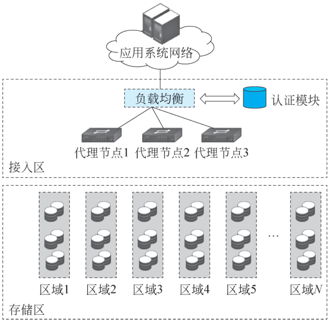
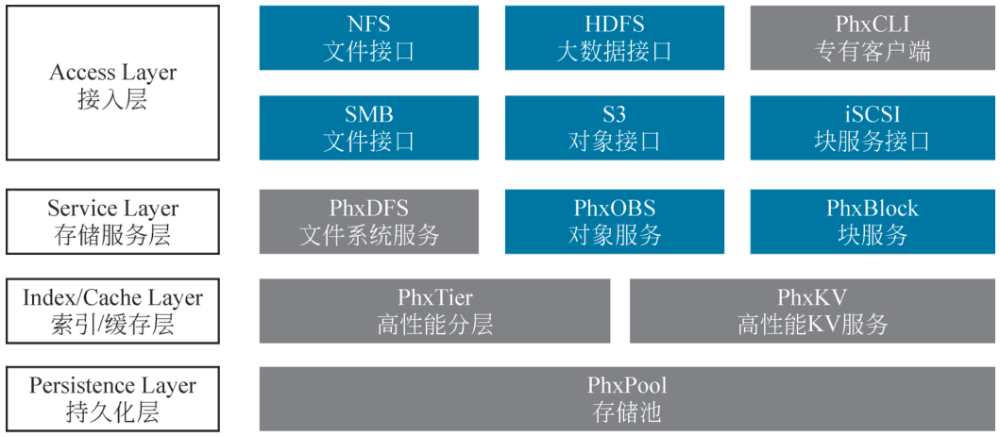

# 2.2 分布式存储技术 {#22}

!!! info "学前导读"

    一块硬盘装不下、坏了还会丢数据，怎么办？分布式存储的办法是：把数据切成很多小块，分散放到很多台服务器上，每块再多存几份。这就像一家连锁超市，货物不放在同一个仓库，而是分散在各地的仓库里，一个仓库失火，别的仓库还有货。

    本节先讲分布式存储的 6 个基本特征（2.2.1），再讲三种最常用的存储类型（2.2.2）：

    - [**对象存储**](../../appendix/glossary.md#g-对象存储 "以“对象”为单位、通过 HTTP 接口存取数据的存储方式，每个对象包含数据、元数据和唯一标识"){ .term }：像停车场的取车牌，凭“对象名”存取整个文件，适合图片、视频、备份；
    - [**文件存储**](../../appendix/glossary.md#g-文件存储 "以目录和文件的层级结构组织数据，可被多台服务器同时挂载访问"){ .term }：像共享文件夹，有目录树，多台机器可以同时挂载；
    - [**块存储**](../../appendix/glossary.md#g-块存储 "把存储空间划分为固定大小的块，以裸磁盘的形式提供给服务器使用"){ .term }：像一块“网络硬盘”，挂到服务器上自己分区、格式化，适合数据库。

    然后介绍 Ceph、HDFS 两个工具（2.2.3）、三种存储的使用案例（2.2.4）和统一分布式存储（2.2.5）。本节的部分技术参数较多，重在理解三种存储的区别，不必记数字。动手内容在[实验 2-3](labs.md#2-3)。

## 2.2.1 分布式存储技术的基本原理与特征 {#221}

分布式存储技术是云计算中的一项核心技术，其基本原理是将数据分散存储在多个物理或虚拟的存储节点上，以提高数据的可用性、可靠性和访问速度。以下是分布式存储技术的基本特征：

#### 1. 数据分片

将大数据集切分成多个小块（称为分片），每个分片可以存储在不同的节点上。这种方式可以提高并行处理能力，减少单个节点的负载。

#### 2. 数据冗余

为了提高数据的可靠性和可用性，分布式存储技术通常会在多个节点上保存数据的副本。即使某个节点发生故障，数据仍然可以从其他节点恢复。因为每份分片默认维护 N 个副本或[纠删码](../../appendix/glossary.md#g-纠删码 "把数据切成若干块并计算出校验块，丢失部分块后仍能恢复数据的冗余技术"){ .term }块，并跨机架、跨机房放置；即便任一磁盘、节点、机柜掉电，系统仍能秒级自愈，且业务无感知。

#### 3. 一致性

分布式存储技术需要在数据一致性和可用性之间进行权衡。常见的一致性模型包括强一致性、最终一致性等。系统需要确保多个副本之间的数据一致性，避免数据冲突。

#### 4. 具备故障检测和恢复机制

分布式存储技术需要具备故障检测机制，能够及时发现节点故障并进行数据恢复。常用的方法包括心跳机制、数据完整性校验等。

#### 5. 动态扩展

分布式存储技术通常具备动态扩展能力，可以根据需求增加或减少存储节点，以适应不断变化的数据存储需求。

#### 6. 提供数据访问接口

分布式存储技术通常提供统一的 API 接口，允许用户通过标准化的方式访问和管理数据。

基于以上特征，分布式存储技术能够有效地支持海量数据的存储和管理，满足云计算环境下对数据高可用性和高性能的需求。

**动手看看 · 多副本与纠删码**

“数据冗余”有两种做法：一种是同一份数据多存几份（多副本），一种是像解方程一样多存几块“校验块”（纠删码）。下面的动画让你亲手“弄坏”几块硬盘，看数据还能不能找回来，以及两种做法各占多少空间。

<iframe class="sim-frame" src="../../sims/replica-ec/main.html" height="560" loading="lazy" title="多副本与纠删码"></iframe>

切换“三副本”和“纠删码 4+2”，点击硬盘把它弄坏，看数据是否还完整；下方显示存储空间利用率。[全屏打开](../../sims/replica-ec/main.html){ target=_blank } · [教学说明](../../sims/replica-ec/index.md)
{ .sim-caption }

## 2.2.2 常见的分布式存储类型 {#222}

**动手看看 · 三种存储怎么存**

同一张照片，交给对象存储、文件存储、块存储分别是怎么存的？在下面的动画里存一张照片，再看看三种存储各适合做什么。

<iframe class="sim-frame" src="../../sims/storage-types/main.html" height="560" loading="lazy" title="三种存储怎么存"></iframe>

点上方三个标签切换存储类型，点“存入照片”看数据被怎样组织；最后做一做“选哪种存储”的小练习。[全屏打开](../../sims/storage-types/main.html){ target=_blank } · [教学说明](../../sims/storage-types/index.md)
{ .sim-caption }

### 2.2.2.1 对象存储 {#2221}

对象存储是一种将数据以对象形式进行组织和管理的存储系统。每个对象都包含数据本身以及相关的元数据，如对象的大小、创建时间、自定义键值对等。对象存储通过对对象 ID 或 URL 进行访问，使数据在物理存储节点上按照一定的分布算法进行存储，具有高扩展性、高可用性和成本效益优势。它适用于大规模存储非结构化数据，如图像、视频、文档等，常见于内容分发网络、社交媒体数据存储、大数据分析等场景。由于采用唯一对象 ID 访问，在全球分布式部署场景中，数据访问更加方便快捷，无论数据存储在何处，只要有对应的 ID 就能快速定位和获取。

#### 1. 典型系统

对象存储的典型系统包括 Ceph RADOS（自定义 CRUSH 算法）、MinIO（高性能 EC 编码）、Swift（强一致性）等。

#### 2. 技术特性

数据模型：采用扁平命名空间存储非结构化数据（如图片、视频等），每个对象可以通过唯一对象 ID 进行访问。

元数据扩展：支持自定义键值对（如拍摄设备、地理坐标等），单个对象的元数据容量可达 10 KB。

一致性模型：主要采用最终一致性模型，以保证高可用性和分区容忍性。部分系统也支持强一致性。

扩展性：通过哈希环或 CRUSH 算法等技术实现良好的扩展性，存储规模能够扩展到 EB 级，单个集群可以支持数千个节点。

**说明**

1. 对象存储在 CDN 源站场景中，能够为全球用户提供全面的加速服务，降低源站的负载压力。例如，一些大型视频网站，将大量的视频文件存储在对象存储中，通过 CDN 分发到各个节点，用户可以从距离自己最近的 CDN 节点获取数据，提高访问速度。

2. 在医疗影像归档领域，对象存储可以长期保存高分辨率的医疗影像数据，如 X 光、CT、MRI 等图像。医疗机构可以方便地进行影像数据的存储、检索和管理，同时保障数据的安全性和访问性，有利于医疗诊断、科研和教学等工作。

### 2.2.2.2 文件存储 {#2222}

文件存储以文件为单位进行数据的存储和管理，是一种传统的存储方式。文件存储通过文件系统组织数据，支持目录结构和文件的层次化管理。文件存储提供了标准的文件访问协议，如 NFS、SMB 等，方便用户和应用程序在不同操作系统之间共享和访问文件。它适合用于需要共享文件访问的场景，如企业文件共享、开发环境中的代码共享等。

文件存储支持多种协议，POSIX 兼容性使其在类 Unix 系统中能够实现无缝挂载和操作。NFS、SMB 协议挂载则方便在不同操作系统之间共享文件。GlusterFS 支持 FUSE 内核模块，进一步提高了文件存储在 Linux 系统中的性能和稳定性。

在元数据管理方面，集中式和分布式两种方式各有优缺点。Lustre 采用集中式元数据服务器（metadata server，MDS）管理目录树，虽然存在单节点性能瓶颈，但对于一些元数据管理简单、目录结构相对稳定的大型高性能计算场景来说，能够提供高效的数据访问控制。CephFS 的动态分片元数据管理方式则适用于大规模的分布式文件系统，可以根据文件系统的增长动态调整元数据分片，实现横向扩展，满足海量文件存储的需求。

#### 1. 核心系统

文件存储的核心系统包括 CephFS（动态子树分区）、BeeGFS（客户端直连 OSS）、Lustre（HPC 领域标准）等。

#### 2. 技术特性

（1）元数据扩展。

CephFS：MDS 集群自动拆分目录子树，如单目录超 500 万文件时触发分裂。

BeeGFS：元数据与服务节点分离，支持亿级文件秒级检索。

（2）锁机制对比。

咨询锁（Advisory Lock）：通过 NFSv4 实现，依赖客户端协作。

强制锁（Mandatory Lock）：CephFS 内核驱动支持，服务端强制执行。

性能实测：Lustre 在 100 节点集群中实现 1.2 TB/s 聚合带宽，可满足气象模拟 10 万核并行 I/O 需求。

**说明**

1. 在 AI 训练数据集共享场景中，文件存储方便多个计算节点同时访问和读取训练数据，提高 AI 模型训练的效率。例如，在深度学习训练中，多个 GPU 服务器可以从文件存储中快速获取大量的训练样本数据。

2. 对于 EDA 设计文件协作，EDA 工程师们可以在文件存储上共享设计文件，方便团队成员之间的协作和数据共享，提高芯片设计等工作的效率。

### 2.2.2.3 块存储 {#2223}

块存储是一种将数据以固定大小的块为单位进行存储的方式。每个块都有一个唯一的标识符，数据以块为单位进行读写操作，可以提供低延迟和高性能的存储服务。块存储通常用于虚拟机磁盘、数据库存储等场景，能够提供类似于本地硬盘的性能和可靠性，适用于对存储性能要求较高的应用场景。

块存储提供的裸块设备对操作系统来说就像是本地硬盘一样，可以直接进行分区、格式化等操作。它支持随机读写，能够满足数据库等对随机 I/O 性能要求较高的应用。最小操作单元为 512 B 扇区，使得数据的读写更加精细和高效。

在性能优化方面，本地缓存加速可以在存储写操作时先将数据写入本地缓存，然后异步写入后端存储，大大减少了数据写入的延迟。多路径 I/O 技术通过多条路径同时向存储设备发送 I/O 请求，实现负载均衡和故障切换，从而将吞吐量提升至 20 Gbps 以上，满足高性能存储的要求，如在虚拟化环境中，多个虚拟机同时对块存储进行高并发的读写操作。

#### 1. 核心系统

块存储的核心系统包括 Ceph RBD（支持延迟克隆）、StarWind NVMe-oF Target（RDMA 优化）等。

#### 2. 技术特性

iSCSI：基于 TCP / IP 协议栈，单路径极限吞吐可达 1.5 GB/s。

NVMe-oF：基于 RDMA 实现，时延小于 10 μs，吞吐可达 14 GB/s（100 GbE 网络）。快照链优化：Ceph RBD 支持快照扁平化，将链式快照转为独立对象，消除深度依赖导致的 IOPS 衰减。

多路径容灾：DM -Multipath 支持异步逻辑单元访问（asymmetric logical unit access，ALUA）策略，自动切换优先路径。

**说明**

除了虚拟机磁盘和 Oracle RAC 共享存储，块存储还适用于一些对存储性能要求极高的企业级应用。例如，在金融交易系统中，块存储能够快速响应高频交易的读写请求，确保交易数据的实时性和准确性。在企业资源规划（ERP）系统中，块存储为系统的数据库提供高速、可靠的数据存储支持，保障企业业务的稳定运行。

### 2.2.2.4 主流分布式存储类型对比 {#2224}

对象存储、文件存储和块存储是三种主要的分布式存储类型，各有特点和适用场景。对象存储将数据作为存储对象，具有扁平命名空间和丰富的元数据，适合非结构化数据（如图片和视频）的存储，常用于 CDN 和医疗影像归档。文件存储提供层次化的目录结构和文件共享功能，适合多用户协作和数据共享，常见于办公场景。块存储则提供裸的块设备，支持随机读写，性能高，适用于虚拟机磁盘和数据库存储。对象存储适配海量冷数据，文件存储满足协作型工作负载，块存储专攻高性能交易系统。因此，选择存储类型时需要综合数据规模、访问模式及延迟要求等实际需求权衡。三种主要的分布式存储类型对比见表 2-3。

表 2-3 三种主要的分布式存储类型对比
{ .tab-caption }

| 需求维度 | 对象存储 | 文件存储 | 块存储 |
|---|---|---|---|
| 数据模型 | 非结构化数据 | 目录树结构 | 裸块设备 |
| 访问协议 | HTTP REST（S3/Swift） | NFSv4/SMB/POSIX | iSCSI/NVMe-oF |
| 典型延迟 | 50~200 ms（GET 操作） | 10~100 ms（文件打开操作） | <1 ms（4K 随机读） |
| 扩展能力 | EB 级水平扩展 | 百 PB 级集群扩展 | 单卷 TB 级，集群 PB 级 |
| 协议兼容性 | S3/HTTP 标准接口 | 兼容传统文件系统操作 | 与虚拟化/数据库协议深度集成 |
| 适用场景 | 视频归档、CDN 源站 | 科研计算、AI 训练数据集 | 数据库磁盘、虚拟机镜像 |
| 技术优势 | 元数据扩展性强，支持海量非结构化数据 | 多客户端协作，权限管理精细 | 超低延迟，直接硬件访问 |
| 核心局限 | 不支持文件锁，随机写性能差 | 元数据瓶颈（百万级文件性能衰减） | 无文件系统语义，管理复杂 |
| 性能指标 | PUT 吞吐≥5 GB/s/节点 | 聚合带宽≥100 GB/s（并行访问） | 4K 随机读 IOPS ≥ 50 KB/节点 |
| 扩展机制 | CRUSH 算法动态分布对象 | 动态子树分区 | LVM 卷组在线扩容 |
| 企业用例 | 视频平台 20 PB 冷数据存储 | 超算中心气象模拟 5 万核并发 | 银行 NVMe-oF SAN 升级使 TPCC 性能增加 220% |

### 2.2.2.5 其他存储类型 {#2225}

#### 1. 并行文件存储

并行文件存储是一种为高性能计算环境设计的文件存储方式，能够在多个存储节点和计算节点之间实现数据的并行读写操作。

条带化存储是并行文件存储的核心技术之一，它将数据分割成多个条带，并分别存储在不同的存储节点上。每个条带的大小可以根据实际需求进行配置，通常在 1 MB 到 64 MB 之间。这种存储方式使得数据能够并行地从多个节点读写，从而显著提高了数据传输速率。

并行文件存储具有高带宽和低延迟的特点。通过同时访问多个存储节点，它能够提供高带宽的数据传输速率，数据传输速率通常可以达到数十 GB/s。同时，由于数据分布均匀，并行文件存储减轻了单点负载，降低了延迟，确保了数据快速访问。

高可用性和容错性也是并行文件存储的重要特性。并行文件存储通常采用冗余存储机制，如副本或纠删码，以确保数据的高可用性和容错性。即使某些存储节点发生故障，系统也能自动恢复数据，确保数据的完整性和可用性。

并行文件存储的可扩展性非常强，可以通过添加新的存储节点轻松扩展存储容量和性能。新节点的添加通常不会影响现有数据的访问和系统的运行，实现了在线扩展。

并行文件存储广泛应用于多种高性能计算场景，如大规模科学计算、超级计算机集群、媒体和娱乐行业等。在气象模拟、物理模拟、生物信息学等领域，研究人员需要处理海量的数据集，并行文件存储能够快速存储和读取这些数据，加速计算过程。超级计算机集群通常配备并行文件存储，以满足其对高速存储的需求。在电影制作、后期处理等领域，需要存储和处理大量的高清视频和图像文件，并行文件存储能够满足这些应用对高带宽和低延迟的要求，提高工作效率。

常见的并行文件存储系统有 Lustre、BeeGFS 和 IBM Spectrum Scale。Lustre 是一种广泛使用的并行文件存储系统，特别适合用于大规模高性能计算环境。它采用分布式元数据服务器和对象存储服务器架构，能够支持数 PB 规模的存储容量。BeeGFS 以其高性能和灵活性而闻名，支持动态元数据分区，单个元数据服务器可以管理高达 5 亿个文件，适用于多种高性能计算场景。IBM Spectrum Scale 具备高性能和高可扩展性，可广泛应用于企业级和研究机构的高性能计算环境。

#### 2. 键值存储

键值存储是一种高效、灵活的存储模型，以键值对的形式组织数据。每个键作为唯一标识符，用于快速存储和检索对应的值。这种存储模型具有高性能、高可扩展性和简单易用的特点，适用于多种需要快速数据访问的应用场景。

键值存储的架构简单而强大，键作为唯一标识符，确保了数据的快速检索。其高性能特点源于对简单数据结构的优化，使得读写操作极为迅速，延迟低，吞吐量高。键值存储能够轻松扩展至大规模集群，通过一致性哈希算法等实现数据均匀分布，避免单点性能瓶颈，确保系统在大规模数据和高并发访问下的稳定性和效率。

其应用场景广泛，如在缓存系统中，键值存储可快速暂存计算结果，加速应用响应；在会话管理中，它安全存储用户会话信息，确保数据安全；对于用户偏好设置，键值存储能够提供个性化体验支持。此外，键值存储还适用于计数器、排行榜和物联网设备状态监测等场景，满足实时数据更新和快速访问需求。

键值存储模型的简单性和高效性使其成为现代应用中不可或缺的存储解决方案，为开发者提供了强大的工具来构建高性能、可扩展的应用。

#### 3. 列式存储

列式存储是一种高效的数据管理方式，将数据按“列”进行组织，提升查询效率并节省存储空间。因其能快速聚合和压缩列数据，它在数据分析场景中优势明显。列式存储广泛应用于数据仓库和大数据分析，如 Parquet 和 ORC 格式在 Hadoop 生态系统中被广泛使用。

列式存储的压缩效率高，因为同一列的数据类型和模式相似，差值编码和字典编码等技术可以有效减少存储空间。由于查询通常只涉及少数列，列式存储可以据此缩小数据扫描范围，从而优化查询性能。此外，列式存储利用现代计算机缓存和内存架构，提高了缓存命中率和 CPU 利用率。

列式存储适用于高维度和稀疏性数据，能高效处理复杂数据结构。它与大数据技术如 Hadoop 和 Spark 紧密结合，支持高效的数据处理和分析。在实际应用中，列式存储被用于云数据仓库服务和时间序列数据存储，如物联网设备数据和金融交易数据。

## 2.2.3 常见的分布式存储工具 {#223}

### 2.2.3.1 Ceph {#2231}

Ceph 是一个统一的、分布式的存储系统。“统一的”意味着 Ceph 作为一套存储系统可同时提供对象存储、块存储和文件系统存储 3 种功能，以便在满足不同应用需求的前提下简化部署和运维。而“分布式的”则意味着 Ceph 系统依靠真正的无中心结构实现了高可靠性，同时具备系统规模和性能在理论上无上限的可扩展性。

Ceph 的主要特性如下。

（1）高扩展性：使用普通的商用 X86 服务器，支持 10 ~ 10 000 台服务器，支持 TB 到 PB 级的扩展。

（2）高可靠性：没有单点故障，多数据副本，自动管理，自动修复。

（3）高性能：数据分布均衡，并行化程度高。对于分布式对象存储和块存储，不需要元数据服务器。

（4）Ceph 凭借其优良特性，获得了广泛的支持，越来越多的企业在生产环境中部署了 Ceph。

### 2.2.3.2 HDFS {#2232}

HDFS 是 Hadoop 生态系统中的核心组件，是专为大数据处理而设计的分布式文件系统。它具备高容错性，支持数据冗余，优化了大文件的存储和处理，适合批量处理任务，通常与 MapReduce 等计算框架结合使用。

## 2.2.4 主流存储的使用案例 {#224}

### 2.2.4.1 对象存储的使用案例 {#2241}

对象存储是云计算的重要组成部分，可以为用户提供基于互联网的云存储服务，面向互联网的应用开发者提供简单、灵活的存储服务功能。某企业需要为其大量非结构化数据（如日志文件、文档、图片、视频等）设计一套高效、可靠且可扩展的备份与归档系统。传统的文件存储方案在面对海量数据时，可能会面临性能瓶颈、管理复杂度高以及成本过高等问题。因此，企业决定采用对象存储技术，并选择基于 OpenStack 的 Swift 项目构建解决方案。

Swift 是 OpenStack 中的对象存储服务，专为大规模非结构化数据存储而设计。它具有分布式架构、高可用性和水平扩展能力，非常适合用于备份和归档场景。

#### 1. 功能架构

代理层（Proxy Server）：作为客户端请求的入口，负责处理客户端的 REST API 请求，如对象的上传、下载和删除等操作。它还会对请求进行身份验证，并根据配置的策略，将请求路由到相应的账户、容器和对象服务。代理层是无状态的，可以部署多个代理服务器来实现负载均衡和高可用性。

账户服务（Account Server）：用于管理用户账户的信息，包括账户的元数据和账户下容器的列表等。每个账户服务器负责处理与特定账户相关的请求，并维护账户的相关数据。

容器服务（Container Server）：主要负责管理容器的相关信息，如容器的元数据、对象列表等。它处理与容器相关的操作，如创建、删除容器以及查询容器中的对象列表等。

对象服务（Object Server）：负责实际的对象数据存储和管理。对象服务器存储对象的数据，并处理对象的读写请求。对象数据以文件的形式存储在文件系统中，并且可以通过 Swift 的管理命令进行数据的清理和审计等操作。如图 2-8 所示。

{ loading=lazy }

图 2-8 Swift 架构
{ .fig-caption }

#### 2. 接入区

负载均衡器：将来自应用系统的用户请求分配到多个代理节点。

代理节点：代理节点接收并处理来自负载均衡器的请求，进行预处理后转发到存储节点。

认证模块：负责验证用户身份，确保只有授权用户能够访问对象存储资源，确保访问安全。

#### 3. 存储区域

存储区：表示实际存储数据的服务器，每个存储区包含多个存储节点。

区域：Swift 架构中的物理位置划分，用于数据的地理冗余和故障隔离。每个区域可以有多个存储节点，确保数据的高可用性和容错性。实际存储数据的服务器，负责数据的存储、检索和管理。

#### 4. 存储架构

分区（Partition）：Swift 将数据分布在一个或多个存储节点上，这些存储节点可以是物理服务器或虚拟机。每个节点都有一定数量的分区，分区是 Swift 中数据存储的基本单位。对象数据通过哈希算法分配到不同的分区中。

副本（Replication）：为保证数据的高可用性和容错性，Swift 会为每个对象创建多个副本。默认情况下，Swift 会创建三个副本，并将其分布在不同的存储节点上。副本机制确保了即使某个存储节点出现故障，数据仍然可以从其他副本中恢复。

一致性哈希（Consistent Hashing）：Swift 使用一致性哈希算法来确定对象存储的位置。这种算法允许在添加或删除存储节点时，最小化数据的重新分配，确保系统的稳定性和性能。

### 2.2.4.2 文件存储的使用案例 {#2242}

#### 1. 企业文件共享

文件存储适合用于企业内部的文件共享和协作。例如，团队成员可以通过文件存储系统（如 NAS）共享文档、表格和演示文稿，以便于协作。

#### 2. 虚拟机镜像存储

在虚拟化环境中，文件存储可以用于存储虚拟机镜像和快照。例如，云服务提供商（如 VMware、OpenStack）使用文件存储来管理虚拟机的生命周期。

#### 3. 开发和测试环境

开发人员可以使用文件存储来存储源代码、构建工件和测试结果。在持续集成和持续交付流程中，文件存储可以作为构建和发布的中间存储。

#### 4. 内容管理系统

网站和应用的内容管理系统通常使用文件来存储网页、模板和媒体资源，便于内容的管理和更新。

#### 5. 数据库文件存储

一些数据库（如 MySQL、PostgreSQL）可以将数据文件存储在文件存储系统中，以便于数据的管理和备份。

### 2.2.4.3 块存储的使用案例 {#2243}

块存储作为底层存储基础设施的核心组件，通过将数据划分为固定大小的块并赋予独立寻址能力，为关键业务系统提供了高性能、低延迟的数据持久化解决方案。

#### 1. 数据库系统承载平台

（1）场景描述。金融级交易系统、电商订单处理、ERP 核心模块等联机事务处理过程（on-line transaction processing，OLTP）场景，对存储 IOPS、时延及数据一致性要求严苛。

（2）技术优势。

低延迟访问：通过 NVMe 协议或 RDMA 技术，块存储可实现微秒级时延，满足每秒数万次读写请求。

数据一致性：支持 SCSI 持久化预留或 SCSI-3 PR 协议，确保分布式数据库多节点并发访问时的数据强一致性。

（3）典型实现。AWS EBS io2 Block Express 单卷可提供最高 256 000 IOPS、4 GB/s 吞吐及亚毫秒延迟；阿里云 ESSD 云盘通过用户态 I/O 栈（SPDK+vhost-user）+ RDMA 网络，实现单盘百万级 IOPS、百微秒级延迟。

#### 2. 虚拟化环境基础设施

（1）场景描述。企业私有云、混合云中的虚拟机及容器化应用，需动态分配存储资源。

（2）技术优势。

弹性扩展：支持按需调整存储容量与性能，如 Azure Premium SSD v2 可在线扩容至 64 TB。

快照与克隆：基于写时复制技术，可在秒级创建虚拟机快照，加速测试环境部署。

（3）典型实现。VMware vSAN 通过分布式块存储架构，实现跨物理服务器的存储资源池化。

## 2.2.5 统一分布式存储技术 {#225}

随着新兴技术产业的发展，现代企业数据中心的数据类型也从以数据库表单等结构化数据为主的阶段，逐步过渡到以视频、图片、文档等非结构化数据为主的阶段。

上层业务对海量数据频繁的存取请求，给企业存储的性能及容量带来了挑战。为应对这一挑战，统一的企业级分布式存储技术应运而生。以深信服分布式存储 EDS 产品为例，其采用全对称分布式架构设计，可向上层应用同时提供块存储、对象存储、文件存储以及容器存储服务，满足现代数据中心全部类型的业务承载需求，能从容地应对数据爆发式增长带来的挑战。

▶ 配套微课 V2-1《统一分布式存储技术》（纸质书中为二维码，网络版视频待上线）

统一分布式存储系统架构如图 2-9 所示。

接入层（Access Layer）：上层应用访问存储系统的标准访问接口，负责各种访问服务的接收和处理。其中，对象存储支持 S3 访问，文件存储支持 NFS、SMB 和专有客户端访问，块存储支持 iSCSI 访问。

存储服务层（Service Layer）：负责提供文件系统服务、对象存储服务、块存储服务，支持集群多 MDS 部署，提供元数据高可靠服务，为非结构化数据存储提供多种特性增值服务，如配额、快照等。

{ loading=lazy }

图 2-9 统一分布式存储系统架构
{ .fig-caption }

索引/缓存层（Index/Cache Layer）：统一分布式存储的“目录柜”与“热数据仓”。它保存文件到对象、对象到分片、分片到节点的全部映射表，并常驻内存或高性能 SSD，对外提供毫秒级元数据查询；同时把近期反复读写的块缓存在本地，用 LRU/LFU 淘汰策略写回后端，减少跨网络取数，使 80% 以上访问在本层命中，支撑快照、克隆、扩容等操作快速完成。高性能分层按访问频度与数据生命周期自动把冷数据降阶到 SATA，热数据上浮至 NVMe，全程无人工干预；高性能 KV 服务则专门承载元数据、小对象及高频键值请求，内存索引+零拷贝网络，单节点可达百万级 QPS、亚毫秒延迟，为整个存储集群提供持续低延迟的索引与访问底座。

持久化层（Persistence Layer）：提供持久化存储能力，支持全 HDD 介质或全 SSD 介质的配置，聚焦于高可靠、高性能、高扩展性等存储底层相关能力，可提供小文件合并等功能。

统一分布式存储技术的主要特征如下。

（1）广泛的协议支持，全应用、全流程数据统一管理：统一分布式存储技术支持 NFS、CIFS、FTP 等多种文件共享协议，支持多种文件协议数据互通，可以实现全应用、全流程数据统一管理。

（2）全面、深度适配行业应用，存储部署即可用：统一分布式存储技术能够面向行业应用，如自动驾驶、基因测序、实景三维、影视动画、医学影像和芯片设计等，打造场景适应性最强的企业级存储系统，帮助用户缩短存储适配和调试周期，部署即可用。

（3）面向应用特征优化性能，激发最佳有效性能：如在医院 PACS 场景，统一分布式存储技术可以通过基于患者拍片时间和影像保存目录的智能预加载技术，提前将医生要访问的影像加载到内存储系统，提升医生阅片体验等。

**说明**

统一分布式存储技术正从“协议统一”向“架构融合”演进，通过多协议支持、容器化适配、AI 驱动优化、横向扩展、边缘轻量化及可信技术，构建适应多云环境的智能化数据基础设施，成为企业数字化转型的核心存储底座。

## 随堂小测

**1.** 某短视频平台要保存每天新增的海量视频，并通过网址供用户播放。最合适的存储类型是（　　）。

- A. 块存储
- B. 对象存储
- C. 文件存储
- D. 本地硬盘

??? tip "答案与解析"
    **答案：B**

    解析：对象存储采用扁平命名空间存储图片、视频等非结构化数据，容量可以扩展到 EB 级，并通过 HTTP 接口按对象名访问，最适合海量视频。块存储适合数据库，文件存储适合需要目录和共享挂载的场景。

    考查：对象存储 · 认知层次：应用 · [回看 2.2.2](#2221)
    { .quiz-meta }

**2.** 把一份数据在三台不同的服务器上各存一份，主要是为了（　　）。

- A. 加快写入速度
- B. 节省存储空间
- C. 实现数据分片
- D. 提高数据的可靠性和可用性

??? tip "答案与解析"
    **答案：D**

    解析：这是“数据冗余”中的多副本。任何一台服务器坏了，另外两份还在。它要多写几份，写入更慢、占用空间是原来的 3 倍，所以 A、B 错；分片是把数据切成块，和副本是两回事。

    考查：分布式存储的基本特征 · 认知层次：理解 · [回看 2.2.1](#221)
    { .quiz-meta }

**3.** HDFS 是 Hadoop 生态中的分布式文件系统，它最擅长存储大量很小的文件。（　　）

- √
- ×

??? tip "答案与解析"
    **答案：×**

    解析：HDFS 是为大数据处理设计的，擅长存储少量的大文件，一次写入、多次读取。海量小文件会让负责管理元数据的 NameNode 不堪重负。

    考查：HDFS · 认知层次：理解 · [回看 2.2.3](#2232)
    { .quiz-meta }
