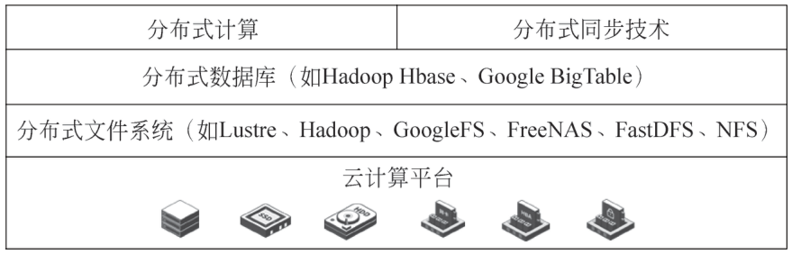
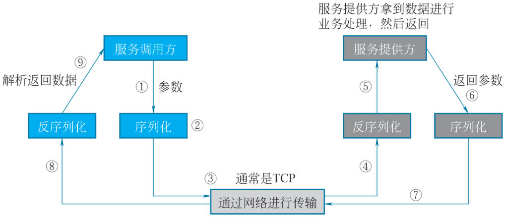
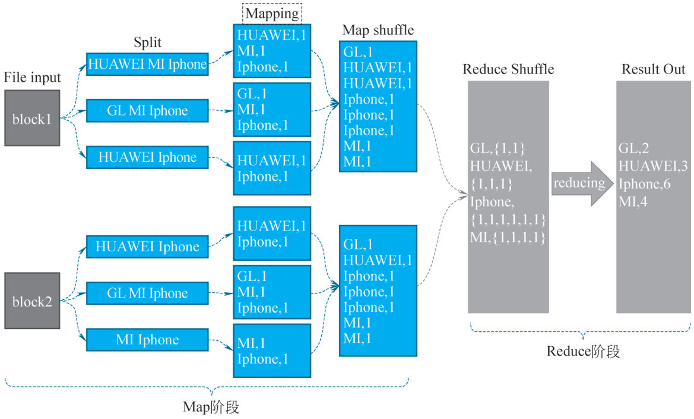

# 2.3 分布式计算技术 {#23}

!!! info "学前导读"

    期末要批改 1 万份试卷，一个老师要改一个月；把试卷分给 100 个老师同时改，最后把分数汇总，一天就改完了。这就是分布式计算的思路：把大任务拆成小任务，交给很多台机器同时算，再把结果合起来。

    本节分四部分：

    1. **分布式计算的基础**（2.3.1）：机器之间怎么“说话”（进程间通信、远程过程调用），怎么对表（时间同步），以及死锁和超时；
    2. **框架和模式**（2.3.2）：集中式、对等式、层次式等架构，MapReduce、BSP、Spark、流计算等模式；
    3. **MapReduce**（2.3.3）：分片、Map、Shuffle、Reduce 四步；
    4. **Spark**（2.3.4）：把中间结果放在内存里，比 MapReduce 快得多。

    进程间通信这部分概念较多，读的时候抓住“谁和谁通信、用什么方式”即可。同学期的《大数据技术处理技术》课会在 Hadoop 集群上真正运行 MapReduce 和 Spark，本书只要求理解原理；[实验 2-4](labs.md#2-4) 用十几行 Python 模拟一遍 MapReduce。

## 2.3.1 分布式计算的概述 {#231}

### 2.3.1.1 分布式计算的定义 {#2311}

计算机的出现极大地推动了人类信息化进程，并显著提升了社会生产力。随着 CPU 性能和计算能力的持续增强，人们希望借助计算机解决的问题也日益庞大、复杂，如地球大气变化与模拟、癌症靶向药物研发、黑洞碰撞模拟、火箭发射过程、传染病的全球传播等。显然，单靠一台计算机已难以胜任如此庞大的计算任务，因此各国政府和大型科研机构不惜投入巨资建造超级计算机，通过专用网络将大量计算机或处理器连接起来，协同完成复杂的科学计算。

然而，超级计算机并非所有机构或企业都能负担得起的设备，更不可能向个人用户普及。随着个人计算机（personal computer，PC）时代的到来，以及局域网、广域网、城域网等网络技术的快速发展，特别是互联网的广泛应用，从一个办公室、一座城市，到跨越国家和地域的众多计算机互联互通得以实现。在这样的背景下，分布式计算应运而生，成为解决大规模计算需求的重要技术路径。

分布式计算是在分布式系统上执行的计算，指让多个物理上独立的组件（如多个 CPU 或网络中的多台计算机）作为一个单独的系统协同工作，以此提高计算能力和计算效率。分布式计算的典范是谷歌提出的分布式编程模型 MapReduce，由此延伸出的概念是分布式处理技术，它能够使云数据中心的大量服务器群协同工作，解决分布式存储和分布式计算问题，并屏蔽底层复杂的分布式处理操作，把简单易用的编程接口和编程模型提供给用户。分布式处理技术主要包括四个部分，如图 2-10 所示。

{ loading=lazy }

图 2-10 分布式处理技术
{ .fig-caption }

### 2.3.1.2 分布式计算的基础技术 {#2312}

分布式计算具有高扩展性、高性能、高可用性等优势，但由于使用了分布式的计算机来完成大型任务的处理，因此也需要一系列的分布式计算技术来管理和协同这些分布式的计算

机节点及处理网络问题等。分布式计算的主要基础技术包括进程间通信、IPC 程序接口、时间同步、死锁和超时、远程过程调用等。

#### 1. 进程间通信

进程间通信（inter process communication，IPC）就是在不同进程之间传播或交换信息的技术。进程间通信的目的如下。

（1）数据传输：一个进程需要将它的数据发送给另一个进程，发送的数据量在一个字节到几兆字节之间。

（2）共享数据：多个进程想要操作共享数据，一个进程对共享数据的修改，其他进程应该立刻看到。

（3）通知事件：一个进程需要向另一个或一组进程发送消息，通知它（它们）发生了某种事件（如子进程终止时要通知父进程）。

（4）资源共享：多个进程之间共享同样的资源。为了做到这一点，需要内核提供锁-步机制。

（5）进程控制：有些进程希望完全控制另一个进程的执行（如 Debug 进程），此时控制进程希望能够拦截另一个进程的所有陷入和异常，并能够及时知道它的状态改变。

#### 2. IPC 程序接口

进程间通信是操作系统提供的一组编程接口，用于实现不同进程之间的数据交换与协同操作。通过这些机制，程序员可以实现多个进程之间的同步、互斥、数据传输等功能，从而提高系统的并发处理能力和资源利用率。

在现代操作系统中，一个程序常常需要同时处理来自多个用户的请求，即使只有一个用户发出请求，也可能触发系统内部多个进程的运行。因此，进程之间必须能够有效地相互通信。为此，操作系统提供了多种 IPC 机制，每种机制都有其适用场景和优缺点。

常见的 IPC 机制包括管道（Pipe）、信号量（Semaphore）、消息队列（Message Queue）、共享内存（Shared Memory）及套接字（Socket）。

（1）管道。

管道是 Linux 系统中最早支持的一种进程间通信方式。它是一种半双工通信机制，即数据只能在一个方向上传输。

无名管道（Unnamed Pipe）：仅用于具有亲缘关系的进程之间通信，如父子进程或兄弟进程。通常用于 shell 命令间的管道连接。

有名管道（FIFO）：又称命名管道，通过文件系统中的一个路径名进行标识，允许无亲缘关系的进程之间通信。虽然同样是半双工通信，但其灵活性更高，适用于更广泛的进程间通信场景。

注意：如果两个进程之间需要双向通信，则需建立两个独立的管道。

（2）信号量。

信号量是一种用于同步和互斥的机制，本质上是一个被保护的计数器变量。它可以控制多个线程或进程对共享资源的访问，防止资源竞争问题。

信号量的操作主要包括两个原子操作。

P 操作（等待）：减少信号量值，若结果小于 0 则阻塞当前进程。

V 操作（发送）：增加信号量值，唤醒等待的进程。

信号量常用于解决多进程环境下的临界区问题，确保资源的有序访问。

（3）消息队列。

消息队列是一种基于链表结构的通信机制，允许一个或多个进程向队列中写入消息，另一个或多个进程从队列中读取消息。

每个消息包含类型和数据两部分，接收方可以根据消息类型有选择地接收。相比于管道，消息队列具有更强的数据结构化能力，且不会受到缓冲区大小的限制。消息队列克服传统管道通信中信息格式单一、容量受限等缺点，适合传递结构化数据。

（4）共享内存。

共享内存是所有 IPC 机制中速度最快的一种。它允许多个进程将同一块物理内存映射到各自的地址空间，从而实现高效的数据共享。一个进程创建共享内存后，其他进程可以通过特定的系统调用将其附加到自己的地址空间。多个进程可以直接读写共享内存区域，无需频繁的数据拷贝。

（5）套接字。

套接字不仅是一种进程间通信机制，还支持跨网络主机的进程间通信，是实现分布式系统通信的核心技术。

套接字通信基于客户端-服务器模型，每个套接字都拥有唯一的地址标识。

它支持多种协议，如 TCP、UDP 等，可实现可靠的面向连接通信或高效的无连接通信。例如，利用套接字可以轻松构建一个客户端-服务端模型的网络应用程序，实现远程登录、文件传输、Web 服务等功能。

常见的 IPC 机制对比见表 2-4。

表 2-4 常见的 IPC 机制对比
{ .tab-caption }

| IPC 机制 | 通信范围 | 数据形式 | 同步机制 | 跨主机 | 效率 |
|---|---|---|---|---|---|
| 管道 | 本地（父子/兄弟） | 字节流 | 无 | 否 | 中等 |
| 有名管道 | 本地任意进程 | 字节流 | 无 | 否 | 中等 |
| 信号量 | 同步机制 | 控制变量 | 是 | 否 | 高 |
| 消息队列 | 本地任意进程 | 结构化消息 | 是 | 否 | 高 |
| 共享内存 | 本地任意进程 | 内存数据块 | 是 | 否 | 最高 |
| 套接字 | 本地或远程主机 | 字节流/数据报 | 是 | 是 | 中等 |

根据不同的应用场景，开发者可以选择最合适的 IPC 机制来实现进程间的高效协作。

#### 3. 时间同步

时间同步是指通过对本地时钟进行调整，使分布式系统中的各个节点能够共享一个统一的时间标准。在集中式系统中，所有进程或模块都可以访问同一个全局时钟，因此事件之间的先后顺序可以确定。然而，在分布式系统中，由于各节点在物理上是分散的，系统无法提供一个统一的全局时钟，每个节点只能依靠自己维护的本地时钟。由于不同节点的时钟在计时速度和运行环境上存在差异，即使这些时钟在某一时刻被校准为一致，经过一段时间后也会出现偏差。为了确保各节点之间的时间一致性，就需要进行时间同步操作。这类似于军事行动前的“对表”行为：所有参与人员在执行任务前统一时间，然后各自行动。同样地，分布式系统中的时间同步就是在各个计算机或模块之间实现时间上的协调与统一，从而保障系统整体的协同工作。

#### 4. 死锁和超时

死锁是两个或多个进程在执行中，因竞争资源或相互通信而出现的阻塞现象。若无外力干预，这些进程将无法推进，此时系统处于死锁状态，相关进程即死锁进程。

死锁的发生需同时满足以下 4 个必要条件。

（1）互斥条件：进程对分配到的资源排他性使用，一段时间内某资源仅由一个进程占用，其他请求进程只能等待资源释放。

（2）请求和保持条件：进程已持有至少一个资源，又请求新资源，而该资源被其他进程占用时，请求进程阻塞，但不释放已获资源。

（3）不剥夺条件：进程已获得的资源在未使用完前不能被剥夺，只能自行释放。

（4）环路等待条件：死锁发生时，存在进程和资源的环形链，如进程集合 { P0，P1，P2，，Pn} 中，P0 等待 P1 占用的资源，P1 等待 P2 占用的资源，以此类推，Pn 等待 P0 占用的资源。

了解死锁原因及条件，有助于在系统设计、进程调度等方面避免、预防和解除死锁。若系统出现死锁，需及时检测并解除，常用方法是撤销或挂起部分进程回收资源，再分配给阻塞进程使其就绪运行。

分布式计算常遇到超时问题，即特殊事件超出特定时间周期仍未发生或结束。网络消息发送、任务执行等都可能超时，如网络拥堵、故障或接收者问题会导致消息发送超时。设置超时检测可发现死锁。多任务调度时，有时采用多副本方式，一个任务生成多个副本发至多台服务器运行，只要一个任务完成返回，就中止其他任务，以快速响应用户，谷歌服务就采用了此方式。

#### 5. 远程过程调用

在分布式计算体系中，一个大型计算/服务会被拆分成很多独立的小的计算/服务，每个小的计算/服务会由独立的进程去管理和运行。当用户的请求到来时，需要将用户的请求分散到这些进程去处理，然后需要将这些子计算/服务的结果汇总起来返给用户。

远程过程调用（remote procedure call，RPC）是分布式系统中常见的一种通信方法，允许程序调用另一个地址空间（通常是通过网络连接到另一台机器上）的过程或函数，而不用程序员显式编码这个远程调用的细节。RPC 的目的是让用户更容易地构建分布式应用。简单来说，RPC 就是程序 A 使用某种通信协议，通过参数传递远程调用程序 B 提供的服务，并得到返回的结果的过程。

（1）RPC 的组成。

RPC 主要包含以下两个部分。

序列化和反序列化：在本地函数调用中，参数可通过栈传递，但远程过程调用时，客户端和服务端是独立进程，无法直接通过内存传递参数。此时，客户端需将参数序列化为字节流传输给服务端，服务端再将字节流反序列化为可用格式。序列化是将对象转为字节流，反序列化则是将字节流还原为对象。常见的序列化协议有 JSON、XML、Hessian、Thrift、Text、Bytes 等。

网络通信协议：所有数据需通过网络传输，网络层负责将被调用函数及序列化参数字节流传递给服务端，并将服务端返回的序列化结果送回客户端。常用的网络通信协议主要是 TCP 和 HTTP。

（2）RPC 的调用过程。

一个完整的 RPC 调用过程如图 2-11 所示，该过程包含以下 9 个步骤。

①服务调用方调用服务提供方对外暴露的接口 API，然后把相关数据以参数进行传输。

②将数据进行序列化。

③把序列化的数据通过网络进行传输，网络通信协议通常是 TCP。

④服务提供方接收到调用请求，把数据反序列化为可以解析的数据。

⑤调用服务提供方的过程，执行响应业务逻辑，进行计算和处理。

⑥将处理结果返回给服务调用方，把返回数据进行序列化。

⑦通过网络把数据传输到服务调用方。

⑧服务调用方把数据进行反序列化，得到可解析的数据。

⑨服务调用方通过解析处理数据，得到结果。

{ loading=lazy }

图 2-11 RPC 调用过程
{ .fig-caption }

### 2.3.1.3 分布式计算的优缺点 {#2313}

如前所述，分布式计算具有一些显著的优势：

（1）快速响应。

分布式计算可以把大型计算分布到多台计算机上进行，它可以根据不同的任务和场景来配置不同数量的计算资源，满足快速响应的需求。

（2）高性能。

相对于单机计算，或是集中式的计算机网络集群，分布式计算可以提供更高的性能及更好的性价比。

（3）高可扩展性。

分布式计算系统可以根据需要，增加更多的计算机来满足技术需求。

（4）高可靠性（容错性）。

分布式计算因为采用很多计算机来完成计算，一台服务器的崩溃并不会影响其余的服务器，失败的任务也会被调度到其他服务器上重新执行，不影响总体任务的完成。

（5）开放性。

大多数分布式计算系统，都是基于一些开放的标准和协议来开发的，本地或者远程都可以访问所提供的分布式计算服务。

同时，由于其分布式的特性，分布式计算也存在一些缺点：

（1）故障诊断和调试。

由于任务可能是在分布于不同地域和管理域的多台计算机上执行，因而要定位具体的故障机器及其原因，并进行故障调试就会存在诸多困难。引起故障的原因也是多方面的，可能是网络问题、硬件问题、权限问题、同步问题等，要进行问题的重现与跟踪诊断远不如在单台服务器环境中便捷。

（2）异构环境配置及支持。

由于任务运行在不同的计算机上，而这些计算机的硬件、软件及环境配置都不尽相同。因此，针对统一的任务，要提前准备和配置相应的硬件和软件环境，否则任务无法执行。

（3）网络问题。

在任务的调度和运行过程中，经常会遇到网络基础设施的问题，如传输问题、网络拥堵、信息丢失等，需要在应用层面处理所有这些故障，开销较大。

## 2.3.2 分布式计算的框架、模式及挑战 {#232}

### 2.3.2.1 分布式计算的框架 {#2321}

分布式计算的框架提供了构建和管理分布式计算应用的基础设施和工具。以下是一些常见的分布式计算的框架。

（1）集中式架构。

①架构描述。集中式架构是分布式计算的早期形式，具有明显的中心节点。中心节点负责任务的分配、调度和结果的汇总，其他计算节点围绕中心节点展开工作。这种架构简单直观，易于实现和管理。

②优势与局限。集中式架构的优势在于任务管理和资源调度相对集中，便于控制和管理。然而，这种架构的局限性也相当明显，中心节点一旦出现故障，整个系统就会陷入瘫痪，数据传输也高度依赖中心节点，容易造成网络瓶颈。

③适用场景。集中式架构适用于小型或对可靠性要求不高的分布式系统。例如，在企业内部的小型数据处理系统中，集中式架构可以快速搭建和部署，满足基本的数据处理需求。

（2）对等式架构。

①架构描述。对等式架构摒弃了中心节点的概念，所有节点地位平等，每个节点既是任务的发起者，也是任务的执行者。节点之间通过网络直接通信和协作，共同完成计算任务。

②优势与局限。对等式架构的优势在于没有单点故障风险，系统具有良好的容错性和扩展性。然而，这种架构的资源管理和任务调度较为复杂，对节点间的通信和协同要求较高。

③适用场景。对等式架构适用于大规模、动态变化的分布式系统，如文件共享网络和分布式存储系统。以文件共享网络为例，用户可以同时上传和下载文件，系统可以根据节点的资源和需求动态调整任务分配。

（3）层次式架构。

①架构描述。层次式架构将分布式系统划分为多个层次，每一层都有特定的功能和职责。底层负责基础的计算和数据存储，向上逐层提供更高级的服务和功能。各层之间通过明确定义的接口进行通信和交互。

②优势与局限。这种架构的优势在于层次分明，便于系统的设计、开发和维护。然而，层次之间的依赖关系可能导致系统的灵活性降低，跨层次的通信可能会引入额外的延迟。

③适用场景。层次式架构适用于复杂的分布式应用系统，如电子商务平台和企业级应用系统。在电子商务平台中，层次式架构可以将数据存储、业务逻辑处理、用户界面展示等划分为不同的层次，各层次之间协同工作，提供完整的电子商务服务。

（4）混合式架构。

①架构描述。混合式架构是集中式、对等式和层次式架构的有机结合。它根据不同场景和需求，灵活地采用不同的架构模式，以提高性能和可靠性。

②优势与局限。混合式架构的优势在于能够充分发挥各种架构模式的优势，适应复杂的计算场景和动态变化的系统需求。然而，这种架构较为复杂，实现和管理难度较大。

③适用场景。混合式架构适用于超大规模、复杂多变的分布式系统，如云计算平台和大数据处理系统。在云计算平台中，混合式架构可以根据不同的服务类型和用户需求，优化资源利用并提高服务质量。

（5）面向服务的架构。

①架构描述。面向服务的架构是一种构建分布式系统的方法论，它将系统功能分解为一组相互协作的服务。每个服务具有明确的功能接口，通过网络协议进行通信和交互。服务可以独立开发、部署和维护，具有良好的可重用性和灵活性。

②优势与局限。面向服务的架构的优势在于能够提高系统的可维护性和可扩展性，促进不同系统之间的集成和互操作。然而，这种架构需要对服务进行详细的建模和设计，开发和部署成本较高。

③适用场景。面向服务的架构适用于企业级应用集成和跨组织的业务协同。例如，在供应链管理系统中，不同企业可以通过面向服务的架构将各自的信息系统集成在一起，实现订单处理、库存管理、物流跟踪等业务流程的协同。

### 2.3.2.2 分布式计算的模式 {#2322}

（1）MapReduce 编程模型。该模型比较适合大规模数据的离线批处理，最早是谷歌用来支持其搜索引擎后台所需的强大的文档处理而发明的，其后又有了基于开源平台 Hadoop 的 MapReduce 计算引擎。

（2）整体同步并行计算模型（bulk synchronous parallel computing model，BSP model）。该模型又称大同步模型，主要面向图计算和数据挖掘。

一个 BSP 模型计算由一组通过通信网络互连的处理器完成。它主要有以下三个部分：

①一组具有局部内存的分布式处理器。

②全局数据通信网络。

③支持所有处理单元间全局路障同步的机制。

其执行过程是由一系列并行执行的超步和路障同步操作交叠而成的。每一次同步也是一个超步的完成和下一个超步的开始。

（3）交互式计算框架 Spark 模式。该模式是由加州大学伯克利分校 AMP Lab 开源的类 MapReduce 的通用并行计算框架，主要用于提升数据分析的运行和读写效率。与传统的 Hadoop MapReduce 相比，Spark 模式不仅继承了其所有优点，还通过将任务的中间结果保存在内存中，避免了频繁地读写 HDFS，从而显著提高了查询速度。这种特性使 Spark 模式在处理需要多次迭代的算法（如机器学习、图挖掘）及交互式数据挖掘任务中表现得更为出色。

（4）实时流计算模式。该模式专注于对大规模流动数据进行实时分析。它能够在数据不断变化的过程中连续地捕捉有用信息，并即时将分析结果反馈给下一个计算节点。该模式的数据处理和服务过程是持续不断的，具有低延迟和秒级响应的特点，非常适合需要快速响应的实时应用场景。

### 2.3.2.3 分布式计算的挑战 {#2323}

（1）数据一致性和同步问题：在分布式计算中，数据分布在多个节点上，确保数据的一致性和及时同步是一个难题。如果不同节点上的数据不一致，可能会导致错误的计算结果。

（2）网络延迟和带宽限制：节点之间的通信依赖于网络，网络延迟和带宽限制可能会影响分布式计算的效率。特别是在大规模的分布式计算中，网络问题可能会成为性能瓶颈。

（3）安全性和隐私保护：分布式计算涉及大量的数据传输和共享，如何确保数据的安全性和保护用户的隐私是至关重要的。防止数据泄露和被恶意利用是分布式计算必须面对的挑战

## 2.3.3 MapReduce 基础及其应用场景 {#233}

### 2.3.3.1 MapReduce 基础 {#2331}

MapReduce 是一种编程模型和计算框架，主要用于处理和生成大规模数据集。它由谷歌提出，并被广泛应用于大数据处理。MapReduce 的核心思想是将计算任务分为两个主要阶段：Map 阶段和 Reduce 阶段。Map 阶段负责将输入数据转换为中间键值对，而 Reduce 阶段负责对这些中间键值对进行合并和汇总，最终生成输出结果。Shuffle 阶段管理 Map 和 Reduce 之间的数据，在工作流程中有体现。具体如图 2-12 所示。

{ loading=lazy }

图 2-12 MapReduce 运行原理图解
{ .fig-caption }

### 2.3.3.2 MapReduce 工作流程 {#2332}

MapReduce 的工作流程可以分为以下几个阶段。

（1）输入分片（input split）：在 mapreduce 作业开始之前，输入数据会被分割成多个分片（split）。每个分片的大小通常根据 HDFS 的块大小（默认 64 MB 或 128 MB）来设置。分片的目的是将数据分配给不同的 Map 任务进行并行处理。

（2）Map 阶段：输入数据被分割成多个数据块（通常是文件），每个数据块由一个 Map 函数处理。Map 函数接收输入数据，进行处理并生成中间键值对。每个 Map 函数的输出结果会被存储在临时存储中。

（3）Shuffle 和 Sort 阶段。

① Shuffle 阶段：将所有 Map 函数的输出结果进行整理和分组，以便将相同的键聚集到一起。这个阶段的目的是将 Map 的输出传递给相应的 Reduce 函数。Shuffle 过程包含在 Map 和 Reduce 两端，即 Map shuffle 和 Reduce shuffle。

② Sort 阶段：在每个 Reduce 任务接收到中间键值对后，会按照键进行排序，以便后续的合并操作。

（4）Reduce 阶段：Reduce 任务对排序后的中间键值对进行汇总，生成最终的输出结果。Reduce 函数接收 Shuffle 阶段的输出（相同键的所有值），对这些值进行处理，生成最终的输出结果。Reduce 函数的输出通常是一个或多个键值对，最终结果会被写入持久存储中。

（5）输出阶段：Reduce 任务的输出结果会被写入 HDFS 或其他存储系统中，供后续应用使用。

MapReduce 的优点如下。

①可扩展性：能够处理从几百 MB 到 PB 级别的数据。

②容错性：系统能够自动处理节点故障，保证计算的可靠性。

③并行处理：可以充分利用集群中的计算资源，实现高效的数据处理。

**动手看看 · MapReduce 词频统计**

下面的动画用三句话演示 MapReduce 统计词频的全过程。可以一步一步点，也可以自动播放，观察每个词是怎样从三台机器“汇合”到同一个 Reduce 上的。

<iframe class="sim-frame" src="../../sims/mapreduce-wordcount/main.html" height="600" loading="lazy" title="MapReduce 词频统计"></iframe>

点“下一步”依次执行分片、Map、Shuffle、Reduce；也可以在输入框里改成自己的句子（词之间用空格隔开）。动画的默认数据与实验 2-4 相同。[全屏打开](../../sims/mapreduce-wordcount/main.html){ target=_blank } · [教学说明](../../sims/mapreduce-wordcount/index.md)
{ .sim-caption }

### 2.3.3.3 MapReduce 应用场景 {#2333}

（1）数据分析与处理：MapReduce 被广泛应用于大数据分析，如日志分析、用户行为分析等。例如，电商网站可以使用 MapReduce 处理用户的购买记录，以分析用户购买行为和购买趋势。

（2）文本处理：MapReduce 可用于处理和分析大量文本数据（如网页、社交媒体内容等）。例如，搜索引擎可以使用 MapReduce 进行网页索引和关键词提取。

（3）数据挖掘：MapReduce 可用于实现各种数据挖掘算法，如聚类、分类和关联规则挖掘。例如，社交网络可以使用 MapReduce 来识别用户之间的关系和社区结构。

（4）图计算：MapReduce 可用于处理大规模图数据（如社交网络、交通网络等）。例如，可以使用 MapReduce 计算图的最短路径、连通性等属性。

（5）机器学习：MapReduce 可用于在大规模数据集上训练机器学习模型，参与特征提取、模型训练和评估等过程。

MapReduce 是一种强大的处理大规模数据集的编程模型，适用于多种数据处理和分析场景。通过将计算任务分解为 Map 和 Reduce 两个阶段，MapReduce 能够有效地利用集群资源，实现高效的并行处理。虽然随着技术的发展，出现了许多新的数据处理框架（如 Apache Spark），但 MapReduce 仍然是大数据处理的重要基础。

## 2.3.4 Spark 基础及其应用场景 {#234}

### 2.3.4.1 Spark 基础 {#2341}

Apache Spark 是一个开源的分布式计算系统，旨在处理大规模数据处理任务。其核心设计理念围绕内存计算、弹性分布式数据集和有向无环图执行引擎构建，显著提升了大数据处理性能。

Spark 架构采用主从模式，由以下关键组件构成。

Driver Program: 作为应用程序的主控节点，负责解析用户程序，构建逻辑和物理执行计划，并协调任务执行。Driver Program 包含 Spark Context 对象，是与集群交互的主要入口点。

Cluster Manager: 负责资源管理和分配，支持 Standalone、YARN、Mesos 和 Kubernetes 等多种模式。在 YARN 模式下，Resource Manager 作为全局资源管理器，而 Node Manager 管理单个节点资源。

Executor: 工作节点上的进程，负责执行具体任务并存储计算数据。每个应用有独立的 Executor 进程，保障了应用间的隔离性。Executor 通过线程池并行执行任务，最大化 CPU 利用率。

Worker Node: 集群中运行应用代码的物理或虚拟机器，可托管多个 Executor。Worker Node 负责向 Cluster Manager 汇报资源状态和任务执行情况。

（1）核心抽象概念。

弹性分布式数据集（resilient distributed dataset，RDD）：Spark 的基础数据结构，是不可变的分布式对象集合。RDD 具有以下五大核心特性。

①分区列表（partitions）：数据被划分为多个分区，分布在集群中。

②依赖关系（dependencies）：记录 RDD 间的血缘关系（lineage）。

③计算函数（compute function）：用于计算分区数据的函数。

④分区器（partitioner）：决定数据如何分区。

⑤首选位置（preferred locations）：数据本地性信息。

Data Frame/Dataset: 基于 RDD 构建的更高级抽象，提供结构化数据处理能力。Data Frame 是以命名列组织的分布式数据集，相当于关系型数据库中的表。Dataset 结合了 RDD 的类型安全和 Data Frame 的查询优化优势。

DAG 执行引擎：Spark 将作业转换为有向无环图（directed acyclic graph，DAG），通过阶段划分和流水线执行优化性能。DAG Scheduler 将逻辑计划转换为物理执行计划，并划分为多个 Stage，每个 Stage 包含多个可并行执行的 Task。

（2）内存管理机制。

Spark 采用多层内存管理策略。

存储内存（storage memory）：用于缓存 RDD 和广播变量，采用 LRU 淘汰策略管理缓存数据。

执行内存（execution memory）：用于 Shuffle、Join 等操作时的临时数据存储，与存储内存共享统一内存区域，具有动态占用特性。

内存管理（unified memory management）：Spark 1.6 及更高版本引入统一内存管理，允许 Execution 与 Storage 内存互相借用，提高资源利用率。当双方内存均不足时，Spark 会按 LRU 规则把部分缓存块 spill 到磁盘，但会增加磁盘 I/O，导致性能下降。

（3）容错机制。

Spark 通过以下机制实现容错。

RDD 血缘关系：记录 RDD 的转换历史，当部分数据丢失时可重新计算恢复。这种基于血缘的恢复机制避免了数据复制开销。

检查点：将关键 RDD 持久化到可靠存储系统（HDFS 等），切断长血缘链，适用于迭代算法（如 PageRank）和长时间运行的作业。

任务重试：Executor 失败时，Driver 会重新调度受影响的任务到其他节点执行。默认重试次数为 4 次（可配置）。

### 2.3.4.2 Spark 工作流程 {#2342}

Spark 作业执行遵循一套精细的工作流程，从代码提交到结果返回涉及多个协同工作的组件和阶段。

（1）应用初始化阶段。

①用户程序创建 Spark Context 实例，作为与集群连接的主入口点；

② Spark Context 向 Cluster Manager 注册应用并申请资源；

③ Cluster Manager 根据配置分配 Executor 进程到 Worker 节点；

④ Executor 启动后反向注册到 Spark Context，建立通信通道。

（2）逻辑计划生成。

① Driver 解析用户代码中的转换和动作操作；

②构建未优化的逻辑计划，表示数据处理流程；

③应用 Catalyst 优化器的规则进行逻辑优化，如谓词下推、列剪裁等；

④生成多个候选物理执行计划，基于成本模型选择最优方案。

（3）物理计划执行。

① DAG Scheduler 将逻辑计划转换为 DAG 图，并划分为多个 Stage；

②每个 Stage 对应一组可并行执行的 Task，Task 数量等于该 Stage 最后一个 RDD 的分区数；

③ Task Scheduler 将 Task 集合提交给 Cluster Manager 分配到各个 Executor；

④ Executor 启动线程执行 Task，其间可能发生数据 Shuffle 和磁盘溢出。

（4）结果返回与资源释放。

①最终结果由各个 Executor 返回给 Driver 程序；

② Driver 聚合结果后返回给用户应用或写入外部存储系统；

③应用结束时，Spark Context 通知 Cluster Manager 释放所有资源。

### 2.3.4.3 Spark 应用场景 {#2343}

Spark 因其通用性和高性能，已被广泛应用于各行业的大数据处理场景。不同场景需要采用特定的架构设计和优化策略。

（1）批处理场景。

① ETL 流水线。

典型场景：从多种数据源中抽取数据，转换后加载到数据仓库。

技术实现：使用 Spark SQL 读取 JDBC/HDFS/Kafka 等数据源，应用 Data Frame API 进行清洗转换，写入 Hive/Delta Lake 等。

性能优化：并行读取源数据、分区写入、合并小文件（使用 coalesce/repartition）。

②数据仓库分析。

典型查询：多表关联、复杂聚合、窗口函数等。

技术方案：Spark SQL+Hive Meta Store，利用 Catalyst 优化器生成高效执行计划。

存储格式：列式存储配合分区和统计信息，实现谓词下推和分区裁剪。

③大规模日志分析。

数据特点：半结构化（JSON）、高吞吐量、需实时解析。

性能要点：合理设置并行度，避免小文件问题。

（2）实时流处理。

基本原理：将实时流数据划分为小批次，按批处理模型执行。

适用场景：延迟要求从秒级到分钟级的场景，如监控告警、实时仪表盘。

（3）结构化流处理（Structured Streaming）。

编程模型：基于 Data Frame API 的统一批流处理，支持事件时间、水位线和容错。

输出模式：Complete（全量输出）、Append（追加）、Update（更新）。

水印机制：处理延迟数据，通过 with Watermark 设置阈值。

（4）机器学习场景。

①分布式算法训练。

MLlib 提供标准算法：分类、回归、聚类、推荐等。

特征工程工具：特征提取、转换、选择、降维。

流水线 API：将多个预处理和模型步骤组合成单一工作流。

②超参数调优。

交叉验证：使用 Cross Validator 自动尝试不同参数组合。

分布式搜索：并行评估多个参数组合，加速调优过程。

（5）图计算应用。

①社交网络分析。

典型任务：社区发现、影响力传播、路径分析。

性能考虑：合理分区策略、顶点切割减少通信。

②金融风控案例。

构建交易关系图，识别异常模式和潜在风险；应用标签传播算法检测欺诈团伙，结合流处理实现实时风险预警。

## 随堂小测

**1.** MapReduce 中，把相同的键（如同一个词）汇集到同一个 Reduce 任务上的是哪个阶段？（　　）

- A. 输入分片
- B. Map
- C. Shuffle
- D. 输出

??? tip "答案与解析"
    **答案：C**

    解析：Map 只负责把每行拆成 (词, 1)；Shuffle 阶段把所有 Map 的输出按键整理分组，保证同一个词去同一个 Reduce，然后 Sort 按键排序，Reduce 再汇总。

    考查：MapReduce 工作流程 · 认知层次：理解 · [回看 2.3.3](#2332)
    { .quiz-meta }

**2.** 机器学习训练要对同一批数据反复计算几十轮。相比 MapReduce，Spark 更适合这类任务，主要因为（　　）。

- A. Spark 把中间结果保存在内存中，不必每轮都读写磁盘
- B. Spark 不需要集群
- C. Spark 只能处理小数据
- D. Spark 不支持容错

??? tip "答案与解析"
    **答案：A**

    解析：MapReduce 每一轮的中间结果都要写到磁盘，下一轮再读出来；Spark 基于内存计算，迭代计算时速度优势明显。Spark 同样运行在集群上，也能处理海量数据并支持容错。

    考查：Spark 基础 · 认知层次：理解 · [回看 2.3.4](#2341)
    { .quiz-meta }

**3.** 远程过程调用（RPC）让程序调用另一台机器上的函数，就像调用本地函数一样，参数和结果需要经过序列化后在网络上传输。（　　）

- √
- ×

??? tip "答案与解析"
    **答案：√**

    解析：RPC 由序列化／反序列化和网络通信协议两部分组成。调用方把参数序列化后通过网络发给服务方，服务方反序列化、执行、再把结果序列化传回。

    考查：远程过程调用 · 认知层次：理解 · [回看 2.3.1](#2312)
    { .quiz-meta }
