# 2.4 云网络技术 {#24}

!!! info "学前导读"

    云上有成千上万的用户，他们的服务器都连在同一套物理网络上，怎么保证 A 公司的服务器看不到 B 公司的？答案是在物理网络之上“画”出一张张虚拟网络。好比一栋写字楼里有很多公司，大家共用电梯和走廊（物理网络），但每家公司有自己的门禁和内部电话分机（虚拟网络）。

    本节分四部分：

    1. **网络关键技术**（2.4.1）：SDN 把网络的“大脑”和“手脚”分开；Overlay（如 VXLAN）在已有网络上叠加一层虚拟网络；
    2. **虚拟网络、私有网络与弹性 IP**（2.4.2）：这是使用云服务器时每天都要打交道的概念，重点掌握；
    3. **虚拟网元设备**（2.4.3）：虚拟交换机、虚拟路由器；
    4. **可视化与运维**（2.4.4）。

    学过《计算机网络》课的同学会更轻松；没学过也不要紧，抓住“私有网络 = 自己的局域网、弹性 IP = 可以换绑的公网地址”这两句话就够了。多集群大二层网络技术（2.4.1.3）偏工程实施，折叠为拓展阅读。

## 2.4.1 云计算中的网络关键技术 {#241}

### 2.4.1.1 SDN 技术 {#2411}

软件定义网络（software defined networking，SDN）是一种网络架构，相比于传统数据中心的物理网络架构，其主要的特点是转控分离、集中控制、开放接口，解决了中心化、协议规范化、操作指令标准化的问题。SDN 标准架构如图 2-13 所示。

当前业界比较认可的 SDN 特征属性包含以下几点：

①控制平面和转发平面分离。

②接口可编程。

③网络控制集中化。

转控分离将网元控制器和转发面解耦，网元的控制平面在控制器上，负责协议计算，产

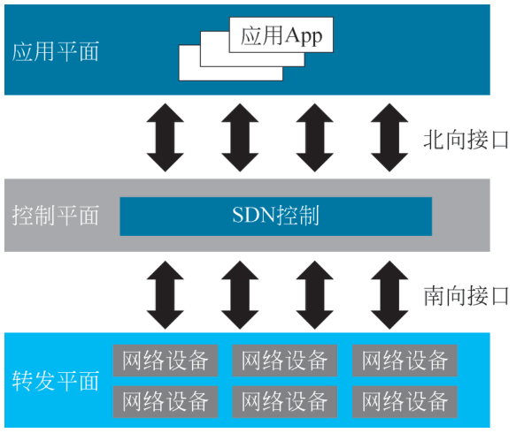{ loading=lazy }

图 2-13 SDN 标准架构
{ .fig-caption }

生流表；而转发平面只在网络设备上。集中控制指的是通过控制器集中管理和下发流表，对控制器进行配置，不需要对设备进行逐一操作。开放的接口使得第三方应用只需要经由控制器的开放接口，通过编程方式定义一个新的网络功能，然后在控制器上运行即可。

从广义的角度来说，具有控制平面与转发平面解耦、网络集中控制、支持网络接口 API 这三个核心特征，就可以称为 SDN，aNET 架构属于广义上的 SDN。

### 2.4.1.2 Overlay 技术 {#2412}

在网络技术领域，Overlay 技术指的是一种在现有基础网络架构上叠加的虚拟化技术模式，它能够在不对基础网络进行大规模修改的前提下，实现应用在虚拟网络上的承载，并能达到业务之间相互分离的效果。

一个 Overlay 网络主要由三个部分组成，即边缘设备、控制平面、转发平面，如图 2-14 所示。

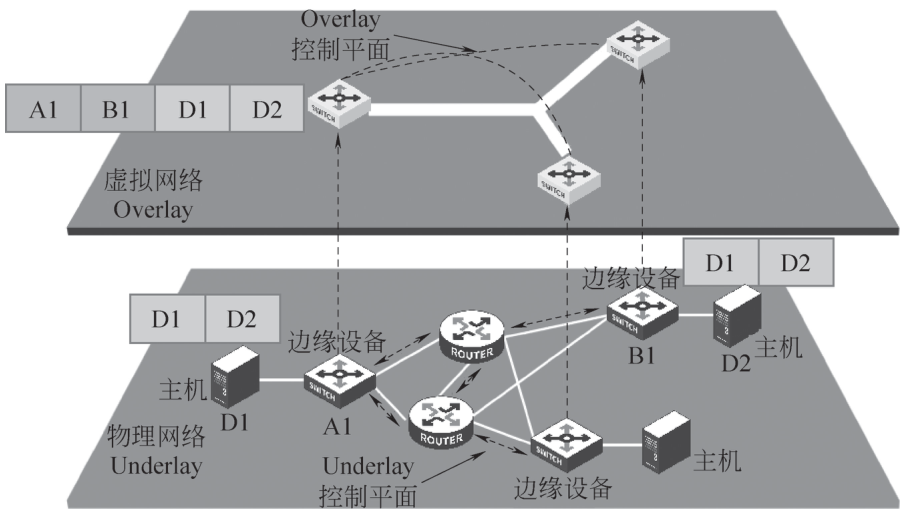{ loading=lazy }

图 2-14 Overlay 网络架构
{ .fig-caption }

①边缘设备：是指与虚拟机直接相连的设备。

②控制平面：主要负责虚拟隧道的建立维护以及主机可达性信息的通告。

③转发平面：承载 Overlay 报文的物理网络。

通常来说，Overlay 的实现有三大技术路线，分别是 VXLAN、NVGRE、STT，这三种技术均将以太报文承载到某种隧道平面，差异点在于选择和构造的隧道不同。对比之下，VXLAN 和 STT 对现网设备流量均衡负载的要求较低，一般的网络设备都能对 L2—L4 的数据内容参数进行链路聚合或等价路由的流量均衡，但 VXLAN 技术利用的是现有通用的 UDP 传输，成熟性高，因此成为最广泛支持的 Overlay 技术。

Overlay 技术给服务器虚拟化后的数据中心带来了以下主要价值：

①虚拟机发出的数据包被封装在 IP 数据包中，打破了 MAC 地址表的容量限制，满足了数据中心大规模部署虚拟机的需求。

②极大提高了隔离能力，满足了大规模下大二层网络租户隔离的需求。

③以太报文封装在 IP 报文之上，通过路由在网络中传输，虚拟机迁移不受二层物理网络限制，扩大了虚拟机的可迁移范围。

目前 Overlay 技术支持有以下三种方式：

①网络 Overlay: 由硬件网络设备（如路由器、交换机）作为 Overlay 网络的边缘设备，并通过控制协议实现网络构建和扩展，形成 Overlay 网络。物理机或虚拟化平台作为接入终端使用网络 Overlay。网络 Overlay 架构如图 2-15 所示。

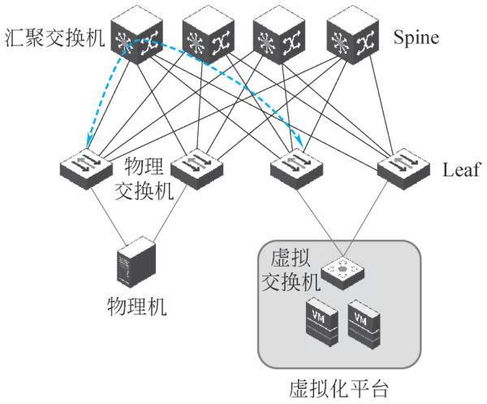{ loading=lazy }

图 2-15 网络 Overlay 架构
{ .fig-caption }

②主机 Overlay: 由虚拟化平台的虚拟交换机作为 Overlay 网络的边缘设备，并通过控制协议实现网络构建和扩展，形成 Overlay 网络。虚拟机作为接入终端使用虚拟网络构建的 Overlay 网络。主机 Overlay 架构如图 2-16 所示。

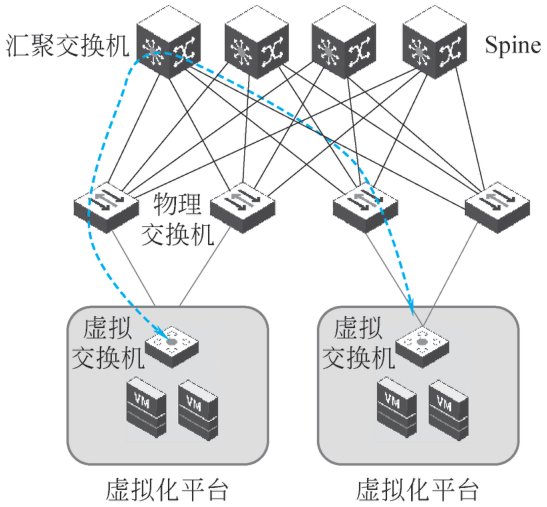{ loading=lazy }

图 2-16 主机 Overlay 架构
{ .fig-caption }

③混合 Overlay: 由硬件网络设备和虚拟网络设备混合作为 Overlay 网络的边缘设备，并通过控制协议实现网络构建和扩展，形成 Overlay 网络。物理机和 VM 作为接入终端使用构建出来的混合 Overlay 网络。混合 Overlay 架构如图 2-17 所示。

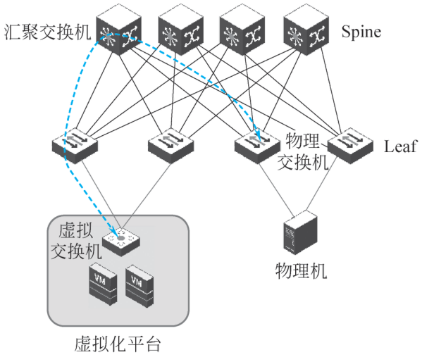{ loading=lazy }

图 2-17 混合 Overlay 架构
{ .fig-caption }

VXLAN 技术：IETF 定义 NVO3（Network Virtualization over Layer 3）是基于三层构造 IP Overlay 虚拟网络技术的统称，VXLAN 是 NVO3 的标准技术之一，采用 L2 over L4（MAC-in-UDP）的报文封装模式，将二层报文用三层协议进行封装，构造隧道进行数据包转发。一个标准的 VXLAN 报文，从外到内分别是 Outer MAC Header、Outer IP Header、UDP Header、VXLAN Header 以及原始二层帧。

Outer MAC Header 一共 14 字节，包含源 VTEP 的 MAC 地址以及下一跳设备的 MAC 地址，除此之外还含有 VLAN Type 和 VLAN TAG，用来标识 VLAN 类型以及 ID。

Outer IP Header 一共 20 字节，主要包含源、目的虚拟机所属的 VTEP 的 IP 地址，用来实现三层路由，找到虚拟机所在的 VTEP。

UDP Header 一共 8 字节，其中目的端口号 VXLAN Port 固定为 4789，源端口号 UDP Src. Port 是原始以太帧通过哈希算法计算后的值。

VXLAN Header 一共 8 字节，包含 24 比特的 VNI，用来标识不同的隔离网络。

原始二层帧即为原始报文，主要包括源、目的虚拟机的 IP 以及 Payload，这部分才是虚拟机真正看到的报文。如图 2-18 所示。

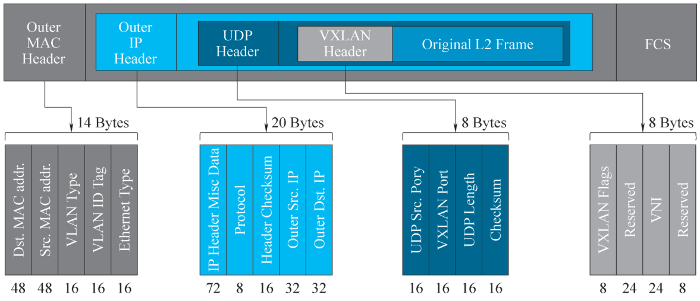{ loading=lazy }

图 2-18 VXLAN 报文格式
{ .fig-caption }

VXLAN Tunnel Endpoints，VXLAN 网络的边缘设备，是 VXLAN 隧道的起点和终点，VXLAN 报文的解封装处理均在上面进行。物理网络交换机或虚拟网络交换机均可作为 VTEP 设备，发送端宿主机中虚拟机的原始数据帧在 TOR 中逐层封装 VXLAN Header、UDP Header、Outer IP Header、Outer MAC Header，在 IP 网络中进行转发。VXLAN 报文通过接收端 TOR 交换机解封装后，原始报文到达接收端虚拟机。

VNI（VXLAN Network Identifier），VXLAN 网络标识符，类似 VLAN tag，VXLAN 使用 VNI 标识不同的网段，VNI 字段有 24 bits 大小，相同 VNI 内的 VM 之间可以直接通信，不需要通过网关，跨 VNI 通信需要 VXLAN L3 Gateway。

### 2.4.1.3 多集群大二层网络技术 {#2413}

??? abstract "拓展阅读（点击展开原书本小节全文）"

    （1）大二层互通。

    多集群/站点之间二层网络通过 VXLAN 打通，二层封装在三层中转发，不出现环路，无须额外配置 STP 环路防护或使用私有协议。

    站点间物理网络层面隔离，单个站点网络故障（如广播风暴、环路）不会延伸到其他站点。

    在网络管理功能上，同一个画布自定义编排多集群经典网络，跨集群组建租户网络。多集群连通域如图 2-19 所示。

    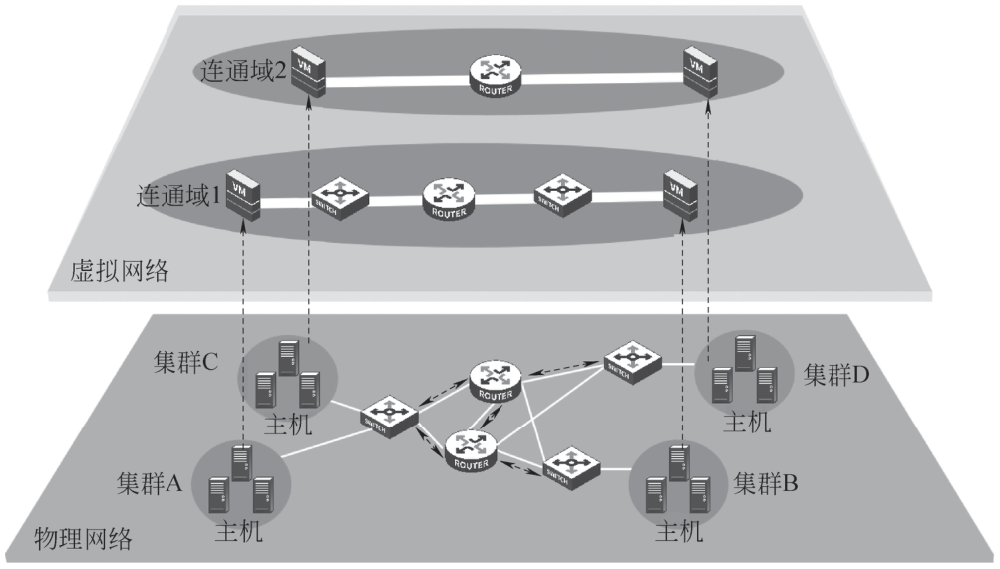{ loading=lazy }

    图 2-19 多集群连通域
    { .fig-caption }

    （2）连通域。

    两个集群要组成一个连通域，需要确保这两个集群的管理网之间相通，由于引入了 VXLAN 网关，VXLAN 所在的物理网络只需要保证三层可达即可。

    通过将多个集群组成一个连通域，支持经典网络和租户网络跨集群的二层网络打通，可以在云平台软件 SCP 上的经典网络和 VPC 网络视图内进行统一的网络编排。

## 2.4.2 虚拟网络、私有网络与弹性 IP {#242}

### 2.4.2.1 虚拟网络 {#2421}

虚拟网络（virtual network）是由虚拟链路组成的网络。虚拟网络节点之间的连接并不使用物理线缆连接，而是依靠特定的虚拟化链路相连。典型的虚拟网络包括叠加网络、虚拟专用网络及虚拟二层延伸网络。

#### 1. 叠加网络

叠加网络（overlay network）简单来说就是在现有网络的基础上搭建另外一种网络。叠加网络允许对没有 IP 地址标识的目的主机路由信息，如分布式哈希表（distributed hash table，DHT）可以路由信息到特定的节点，而这个节点的 IP 地址事先并不知道。叠加网络可以充分利用现有资源，在不增加成本的前提下提供更多的服务。例如，ADSL Internet 接入线路就是基于已经存在的 PSTN 网络实现的。

#### 2. 虚拟专用网络

虚拟专用网络（virtual private network，VPN）是一种常用于连接中大型企业或团体与团体间的私人网络的通信方法。虚拟专用网络通过公用的网络架构（如互联网）来传送内联网的信息，利用已加密的隧道协议来达到保密、终端认证、确保信息准确性等效果。这种技术可以在不安全的网络上传送可靠的、安全的信息。需要注意的是，信息是否加密是可以控制的，未加密的信息依然有被窃取的危险。

#### 3. 虚拟二层延伸网络

虚拟化从根本上改变了数据中心对网络架构的需求。虚拟化引入了虚拟机动态迁移技术，要求网络支持大范围的二层域。一般情况下，多数据中心之间的连接是通过三层路由实现连通的。而要实现通过三层网络连接的两个二层网络互通，就要使用虚拟二层延伸网络。

传统的 VPLS（MPLS L2VPN）技术，以及新兴的 Cisco OTV、H3C EVI 技术，都是借助隧道的方式，将二层数据报文封装在三层报文中，跨越中间的三层网络，实现两地二层数据的互通。也有虚拟化软件厂商提出了软件的虚拟二层延伸网络解决方案。例如 VXLAN、NVGRE，在虚拟化层的 vSwitch 中将二层数据封装在 UDP、GRE 报文中，在物理网络拓扑上构建一层虚拟化网络层，从而摆脱对底层网络的限制。

虚拟网络中的经典网络是从管理角度划分的，是虚拟化管理员视角的网络。对于经典网络来说，只有管理员才能对整个网络进行规划和运维，不再进行管理和使用上的网络逻辑划分。经典网络部署如图 2-20 所示。

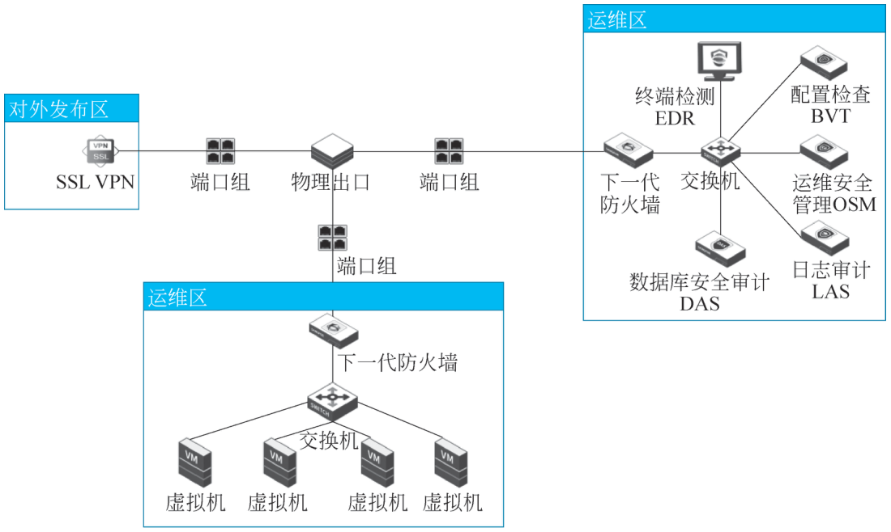{ loading=lazy }

图 2-20 经典网络部署
{ .fig-caption }

### 2.4.2.2 私有网络 {#2422}

私有网络（virtual private cloud，VPC）是云服务提供商提供的一种服务，允许用户在公有云中创建一个逻辑隔离的网络环境。VPC 的特点如下。

（1）完全控制：用户可以完全控制 VPC 内的网络配置，包括 IP 地址范围、子网、路由表和网络网关。

（2）安全性：VPC 允许用户设置安全组和网络访问控制列表（ACL），以控制流入和流出网络的流量。

（3）连接选项：用户可以选择通过 VPN 或专线连接将 VPC 与本地数据中心连接起来，形成混合云架构。

VPC 网络拓扑固定，在该网络拓扑上均以边界虚拟路由器作为网络出口，包含内网路由器及各子网交换机的结构。对于租户管理员，只需要根据业务需要，进行具体的网络配置即可。VPC 网络部署如图 2-21 所示。

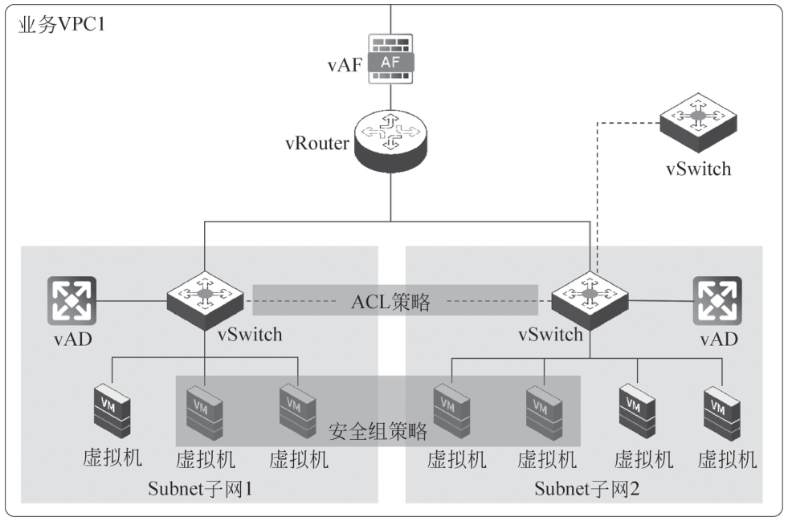{ loading=lazy }

图 2-21 VPC 网络部署
{ .fig-caption }

### 2.4.2.3 弹性 IP {#2423}

弹性 IP 是一种可用于公有云环境的 IP 地址，通常与云服务提供商的计算资源（如虚拟机）相关联。弹性 IP 的特点如下。

（1）动态分配：用户可以将弹性 IP 动态分配给不同的计算资源，方便在需要时进行更换。

（2）高可用性：当计算资源发生故障或需要维护时，可以快速将弹性 IP 重新指向其他资源，确保服务的连续性。

（3）公共访问：弹性 IP 通常用于提供对外部网络的访问，使得云资源可以被外部用户访问。

（4）结合使用：在实际应用中，虚拟网络、VPC 和弹性 IP 通常结合使用，以实现灵活、安全、高可用的云网络架构。例如，用户可以在 VPC 中创建多个虚拟网络，并为其分配弹性 IP，以便对外提供服务。同时，借助 VPC 的安全组和网络 ACL，可以有效保护云资源的安全性。

**动手看看 · VPC 拼图**

在云上搭一个网站，网络部分通常要准备：私有网络（VPC）、交换机（子网）、云服务器、弹性 IP。下面的动画让你按顺序把它们“拼”起来，拼错了会提示原因。

<iframe class="sim-frame" src="../../sims/vpc-builder/main.html" height="600" loading="lazy" title="VPC 拼图"></iframe>

按提示依次添加 VPC、子网、云服务器和弹性 IP，最后点“从公网访问”测试；也可以试试把弹性 IP 换绑到另一台服务器。[全屏打开](../../sims/vpc-builder/main.html){ target=_blank } · [教学说明](../../sims/vpc-builder/index.md)
{ .sim-caption }

## 2.4.3 虚拟网元设备技术 {#243}

### 2.4.3.1 分布式虚拟交换机 {#2431}

在物理网络中，交换机用来隔离广播域设备，连接在同一个交换机下的设备可认为是同一个二层网络。分布式虚拟交换机（distribute virtual switch，DVS）沿用了交换机的能力，即连接在同一个 DVS 下的虚拟机在逻辑上属于同一个二层网络，对应一个子网，如图 2-22 所示。

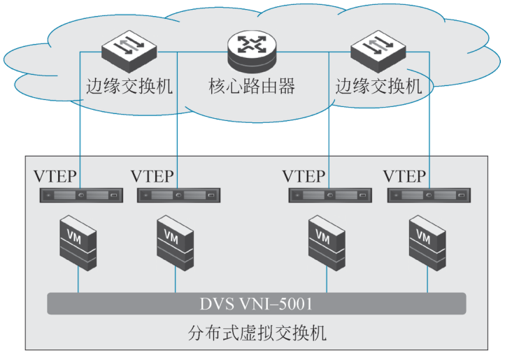{ loading=lazy }

图 2-22 分布式虚拟交换机
{ .fig-caption }

在实际集群部署中，虚拟机大多运行在不同物理节点上，并且集群之间的物理网络连接可能跨三层网络。在此种情况下，要实现虚拟机同属于一个二层网络的效果，首先在网络转发上引入了 VXLAN 技术，构造 VXLAN 网络，对数据包进行转发。在包封装上，物理节点作为 VTEP，对二层数据包进行三层封装或解封装，保证虚拟机发送或接收的数据包始终为原始二层帧，VTEP 再通过原始层帧中的源和目的虚拟机 MAC 信息进行转发。VTEP 采用分布式部署模式，集群中每一台物理主机上都存在一个 VTEP，每一个 VTEP 进行“最后一公里”的二层数据包转发（同一个 VNI），最终呈现为一个贯穿集群所有物理主机的虚拟交换机进行虚拟机业务的二层转发。

DVS 除了基础的二层转发能力，还支持 ARP 广播抑制、端口镜像、端口聚合、QOS 等高级功能。

### 2.4.3.2 边界虚拟路由器 {#2432}

边界虚拟路由器（edge virtual router，EVR）是实现虚拟网络内三层转发的网元，以主备实例的形式运行在两个物理节点上，除基本的路由能力外，还可以提供更高阶的能力，如地址转化、访问控制，具有实体路由器的功能。当前支持给边界虚拟路由器配置 IPv4/IPv6 地址，创建 IPv4/IPv6 静态路由、策略路由及 DHCP 池，路由器的 ACL 暂不支持 IPv6。

正常情况下，只会有一个主虚拟路由器处于工作状态，运行位置固定，备虚拟路由器不工作，主备之间依靠物理节点的数据通信口建立心跳线侦测状态。若主虚拟路由器故障，则数据通信口切换至备虚拟路由器，此时备虚拟路由器升级为主虚拟路由器，保障了虚拟路由器的高可用性。虚拟路由器可以被迁移到网络转发开销相对较小的物理节点上，实现网络性能优化，迁移过程不会造成业务中断。

如图 2-23 所示，以物理网络的 PC1 访问虚拟机 1 为例，PC1 通过业务网口将数据传输到边界虚拟路由器，边界虚拟路由器将数据发送给主机 2 的分布式交换机，主机 2 的分布式交换机将数据通过 VXLAN 口发送给主机 1 的分布式交换机，主机 1 的分布式交换机将数据发送给虚拟机 1。

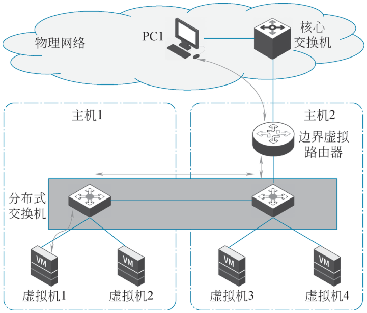{ loading=lazy }

图 2-23 边界虚拟路由器流量转发
{ .fig-caption }

### 2.4.3.3 边界虚拟交换机 {#2433}

边界虚拟交换机（edge virtual switch，EVS）也称为物理出口，用于实现集群业务与外界的通信，是虚拟网络和物理网络的边界出口。用户通过配置物理出口桥接到集群中主机的网口，就可以实现该主机上的虚拟机与物理网络的通信。物理出口支持 VLAN，用于对接物理交换的 VLAN 配置。边界虚拟交换机支持以下使用场景。

（1）物理交换机没有配置 VLAN，集群内部虚拟机也没有配置 VLAN，如图 2-24 所示。

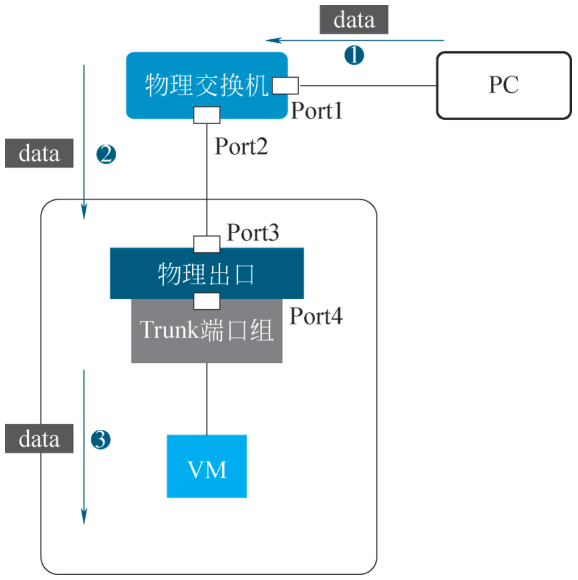{ loading=lazy }

图 2-24 物理出口场景 1
{ .fig-caption }

①配置。

Port1：Trunk All（pvid 1）。

Port2：Trunk All（pvid 1）。

Port3：Trunk All（pvid 1）。

Port4：使用 Trunk 端口组。

②转发流程。

外部 PC 访问集群内部虚拟机业务，Port1 为 Trunk All（pvid 1）。流量经过 Port1 之后，从 Port2 出来，没有任何 tag。Port3 为 Trunk All（pvid 1），流量从 Port4（Trunk 端口组）出来之后，仍然没有 tag，数据正常送达虚拟机。

（2）物理交换机配置了 Access VLAN，集群内部虚拟机没有配置 VLAN，如图 2-25 所示。

①配置。

Port1：Access VLAN 10。

Port2：Trunk VLAN 1—10。

Port3：Trunk All（pvid 1）。

Port4：使用 Access 端口组，配置 Access 为 10。

②转发流程。

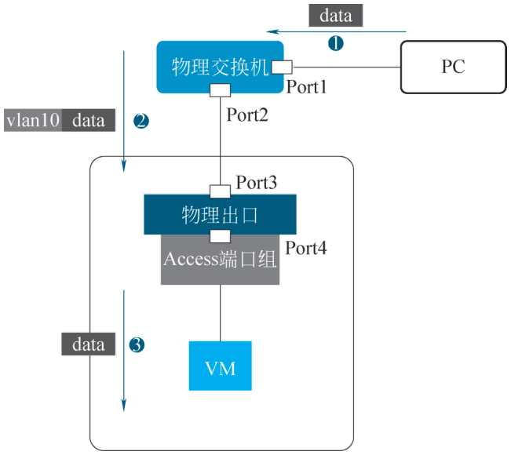{ loading=lazy }

图 2-25 物理出口场景 2
{ .fig-caption }

外部 PC 访问集群内部虚拟机业务，Port1 为 Access 口（VLAN 10）。流量经过 Port1 之后，从 Port2 出来，被打上 tag（VLAN 10）。Port3 为 Trunk All（pvid 1），流量从 Port4（Access 端口组，VLAN 10）出来之后，被 untag 掉，数据正常送达虚拟机。

（3）物理交换机配置了 Access VLAN，集群内部虚拟机（虚拟网络设备）业务配置了 VLAN，如图 2-26 所示。

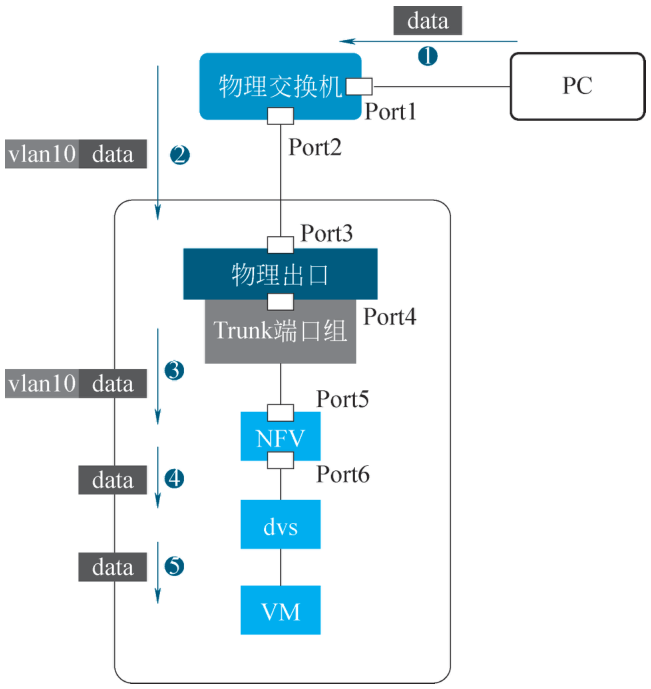{ loading=lazy }

图 2-26 物理出口场景 3
{ .fig-caption }

①配置。

Port1：Access VLAN 10。

Port2：Trunk VLAN 1—10。

Port3：Trunk All（pvid 1）。

Port4：使用 Trunk 端口组，VLAN 1—10。

Port5：使用 Trunk 口，VLAN 1—10。

Port6：使用 Access 口，VLAN 10 转发流程。

②转发流程。

外部 PC 访问集群内部虚拟机业务，Port1 为 Access 口（VLAN 10）。流量经过 Port1 之后，从 Port2 出来，被打上 tag（VLAN 10）。Port3 为 Trunk All（pvid 1），流量从 Port4（Trunk 端口组，VLAN 1—10）出来之后，带 tag 转发给 NFV。Port5 为 Trunk 口，流量从 Port6（Access 口）出来后，被 untag 转发给 DVS，DVS 将流量正常转发给虚拟机。

## 2.4.4 虚拟网络可视化及运维 {#244}

### 2.4.4.1 虚拟网络可视化 {#2441}

随着用户业务规模的扩大和业务复杂度的提高，虚拟化网络流量可视化提供业务流采集和分析，为业务系统瓶颈诊断、故障发现、容量规划、服务状态等提供可视化辅助，便于服务综合治理。其具有以下特征。

（1）实现业务访问流量和访问关系的可视化，帮助用户优化业务拓扑。

（2）具有防火墙规则意图验证功能，能够确定访问流量的合规性，快速对异常流量进行隔离，帮助用户更好地配置访问策略。

（3）对于受网络攻击的场景，便于识别影响范围，能快速并以最小范围隔离故障域。

（4）支持历史访问详情查询，帮助用户分析指定业务的访问关系，也方便运维人员快速定位问题，提升运维效率。

（5）支持历史访问详情导出，可以用于用户内部的分析平台，对业务访问进行分析统计。

（6）在确保业务访问流量采样率百分之百的同时，能够使网络转发性能基本无损耗，保障不会漏掉访问的流量和访问关系。

虚拟网络流量访问可视化的逻辑架构如图 2-27 所示。

网络流量访问可视化能够对业务间的访问流量进行分析，准确地表示业务系统之间的访问关系。

网络流量访问可视化的采集器通过旁路方式将流量导入收集器，收集器对收集的流量进行分析后将分析结果存储在 DB 中供管理员查询。流量访问可视化具备以下特点：

（1）流量访问关系的导出通过旁路的方式，支持大并发、大吞吐场景，基本不影响网络转发性能。

（2）采用时序数据库进行分析数据存储，支持数据聚合和压缩，降低了对存储空间和性能的要求。同时支持 30 天的大范围查询，支持实时数据摄取、快速聚合分析，界面响应时间在 3 s 内。

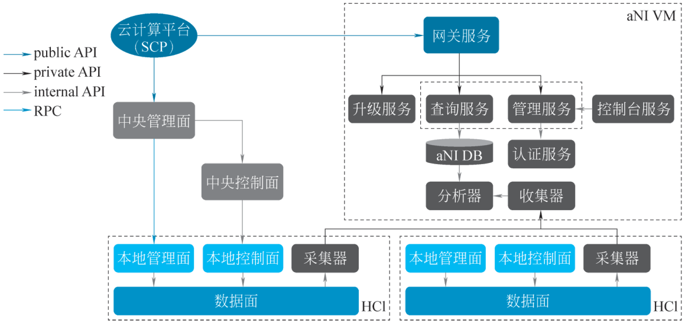{ loading=lazy }

图 2-27 虚拟网络流量访问可视化的逻辑架构
{ .fig-caption }

### 2.4.4.2 虚拟网络运维技术 {#2442}

（1）所画即所得。

以业务逻辑呈现的所画即所得网络拓扑图，为业务逻辑拓扑的搭建提供了各种元素，通过管理平台可以快捷地从资源池中调取相应的资源，呈现出不同的拓扑架构。当从管理平台构建业务逻辑拓扑时，整个超融合架构底层会执行大量的动作和指令，并且根据业务逻辑拓扑进行底层真实的环境模拟，从而屏蔽了平台底层复杂性，方便 IT 管理人员快速、简单、直观地构建数据中心各个业务所需的逻辑拓扑。管理员通过简单的拖拽、连线，即可快速地从资源池中调取资源，进行业务编排，搭建不同的拓扑架构。

（2）虚拟机网卡限速。

云网络技术对接入的网络设备（虚拟机）提供网卡级别的服务质量保障机制，可限制虚拟机对应网卡的网速上限，为重要的虚拟机提供网络带宽保障，限制异常虚拟机对虚拟化网络平台的网络攻击。

基于令牌桶算法实现对虚拟机网卡收发两个方向上的数据包的限速和整形处理，如图 2-28 所示。使用双桶结构：C 桶和 E 桶。TC 表示 C 桶中的令牌数，TE 表示 E 桶中的令牌数，两桶的总容量分别为 CBS 和 EBS。初始状态时两桶是满的，即 TC 和 TE 的初始值分别等于 CBS 和 EBS。令牌的产生速率是 CIR。通常是先往 C 桶中添加令牌，待 C 桶满了，再往 E 桶中添加令牌，当两桶都被填满时，新产生的令牌将会被丢弃。同时，以字节为单位去消耗令牌，完成对两个方向的数据包的限速操作。

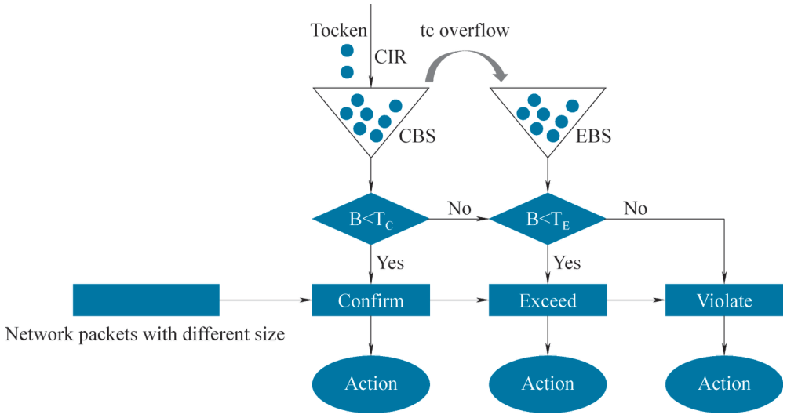{ loading=lazy }

图 2-28 令牌桶算法示意图
{ .fig-caption }

网卡限速支持人机交互的所有常见部署场景，包括虚拟机直连物理出口、虚拟机连接隧道口、虚拟机连接边界路由器等场景。

如图 2-29 所示，用户在虚拟机网卡设置界面可开启指定网卡的流量限制功能，针对发送流量、接收流量两个方向可以配置 1~20 000 m 的网络限速指标。

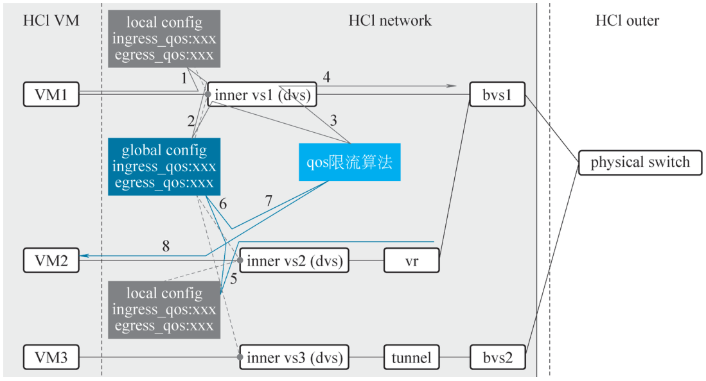{ loading=lazy }

图 2-29 网络限流
{ .fig-caption }

## 随堂小测

**1.** SDN（软件定义网络）的核心特征之一是（　　）。

- A. 每台交换机各自决定怎么转发，互不通信
- B. 控制平面与转发平面分离，由控制器集中控制
- C. 只能用硬件实现，不能编程
- D. 必须使用 IPv6

??? tip "答案与解析"
    **答案：B**

    解析：业界认可的 SDN 特征是控制平面和转发平面分离、接口可编程、网络控制集中化。传统网络中每台设备自己做决定，这正是 SDN 要改变的。

    考查：SDN 技术 · 认知层次：记忆 · [回看 2.4.1](#2411)
    { .quiz-meta }

**2.** 一台云服务器出了故障，运维人员希望网站的公网地址不变，把流量切到备用服务器上。应当使用（　　）。

- A. 虚拟专用网络（VPN）
- B. 私有网络（VPC）
- C. 安全组
- D. 弹性 IP

??? tip "答案与解析"
    **答案：D**

    解析：弹性 IP 是独立购买、可以动态绑定到不同计算资源上的公网 IP。故障时把它解绑后绑定到备用服务器，对外的地址不变。

    考查：弹性 IP · 认知层次：应用 · [回看 2.4.2](#2423)
    { .quiz-meta }

**3.** VXLAN 用 24 比特的 VNI 标识不同的隔离网络，因此可以划分出的虚拟网络数量远多于 VLAN。（　　）

- √
- ×

??? tip "答案与解析"
    **答案：√**

    解析：VLAN 的标识只有 12 比特，最多约 4000 个；VXLAN 的 VNI 有 24 比特，约 1600 万个，能满足云上大量租户隔离的需要。

    考查：Overlay 技术 · 认知层次：理解 · [回看 2.4.1](#2412)
    { .quiz-meta }
