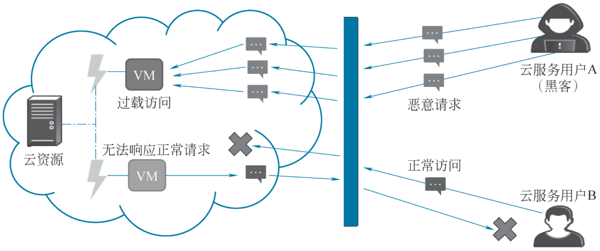
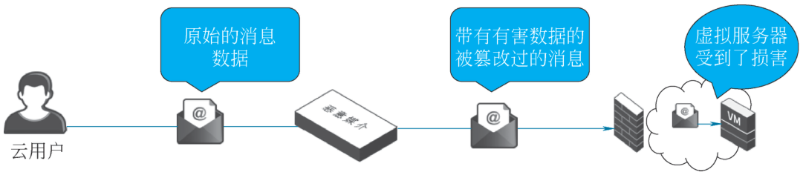
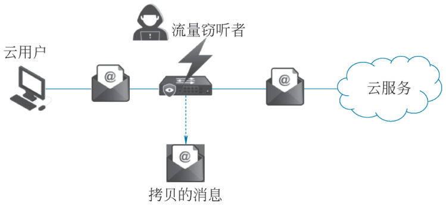
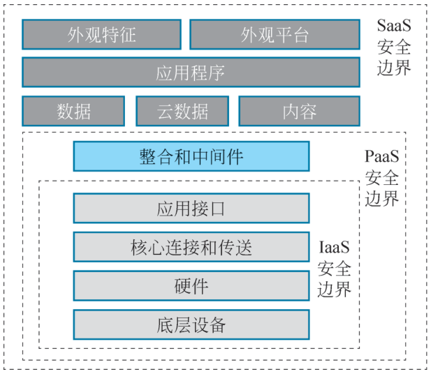
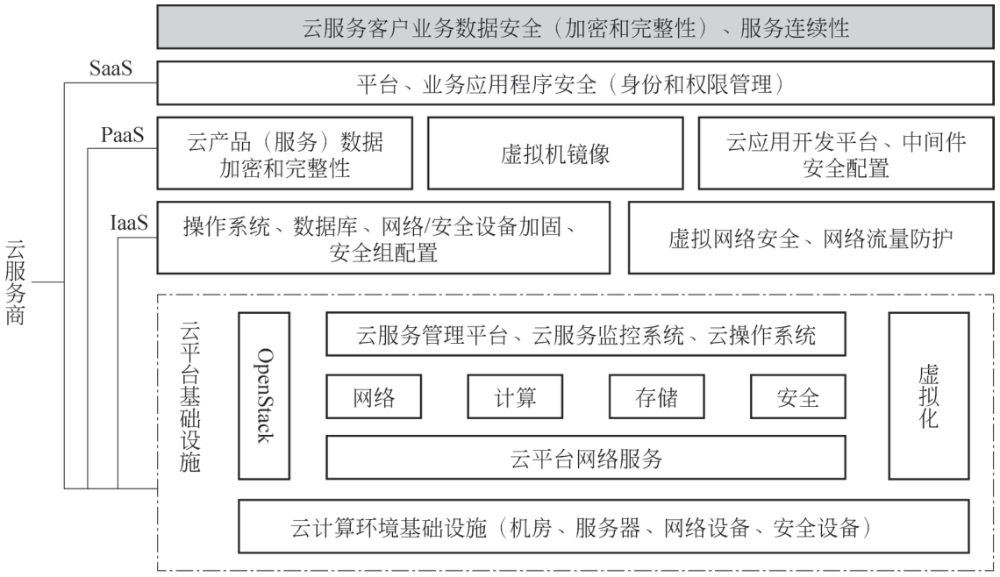
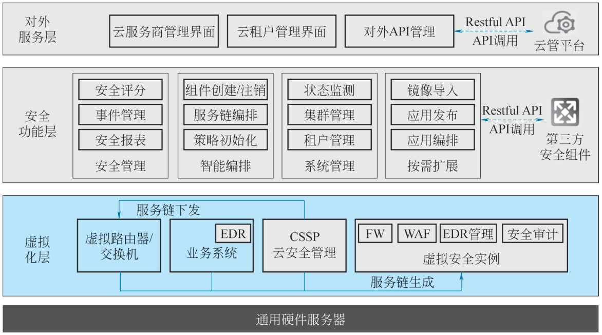
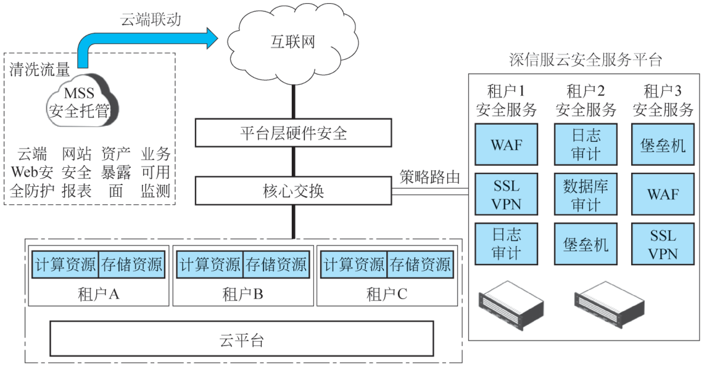
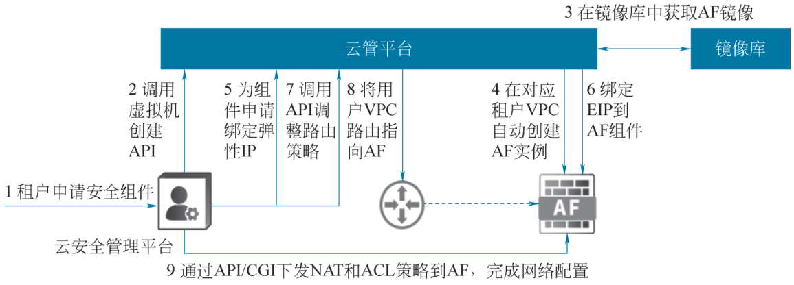
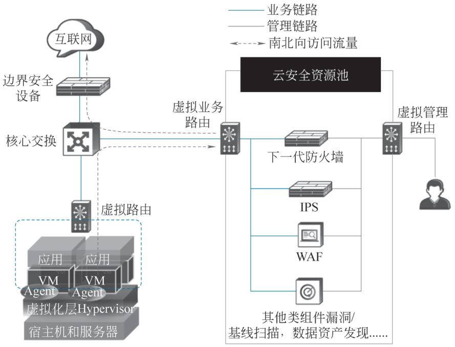
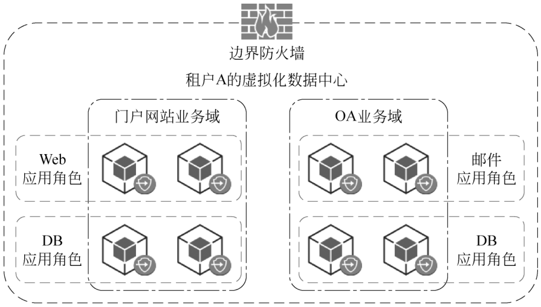

# 2.5 云安全技术 {#25}

!!! info "学前导读"

    把钱存进银行，你不用自己守保险柜，但银行卡密码还得自己保管好。云安全也是这样：云服务商负责机房、硬件和平台的安全，用户要负责自己的账号、配置和数据。现实中的大多数云上数据泄露，并不是黑客多厉害，而是用户把存储桶设成了“公开”、把数据库端口对全网开放、密码太简单。

    本节先讲云安全的发展（2.5.1），再用大量真实案例讲常见的云安全问题（2.5.2）和威胁（2.5.3），这三部分是重点，请结合案例阅读。

    后面的安全体系架构（2.5.4）、关键技术（2.5.5）、合规与审计（2.5.6）、主流防护技术（2.5.7）专业性较强，折叠为拓展阅读，有兴趣或今后从事云安全工作的同学可以展开细读。其中“安全组”这个最常用的概念，在下面的动画里先体验一下，第 3 章和第 4 章搭网站时还会用到。

云计算技术作为数字经济的重要基础设施，正加速推动各行各业的数字化转型与深度互联互通。在这一进程中，人工智能、大数据、区块链、边缘计算、5G 以及物联网等新兴技术也依托云计算平台，逐步打破技术壁垒，形成协同创新的力量，共同驱动产业升级并满足社会发展的多样化需求。

与此同时，随着云计算技术承载越来越多的关键业务与核心价值，其安全性问题日益凸显。云计算技术的安全不仅关系到信息系统的稳定运行，更直接影响国家安全、社会稳定、行业秩序、企业运营，乃至个人的人身安全、财产安全和隐私保护等多个层面。因此，本章将从云安全的发展历程与现状出发，深入探讨当前云计算面临的主要安全威胁与典型案例，并系统介绍云计算的安全体系架构、关键技术及合规与审计要求等内容。

## 2.5.1 云安全的发展历程与现状 {#251}

云安全的发展历程与云安全联盟（cloud security alliance，CSA）息息相关。

2009 年，CSA 成立，随后发布了首个云计算安全的最佳实践《针对云计算重点领域的安全指南》（简称《CSA 云安全指南 V1.0》）。

2010 年，CSA 提出云控制矩阵，被业界认作云计算安全的黄金标准。

2013 年，CSA 正式发布了基于 CCM 的 STAR 认证，使云服务安全性首次得到通用的自我评估和第三方评估。

2017 年，CSA 发布《通用数据保护条例》（GDPR）首席认证审计师课程，响应欧盟《通用数据保护条例》，强化跨境数据安全。

2022 年，天翼云当选 CSA 大中华区理事单位，推动国产云服务安全标准国际化。

2023 年，中国修订《信息安全技术云计算服务安全能力要求》（GB/T 31168—2023），新增数据保护与云管平台安全要求；CSA 聚焦供应链攻击与量子安全威胁。

2024 年，第八届 CSA 中国区大会以“云安全·AI，迎接未来”为主题，发布 20 份 AI 安全报告；SASE 架构成熟，白山云等企业入选技术标杆方阵。

2025 年，CSA 大中华区将 AI 安全、云安全、数据安全列为三大核心方向，推动 AI 与云安全深度融合；量子加密技术进入商用试点，AI 安全工具普及。

历年来 CSA 一直积极发布云计算安全报告，以帮助企业了解最新的云计算安全问题，进而采取更为明智的防护举措。2020 年 9 月 CSA 发布的最新版本的《云计算的 11 个最大威胁报告》将云计算面临的安全威胁归纳为九大类，包括云安全架构和策略缺失、数据泄露问题、恶意内部人员问题、配置错误问题、身份访问不足问题、API 风险问题、账户劫持问题、受限的云使用可见性、滥用和恶意使用云服务等。

## 2.5.2 常见的云安全问题 {#252}

### 2.5.2.1 云安全架构和策略缺失 {#2521}

当组织将现有的 IT 架构和安全控制“直接迁移”到云环境时，数据面临着诸多威胁。因为云环境在架构设计和安全机制上与传统环境存在显著差异。例如，云环境中新增了虚拟化安全、容器化安全等内容。如果忽视这些差异，采用“直接迁移”的方式，组织可能无法充分利用云环境的安全优势，如自动化安全策略、分布式防御机制等，导致数据暴露于风险之中。具体案例如下。

案例一：2018 年，Kromtech 安全中心披露，全球音乐巨头环球唱片因承包商的失误，导致内部 FTP 凭证、数据库密码和 AWS 配置详细信息（包括访问密钥和密码）被泄露。这些敏感信息被存储在未受保护的 S3 存储桶中。

案例二：2018 年，Kromtech 安全中心的研究员表示发现了本田 Connect App 上的大量数据在网上曝光。这些数据存储在两个不安全的、可被公开访问的、不受保护的 AWS S3 存储桶中。

### 2.5.2.2 数据泄露问题 {#2522}

在云环境下，数据泄露是指敏感、受保护或机密信息被未经授权发布、查看、窃取或使用的网络安全事件。具体案例如下。

案例一：2021 年 3 月，德国毕马威会计师事务所因云服务器配置不当，致全球 75 家蓝筹公司的商业机密泄露。

案例二：2022 年 5 月，印度国家支付公司存储在 AWS S3 存储桶中的数据泄露，包含 1.13 亿印度人敏感数据。

案例三：2023 年 11 月，某政务云平台因配置错误，200 万条公民个人信息泄露，涉及户籍、社保等敏感数据。

案例四：2024 年 8 月，网络安全公司研究人员警告，多个主流云服务商因存储桶配置错误，导致约 2 000 亿份文件可被公开访问，含机密文档、登录凭证等敏感内容。

案例五：2025 年 4 月，国家网络与信息安全信息通报中心曝光 67 款 App 违法违规收集使用个人信息，涉及教育、金融、政务等领域。

### 2.5.2.3 恶意内部人员问题 {#2523}

安全事件大多数起因于内部人员的恶意操作，内部人员通常指在职或已离职的员工、承包商或长期合作的商业伙伴。与外部攻击者不同，内部人员往往拥有合法的身份和访问权限，无须突破防火墙、虚拟专用网络或其他外围安全防护机制即可进入企业内部系统。由于他们被授予一定程度的信任，因此可以直接接触公司网络、信息系统及敏感数据。

这种可信任身份使得内部人员一旦实施恶意行为，其造成的危害往往更为严重且难以防范。例如，超级管理员等高权限账号若被滥用，可能导致关键数据被非法访问、篡改或删除，一旦此类人员滥用权限进行恶意操作，极有可能引发灾难性后果，严重影响业务连续性和数据安全。具体案例如下。

案例一：2018 年，特斯拉一名因没有得到晋升而不满公司的员工，认为报复公司才能引起注意，因此用虚假用户名直接篡改制造操作系统（MOS）代码，导致生产数据异常或停线；并将“大量高度敏感数据”打包外泄给未知第三方。马斯克借此再次强调“内部威胁可能比外部攻击更致命”，并鼓励员工通过匿名邮箱举报异常。该案例后来被写入特斯拉信息安全培训教材。

案例二：2018 年，印度旁遮普国家银行发生了 18 亿美元的内部欺诈事件。这家银行的一名员工利用极其敏感的密码未经授权访问国际资金清算系统，在一个高度复杂的欺诈性交易链中操作资金交易。

案例三：2020 年，企业销售团队利用云 CRM 权限批量导出客户资料并跳槽至竞对公司，因云平台缺乏细粒度审计机制，窃密行为延迟数月被发现。

案例四：2024 年，某企业员工私自开放云服务器远程登录端口且未设防护，被境外间谍控制为跳板，窃取了大量内网数据。

### 2.5.2.4 配置错误问题 {#2524}

在云平台环境中，当云存储资源、计算资源等云资源配置不正确时，就会产生配置错误。这些不恰当甚至错误的配置往往会使云资源面临严重的安全风险，使它们在面对诸如数据泄露、非法访问和恶意攻击等恶意活动时不堪一击。具体案例如下。

案例一：2019 年，某金融机构因在云环境中部署 MongoDB 数据库时未设置密码保护，未限制访问来源 IP，并且关闭了传输层加密，导致数据库直接暴露在互联网上。数据库最终被黑客扫描发现并入侵，数百万条用户敏感信息被盗取。

案例二：2021 年，一家科技公司在部署云服务器时，错误地将安全组规则配置为允许所有入站流量，使得其后端数据库可以直接通过公网访问。攻击者利用这一漏洞入侵系统，植入勒索软件，造成业务中断和大量数据被加密篡改。

### 2.5.2.5 身份访问不足问题 {#2525}

云环境为传统内部系统的身份与访问管理（identity and access management，IAM）带来深刻变革。在云环境中，一旦用户身份信息被盗用，攻击者便可能非法访问云资源，进而导致云环境中的数据泄露和系统失陷。具体案例如下。

案例一：2022 年，一家国际知名的云服务提供商由于未正确配置 IAM 角色权限，导致部分开发人员账号拥有过度权限。攻击者通过钓鱼方式获取这些账号后，获得访问生产环境的权限，最终导致核心数据被非法下载并泄露。

案例二：在 2023 年，一名攻击者通过社会工程手段获取 Microsoft 合作伙伴技术支持人员的身份认证信息，并借此访问了客户支持门户，进一步入侵多个客户的云环境，造成多国政府机构和企业数据外泄。

### 2.5.2.6 API 风险问题 {#2526}

云服务提供商通常会开放各类软件的用户界面和应用程序编程接口（API），以便用户能够方便地管理云服务并与其进行交互。然而，这些 API 的安全性直接关系到云服务的整体安全性和可用性。如果 API 设计存在缺陷，就可能被攻击者利用，导致服务滥用、数据泄露等严重后果。具体案例如下。

案例一：2017 年 7 月，Facebook 在其 API 代码中引入了一个漏洞，该漏洞直到 2018 年 9 月 25 日才被发现，并于 9 月 27 日被正式确认。该漏洞存在于 Facebook 的“查看你的活动”功能中，攻击者可以利用该漏洞窃取用户的访问令牌，从而非法控制用户账户。据估计，该漏洞影响了超过 5 000 万个用户账户，造成大规模的数据泄露风险。尽管 Facebook 已修复漏洞并向执法部门报告，但始终未能确定攻击者的身份和具体来源，也无法全面评估此次事件的影响范围。

案例二：2020 年，Cloudflare 在其 API 网关配置中发现了一个严重的安全漏洞。由于其 API 的认证机制存在缺陷，部分请求中的敏感信息（如 API 密钥）可能被记录在服务器日志中，并意外暴露给第三方服务。这使得攻击者有可能获取合法用户的 API 密钥，进而冒充用户访问 Cloudflare 提供的服务，篡改 DNS 设置或获取网站流量数据。虽然 Cloudflare 及时采取了补救措施，但仍无法排除已有密钥被滥用的可能性，这凸显了 API 安全设计的重要性。

**动手看看 · 安全组规则试验台**

2.5.2.4 节的案例二提到“错误地将安全组规则配置为允许所有入站流量”。安全组就是云服务器的“门卫”：按规则决定哪些访问可以进来。下面的动画让你自己写几条规则，再看看各种访问是被放行还是被拦下。

<iframe class="sim-frame" src="../../sims/security-group/main.html" height="620" loading="lazy" title="安全组规则试验台"></iframe>

勾选或修改左边的入方向规则，右边列出的访问请求会实时显示“放行”或“拒绝”；点“一键全开”看看危险在哪里。[全屏打开](../../sims/security-group/main.html){ target=_blank } · [教学说明](../../sims/security-group/index.md)
{ .sim-caption }

## 2.5.3 云安全的威胁 {#253}

### 2.5.3.1 拒绝服务攻击 {#2531}

拒绝服务（denial of service，DoS）攻击的目的是使 IT 资源过载至无法正确运行。这种形式的攻击发起方式有以下几种。

（1）云服务上的负载由于伪造的消息或重复的通信请求而不正常地增加。

（2）网络流量过载，响应性降低，性能下滑。

（3）发出多个云服务请求，每个请求都设计成消耗过量的内存和处理资源，成功的 DoS 攻击使得服务器性能恶化或失效，如图 2-30 所示。

{ loading=lazy }

图 2-30 拒绝服务攻击示意图
{ .fig-caption }

### 2.5.3.2 恶意中介攻击 {#2532}

恶意中介攻击是指在通信过程中，消息被恶意的服务参与者截获并篡改，从而导致信息的保密性和完整性遭到破坏。此外，攻击者还可能在将消息转发至最终目的地之前，插入有害或伪造的数据。图 2-31 展示了一个典型的恶意中介攻击场景。

{ loading=lazy }

图 2-31 恶意中介攻击场景
{ .fig-caption }

### 2.5.3.3 流量窃听 {#2533}

流量窃听是指在数据传输过程中，无论是从云用户传送到云服务提供者，还是在云内部进行传输，被恶意的服务参与者被动地截获。攻击者通过这种方式非法获取信息，如图 2-32 所示。此类攻击的主要目的是破坏数据的机密性，有时甚至会危及云用户与云服务提供者之间关系的私密性。由于这类攻击具有被动性，不易被检测，因此往往能够在未被察觉的情况下持续很长时间。

{ loading=lazy }

图 2-32 流量窃听示意图
{ .fig-caption }

### 2.5.3.4 授权不足攻击 {#2534}

授权不足攻击是指由于权限分配错误，导致攻击者被不当授予访问权限，或者授权范围过于宽泛，从而使攻击者能够访问本应受到保护的 IT 资源。这类攻击的常见后果是，攻击者获得了对某些 IT 资源的直接访问权限，而这些资源在设计时假设仅限受信任的用户或程序访问。

该攻击的一种变种被称为“弱认证”，通常发生在使用弱密码或共享账户来保护 IT 资源的情况下。在云环境中，此类攻击可能带来严重的安全风险和影响。

### 2.5.3.5 虚拟化攻击 {#2535}

虚拟化提供一种方法使得多个云用户可以访问 IT 资源，这些资源共享底层硬件但是在逻辑上互相独立。云服务提供者给予云用户对虚拟化的 IT 资源（如虚拟服务器）的管理权限，随之而来的风险就是云用户会滥用这种访问权限来攻击底层物理 IT 资源。

虚拟化攻击利用虚拟化平台中的漏洞来攻击虚拟化平台的保密性、完整性和可用性。

!!! tip "小贴士"

    拒绝服务攻击是当目标 IT 资源由于请求过多而负载过重时发生的，这些请求意在使 IT 资源性能陷于瘫痪或不可用状态。

    恶意中介攻击和流量窃听通常是由截取网络流量的恶意服务作用者实施的。

    授权不足攻击是指错误地授予了攻击者访问权限或授权太宽泛，或是使用了弱密码。虚拟化攻击利用的是虚拟化环境中的漏洞，获得了对底层物理硬件未被授权的访问。重叠的信任边界潜藏了一种威胁，攻击者可以利用多个云用户共享的基于云的 IT 资源。

### 2.5.3.6 责任难以界定 {#2536}

在传统模式下，信息安全责任通常遵循“谁主管谁负责、谁运行谁负责”的原则，责任划分较为清晰。然而，在云计算模式下，云计算平台的管理和运行主体与数据安全的责任主体往往不一致，导致在责任界定上缺乏明确的规范依据。此外，不同的服务模式（如 IaaS、PaaS、SaaS）和部署模式，以及云计算环境本身的复杂性，进一步加大了在发生安全事件时划分云服务商与用户之间责任的难度。

更为复杂的情况是，云服务商在构建自身服务时，往往会采购并依赖其他云服务商的基础服务。例如，提供 SaaS 服务的厂商可能将其服务架构建立在其他厂商提供的 PaaS 或 IaaS 上。这种多层依赖关系使得责任边界更加模糊，特别是在租户与云服务平台提供商之间，一旦出现安全问题，责任归属变得更加难以厘清。

## 2.5.4 云计算安全体系架构 {#254}

??? abstract "拓展阅读（点击展开原书本小节全文）"

    不同服务模式下用户和云服务提供商对计算资源的控制范围不同，控制范围则决定了安全责任的边界，如图 2-33 所示。在 IaaS 模式下，用户负责分配到的虚拟网络安全，自己部署的操作系统、运行环境和应用的安全，并对这些资源的操作、更新、配置的安全和可靠性负责；云服务提供商负责虚拟化计算资源层及底层资源的安全。在 PaaS 模式下，用户承担自己开发和部署的应用及其运行环境的安全责任，其他安全责任由云服务提供商负责。在 SaaS 模式下，用户承担客户端安全相关责任，云服务提供商承担服务端安全责任。

    { loading=lazy }

    图 2-33 云计算安全体系架构
    { .fig-caption }

    ### 2.5.4.1 IaaS 层安全 {#2541}

    #### 1. IaaS 服务安全责任

    根据云计算的安全责任模型，IaaS 服务提供者控制了底层的物理和虚拟资源，客户控制了访问和使用 IaaS 服务的用户凭据（如用户证书、账号等）、工具（如 Web 浏览器、客户端软件等）或系统（如运行客户业务处理、应用、中间件和相关基础设施的企业系统），客户同时控制了使用物理和虚拟资源的操作系统、存储以及部署的应用。

    因此除租户虚拟资源私有空间内的服务层的安全由租户负责之外，其他安全都归属 IaaS 层，包括用户层安全、访问层安全、资源层安全、安全管理，以及公共的安全服务。

    #### 2. IaaS 安全风险

    IaaS 层的安全风险既有传统数据中心的边界网络的安全风险以及内部网络安全威胁，也有云计算多租户架构带来的新风险。对于管理员而言，主要存在以下风险和威胁：

    （1）虚拟管理层成为新的高危区域。

    云计算系统通过虚拟化技术为大量用户提供计算资源，虚拟管理层成为新的高危区域。

    （2）恶意用户难以被追踪和隔离。

    资源按需自主分配使得恶意用户更易于在云计算系统中发起恶意攻击，并且难以对恶意用户进行追踪和隔离。

    （3）云计算的开放性使云计算系统更容易受到外部攻击。

    用户通过网络接入云计算系统，开放的接口使得云计算系统更易于受到来自外部网络的攻击。而对于最终用户而言，使用云计算服务带来的主要风险和威胁如下：

    ①数据存放在云端无法控制的风险。

    计算资源和数据完全由云服务提供商控制和管理，带来的风险包括提供商管理员非法入侵用户系统的风险；释放计算资源或存储空间后，数据能否完全销毁的风险；数据处理存在法律法规遵从风险。

    ②资源多租户共享带来的数据泄露与攻击风险。

    多租户共享计算资源，带来的风险包括由于隔离措施不当造成的用户数据泄露风险；遭受处在相同物理环境下的恶意用户攻击的风险。

    ③网络接口开放性的安全风险。

    在云计算环境下，用户通过网络操作和管理计算资源，鉴于网络接口的开放性，带来的风险也随之升高。

    #### 3. IaaS 安全措施

    IaaS 层安全是云安全防护体系的核心组成部分，包括物理与环境安全、物理网络安全、虚拟化平台安全、API 安全、数据安全。

    （1）物理与环境安全：在机房选址、物理访问控制、安保措施三方面实施完善的安全防护策略、规程和措施。

    （2）物理网络安全：又可以分为不同区域的网络隔离以及边界网络安全。不同安全区域划分与隔离，实现物理和逻辑控制并用的隔离手段。一般网络区域划分为 DMZ 区、公共服务区（PSZ）、资源交付区（POD）、数据存储区及运维管理区。边界网络安全一般部署 DDoS 异常和超大流量清洗服务、网络入侵检测与拦截（IDS/IPS - Intrusion Detection System/Intrusion Prevention System）、Web 安全防护。

    （3）虚拟化平台安全：虚拟化平台通过对服务器物理资源的抽象，将 CPU、内存、I/O 等物理资源转化为一组统一管理、可灵活调度、可动态分配的逻辑资源，并基于这些逻辑资源，在单个物理服务器上构建多个同时运行、相互隔离的虚拟机执行环境。通过 CPU 隔离、内存隔离和 I/O 隔离等技术手段实现虚拟主机操作系统与访客虚拟机操作系统之间的隔离，并通过 Hypervisor 让虚拟主机操作系统与访客虚拟机操作系统使用不同的权限运行，来保证平台系统资源的安全。

    （4）API 安全：API 安全具体涉及身份认证及鉴权，令牌（token）认证、访问密钥 ID/访问密钥（AK/SK - Access Key ID/Secret Access Key）认证、传输保护（一般 https）、边界防护以及 API 流量控制。

    （5）数据安全：具体涉及的技术措施有身份认证和访问控制、数据隔离、数据脱敏，传输安全、存储安全、数据删除与销毁。

    ### 2.5.4.2 PaaS 层安全 {#2542}

    PaaS 模型中云服务供应商通常向云客户提供多种操作系统以供选择。云服务供应商负责系统的补丁、管理和更新，云客户可以在平台上安装任何适用的应用软件。

    #### 1. PaaS 服务安全责任

    PaaS 服务所需的基础资源既可以由 IaaS 服务提供商提供，也可以由传统的数据中心提供。当基础资源由 IaaS 服务提供商提供时，基础资源的安全责任由 IaaS 服务提供商承担，PaaS 服务提供商需要选择安全能力满足自身业务需求的 IaaS 服务提供商；当基础资源由传统数据中心提供时，基础资源的安全由 PaaS 服务提供商负责。

    根据云计算安全责任模型，PaaS 服务提供商负责包括网络、主机、软件平台在内的 PaaS 平台安全，同时为 PaaS 租户提供一个安全的虚拟资源空间。该虚拟资源空间的控制权为 PaaS 租户所有，虚拟资源私有空间内的安全由租户负责。例如，云数据库作为 PaaS 的资源，数据库的 Admin 账号需要租户管理。

    #### 2. PaaS 安全风险

    PaaS 模式除了具有 IaaS 模式中的风险，还具有其他风险，例如：

    （1）互操作性：由于操作系统由云服务提供商管理和更新，当环境发生调整时，云客户的应用软件可能无法正常工作。

    （2）后门：云客户可以在云环境中安装任何软件并通过远程访问，这可能会留下后门。如果后门被发现并利用，可能会被用作攻击媒介。

    （3）虚拟化：大多数 PaaS 产品都使用虚拟化操作系统，因此必须考虑与虚拟化相关的威胁和风险。

    （4）资源共享：云客户与其他云客户共享相同的设备，有时候甚至会同时运行，因此必须考虑信息泄露和侧信道攻击的风险。

    #### 3. PaaS 安全措施

    （1）网络安全。

    PaaS 系统需保障用户通信的完整性和机密性，并在资源访问前进行用户鉴别与授权。其网络须满足：

    ①网络隔离：支持网络分区及逻辑隔离，涵盖管理网与业务网的隔离，以及业务网与租户业务网的隔离。不同安全级别区域间及远程管理网络设备时，应采用安全传输方式。

    ②弹性与可用性：主要网络和安全设备需依业务需求弹性扩展，支持高可用性部署，且在局部故障时能自动切换业务。

    ③访问控制：系统管理员可登录管理网进行访问控制，设置管理网的最大流量和单用户连接数上限，过滤进出业务网和管理网的信息。远程管理网络时，应限制特权命令的使用，并自动化更新网络边界管理设备的 ACL 策略。支持租户通过 VPN 访问服务，采用多因素认证限制管理员登录地址，并遵循最小化权限原则。

    ④监测与审计：依据实时网络拓扑图集中监控网络资源，监控网络边界流量，检测攻击和入侵行为。支持处理登录网络设备的失败尝试，记录区域边界网络设备和安全设备的日志，生成审计报表。

    ⑤ DDoS 防护：PaaS 系统应该支持对 DDoS 的防护。

    （2）主机安全。

    对主机安全的加固应该覆盖主机的生命周期，支持主机入侵检测和防范，以及对主机恶意代码防护的能力。

    （3）软件安全。

    PaaS 平台的软件安全包括管理平台安全和租户虚拟资源空间的安全。

    1) 管理平台安全。

    管理平台安全应满足以下需求：

    ①代码和加固：对代码进行安全测试和缺陷修复，支持安全加固的能力，支持对 Web 应用漏洞的检测和防护。

    ②监测和处理：支持对攻击行为进行监测和告警的能力。检测到攻击行为时，能够记录攻击的源 IP、攻击的类型、攻击的目的、攻击的时间，支持对恶意代码进行检测和处理，支持监视远程管理连接，中断未经授权的管理连接，支持对资源集中监控。

    ③最小化权限：支持对远程执行 PaaS 平台软件特权管理命令进行限制。支持最小化安装，仅安装必要的组件和应用程序。

    2) 租户虚拟资源空间的安全。

    租户虚拟资源空间的安全应满足以下需求：

    ①可用性：应支持租户故障的安全隔离。单个 PaaS 租户应用故障不应该影响其他租户，部分系统故障也不应该影响提供 PaaS 服务的能力。

    ②权限控制：禁止系统管理员直接访问查看租户数据，同时支持用户的权限控制，可以限制用户功能权限和数据访问权限。用户权限的设置应该最小化。

    在 PaaS 模式中云服务提供商负责安装、维护和管理操作系统，但在操作系统上运行的程序和数据属于云客户。因此为了提供一个安全可信的运营环境，云服务提供商应该承担相应的责任并采取恰当的措施，同时给予云客户对于日志的适当访问权限，以提升客户对平台的信心。

    ### 2.5.4.3 SaaS 层安全 {#2543}

    随着 SaaS 技术的不断成熟，越来越多的 SaaS 应用呈现在用户面前。SaaS 有着简单部署、初期投入成本低、管理容易的优点，成了中小企业的最优选择。但是 SaaS 产品的安全性在目前并未被广泛认可，且频繁爆发的用户数据泄露事件使得 SaaS 产品的安全性一度被质疑。

    由于 SaaS 的数据安全状况对租户不透明，且用户无法感知 SaaS 所面临的安全威胁，使得租户对存放在 SaaS 云上的数据缺乏控制能力。因此，难免会发生“亡羊补牢，为时已晚”的情况。

    根据 Gartner 2019 年的报告，并非所有 SaaS 提供商的安全性都是透明的，企业必须对两种风险有充分的认识：一种是将重要的用户数据放入云服务的风险，另一种是过度信任云服务提供商的风险。

    为了帮助企业充分认识到风险，以下总结了评估 SaaS 服务商安全性的十个要点：

    查看 SaaS 的漏洞管理/修补策略。

    检查 SaaS 与内部安全控制的一致性。

    确保企业掌握数据。

    确保 SaaS 提供商的合规性。

    知道数据存储在哪里。

    检查数据丢失或损坏的规定。

    安全团队应当参与 SaaS 的采购过程。

    识别 SaaS 提供商使用的子服务（SaaS 提供商可能使用的子服务也是需要讨论的话题）。

    在 SaaS 免费试用期间进行全面测试。

    审查 SaaS 提供商的第三方安全审计报告。

## 2.5.5 云计算安全关键技术 {#255}

??? abstract "拓展阅读（点击展开原书本小节全文）"

    云计算的设施层（物理环境）、硬件层（物理设备）、资源抽象和控制层都处于云服务提供商的完全控制下，所有安全责任由云服务提供商承担。应用软件层、软件平台层、虚拟化计算资源层的安全责任则由双方共同承担，越靠近底层（IaaS）的云计算服务，客户的管理和安全责任越大；反之，云服务提供商的管理和安全责任越大。云计算安全关键技术逐步从静态防御（边界防御、纵深防御等）向动态防御（零信任、安全智能编排等）发展。

    ### 2.5.5.1 身份管理与访问控制 {#2551}

    身份与访问管理（identity and access management，IAM）是通过包括人、流程和系统在内的多种手段对访问企业资源的实体进行管理，并确保经过身份验证的实体基于被保护资源、身份及其他条件授予准确的访问权限。基于可信身份和动态授权的现代 IAM 是零信任关键技术之一。

    #### 1. 身份管理

    身份管理中的“身份”部分主要关注身份的注册、配置、传播、管理和取消配置等整个生命周期的流程与技术。数十年来，身份管理始终是信息安全领域的重要议题。云消费者可以在云服务提供商的系统中创建所需的身份，但这种方式存在扩展性局限和运维复杂度问题。因此，大多数组织倾向于采用联动型技术方案，即联邦身份管理（federated identity management，FIM）服务。在联动型技术方案中，云消费者需要确定一个唯一的身份标识授权源，这个唯一的身份标识授权源通常为组织内部的目录服务器（如 LDAP 或 Active Directory）。

    联动型技术方案有两种抽象架构：一种是对云端开放的身份认证接口，另一种是基于标准协议的身份联合机制，如 SAML、OAuth、OpenID Connect 等。

    #### 2. 认证

    认证是指验证实体是否为其所声称的身份的过程，在信息安全中通常理解为用户登录行为，但实际上涵盖任何时间点对身份真实性的确认。认证的责任归属于身份提供方。

    广泛存在的网络访问渠道可能增加凭据泄露和被攻击者利用的风险。为了减少频繁认证带来的用户体验负担，常采用单点登录（single sign-on，SSO）机制，但这也可能扩大云服务的潜在攻击面。因此，通常结合多因素认证（multi-factor authentication，MFA）以增强安全性，降低账户被恶意使用的可能性。

    #### 3. 授权与访问控制

    授权是指被授予执行某项操作的权利，如访问某个网络地址或调用特定 API。访问控制则是通过策略判断是否允许该授权被执行，确保在访问之前已完成身份认证。权利是身份与授权及其附加属性之间的映射关系。在实际应用中，云服务提供商通常通过策略实现强制的授权与访问控制。例如，将某些身份绑定到特定的 API 调用权限上，并附加额外限制条件（如 IP 白名单、时间段限制、地理位置限制等），以在保障功能可用性的同时最大限度地降低安全风险。

    常见的授权模型包括基于角色的访问控制模型、基于属性的访问控制模型以及策略驱动的访问控制模型。

    #### 4. 特权管理

    在云计算环境中，特权管理涉及对高权限账户及操作的控制与审计。云平台通常通过虚拟网络技术抽象物理网络资源，并构建资源池供云消费者按需分配与使用。例如，某些云平台仅允许在指定子网内分配 IP 地址，而其他平台则支持用户自定义 B 类虚拟网络及完整的子网结构。

    云消费者在配置虚拟网络时，必须遵循云平台的限制条件，同时合理规划权限边界，防止因不当配置导致的安全隐患。特权账户的操作应受到严格监控与审计，必要时遵循最小权限原则并建立临时权限提升机制，以降低因特权滥用引发的安全威胁。

    ### 2.5.5.2 虚拟网络安全 {#2552}

    #### 1. 虚拟防火墙

    虚拟防火墙即服务插件，可通过增加边界防火墙来管理网络。

    （1）作用。防火墙是云网络的第一道防线，用于监控进出网络的流量，基于预定义规则允许或拒绝数据包。

    （2）类型。

    ①虚拟化网络层防火墙：基于 IP、端口、协议（如 TCP / UDP / ICMP）进行过滤。

    ②虚拟化应用层防火墙（WAF）：深度检测 HTTP / HTTPS 流量，防御 SQL 注入、XSS 等 Web 攻击。

    ③无状态防火墙：AWS Network ACL，绑定到子网层级。Azure NSG（网络安全组）：可绑定到子网或虚拟机，支持有状态规则。

    #### 2. 安全组

    （1）作用。安全组是作用于虚拟机/实例级别的虚拟防火墙，提供有状态的流量控制（允许响应流量自动放行）。

    （2）关键特性。

    ①默认拒绝所有入站，允许所有出站（可手动修改）。

    ②支持基于标签的动态管理（如绑定到“Web-Server”标签的实例）。

    ③规则支持细粒度授权：源/目标 IP、端口范围、协议（如 SSH 仅限管理 IP）。

    （3）示例。亚马逊云安全组规则如表 2-5 所示。

    表 2-5 亚马逊云安全组规则
    { .tab-caption }

    | 类型 | 协议 | 端口范围 | 源 IP | 描述 |
    |---|---|---|---|---|
    | SSH | TCP | 22 | 203.0.113.1 | 管理员访问 |
    | HTTP | TCP | 80 | 0.0.0.0/0 | 公开 Web 访问 |

    （4）与防火墙的区别。

    层级：防火墙作用于子网/网络边界，安全组绑定到实例。

    状态性：安全组有状态（自动允许响应流量），传统 ACL 可能无状态。

    #### 3. 访问控制列表

    （1）作用。访问控制列表是无状态的访问控制规则集，通常用于子网或 VPC 边界，提供更粗粒度的流量控制。

    （2）特点。

    ①规则按顺序评估（如第一条匹配后停止执行）。

    ②无状态：需显式配置出/入站规则（如允许出站但需单独配置入站响应）。

    （3）适用场景：多租户隔离、合规性要求严格的网络分段。

    下面以阿里云 VPC ACL 规则来说明：

    规则 1：允许来自 10.0.1.0/24 的 HTTP 流量（端口 80）到子网 A。

    规则 2：拒绝所有其他入站流量（默认规则）。

    #### 4. 安全审计

    （1）安全审计的目的。

    ①及时发现并修复安全漏洞，提高系统的安全性。

    ②提高安全意识和能力，增强组织内部的安全意识，提升员工的安全技能。

    ③满足合规性要求，确保信息系统符合安全要求。

    （2）安全审计的步骤。

    ①规划阶段：确定审计目标和范围，制订详细的审计计划。

    ②数据收集：通过访谈、问卷调查、系统扫描等方式，收集必要的证据和信息。

    ③数据分析：对收集到的数据进行分析，识别安全问题和不一致之处。

    ④报告编制：基于分析结果编写审计报告，详细列出发现的问题、风险评估和改进建议。

    ⑤整改跟进：组织根据审计报告执行必要的整改措施，并跟踪效果。

    ### 2.5.5.3 数据安全 {#2553}

    
▶ 配套微课 V2-2《«中华人民共和国数据安全法»解读》（纸质书中为二维码，网络版视频待上线）

    随着数字化转型的发展，数据已成为关键生产要素，数据安全的重要性不言而喻。2021 年 9 月 1 日起施行的《中华人民共和国数据安全法》（以下简称《数据安全法》）为数据安全保驾护航，具有极为重要的意义。云上数据安全作为重点领域，其重要性更是日益凸显。云计算服务的广泛应用使得大量数据在云端进行存储和处理，云上数据面临着网络攻击、数据泄露、数据损坏等多重风险。一旦云上数据安全失守，影响范围广、危害程度深，可能波及众多企业和个人。

    依据《数据安全法》，云计算服务提供商需履行数据安全保护义务，采取技术措施如加密、访问控制、数据备份等，建立健全数据安全管理制度，加强风险监测与应急处置能力。

    #### 1. 数据分类分级

    云上数据的分类分级是对云上数据进行精细化管理的重要环节，以下将介绍分类分级的方法及内容与数据安全大模型。

    （1）分类方法及内容。

    按数据的性质和用途：数据可分为结构化数据和非结构化数据。结构化数据如数据库中的表格数据，具有明确的字段和数据类型；非结构化数据如文本、图像、音频等，没有固定的格式和结构。

    按数据的敏感性：数据可分为高敏感数据、中敏感数据和低敏感数据。高敏感数据如用户的个人身份信息、金融账户信息等，一旦泄露会暴露用户隐私并造成严重的财产损失；中敏感数据如企业的内部业务数据、员工信息等，对企业运营有一定的重要性；低敏感数据如公开的新闻资讯、产品介绍等，泄露风险相对较小。

    按数据的来源：数据可分为内部数据和外部数据。内部数据是企业在自身业务运营过程中产生的数据，如销售数据、客户数据等；外部数据是企业从外部获取的数据，如市场调研数据、合作伙伴共享的数据等。

    按数据的业务领域：数据可分为金融数据、医疗数据、教育数据、电商数据等。不同业务领域的数据具有不同的特点和管理要求，需要根据其特定的业务需求和法规要求进行分类和管理。

    （2）分级方法及内容。

    基于数据的敏感程度分级：以数据的隐私性、重要性，以及泄露后对个人、企业或社会可能造成的影响为依据，将数据分为不同的级别，如绝密级、机密级、秘密级等。绝密级数据是最重要的数据，泄露会对企业或个人造成极其严重的损害，如国家的关键基础设施数据、企业的核心商业机密等；机密级数据是较为重要的数据，泄露会对企业或个人造成较大的损害，如企业的内部财务数据、用户的详细个人信息等；秘密级数据是一般重要的数据，泄露会对企业或个人造成一定的损害，如企业的普通业务数据、用户的公开个人信息等。

    基于数据的使用频率分级：根据数据在企业业务中的使用频率来划分数据的级别。高频使用的数据通常需要更高的可用性和访问性能，如企业的实时交易数据；低频使用的数据则可以采用较低的存储和访问优先级，如企业的历史归档数据。

    （3）数据安全大模型。

    随着安全大模型的发展，深信服于 2024 年 10 月发布的安全 GPT4.0 数据安全大模型，在数据安全分类分级上发挥了很大价值，其具有以下特点。

    ①自动化动静态数据分类分级。

    安全 GPT4.0 数据安全大模型能够自动化完成数据库静态数据以及 API 等流动数据的分类分级工作，与传统基于规则的人工分类分级效率相比，数据标签化效率提升了 40 倍，准确率从 60% 提升到 90%，人工只需设置分类标准，数据标签化过程全部由模型自动完成。

    
▶ 配套微课 V2-3《数据安全大模型技术》（纸质书中为二维码，网络版视频待上线）

    ②数据风险自动研判分析。

    经过大量数据安全风险分析案例微调，安全 GPT4.0 数据安全大模型可自动监测异常行为，并进行上下文关联分析，有效区分正常的业务行为和真正的数据安全风险，同时输出详细的研判分析过程，极大降低研判分析难度。在数据泄露、数据滥用、违规数据出境和超范围处理数据等多种典型的攻击场景，其检出率高达 90%，准确率达 70%。

    ③数据资产地图生成。

    安全 GPT4.0 数据安全大模型基于强大的文本数据理解和跨行业数据识别能力，自动对企业数据和上传的分类分级模板进行理解、分析和匹配，不仅能识别静态数据，更能突破业界方案局限，对流动数据进行识别，最终生成完整的动静态数据资产地图，让用户清晰了解数据资产情况。

    ④数据流转路径追踪。

    安全 GPT4.0 数据安全大模型能够针对单类重要数据流转绘制路径，汇总访问应用及高频访问用户，使数据动向清晰可见，同时能够及时调查重要数据是否存在异常访问，并针对性输出预防或调整策略。

    ⑤智能风险研判。

    安全 GPT4.0 数据安全大模型能够针对数据使用行为过程实时进行风险检测，并及时研判生成事件。对于隐蔽性高、类似正常业务行为的风险，安全 GPT4.0 数据安全大模型也能够监控到异常，并调查上下文信息，对该数据使用账号的更多异常行为进行关联分析，综合研判定性真实数据安全风险。

    ⑥提升数据安全建设效能。

    安全 GPT4.0 数据安全大模型能够帮助用户降低管理和建设数据安全的门槛，通过大模型技术赋能，实现数据安全建设化繁为简，以更简单有效的方式助力各企事业单位保障数据安全，共同抓住数字机遇，促进高质量发展。

    #### 2. 加密和模糊化

    云计算对加密有着巨大的依赖性，不同的加密技术分别用于保护存储的（静态数据）、传输中的（动态数据）和使用中的数据。加密密钥的存储方式和位置将以不同方式影响数据的整体风险。对加密密钥的保护必须和被加密数据保持相同或更高的安全水平。只有私钥未泄露，密码系统才是有效的。

    考虑到数据的敏感性问题，有必要使用一些技术对数据进行模糊化，以便在云环境中使用。这些技术包括随机化、置换、混淆、遮蔽、空值等。

    #### 3. 数据访问控制

    数据访问控制至少可以在以下三个层面执行。

    （1）管理平面：对云平台提供的管理平面的用户访问的控制，在默认情况下的策略应是拒绝访问。

    （2）公共和内部共享控制：有时数据需要共享给公众或不直接访问云平台的用户及合作伙伴，这时应在共享层面设置控制。

    （3）应用程序级别控制：除了云平台的控制，在平台上的应用程序内部同样需要构建应用层的访问控制。

    数据是组织重要的资产。随着组织将系统迁移到云端，组织对数据的责任并没有发生改变。无论是云服务提供商还是云用户，都需要确保数据安全。相比于传统的 IT 环境，云计算尤其特殊，组织应根据数据价值，按照数据生命周期的不同阶段，确保云服务提供商采取适当的保护措施。

    ### 2.5.5.4 容器安全 {#2554}

    容器的安全防护应覆盖整个容器的生命周期，即容器的构建、分发、运行三个阶段，这样才能确保持续的安全性。容器全面防护的本质是控制风险，从全生命周期角度进行安全威胁识别，更加便于选择安全控制措施。根据《容器安全指南》的建议，全生命周期容器安全应至少考虑容器构建安全性、容器分发安全性、容器运行安全性三个方面。

    （1）容器构建安全性：在构建容器时，应只使用受信任的镜像，加强镜像安全扫描工作，定期扫描镜像注册中心，及时更新镜像版本与补丁，删除任何不必要的包，对镜像进行精简及加固，从而限制容器容量与能力，减少容器攻击面。

    （2）容器分发安全性：在分发容器时，应进行安全认证，加强访问控制，设置统一的访问控制策略，保证网络及连通性安全。

    （3）容器运行安全性：容器在运行时会不断地受到扫描和攻击，确保安全响应团队应能够检测并及时响应容器的安全威胁，限制容器使用特权，进行基线管理并检测异常行为，补救潜在威胁，对安全事件进行事后分析，限制环境运行时策略并检查隔离。

    综上所述，对于容器来说，安全性是必须重视的问题。云服务提供商及云用户应熟悉云服务交付的安全工具，并根据全生命周期的容器安全建立起云计算的深度防御模式，保障容器的安全运行，从而通过管理与技术的安全措施实现云计算安全运营。

    ### 2.5.5.5 云访问安全代理 {#2555}

    云访问安全代理（cloud access security broker，CASB）是由 Gartner 在 2012 年提出的云安全方案和工具，目前已被标准组织 NIST 和美国系统管理、审计、网络与安全研究院（SysAdmin，Audit，Network，Security，SANS）作为云安全的解决方案放在标准和指南中，并被广泛应用于国外企业。CASB 可以是公司内部部署，或基于 SaaS 云部署的安全策略实施工具。CASB 位于云服务使用者和云服务提供商之间，在各种云服务界面结合和插入企业安全策略。

    CASB 具有以下 4 个主要功能。

    （1）可视化：未知的云应用会产生不受控制的信息资产，这些资产往往不符合企业的治理、风险和合规性流程。例如自带设备策略，SaaS 和云应用程序的日益普及以及影子 IT 等现象的兴起使云应用的安全成为艰巨的任务。受管和不受管的设备通常需要采用不同的策略来有效保护公司数据。CASB 能够帮助发现并可视化影子 IT 的应用。

    （2）数据安全：CASB 能够强制执行以数据为中心的安全策略，以防止基于数据分类、数据发现以及对敏感数据访问或特权升级的用户活动监视而进行的有害活动。数据安全策略可以通过各种安全控件来实现，如审计、警报、阻止、隔离、删除和查看。另外，CASB 的数据泄露防护（data leakage prevention，DLP）通过互联网内容自适应协议（ICAP）或 RESTful API 集成在本地运行，并与企业 DLP 产品结合使用。

    （3）威胁防护：CASB 通过提供自适应访问控制（adaptive access controls，AAC）来防止有害的设备、用户和应用程序版本访问云服务，并可以根据登录期间和登录之后观察到的信号来更改云应用程序功能。例如，CASB 可用于识别异常行为的嵌入式用户和实体行为分析（user and entity behavior analytic，UEBA），同时还能够借助威胁情报、网络沙箱等实现恶意软件的识别和补救。

    （4）满足合规要求：CASB 帮助企业证明在使用云服务过程中满足合规要求。CASB 利用可见性、权限控制、报表等功能帮助企业满足数据驻留地和其他安全合规要求。在大多数情况下，CASB 是作为 SaaS 服务提供给企业的，有时还附带一个本地虚拟或物理设备。但是，CASB 可能需要内部部署设备才能符合某些法规或数据主权规则，尤其是在执行在线加密、令牌化或需要内部部署日志聚合的情况下。

    ### 2.5.5.6 其他安全机制 {#2556}

    其他安全机制如下。

    网络隔离：

    ■ VPC（虚拟私有云）：逻辑隔离的私有网络，可通过专线/VPN 与本地连接。■微隔离（Micro-Segmentation）：东西向流量控制。

    加密与隧道：

    ■ IPSec/VPN：加密公网传输的数据。

    ■ TLS 加密：保护应用层数据（如 HTTPS）。

    入侵检测/防御（IDS/IPS）：

    如 AWS Guard Duty、Azure Sentinel，实时分析流量异常。

    ### 2.5.5.7 最佳实践 {#2557}

    （1）最小权限原则：安全组仅开放必要端口（如避免暴露 22 端口给 0.0.0.0/0）。

    （2）分层防御：结合防火墙（边界）+ 安全组（实例）+ ACL（子网）。

    （3）日志与监控：启用 Flow Logs（如 AWS VPC 流日志）分析异常流量。

    （4）零信任架构：动态验证身份（如 IAM 角色）而非依赖 IP 白名单。

    主流云平台安全功能对比如表 2-6 所示。

    表 2-6 主流云平台安全功能对比
    { .tab-caption }

    | 功能 | AWS | Azure | 阿里云 |
    |---|---|---|---|
    | 防火墙 | Network ACL | NSG（网络安全组） | 云防火墙 |
    | 安全组 | Security Group（有状态） | NSG（有状态） | 安全组（有状态） |
    | 高级威胁防护 | GuardDuty + WAF | Sentinel + Azure Firewall | 云盾（安骑士） |

    通过合理配置这些机制，可以有效防御 DDoS、未授权访问、横向渗透等云环境常见的威胁。实际部署时需结合业务需求与合规要求。

## 2.5.6 云计算的合规与审计要求 {#256}

??? abstract "拓展阅读（点击展开原书本小节全文）"

    在全球范围内，云计算安全的合规要求正不断演进与发展，主要体现在相关标准的建设与法律法规的完善上。同时，各类安全合规审查也变得更加严格和频繁。为了验证和确认对各项安全合规要求的符合情况，通常需要通过多种安全合规测评或认证审核来实现。此外，采用云服务的企业也要求服务提供商提供充分的安全合规证据，以建立信任并消除对其安全性的顾虑。

    ### 2.5.6.1 云安全联盟的《云计算关键领域安全指南》和控制框架 {#2561}

    云安全联盟（CSA）是全球领先的专注于云计算安全定义与最佳实践推广的非营利组织。它依托来自行业从业者、协会、政府机构及企业的专业知识，致力于提供有关云安全的前沿研究、教育培训、认证体系及相关行业活动。

    2009 年，CSA 发布《云计算关键领域安全指南》，为各类组织在采用云计算模式时提供了实用且具有可操作性的安全管理指导和路线图。2010 年，CSA 进一步推出了全球首个专注于云安全的控制框架———云控制矩阵（cloud controls matrix，CCM），该框架系统性地整合了国际上广泛认可的标准、法规和最佳实践，帮助企业更好地理解和实施云环境下的安全控制措施，提升合规性和风险管理能力。

    《云计算关键领域安全指南》目前为第 4 版，该指南融合了云技术、安全技术和支持技术的先进性，反映了现实世界的云安全实践，整合了最新的云安全联盟研究项目，并为相关技术提供了指导。《云计算关键领域安全指南》的目标是提供指导和灵感，以支持业务目标，同时降低与云计算技术相关的风险。另外，CSA 每年都会发布云计算领域的重大风险和威胁白皮书，如 2020 年发布了《云计算的 11 个最大威胁报告》。

    CSA 云控制矩阵是一个用于云计算的网络安全控制框架，由 133 个控制目标组成，这些目标划分为 16 个领域，涵盖了云技术的所有关键领域。它可以作为对云计算安全的实施行动系统评估的工具，并为实施云计算安全控制提供指导。控制框架与《云计算关键领域安全指南》保持一致，被广泛视为云安全保证和合规性事实上的标准。

    
▶ 配套微课 V2-4《云计算关键领域安全指南》（纸质书中为二维码，网络版视频待上线）

    安全、信任与保证注册（Security，Trust & Assurance Registry，CSA STAR）是云安全联盟（CSA）于 2013 年发布的国际云安全评估计划，分为三个层级：Level 1 自我评估、Level 2 第三方审计/认证、Level 3 连续监控。第三方评估体系由 CSA 制定，BSI 等获得认可的机构可在全球执行 Level 2 审计与认证。通过 Level 2 后，部分评估机构（如 BSI）可额外授予金、银、铜等成熟度等级，用于客观区分云服务提供商的安全能力，但该等级并非 CSA STAR 官方强制分级。

    2018 年 5 月，欧盟《通用数据保护条例》（GDPR）正式生效，这在数据隐私和合规性方面对全球范围内提供云计算服务的企业提出了更高的要求。为应对这一挑战，CSA 发布《GDPR 合规行为准则》，为企业提供了统一且全面的合规框架。该准则不仅能够帮助企业理解 GDPR 的核心要求，还提供了实现合规所需的工具、指导以及关于数据保护透明度的参考标准，进一步增强了云服务提供商在国际市场上的可信度与竞争力。

    ### 2.5.6.2 ISO/IEC 系列标准 {#2562}

    ISO/IEC 27001 是全球首个且被广泛认可的信息安全管理体系国际标准，提供了信息安全管理系统的基本要求，成为信息安全认证的主流标准。它涵盖组织安全、人员安全、运维安全等多方面的标准。

    ISO/IEC 27000 系列标准以 ISO/IEC 27001 为核心，覆盖信息安全不同领域。

    ISO/IEC 27017 是针对云服务信息安全的标准，基于 ISO/IEC 27002 进行延伸，为云服务提供商和云用户提供建议，确保云端建设与运维的安全。

    ISO/IEC 27018 则聚焦云中个人信息保护，提出公有云中的个人可识别信息控制体系，补充了安全控制措施，满足了公有云个人信息保护的需求。

    ### 2.5.6.3 国内云安全合规与审计要求 {#2563}

    2017 年，我国正式实施《中华人民共和国网络安全法》，其中第二十一条提出“国家实行网络安全等级保护制度”。《信息安全技术网络安全等级保护基本要求》（GB/T 22239—2019）明确了信息安全技术网络安全等级保护的基本要求，以信息系统为评估对象，包括基础信息网络、云计算、移动互联、物联网、大数据和工业控制系统等各个领域，实现等级保护对象的全覆盖。

    网络安全等级保护制度 2.0 标准由国家市场监督管理总局、国家标准化管理委员会于 2019 年 5 月 13 日正式发布，并于 2019 年 12 月 1 日起全面实施，重新定义和增加了对云计算安全的扩展要求。

    2019 年，我国正式发布《云计算服务安全评估办法》，与评估配套的国内标准包括《信息安全技术云计算服务安全能力要求》（GB/T 31168—2023）、《信息安全技术云计算服务安全指南》（GB/T 31167—2023），分别从两个方面对采用和提供云服务提出了严格的安全措施要求，覆盖了云计算服务生命周期中采取的措施和具备的能力，涉及安全技术和管理措施，从而保障数据和业务的安全。

    #### 1. 云计算安全

    基于云计算新增的安全威胁及安全特征，《信息安全技术网络安全等级保护基本要求》（GB/T 22239—2019）形成了云计算安全扩展要求。网络安全等级保护制度 2.0 标准聚焦于全方位的动态防御、主动防御、纵深防御、精准防护、整体防控、联防联控的安全防护体系，将云计算平台/系统的安全问题分为安全物理环境、安全通信网络、安全区域边界、安全计算环境、安全管理中心、安全管理六个方面。

    （1）安全物理环境。

    安全物理环境是系统安全的前提。信息系统所处物理环境安全状况的优劣对信息系统的安全有直接的影响。物理环境安全主要包括两个方面：一是保护云计算平台免遭地震、水灾、火灾等自然灾害及人为行为的破坏，预防措施主要包括保障场地安全、防火、防水、防静电、防雷击、电磁防护、保障线路安全等；二是对云服务商所部署的基础设施的数据中心进行安全设计和运维管理，建立严格的管理规章制度。

    （2）安全通信网络。

    云计算的主要特征———泛在接入，凸显云计算的重要基石———网络。网络安全是云计算安全的重要一环。网络的性能对云计算的性能有决定性作用。通信网络安全，既要保障边界内部的局域网网络架构及虚拟网络架构设计的安全，又要保障数据在网络传输过程中的安全，还要确保虚拟网络通信的安全。

    （3）安全区域边界。

    云计算与外部网络互联互通的过程也存在着较大的安全隐患。尽管云计算具有无边界化、分布式的特性，但对于每一个云数据中心，其服务器仍然是局部规模化集中部署的。通过对每个云数据中心分别进行安全防护，可以实现云基础设施边界安全；通过在云计算服务的关键节点和服务入口处实施重点防护，可以实现从局部到整体的紧密联防。

    网络边界防护是云计算环境安全防御的第二道防线。除传统的互联网边界、不同物理网络区域边界、第三方边界的安全防护要求外，在云边界安全方面，其增加了虚拟网络边界、虚拟机与虚拟机、虚拟机与其所知宿主机之间的区域边界安全防护需求。

    （4）安全计算环境。

    除了对传统的服务器操作系统、数据库、业务应用及数据的安全要求，《信息安全技术网络安全等级保护基本要求》（GB/T 22239—2019）在云计算安全扩展要求中，专门把“镜像和快照保护”与“虚拟化安全”列入强制条款。

    云计算操作系统基于虚拟化技术实现计算资源的池化、动态配置及编排，为了应对虚拟化技术自身的安全问题，对云计算平台提出了额外的安全要求。针对虚拟机在使用和迁移过程中可能存在的风险，增加的安全要求包括虚拟服务管理平台安全、虚拟资源隔离安全、虚拟机镜像安全等。

    （5）安全管理中心。

    安全管理中心是纵深防御体系的大脑。通过安全管理中心，可以实现技术层面的系统管理、审计管理、安全管理及整个云计算环境的集中管理。通过一个或多个技术工具实现云计算环境的集中管理，能够方便地对云计算资源进行调度、管理和监管，并能够对统一身份、认证、授权及密钥进行管理。在安全管理中心方面，对第三级及以上系统，增加了集中管控要求及运维地域限定要求。

    （6）安全管理。

    安全管理包括安全运维管理、安全建设管理、安全人员管理、安全机构管理和安全制度管理。任何一个机构都应制定符合国家要求和本机构内部需求的安全管理制度体系，构建从单位最高管理层到执行层及具体业务运营层的组织体系，明确各个岗位的安全职责，对参与系统建设、管理、运维等的人员实施科学、完善的管理，保证系统建设的进度、质量和安全，以及系统运维的有效性和完整性。

    #### 2. 云安全责任分担模型

    云服务商的主要安全责任是研发和运维云平台，保障云平台基础设施的安全同时提供各项基础设施服务及各项服务内置的安全功能。云服务商在不同的服务模式下承担的安全责任不同（如图 2-34 所示）。在 IaaS 模式下，云服务商需确保基础设施没有漏洞。云服务商基础设施包括支撑云服务的物理环境、云服务商自主研发的软/硬件及运维/运营（包括计算、存储、数据库、虚拟机镜像等）各项云服务的系统设施。同时，云服务商负有使底层基础设施和虚拟化技术免遭外部攻击和内部滥用的安全防护责任，并与云服务客户共同分担网络访问控制策略的防护责任。在 Paas 模式下，云服务商除防护底层基础设施安全外，需对其提供的虚拟机、云应用开发平台及网络访问控制等进行安全防护，并对其提供的数据库、中间件进行基础安全加固。在 SaaS 模式下，云服务商需对整个云计算环境提供安全防护。

    { loading=lazy }

    图 2-34 云安全责任分担模型———云服务商的安全责任
    { .fig-caption }

    云服务客户的主要安全责任是在云平台基础设施与服务之上定制配置并运维/运营其所需的虚拟网络、平台、应用、数据、管理等服务。在 IaaS 模式下，云服务客户需对其部署在云上的各类可控的资源进行安全配置，对其云平台相关账户进行安全策略配置，对运维人员实施权限管理和职责分离，对云服务商提供的虚拟机、安全组、高级安全服务及云服务客户自行部署的安全防护软件进行合理的安全策略配置。

## 2.5.7 主流云安全防护技术 {#257}

??? abstract "拓展阅读（点击展开原书本小节全文）"

    主流云安全防护技术以虚拟化、智能化、服务化为核心，构建起多层次防御体系。NFV（网络功能虚拟化）技术将防火墙、IPS/IDS 等安全功能从硬件解耦，以软件形式运行于通用服务器，支持按需弹性扩展，在降低硬件成本的同时提升运维效率。云 WAF 作为云端 Web 应用防火墙，通过 SaaS 模式提供全局分布式防护，集成 AI+大数据威胁检测引擎，可实时拦截 SQL 注入、XSS 攻击及 CC 攻击，支持 DNS 秒级接入与自动化策略更新，特别适用于教育、政务等合规敏感场景。安全资源池则进一步整合虚拟防火墙、漏洞扫描、加密服务等模块，通过管理平台实现安全能力的统一编排与动态调度，结合 SDN 技术构建服务链，使流量按需经过多级防护，典型案例中单集群可支撑 500+节点并发访问，总带宽达 38 GB/s。三者协同形成从网络层到应用层的纵深防御，满足企业上云过程中对敏捷性、合规性及成本控制的综合需求。

    ### 2.5.7.1 NFV 虚拟化安全技术 {#2571}

    NFV（网络功能虚拟化）是将传统网络中的设备（如防火墙、路由器等）虚拟化为软件实例，运行在通用服务器硬件上。这种技术实现了网络功能的软件化、灵活性和扩展性，极大地提升网络服务的部署效率和资源利用率。NFV 安全技术则是确保 NFV 系统在虚拟化环境中的安全性、隔离性和可靠性。

    #### 1. 技术的关键点

    （1）虚拟机隔离：通过虚拟化技术，NFV 确保不同虚拟机之间的资源隔离，防止恶意攻击或数据窃取。每个虚拟机都有独立的运行环境，互不干扰，提高了系统的安全性。

    （2）安全策略编排：NFV 需要动态的安全策略管理。安全管理编排中心可以实时分析系统安全状态，自动调整安全策略，以应对不断变化的威胁环境。

    （3）防火墙部署：在 NFV 架构中，防火墙可以作为虚拟网络功能（VNF）部署在多个层次。物理防火墙用于保护物理基础设施，虚拟防火墙则用于虚拟基础设施子层和电信业务网络层，实现全层次的安全防护。

    （4）虚拟机安全加固：通过安全加固、打补丁、系统裁剪、安全编码等措施，加强虚拟机的安全性。同时，采用最小化权限控制、开放端口扫描和防病毒软件等技术，进一步提升虚拟层的安全性。

    （5）数据加密与隐私保护：NFV 架构中的数据传输需要加密保护，防止数据在传输过程中被窃取或篡改。同时，对敏感数据进行加密存储，确保数据的隐私和安全。

    （6）虚拟化层安全：NFV 层的安全至关重要，包括虚拟机之间的资源隔离、虚拟机的启动和运行安全等。通过虚拟化技术，确保虚拟机的隔离性和完整性，防止恶意代码的注入和传播。

    （7）弹性扩展与资源优化：NFV 的弹性伸缩能力允许网络功能根据流量需求动态调整资源分配。这不仅提高了资源利用率，还增强了系统的抗攻击能力，能够快速响应和恢复服务。

    #### 2. 应用场景

    云计算环境：在云计算中，NFV 能将云服务器虚拟化为多个虚拟服务器，根据用户需求灵活分配资源，提高资源利用率，为用户提供高效、灵活的网络服务。

    数据中心：面对海量数据，NFV 可把网络功能虚拟化为虚拟机，实现资源共享和动态资源分配，快速提升网络性能，以保障数据中心的高效运行。

    5G 网络：在 5G 网络建设中，NFV 能够有效支撑大规模连接需求，同时降低延迟，满足 5G 业务的多样性和高性能要求，为 5G 网络的灵活部署和高效管理提供了有力支持。

    软件定义分支和软件定义广域网：NFV 可用于实现软件定义分支（SD-Branch）和软件定义广域网（SD-WAN）的安全功能，将这些功能完全虚拟化并以服务形式提供，提高企业网络的灵活性和管理效率。

    ### 2.5.7.2 云安全资源池技术 {#2572}

    安全资源池架构层利用虚拟化架构层提供的资源单元，将各类安全组件进行统一部署和管理，对内利用安全服务链可以将任意安全组件进行自由组合，对外提供自由的安全编排服务能力。

    云安全资源池的整体技术架构主要由安全组件和云安全管理平台（cloud security management platform，CSSP）两大部分组成，其中安全组件提供各类安全服务，而 CSSP 作为统一的管理中心，承担对安全组件的管理与编排、与外部的 UI 接口以及多租户管理、日志、告警等信息处理系统。

    #### 1. 技术架构

    云安全资源池平台技术架构从上到下包括以下几个层级，如图 2-35 所示。

    { loading=lazy }

    图 2-35 云安全资源池平台技术架构图
    { .fig-caption }

    （1）对外服务层。

    对外服务层是直接面向用户提供服务的功能层，提供人机界面，如 Web 管理界面和后台 SSH 等管理方式，以及 API 接口。人机界面，针对安全资源池面向云租户服务的体系，必须提供云服务商管理界面和云租户管理界面，且每个云租户的管理界面都要相互独立，以满足多租户架构的要求。API 接口，需要具备租户管理、组件管理等基本功能，使得上层管理系统可以灵活调用本地的安全资源，实现统一管理。

    （2）安全功能层。

    安全功能层是安全资源池的核心模块，一般包括安全镜像管理、安全实例管理、安全组件编排、安全事件管理等，深信服安全资源池的安全功能层总体上可以分为安全管理、智能编排、系统管理、按需扩展四个模块，分别为用户提供整体的安全运营管理、安全资源编排、综合管理和第三方安全能力扩展功能。

    （3）虚拟化层。

    安全资源实际运行的环境就是虚拟化层，可以是软硬件一体化资源池的虚拟化环境，也可以是用户本身的云平台提供的虚拟化环境，主要功能实例包括云安全管理平台（CSSP）和各种虚拟安全产品，云安全管理平台通过调用 API，完成网络策略的下发，实现安全服务路径的编排。

    （4）底层是通用硬件服务器，只在软硬件一体化的安全资源池方案中需要，在云内资源池方案中只需要复用云平台底层服务器即可。后续章节，着重针对每一层中所涵盖的产品技术做详细说明。

    #### 2. 关键技术

    云安全资源池作为一个云安全管理平台，主要功能包括安全资源按需交付、云租户安全纵深防御、云租户安全统一管理等。深信服云安全服务平台面向云服务客户的架构部署如图 2-36 所示。

    { loading=lazy }

    图 2-36 深信服云安全服务平台面向云服务客户的架构部署
    { .fig-caption }

    （1）云内部署安全资源编排。

    安全资源池以紧耦合模式部署时，安全设备以虚拟化形态部署在云平台的用户 VPC 内部，直接由云服务商的虚拟化底层和虚拟化网络承载和管理。此时安全资源池管理平台的定位更多地变成一个云安全管理平台，各虚拟安全组件的网络编排方式也变得有所不同。

    不同于解耦合模式下依赖自身的计算和网络虚拟化技术进行服务链编排，在紧耦合安全资源池模式下，云安全管理平台主要通过调用云管理平台开放的 API，实现安全组件在用户 VPC 内部的自动部署和网络配置。本节以虚拟下一代防火墙在云 VPC 中部署和网络配置为例，来说明云内部署安全组件的编排流程，具体如图 2-37 所示。

    { loading=lazy }

    图 2-37 云内部署安全组件的编排流程
    { .fig-caption }

    1) 租户在云安全管理平台（CSSP）上填写和申请所需要的云下一代防火墙。

    2) 根据申请的云下一代防火墙组件，CSSP 调用云管平台 API，并根据云租户的 VPC 位置，在相应位置开始虚拟机的创建。

    3) 在创建虚拟机时，CSSP 通过在镜像库中选择云下一代防火墙镜像作为虚拟机的操作系统，完成虚拟机的创建。

    4) 虚拟机在对应租户 VPC 的位置自动创建一个实例，并拉起。

    5) CSSP 调用云管平台 API，实现网络配置，为防火墙申请并绑定 EIP，让防火墙成为南北向流量的入口。

    6) CSSP 调用云管平台 API，实现网络配置，将防火墙配置为虚拟网关的下一跳，将用户 VPC 路由指向防火墙，让防火墙成为南北向流量的出口。

    7) CSSP 通过防火墙的 API 或 CGI（common gateway interface，通用网关接口）下发 NAT（network address translation，网络地址转换）和 ACL（access control list，访问控制列表）策略到防火墙，完成防火墙上的网络地址转换配置，让通过防火墙入口进入 VPC 网络的流量可以转换为对内网 IP 的访问，完成整个业务访问流转路径。

    （2）云租户南北向安全防护。

    南北向流量即互联网———租户侧业务（如 Web 业务）访问流量，租户侧业务南北向安全风险与原有线下安全风险类似，如 Web 业务需要实现入侵防护、Web 安全防护等功能。

    面向租户的安全南北向防护，主要通过安全资源池，为每一个云租户分配一套独立的南北向安全防护组件，部署在租户虚拟网络边界，对所有进出租户 VPC 边界的访问请求进行深度检测和防护。南北向安全主要的防御组件包括：流量清洗/检测类组件，如 IPS、WAF、下一代防火墙等，根据业务需要，组件串接入业务链路，清洗业务流量。

    通过策略路由等引流技术，将流量引流到安全资源池内部安全组件。各类组件对流量进行检测和处理后，将过滤后流量返回原南北向业务链路。如图 2-38 所示。

    （3）云租户东西向安全防护。

    东西向流量即租户申请的云主机、数据库之间的访问引入的业务流量，具体流量和安全

    { loading=lazy }

    图 2-38 南北向安全防护路径
    { .fig-caption }

    设计可分类为同一业务系统前后端访问安全等。

    当 Web 系统运行的虚拟机访问数据库所在虚拟机时，通过访问控制实现数据库仅允许授权的前端 Web 服务器访问，访问控制一般会通过云上安全组件、分布式防火墙等原生网络机制来实现，也可以通过部署主机安全 EDR 实现微隔离。主机安全 EDR 方案由轻量级的端点探针和管理平台共同组成。轻量级的端点探针 agent 安装在用户的云服务器上，管理平台部署在云安全资源池上。

    1) 恶意文件自动隔离响应。

    端点探针部署在服务器终端上，在操作系统用户稳定运行，轻量级无感知，实时采集部署环境的安全相关数据，全面探测服务器主机和网络上的威胁活动，通过文件信誉库来防止已知的威胁文件运行，并对已知恶意文件进行自动隔离的响应处理。

    2) 入侵行为主动 IP 封堵。

    端点探针实时感知网络威胁活动，对远程攻击的入侵者，可对入侵源进行 IP 封堵处理，并主动把入侵源加到 IP 黑名单，实时响应缓解攻击，持续进行安全加固，减少攻击对业务资产运营的影响。

    3) 应用角色访问控制加固。

    在云环境中，可对服务器应用角色之间的东西向访问进行访问控制策略配置，提供对业务安全域之间、业务安全域内不同应用角色之间、业务安全域内相同应用角色之间的访问控制策略配置，提供简单的安全访问策略配置，提高安全管理的效率。

    4) 威胁情报智能关联检测。

    安全云平台通过端点返回的事件信息，关联在线数十万台安全设备的云反馈威胁情报数据，以及第三方合作伙伴交换的威胁情报数据，智能分析精准判断，超越传统的黑白名单和静态特征库，为已知/未知威胁检测提供有力支持。并且可与产品进行自动化联动检测和防护，形成应对威胁的云管端立体化纵深防护闭环体系，具体如图 2-39 所示。

    { loading=lazy }

    图 2-39 同一业务系统前后端访问安全
    { .fig-caption }

    如果需要在现有的访问控制策略之上，深入分析东西向互访流量中的应用层攻击，检测虚拟机内、虚拟机间入侵和恶意访问行为，并可视化东西向互访流量威胁，可以采用高级主机安全软件 CWPP（cloud workload protection platform，云工作负载保护平台）。CWPP 同样采用主机探针+管理平台的方式，主机探针部署在云主机上，实现虚拟网卡流量采集，主要采集其中的 HTTP、DNS、SMB 协议流量，在保障检测效率的同时可以最小化主机资源占用。

## 随堂小测

**1.** 某公司把存放客户资料的对象存储桶设置成了“公共读”，结果被人下载了全部资料。这属于哪类云安全问题？（　　）

- A. 拒绝服务攻击
- B. 虚拟化攻击
- C. 配置错误导致的数据泄露
- D. 恶意中介攻击

??? tip "答案与解析"
    **答案：C**

    解析：资源权限配置不当是云上数据泄露最常见的原因，本节 2.5.2.2、2.5.2.4 的多个案例都属于这一类。拒绝服务攻击是让服务瘫痪，不是偷数据；虚拟化攻击针对虚拟化平台的漏洞；恶意中介攻击是截获并篡改通信内容。

    考查：常见的云安全问题 · 认知层次：应用 · [回看 2.5.2](#2524)
    { .quiz-meta }

**2.** 攻击者控制大量“肉鸡”同时向某网站发送请求，使网站无法为正常用户提供服务。这种攻击是（　　）。

- A. 拒绝服务攻击
- B. 流量窃听
- C. 授权不足攻击
- D. 恶意内部人员

??? tip "答案与解析"
    **答案：A**

    解析：拒绝服务攻击的目的是让 IT 资源过载而无法正常运行，由大量机器同时发起的称为分布式拒绝服务（DDoS）攻击。

    考查：云安全的威胁 · 认知层次：理解 · [回看 2.5.3](#2531)
    { .quiz-meta }

**3.** 为了方便远程管理，把云服务器安全组的 22 端口（SSH）对 0.0.0.0/0 开放是一种推荐的做法。（　　）

- √
- ×

??? tip "答案与解析"
    **答案：×**

    解析：0.0.0.0/0 表示“任何地址”，等于把远程登录入口暴露给全世界，容易被暴力破解。应当只允许自己的办公网 IP 访问 22 端口，或改用堡垒机、云平台的网页远程连接。

    考查：配置错误与安全组 · 认知层次：评价 · [回看 2.5.2](#2524)
    { .quiz-meta }
