# 2.6 桌面云技术 {#26}

!!! info "学前导读"

    很多学校机房、银行柜台、医院诊室的电脑，桌上只有一个巴掌大的小盒子（瘦终端），开机后看到的 Windows 桌面其实运行在机房的服务器上。这就是[桌面云](../../appendix/glossary.md#g-桌面云 "把桌面操作系统放在云端运行，用户通过终端远程使用"){ .term }：把“电脑主机”搬到云端，终端只负责显示画面和接收键盘鼠标。好处是集中管理、数据不落地；代价是对网络和服务器要求高。

    本节分四部分：

    1. **桌面云的概念**（2.6.1）；
    2. **三种系统架构**（2.6.2）：VDI 在云端算、IDV 在本地算、VOI/TCI 从网络启动后在本地算，这是本节重点；
    3. **VDI 关键技术**（2.6.3）：技术框架、交互流程、终端优化、传输协议、外设重定向、vGPU 等，偏工程实施，折叠为拓展阅读；
    4. **应用场景**（2.6.4）：教育、医疗、金融、企业。

## 2.6.1 桌面云的概念 {#261}

桌面云是一种基于云计算技术的桌面虚拟化解决方案，它将传统桌面环境从本地物理设备迁移至云端，为用户提供支持，实现桌面资源的集中管理和交付，为用户提供更灵活、高效、安全的桌面使用体验，正逐渐成为数字化办公的关键组成方案。

桌面云的核心在于虚拟化技术，服务器上的物理资源通过虚拟化软件被抽象成多个虚拟机，每个虚拟机运行独立操作系统构成虚拟桌面实例。用户经网络，通过各种终端设备（如瘦客户机、平板、智能手机等）接入桌面云平台，依据权限访问专属虚拟桌面，操作体验近似实体机。桌面云的架构通常分为客户端、接入层、管理层、资源层和存储层。客户端是用户入口，接入层负责连接认证与协议转换，管理层统筹资源分配调度，资源层提供计算能力，存储层集中存储桌面数据，确保数据安全性与持久性。

## 2.6.2 桌面云的系统架构 {#262}

### 2.6.2.1 VDI 架构 {#2621}

虚拟桌面基础架构（virtual desktop infrastructure，VDI）是基于各种虚拟化技术，在服务端形成桌面资源池，然后通过网络，把“桌面”交付到终端设备上，终端通过 PC、笔记本计算机、瘦终端，甚至是手机和平板电脑等移动设备访问使用桌面的架构，如图 2-40 所示。

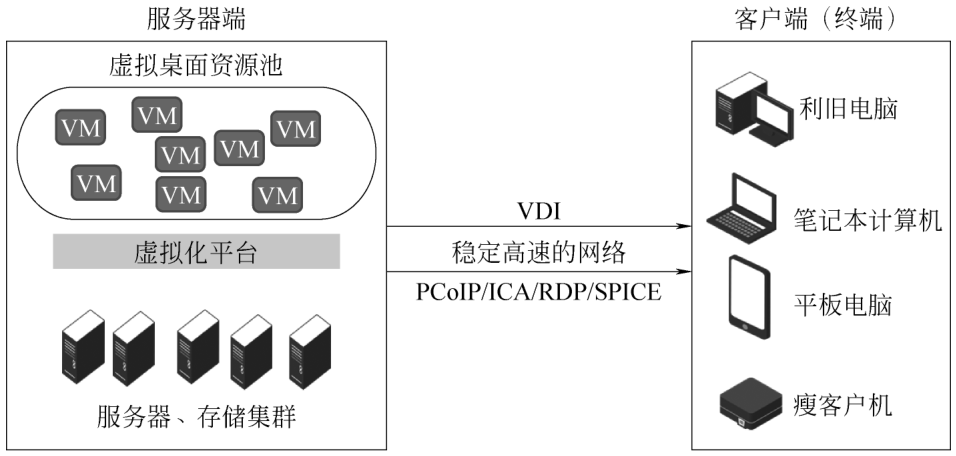{ loading=lazy }

图 2-40 VDI 架构
{ .fig-caption }

（1）技术原理。

VDI 架构是将桌面环境在云端的服务器上进行虚拟化。每台虚拟桌面运行在一个独立的虚拟机中。用户通过远程连接协议（如 RDP、PCoIP 等）从各种终端设备（如瘦客户机、普通 PC、笔记本计算机、平板电脑等）连接到云端的虚拟桌面。例如，企业员工可以在公司的瘦客户机上连接到部署在数据中心的虚拟桌面，进行日常办公操作。在 VDI 架构中，所有的计算、数据存储和应用程序执行都发生在云端服务器上，终端设备主要负责用户输入（如键盘、鼠标操作）的传输和显示输出。

（2）技术特点。

灵活性高：用户可以在任一地点，使用各种设备访问自己的虚拟桌面。只要网络条件允许，无论是在办公室、家中还是在出差途中，用户都能获得一致的桌面体验。

资源集中管理：桌面资源集中在云端服务器，方便 IT 管理人员进行集中配置、更新和维护。例如，企业 IT 部门可以在服务器端批量安装软件更新，而无须逐台管理物理设备。

数据安全：由于数据都存储在云端数据中心，不直接存储在本地终端设备上，因此降低了因设备丢失或被盗而导致的数据泄露风险。同时，数据中心可以采用高级别的安全防护措施，如防火墙、入侵检测系统等，保护数据安全。

性能要求较高：因为所有的计算和数据处理都在云端进行，所以对服务器的性能要求较高。而且，网络带宽和质量也会影响用户体验。如果网络延迟过高或者带宽不足，可能会出现桌面卡顿、应用程序响应缓慢等问题。

（3）适用场景。

VDI 架构适合对数据安全要求较高、需要灵活办公场景的企业。例如，金融机构的办公环境，员工需要处理大量敏感的客户财务数据，使用 VDI 架构可以确保数据存储在安全的数据中心，同时员工可以在不同的办公地点访问自己的桌面。它也适用于有大量临时员工或分支机构的企业，方便快速为这些用户提供更灵活的桌面资源。

### 2.6.2.2 IDV 架构 {#2622}

智能桌面虚拟化（intelligent desktop virtualization，IDV）架构的操作系统和软件在后台服务器的虚拟机上安装，同时将虚拟机文件统一下发到终端，并运行于终端（将虚拟化搬到了本地终端上），服务器不承担计算任务。由于本地增加了一层虚拟化，上层调用硬件资源时，中间要跨一层，因此本地性能会有所损失。另外，上层的 OS 需要穿透虚拟化层才能和各类外设打交道，因此会存在外设兼容性问题。IDV 架构如图 2-41 所示。

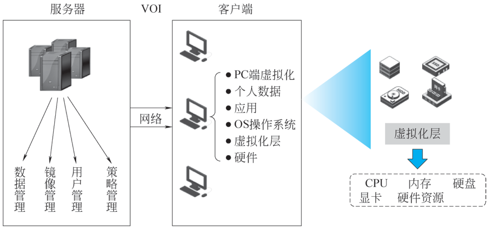{ loading=lazy }

图 2-41 IDV 架构
{ .fig-caption }

（1）技术原理。

IDV 架构将虚拟桌面的计算任务主要放在本地终端设备上，而云端主要负责桌面镜像的管理和分发。云端服务器会将虚拟桌面镜像（包含操作系统、应用程序等）推送到本地终端设备，终端设备根据镜像构建自己的桌面环境。例如，在学校的计算机教室场景中，教师可以通过云端将统一的教学桌面镜像推送到教室中的每台终端设备上，学生在本地终端上运行应用程序，进行学习操作。

（2）技术特点。

本地计算优势：由于计算主要在本地终端完成，对云端服务器的依赖相对较小，可以减少网络带宽的占用。即使网络出现短暂的波动或故障，本地终端在一定程度上仍然可以继续运行已经加载的应用程序。

快速部署和个性化配置：云端可以快速将标准化的桌面镜像部署到大量终端设备上，快速实现桌面环境搭建。同时，允许用户在本地终端上进行个性化的配置和数据存储。例如，在企业环境中，员工可以根据自己的工作习惯在本地终端上设置快捷方式、收藏夹等内容，而这些个性化设置不会影响云端镜像。

终端设备要求较高：本地终端设备需要具备一定的计算能力来运行虚拟桌面环境。因此，对于性能较差的终端设备，可能会出现运行不流畅的情况。

（3）适用场景。

IDV 架构适合于一些对本地计算性能有一定要求，且需要快速部署桌面环境的场景，如学校的计算机机房，学生需要在本地终端上运行各种软件，进行编程、设计等操作。IDV 架构可以快速为每个终端提供统一的软件环境，同时允许学生进行个性化的操作。它也适用于企业中对网络带宽有限制，但又需要为员工提供一定计算能力的办公场景。

### 2.6.2.3 VOI/TCI 架构 {#2623}

虚拟操作系统基础架构（virtual operating infrastructure，VOI）/ 透明终端架构（transparent client infrastructure，TCI）由服务器来管理操作系统镜像，并下发给终端，操作系统运行于终端本地硬件上。计算任务完全由终端承担，服务器只负责镜像管理、镜像上传下载及终端的管理工作。

TCI 为 Intel 认可的 VOI 技术，具备大厂技术保障，主板支持统一可扩展固件接口的老旧 PC 可纳入平台统一管理。VOI 架构如图 2-42 所示。

（1）技术原理。

VOI 架构是一种基于网络启动的桌面虚拟化架构方式。终端设备通过网络从云端服务器获取操作系统镜像，并在本地内存中运行操作系统。所有的系统配置、应用程序安装和更新等操作都在云端服务器上进行统一管理。当终端设备启动时，它会从云端加载最新的操作系统镜像到本地内存中运行。

（2）技术特点。

集中管理与统一性：操作系统镜像在云端集中管理，确保所有终端设备都使用相同的标准镜像。这使得桌面环境的一致性得到很好的保证，方便统一管理和维护。例如，在连锁企业中，通过 VOI 架构可以确保每个门店的终端设备都使用相同的操作系统配置和应用程序版本。

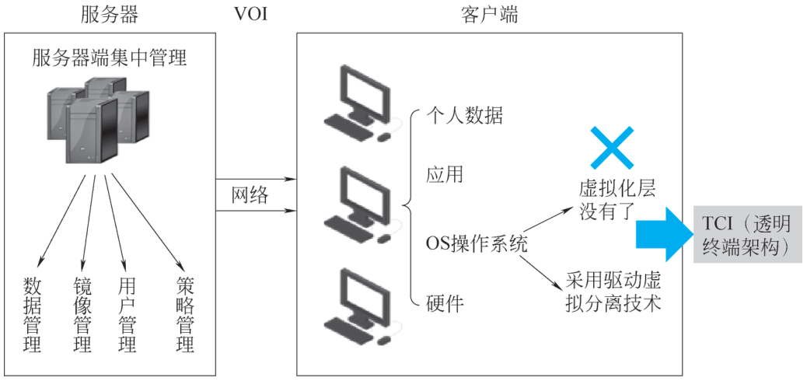{ loading=lazy }

图 2-42 VOI 架构
{ .fig-caption }

对终端硬件要求较低：终端设备主要作为“显示终端”，大部分计算和存储任务都在云端服务器完成。这使得 VOI 架构可以利用较为低端的终端设备，降低硬件成本。

（3）适用场景。

VOI 架构适用于对桌面环境一致性要求高、终端设备较多且集中管理需求强烈的场景，如政府机关的办公环境，需要确保所有办公终端使用统一的操作系统和安全策略。VOI 架构可以方便地实现集中管理，同时在终端设备出现故障时能够快速恢复。它也适用于网吧等场景，网吧的计算机需要快速启动、提供统一的软件环境、方便地进行系统更新和恢复。

**动手看看 · 三种桌面云架构**

VDI、IDV、VOI/TCI 的根本区别在于：操作系统在哪里运行、计算在哪里完成、网络断了还能不能用。在下面的动画里切换三种架构，再试试“断网”和“换一台终端”会发生什么。

<iframe class="sim-frame" src="../../sims/vdi-arch/main.html" height="580" loading="lazy" title="三种桌面云架构"></iframe>

点上方按钮切换架构，点“断开网络”和“换一台终端登录”看结果；下方表格比较三种架构的特点。[全屏打开](../../sims/vdi-arch/main.html){ target=_blank } · [教学说明](../../sims/vdi-arch/index.md)
{ .sim-caption }

### 2.6.2.4 三种桌面云架构对比 {#2624}

三种桌面云架构中，VDI 架构数据安全性高、管理集中、支持桌面移动性，但对网络依赖性强，外设兼容性稍弱；IDV 架构支持离线办公、桌面性能好、兼容性佳，但管理复杂、对终端性能要求高；VOI 架构存储压力小、支持离线运行、数据安全高、桌面性能接近传统 PC，但网络依赖性高、管理维护复杂。三种桌面云架构对比见表 2-7。

表 2-7 三种桌面云架构对比
{ .tab-caption }

| 桌面云架构 | 服务器 | 终端 | 优势 | 劣势 |
|---|---|---|---|---|
| VDI 架构 | 购买服务器后，数据计算与存储都在服务器上 | 瘦终端 | 资源弹性分配；数据安全性强；vGPU 能力强；随时随地可访问接入；支持利旧，分期部署 | 网络依赖程度高，使用流畅度略差于传统 PC |
| IDV 架构 | 只需一台服务器即可，数据计算与存储就在本地终端 | 胖终端 | 断网亦可使用；系统兼容性好（八代及以上的 CPU 兼容 Windows 10）；服务器故障无影响 | 有一定的性能损耗，终端兼容性差，移动性较差，安全性较差，无弹性资源 |
| TCI/VOI 架构 | 只需一台服务器即可，数据计算与存储就在本地终端 | 胖终端 | 断网亦可使用；性能、流畅性等同于 PC；外设兼容性好，服务器故障无影响；支持利旧，分期部署 | 移动性较差，安全性较差，无弹性资源 |

总结：VDI 市场和 IDV、VOI 市场直接竞争是较少的，因为优劣势都很明显，其均有各自领域的应用场景。若是在高安全、移动办公、弹性扩容、数据安全、vGPU 切分等提高效率的场景，VDI 架构有较大优势；若是在高负载场景、离线办公场景，IDV、VOI 架构还是有优势的。但是在云计算技术应用上，仍以 VDI 架构为主，因此以下将详细介绍 VDI 桌面云技术。

## 2.6.3 VDI 桌面云的关键技术 {#263}

??? abstract "拓展阅读（点击展开原书本小节全文）"

    ### 2.6.3.1 VDI 整体技术框架 {#2631}

    业界主流基于 VDI 架构实现的桌面云方案，其主要包含 3 个必备组件———接入终端（VDI Client）、虚拟桌面接入管理系统（VDC）、超融合平台（HCI），3 个可选组件———统一授权中心 SCP、智能运维平台 IOM、报表中心，如图 2-43 所示。

    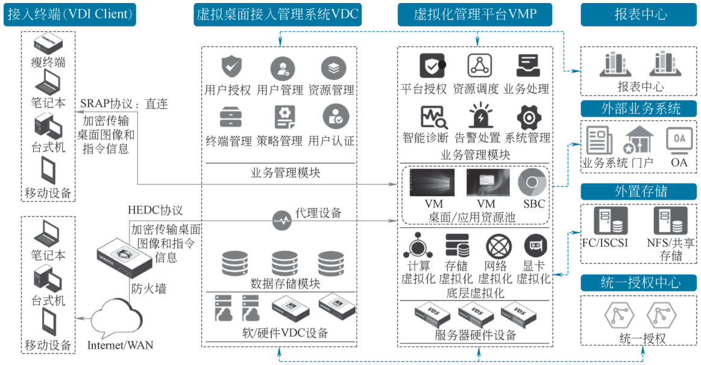{ loading=lazy }

    图 2-43 VDI 桌面云架构图
    { .fig-caption }

    （1）接入终端。

    瘦终端：aDesk ARM 瘦终端、aDesk X86 瘦终端、aDesk 国芯瘦终端。瘦终端支持长时间稳定使用。平均功耗仅 10 W，相对普通 PC 台式机可节省 10 倍电力成本，采用无风扇运行，全程无噪声。

    PC 与笔记本计算机：Windows、Linux（Ubuntu、Centos、麒麟、统信 UOS）、苹果 Mac OS 等。

    移动终端：Android、iOS、华为 HarmonyOS 等。

    （2）虚拟桌面接入管理系统。

    虚拟桌面接入管理系统（virtual desktop controller，VDC）是桌面云平台的核心管理组件，它具有多个管理模块，包括用户管理、认证管理、资源管理、安全管理、策略管理、终端管理等，能够实现安全、可靠的桌面云部署。此外，VDC 还支持软件和硬件多种形态部署，用户可以根据自己的需求进行灵活部署和管理。

    （3）虚拟化管理平台。

    虚拟化管理平台依托于超融合设备的一体化平台，是能够集计算虚拟化、存储虚拟化（按许可使用）、网络虚拟化、安全虚拟化于一体的超融合基础架构平台，为桌面云虚拟机的运行、存储、连通提供强大支撑。

    （4）智能运维平台。

    智能运维（intelligent operation and maintenance，IOM）平台是一个集精细化监控分析与智能诊断于一体的软件运维平台，提供业界领先的桌面云监控分析与智能诊断方案，可以侦测并发现 70% 以上的桌面云性能使用瓶颈相关问题，并能够按需提供优化解决方案。平台具有大屏监控、图谱分析、智能分析、设备监控、报表中心五大管理模块，可以提供用户会话、应用程序、桌面云虚拟机、物理主机、虚拟化集群的资源监控、使用趋势分析、健康状态评分、智能排障等全方位、全流程的智能运维功能。

    （5）报表中心。

    报表中心可以记录和展示 HCI 集群、服务器 CPU、内存、存储的使用详情，可以记录管理员设置的用户权限变更详情，同时可以在报表中记录和展示用户登录信息、用户文件导出审计信息、用户剪贴板审计信息和导出文件备份信息等，满足安全审计需求。

    ### 2.6.3.2 组件间交互流程 {#2632}

    桌面云组件间通信比较简单，用户输入登录账号并单击 VDI Client 上的登录按钮后，VDI Client 向管理中心发送认证请求，如果认证失败，则提示认证失败。认证成功后，VDI Client 向管理中心发送配置、资源请求，并显示资源列表。

    用户单击资源页面的资源图标，开始跟虚拟化平台建立连接，连接通过后，用户可以接收虚拟化平台的图像数据，如图 2-44 所示。

    交互步骤如下。

    步骤 1：用户在 VDI Client 输入账号和密码，并单击登录。VDI Client 通过 HTTPS 向 VDC 发送认证请求，支持的主认证方式有用户名密码、U-Key、数字证书，辅助认证方式有硬件特征码、短信验证码、动态令牌认证，主认证和辅助认证可以自由组合。VDC 认证成功后，把结果返回给 VDI Client。

    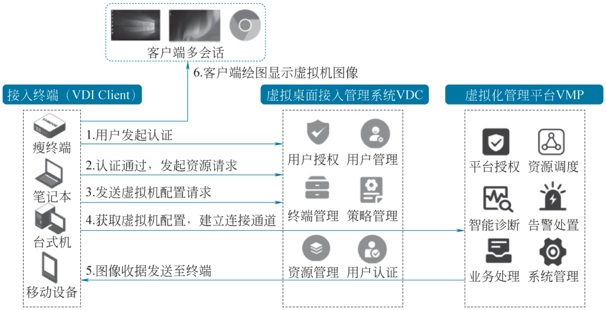{ loading=lazy }

    图 2-44 桌面云组件间交互流程图
    { .fig-caption }

    步骤 2：认证通过，VDI Client 通过 HTTPS 向资源列表发送请求，VDC 把该用户相关的资源返回给客户端，VDI Client 把资源显示出来。

    步骤 3：用户单击资源图标时，VDI Client 通过 SSL 连接向 VDC 发送该虚拟机资源的配置信息，VDC Client 把该虚拟机资源的外设权限、显示配置、连接地址等配置信息返回给 VDI Client。

    步骤 4：VDI Client 拿到虚拟机的配置后，解析部分配置，与 HCI 建立协议通道连接，并与 HCI 进行功能协商及协议认证校验（防止非法接入）。VDI Client 和 HCI 建立通道后，虚拟机有画面变化时，QXL 驱动通知虚拟化平台的虚拟化服务端。

    步骤 5：虚拟化服务端对图形命令进行编码压缩并做去重处理，处理后将数据发送给 VDI Client。

    步骤 6：VDI Client 收到图像命令时，对图像进行解码，并调用系统绘图接口完成绘制。

    ### 2.6.3.3 终端优化技术 {#2633}

    VDI 架构的桌面云终端主要是瘦终端。随着国产化要求的推进，我国研制出了多种芯片架构（如 ARM 架构、飞腾、X86 架构）的瘦终端。云终端架构说明见表 2-8。

    表 2-8 云终端架构说明
    { .tab-caption }

    | 芯片架构 | 终端示例 | 应用场景 |
    |---|---|---|
    | ARM 架构 | STD-100、STD-200H | 1. 普通办公和学生机房，如课堂、无纸化考场、办公等； 2. 2D 设计和视频监控，如多媒体教室 |
    | ARM 架构 | STD-PRO-200H | 物理双网隔离场景，如在公安、检察院、法院等重要单位的网络隔离场景 |
    | 飞腾 ARM | GT-1000 | 国产精简麒麟，如果有国产化明确要求的时候可以采用本终端实现 |
    | X86 架构 | STD-620 | 采用双屏显示/无损 3D，有多屏显示需求的时候，可以采用该终端 |

    #### 1. 显示优化

    （1）在原生系统基础上优化显示框架，实现显示透传。

    （2）基于终端硬件平台，利用硬件特性进行算法相关的硬件加速。

    （3）光标优化：本地光标提升鼠标的操作体验。

    （4）视频类场景的重定向：提升了场景体验的同时，还缓解了虚拟机资源压力。

    #### 2. 音频优化

    （1）声卡兼容，可以主动识别切换声卡。

    （2）本地声卡优化，缩短了声音回路周期，提升了声音场景下的实时性。

    （3）声卡硬件控制，可以本地化控制声卡来优化声音质量。

    #### 3. 外设优化

    （1）优化终端系统的 USB 主控驱动，从而提升 USB 兼容性。

    （2）结合终端系统特性对高拍仪进行优化，提升体验的同时极大地减少了该场景中终端接入所需要的网络带宽压力。

    （3）USB 存储设备传输优化，突破了原有桌面云协议上的流量束缚，从而达到高速率传输。

    #### 4. 终端本地系统优化

    （1）精简系统，去除非必要的原生系统服务，集中资源分配给桌面云业务使用，提升硬件资源的利用率，同时进行底层系统安全加固，提高安全性。

    （2）管理平台可以统一管控终端的应用安装权限、接入合法性，增强终端接入的安全性。

    ### 2.6.3.4 传输协议技术 {#2634}

    传输协议技术是指在虚拟化/云桌面场景中，通过带外加密通道将服务器端画面、音频、外设信号实时编码传输至终端，实现显示器与计算分离、智能压缩、低延迟交互，并兼顾带宽节省与数据安全的一整套协议与算法体系。常见的技术特点如下：

    （1）传输协议只要打通终端和服务器的网络，终端与虚拟机不直接通信（带外协议，网络无惯性特征），且传输数据加密，支持 AES 加密，这样更有利于虚拟机的数据安全。

    （2）协议支持查看虚拟机开机过程及蓝屏界面，与物理机体验保持一致。

    （3）协议的显示信息处理部分在虚拟化层完成，不在虚拟机内部完成，虚拟机 CPU 资源不需要用于图像处理，且协议数据传输不在虚拟机内进行，不影响虚拟机流量。

    （4）局域网 SRAP 协议支持高清无损显示，可以实现高达 30 帧/秒的视频播放效果。可智能识别视频流，精确识别视频区域，对视频区域数据进行有损编码，对非视频区域采用高性能压缩，保证非视频区域画质的清晰度，同时降低整体传输流量。

    （5）广域网 HEDC 协议，通过缓存算法将图像数据缓存命中率提升至 95% 以上；同时，图文分类技术能够精准识别自然、文本以及图文混排类型图片，精准拆分自然图像和非自然图像。其中，自然图像采用压缩处理，非自然图像则保持无损状态，以此降低流量消耗，能够实现在 50 ms 延时、600 KB 带宽条件下的普通办公场景需求。

    ### 2.6.3.5 外设重定向技术 {#2635}

    桌面外围设备简称“外设”，是指连在桌面终端侧（VDI Client）外围的硬件设备。外设起着传输、转送和存储数据及信息的作用，是深信服桌面云系统中的重要组成部分。桌面云外设重定向架构如图 2-45 所示。

    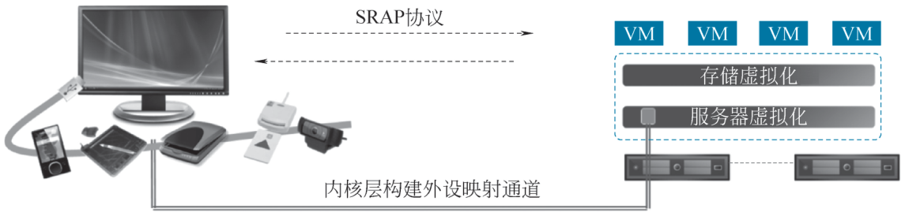{ loading=lazy }

    图 2-45 桌面云外设重定向架构
    { .fig-caption }

    外设按使用的接口类型划分，主要分为 USB 口、串口、并口；按提供的功能划分，则种类繁多，如 U 盘、移动硬盘、摄像头、加密狗、打印机、扫描仪等。

    外设重定向技术是指在桌面云场景下，把桌面终端侧的外围设备，通过 HEDC 协议映射到虚拟机中，并能通过虚拟机使用这些外围设备的技术。不同类型的外设可能使用不同的外设重定向技术，如 U 盘、证件阅读器等外设使用通用 USB 重定向技术，USB 摄像头、串口、并口则有特定的重定向技术。

    目前，外设重定向技术主要分为两大类：通用 USB 映射、特殊优化的外设映射。外设重定向技术模块功能见表 2-9。

    表 2-9 外设重定向技术模块功能
    { .tab-caption }

    | 名称 | 功能介绍 |
    |---|---|
    |  | 功能描述：HEDC 协议完成桌面终端侧的 USB 接口类外围设备到远程桌面的映 |
    | 通用 USB 映射 | 射，并为其提供底层驱动消息传输的专用通道。使用范围：使用 USB 接口的设备，如 USB 打印机、U 盘等。 |
    |  | 支持终端：所有接入终端 |
    |  | 功能描述：HEDC 协议完成桌面终端侧的串口接口类外围设备到远程桌面的映射， |
    | 串口重定向 | 并为其提供底层驱动消息传输的专用通道。使用范围：使用串口接口的设备，如串口打印机、串口扫描器等。 |
    |  | 支持终端：PC 客户端 |
    |  | 功能描述：HEDC 协议完成桌面终端侧的并口接口类外围设备到远程桌面的映射， |
    | 并口重定向 | 并为其提供底层驱动消息传输的专用通道。使用范围：使用并口接口的设备，如并口打印机等。 |
    |  | 支持终端：PC 客户端 |
    |  | 功能描述：HEDC 协议完成桌面终端侧高拍仪/摄像头类设备到远程桌面的映射， |
    | UVC 优化重 | 并为其提供业务数据传输的专用通道。 |
    | 定向 | 使用范围：视频设备，如摄像头、高拍仪等。 |
    |  | 支持终端：所有接入终端 |
    |  | 功能描述：HEDC 协议完成桌面终端侧扫描仪类外围设备到远程桌面的映射，并 |
    | 扫描仪优化 | 为其提供底层驱动消息传输的专用通道。 |
    | 重定向 | 使用范围：特殊的 USB 设备，如中断非缓存模式的 USB 设备等。 |
    |  | 支持终端：ARM 客户端 |
    |  | 功能描述：HEDC 协议完成桌面终端侧特殊的 USB 接口类外围设备到远程桌面的 |
    | 解码解压 | 映射，并为其提供底层驱动消息传输的专用通道。使用范围：特殊的 USB 设备，如中断非缓存模式的 USB 设备等。 |
    |  | 支持终端：所有接入终端 |
    |  | 功能描述：HEDC 协议完成桌面终端侧的 USB 接口类外围设备到远程桌面的映 |
    | 网络模块 | 射，并为其提供底层驱动消息传输的专用通道。使用范围：使用 USB 接口的设备，如 USB 打印机、U 盘等。 |
    |  | 支持终端：所有接入终端 |

    桌面云通过深度融合在虚拟化底层进行外设映射，即无须改变和依赖虚拟机操作系统，保留了和 PC 一样的总线通道，这样可以完全消除总线和设备驱动的对接问题，极大提升兼容性，让用户可以像在 PC 上一样使用各种外设。

    ### 2.6.3.6 多场景应用技术 {#2636}

    #### 1. 独享桌面

    （1）功能概述。

    独享桌面基于 QEMU/KVM 虚拟化技术，在虚拟化平台上创建多个虚拟机，用户通过 HEDC 协议接入这些虚拟机工作，使用时独享一个虚拟机。独享桌面支持常用 PC 外设，包括显示器、音频设备、键盘、鼠标、USB 设备。为提升操作体验，独享桌面 Agent 提供了剪贴板、视频重定向、串口重定向等功能。

    （2）技术原理。

    在终端直连虚拟机场景下，独享桌面架构如图 2-46 所示。QEMU 创建虚拟机后，通过模拟设备和虚拟机内驱动通信，获得图像数据、外设命令及协议栈自定义数据。这些数据经过 HEDC 协议栈编码，由多个网络通道发送到客户端。已支持的通道如下。

    ① MAIN：主通道，最先建立的通道，主要起控制作用，负责创建其他通道。HEDC 在原协议的基础上，扩展增加动态通道的功能，用于剪贴板、支持视频重定向等数据的传输。

    ② DISPLAY：显示通道，处理图形命令、图像和视频流。

    ③ INPUT：输入通道，处理键盘、鼠标消息。

    ④ CURSOR：光标通道，负责处理光标位置、可见性、图标显示等相关信息。

    ⑤ PLAYACK：音频回放通道，Client 接收 Server 发来的音频流并在客户端播放。

    ⑥ RECORD：音频录音通道，Client 发送客户端捕获的音频数据给 Server。

    ⑦ USBREDIR：USB 设备重定向通道，支持 U 盘、摄像头、读卡器等 USB 设备。

    终端通过这些通道收发数据，为用户提供操作界面。目前支持的主流操作系统有瘦终端、PC 客户端、移动端等。

    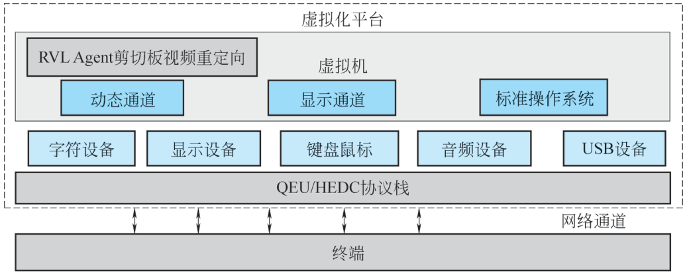{ loading=lazy }

    图 2-46 独享桌面架构
    { .fig-caption }

    （3）技术价值。

    独享桌面的核心技术价值在于安全性好、运维效率高。

    在安全方面，用户的数据都在服务器的虚拟机上，在操作过程中，数据不落到本地。虽然终端可以通过网络通道访问虚拟机，但这些通道都受控，可以加权限限制，如设置 U 盘只读，或者监控数据传输，如审计剪贴板数据。相比传统加密软件，独享桌面极大降低了数据泄露风险，提升了业务安全性。

    在运维方面，相比 PC 的分散式管理，虚拟化平台在机房统一管理用户的虚拟机，节省了维护时间。相比传统 PC，虚拟机可动态调整配置，在硬件更新上更加便捷、节省成本。虚拟化平台还提供了模板一键部署、池桌面等功能，方便管理大量虚拟机。

    #### 2. 共享桌面

    共享桌面和远程应用架构一样，但共享桌面发布的是桌面。用户在操作共享桌面时，和独享桌面一样，可以看到服务器上的桌面、任务栏，可以自由启动应用程序。共享桌面采用 Windows Server 的会话隔离机制实现用户间数据隔离，一些操作系统内的共享资源可能会突破隔离限制，如本地磁盘、注册表。

    安装在共享桌面内的 Agent 模块实现了高级权限控制，可以限制用户在共享桌面内的行为（如打开任务管理器、打开资源管理器、读写本地磁盘协议上）。同时，基于 HEDC 协议，Agent 模块做了一些安全和体验上的改进：剪贴板支持双向拷贝控制，服务端向本地、本地向服务端的拷贝都可以开启和关闭；本地磁盘和 U 盘支持配置只读模式，可配置 U 盘黑白名单；PC 客户端可防止截屏和录屏；虚拟打印支持通过流量优化的通道将服务器文件打印到本地打印机。

    #### 3. 远程应用

    （1）功能概述。

    远程应用扩展了桌面发布协议，提供了类似本地应用的体验。在访问远程资源时，用户看到的不再是桌面，而是应用窗口。

    远程应用支持的服务端为 Windows Server 操作系统。基于 Windows Server 的多会话架构为每个用户分配一个会话，运行应用。相比虚拟化架构，多会话架构没有虚拟化损耗，资源消耗更少，可以支撑更多并发。

    （2）技术原理。

    远程应用架构如图 2-47 所示，各角色功能如下。

    ① VDC：管理应用服务器，包括下发的组策略、性能监控、负载均衡调度等；在客户端请求资源时，选择合适的服务器启动远程应用。

    ②应用服务器池：在部署阶段，管理员安装远程应用 Agent 和需要运行的应用程序；在运行阶段，应用服务器创建会话，启动应用程序。远程应用 Agent 在会话启动后，挂载 NAS 存储，用于应用程序数据持久化。

    ③ NAS 存储：存储文件数据，远程应用通过网络读写这些文件。用户只能访问自己创建的文件，用户间文件通过权限控制隔离。

    在这种架构下，应用服务器上的应用和数据分离。VDC 根据各服务器 CPU、内存、I/O 情况，调度远程应用到合适的服务器上运行，以获得最优体验。在应用服务器故障、扩缩容时，系统可秒级重启远程应用，恢复业务。HEDC 协议示意如图 2-48 所示。

    远程应用基于 HEDC 协议实现，HEDC 协议是一个桌面发布协议，为了得到应用图像，远程应用增加了窗口位置跟踪模块。用户打开远程应用后，窗口位置跟踪模块实时检测应用

    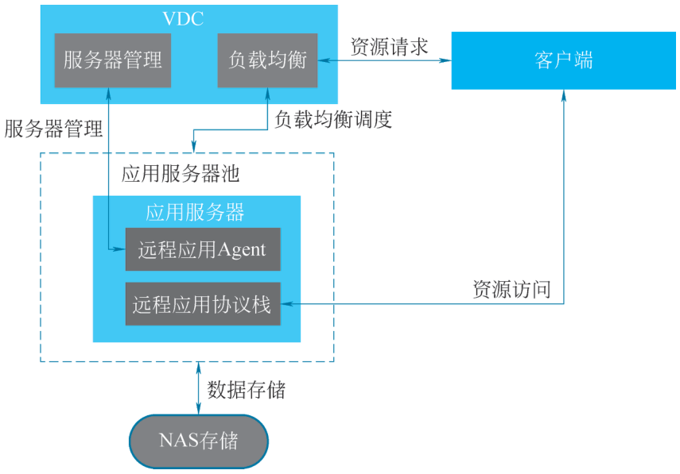{ loading=lazy }

    图 2-47 远程应用架构
    { .fig-caption }

    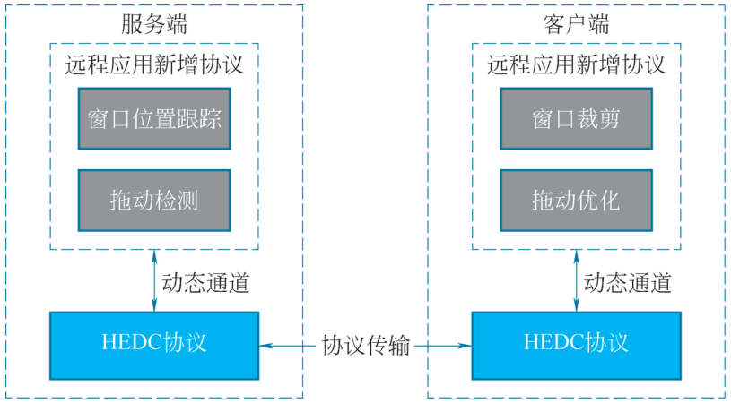{ loading=lazy }

    图 2-48 HEDC 协议示意
    { .fig-caption }

    所有窗口的特征，包括位置、图标、标题等。然后将窗口特征编码发送到客户端，客户端的窗口裁剪模块解析这些数据，将 HEDC 协议生成的桌面图形裁剪为应用窗口图像，在本地显示。除了窗口裁剪，客户端还会在本地任务栏生成远程应用的图标，本地托盘生成远程应用的托盘。

    （3）技术价值。

    在体验上，远程应用将 Windows Server 服务器的应用发布到本地使用，用户操作远程应用看到的是应用窗口，而且可以通过本地任务栏、托盘调整窗口属性，获得和本地应用一致的体验。

    在成本上，远程应用利用 Windows Server 的多会话机制支持多路用户接入，省去了虚拟化额外的资源开销。应用和数据分离的架构伸缩性强，能快速适应业务变化，成本控制更灵活。

    远程应用由于基于 HEDC 协议栈实现，在广域网、3D 场景体验上和 VDI 有差距，后续将接入最新的 VDI 协议栈，提升操作流畅性。

    #### 4. 物理 PC 托管

    物理 PC 托管是指将用户自有或租用的物理 PC 整机托管于数据中心，平台通过带外采集卡或 IP-KVM 把显卡输出、USB 外设信号转换成云桌面协议流；用户侧只接收画面与键鼠，数据不落地。其既保留本地 GPU/加密狗等硬件兼容性，又获得数据中心级供电、带宽、远程维护与容灾能力，实现“物理机性能+云桌面运维”的统一交付模式，常见的技术应用在 3D（指具备高端 3D 图形处理与并行计算能力的专业计算机）场景。

    （1）功能概述。

    3D 客户有部分重载的设计、仿真、渲染场景诉求，使用深信服当前的 VGPU 方案仍存在因硬件瓶颈导致的卡顿、卡慢问题。在此场景下，部分客户采用 3D 工作站（物理主机）来处理重载图纸的设计需求，但随之而来的就有安全管控难、与 VDI 配合使用入口不统一的问题。

    3D 工作站纳管提供一种解决方案，将 3D 工作站（物理主机）纳入 VDC 进行管理和策略控制，用户通过 VDI 客户端统一接入使用。

    （2）技术原理。

    本特性的关键原理为实现 3D 纳管协议来支持纳管机器的协议传输，可以理解为将原来在 HCI（原 VMP）中的 HEDC 协议代理程序运行在 3D 纳管工作站中。如图 2-49 所示。

    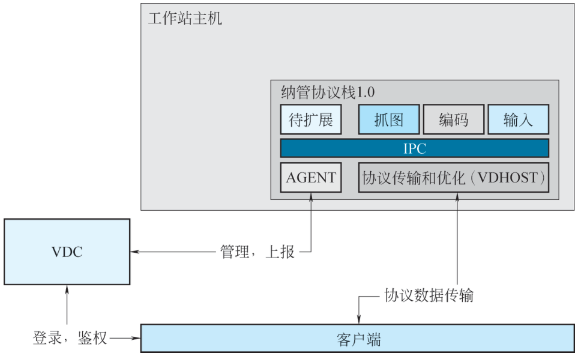{ loading=lazy }

    图 2-49 3D 纳管协议示意图
    { .fig-caption }

    ①在 3D 纳管协议中实现抓图、编码等模块，来提供桌面图像；

    ②传输协议主要用于将工作站桌面图像传输到客户端，实现主体基于 VDI SGAX2.0 算法；

    ③ VDC 主要承担管理相关功能，负责用户登录鉴权、工作站资源分配、工作站资源管理工作。

    A. Agent 安装。只有安装的工作站 Agent 的 3D 工作站才能被 VDC 进行管理。工作站 Agent 里包含 3D 纳管协议和业务应用程序（可以类比理解为 VDI Agent）。

    B. 工作站资源管理。安装了 Agent 的工作站主机，会上报工作站信息到 VDC，VDC 可以对工作站进行管理：将工作站进行资源管理，如专用模式、池模式；管理工作站的自动登录（单点登录）模式；将工作站资源关联用户。

    a. 专用模式：单台工作站供单人使用，绑定用户后，此工作站仅可供绑定的用户使用，其他用户不可使用；

    b. 池模式：单台或多台工作组成资源池，关联此资源的多个用户接入后从资源池中选择空闲的资源接入，用户退出后，释放此资源。

    C. 客户端接入。工作站资源关联用户后，用户在客户端（当前仅支持 PC 客户端和 X86 STD600 客户端）登录后，可查看到工作站资源，可通过客户端接入工作站，其操作流程与 VDI 相同。

    D. 自动登录。客户端登录通过后，可根据策略自动登录到工作端，无须二次登录，自动登录有以下三个可选策略。本地用户：所有的用户登录 VDI 后，工作站均使用指定的用户进行自动登录；域用户：使用域用户登录，前提是需要手动将工作站加入域；配置 VDI 账号：用户登录 VDI 后，将会在工作站中创建与 VDI 账号相同的 Windows 账号，并使用此账号登录到 Windows。

    E. 工作站策略管理。在策略管理中，可针对工作站配置相应工作站策略，一期仅支持帧率和码流配置，后续会增加安全策略，如剪贴板管控、水印等。

    （3）技术价值。

    支持将 3D 工作站（物理主机）纳入 VDC 进行管理和策略控制，用户通过 VDI 客户端统一接入使用。其主要价值如下：

    ①支持使用 VDI 客户端接入，统一接入入口，提升使用体验；

    ②支持对工作站进行管理，如开机、关机、资源分配等，提升管理员的运维能力；

    ③通过协议优化，在帧率和流量上超越 mstsc，使用体验超越 mstsc；

    ④支持对工作站的策略管理，提升安全性；

    ⑤后续可扩展支持对 2D 物理主机纳管。

    ### 2.6.3.7 桌面云 vGPU 技术 {#2637}

    GPU 硬件虚拟化就是根据显存大小将显卡进行切片，并将这些切片分配给虚拟机使用。支持硬件虚拟化的显卡可以根据需要切分成不同规格的时间片，进而可以分配给多台虚拟机使用。以英伟达 Tesla M60 为例，单个显卡最多可以虚拟化出 16 个 vGPU，支持 16 个用户同时使用。M10、M60、P40、T4、L20、H20、RTX6000、RTX8000 显卡可以根据不同场景和负载的需求，虚拟出不同规格的 vGPU，并能支持在具有相同显卡型号的 3D 服务器之间启动 3D 虚拟机，这些都是新一代显卡虚拟化比较突出的特色功能。桌面云 vGPU 示意如图 2-50 所示。

    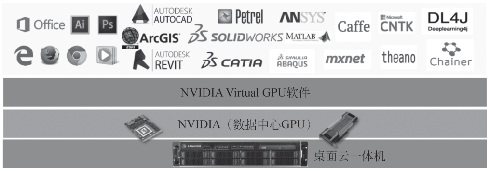{ loading=lazy }

    图 2-50 桌面云 vGPU 示意
    { .fig-caption }

    #### 1. 显卡类型和切分

    vGPU 技术支持多种不同的显卡切分类型，管理员在设置虚拟机时可以根据用户的需求灵活分配显卡资源。显卡的切片最小范围为一个物理核心，不同的物理核心可以做不同的切片。例如，M10 有 4 个物理核心，在一张卡上最多可以支持 4 种不同的切片类型。常见的显卡切分见表 2-10。

    表 2-10 常见的显卡切分
    { .tab-caption }

    |  | 直通 |
    |---|---|
    |  | NVIDIA GRID T4-1B |
    |  | NVIDIA GRID T4-2B |
    | T4 | NVIDIA GRID T4-1Q |
    |  | NVIDIA GRID T4-2Q |
    |  | NVIDIA GRID T4-4Q |
    |  | NVIDIA GRID T4-8Q |
    |  | 直通 |
    |  | NVIDIA GRID RTX6000-1B |
    |  | NVIDIA GRID RTX6000-2B |
    | RTX6000 | NVIDIA GRID RTX6000-1Q NVIDIA GRID RTX6000-2Q |
    |  | NVIDIA GRID RTX6000-4Q |
    |  | NVIDIA GRID RTX6000-8Q |
    |  | NVIDIA GRID RTX6000-12Q |

    #### 2. 技术优势

    （1）vGPU 技术具备可扩展性高、可维护性强，硬件显卡上市后依然可以持续迭代升级。

    （2）依托 Cuda 生态加持，视频编码效果更好，在设计场景中显卡性能能够得到最优发挥。

    （3）通过 CAD 光标优化算法，自研 CAD 插件，精准识别 CAD 光标并重定向到客户端绘制显示，达到与使用物理机光标相同的效果，业界体验最优。

    （4）支持 3D 图像无损编码及无损显示，保证 3D 设计场景图像显示体验。

    #### 3. vGPU 资源可视化

    vGPU 由于其定位和价格，在桌面云系统中通常作为稀缺资源存在。管理员能直观地看到 GPU 资源的利用情况和空闲情况，最大化合理利用资源。

    桌面云允许管理员在控制台上看到每个显卡的切分情况。平台页面能基于每个核心提示虚拟机使用情况以及整体的 vGPU 已占用情况。

    #### 4. vGPU 资源池化调度和负载均衡

    在 vGPU 模式下，整个集群中的 GPU 资源会作为一个资源池灵活地调度给最终用户使用，用户关机后会自动释放授权和硬件资源到资源池。显卡的分配模式有两种，分别是密度模式和性能模式，这两种模式的调度范围为同一个主机内部的同一张显卡。

    （1）密度模式：在主机内部，若多个虚拟机配置相同切片模式的虚拟显卡（如均为 2 GB 显存），调度器会优先将它们集中在同一物理 GPU 核心上运行，从而空出更多完整核心，供其他切片模式或整卡模式的虚拟机使用。该模式适用于存在多种虚拟显卡规格且虚拟机频繁开关机的场景，可提升 GPU 资源利用率并降低碎片率。

    （2）性能模式：主机为 3D 虚拟机优先绑定当前显存剩余最多、计算单元最完整的 GPU 核心，确保每台新启动的虚拟机立即获得最大可用算力；该模式适用于同规格虚拟显卡占主流、追求极致图形性能的场景，可显著降低 GPU 资源争用，保障单虚拟机渲染与计算体验。

    #### 5. 自动调整显卡配置

    GPU 虚拟机启动时，平台会检测是否存在空闲的同类 GPU 资源，若有则会自动调整物理 GPU 配置，使其与 GPU 虚拟机的参数配置一致后，再分配 GPU 资源给对应虚拟机。

## 2.6.4 VDI 桌面云的应用场景 {#264}

VDI 桌面云的集中管理、灵活适配与安全保障特性，使其在多个行业数字化转型中扮演关键角色，驱动业务流程优化与创新。在教育行业，桌面云为学生提供跨设备的个性化学习环境，教师可集中管理教学资源，降低 IT 维护成本。金融行业借助其强化数据安全，确保敏感信息在传输和存储中的保密性，同时支持员工灵活办公，快速访问交易与客户管理系统。在企业办公场景中，它支持员工远程办公与移动办公，灵活适配不同岗位资源需求，简化了 IT 管理流程，提升了整体运营效率。

### 2.6.4.1 教育行业应用 {#2641}

在教育行业中，VDI 桌面云为学生和教师带来了极大的便利。对于学生而言，在学校的计算机教室或图书馆等场所，他们可以随时随地访问自己的个性化桌面环境。无论是进行编程学习、设计课程作业，还是查阅资料、撰写论文，桌面云都能快速响应并提供一致的操作体验。教师也能轻松管理教学资源，如在讲授计算机课程时，可以提前在桌面云模板中安装好所需的教学软件，方便学生统一使用。此外，学校的信息技术管理人员能够集中管理和维护所有计算机桌面环境，及时更新软件、修复漏洞，确保教学过程的顺畅进行，同时降低了硬件采购成本和维护工作量。VDI 桌面云在教育行业的应用场景如图 2-51 所示。

▶ 配套微课 V2-5《桌面云教育行业应用案例》（纸质书中为二维码，网络版视频待上线）

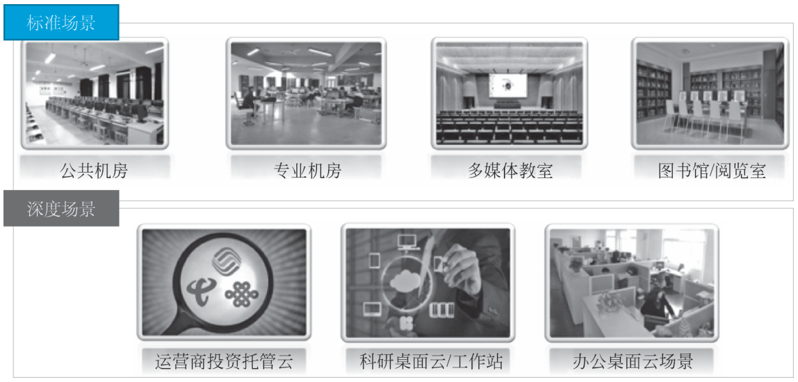{ loading=lazy }

图 2-51 VDI 桌面云在教育行业的应用场景
{ .fig-caption }

### 2.6.4.2 医疗行业应用 {#2642}

在医疗行业中，VDI 桌面云助力医护人员高效开展工作。医护人员可以在病房、护士站、医生办公室等不同区域便利地访问患者的电子病历系统、医嘱系统和医学影像系统等。这使得医生能够快速浏览患者的病史和最新检查结果，及时做出诊断和治疗决策。同时，医院的信息技术人员能够对桌面云进行集中管理，确保医疗信息系统的高可用性和数据的完整性。此外，桌面云的使用减少了医院在终端硬件上的投入，便于根据不同科室的需求快速调整和扩展计算资源。

### 2.6.4.3 金融行业应用 {#2643}

金融企业的业务处理对数据安全和访问的灵活性有着极高的要求。VDI 桌面云能够在保障数据存储在安全的数据中心的前提下，让金融从业者在不同的办公地点，安全地访问核心业务系统（交易系统、客户关系管理系统等）。例如，银行的客户经理在外出拜访客户时，可以通过桌面云安全地查询客户的账户信息和交易记录，为客户提供实时的金融服务咨询。此外，金融机构可以灵活地为不同的岗位分配相应的桌面云权限，严格控制数据的访问范围，防止敏感信息泄露。

### 2.6.4.4 企业行业应用 {#2644}

对于各类企业，VDI 桌面云支持员工的远程办公和移动办公需求。员工在家中或出差途中，只需通过网络连接就可以像在办公室一样使用公司统一配置的办公软件并访问内部业务系统，提高了工作效率。企业可以根据员工的岗位职责，灵活分配桌面云资源，如为设计人员分配高配置的图形处理桌面，为普通行政人员分配常规配置的办公桌面。同时，企业的 IT 部门可以集中管理桌面云，进行软件更新、数据备份等操作，简化了 IT 管理流程，降低了因硬件故障导致的业务中断风险。

## 随堂小测

**1.** 某银行要求柜员电脑上不能留下任何客户数据，员工在任何网点登录都能看到自己的桌面。最合适的桌面云架构是（　　）。

- A. VDI
- B. IDV
- C. VOI
- D. 传统 PC

??? tip "答案与解析"
    **答案：A**

    解析：VDI 的桌面运行在云端服务器上，数据不落地到本地终端，安全性高，并支持桌面移动性（换终端登录看到的还是同一个桌面）。IDV、VOI 的计算在本地完成，本地终端可能留存数据。

    考查：桌面云的系统架构 · 认知层次：应用 · [回看 2.6.2](#2621)
    { .quiz-meta }

**2.** 某中学的机房网络不太稳定，希望断网时学生电脑也能继续上课使用。相对更合适的是（　　）。

- A. VDI
- B. IDV 或 VOI
- C. 必须换成高端服务器
- D. 都不行

??? tip "答案与解析"
    **答案：B**

    解析：IDV 和 VOI 的计算在本地终端完成，镜像下发到本地后，断网也能继续使用；VDI 完全依赖网络，断网后桌面无法使用。

    考查：三种桌面云架构对比 · 认知层次：分析 · [回看 2.6.2](#2624)
    { .quiz-meta }

**3.** VDI 架构下，用户终端可以是瘦终端，也可以是普通 PC、笔记本电脑或手机。（　　）

- √
- ×

??? tip "答案与解析"
    **答案：√**

    解析：2.6.3.1 节列出的接入终端包括瘦终端、PC 与笔记本电脑、移动终端。只要能装客户端并联网，就能访问云端的虚拟桌面。

    考查：VDI 整体技术框架 · 认知层次：记忆 · [回看 2.6.3](#2631)
    { .quiz-meta }
