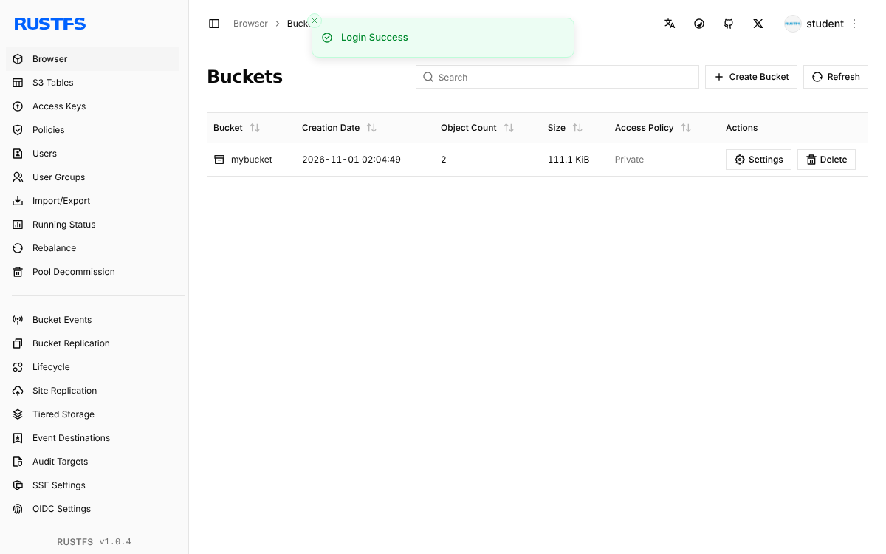

# 第 2 章 本章实验

!!! abstract "实验总览"

    | 实验 | 难度 | 环境 | 时长 | 对应小节 |
    |---|---|---|---|---|
    | [实验 2-1 创建云服务器并打快照](#2-1) | ★ 基础 | 阿里云（免费试用或云起实验室沙箱） | 40 分钟 | [2.1.3](2-1.md#213) |
    | [实验 2-2 用 Docker 运行一个网站](#2-2) | ★ 基础 | 装有 Docker 的 Linux | 30 分钟 | [2.1.2](2-1.md#2122) |
    | [实验 2-3 搭建对象存储并用 Python 存取文件](#2-3) | ★ 基础 | 装有 Docker 的 Linux + Python | 40 分钟 | [2.2.2](2-2.md#2221) |
    | [实验 2-4 用 Python 模拟 MapReduce 词频统计](#2-4) | ☆ 拓展 | 任意装有 Python 3 的电脑 | 20 分钟 | [2.3.3](2-3.md#233) |
    | [原书实训活动](#book-practice) | 课后 | 学校实训室（超融合与云桌面） | 课后 | [2.6](2-6.md) |

    本章实验学时为 3 学时，教师可从中任选。实验 2-2、2-3 需要一台装有 Docker 的 Linux 环境，获取方法见[附录 A 实验环境准备](../../appendix/a-labs-env.md)：可以用实验 2-1 创建的云服务器，也可以用阿里云云起实验室的免费沙箱，或在自己电脑上安装 Docker Desktop。

## 实验 2-1 ★ 创建云服务器并打快照 { #2-1 }

**实验目的**

1. 亲手创建一台云服务器（ECS），理解 [2.1.3.1](2-1.md#2131) 中创建虚拟机要选的 CPU、内存、镜像、磁盘、网络；
2. 给云服务器的系统盘打快照，误删文件后用快照回滚，体会 [2.1.3.2](2-1.md#2132) 快照的作用。

**实验环境**

- 运行环境：**云算力**。阿里云 ECS，推荐通过“云起实验室”领取免费沙箱，或使用新用户免费试用；规格 2 核 2 GB 即可，镜像选 Alibaba Cloud Linux 3 或 Ubuntu 22.04。
- 费用：沙箱和免费试用为 0 元。自己付费购买时，按量付费 2 核 2 GB 每小时约几角钱，快照按容量另计少量费用，**实验结束后务必释放实例并删除快照**。

**实验数据**：无。

**实验步骤与代码**

1. **创建实例**。登录阿里云控制台，进入“云服务器 ECS”→“实例”→“创建实例”，依次选择：
    - 付费类型：按量付费（沙箱或试用则按其页面默认）；
    - 地域：离自己近的地域，如“华南 1（深圳）”；
    - 实例规格：2 vCPU 2 GiB；
    - 镜像：公共镜像 Alibaba Cloud Linux 3；
    - 系统盘：ESSD Entry 或高效云盘 40 GiB；
    - 网络：默认专有网络（VPC）和交换机，勾选“分配公网 IPv4 地址”，带宽 1 Mbit/s；
    - 安全组：默认安全组，确认开放了 22 端口；
    - 登录凭证：自定义密码，牢记 root 密码。
2. **远程登录**。实例状态变为“运行中”后，在实例列表点“远程连接”→“通过 Workbench 远程连接”，输入密码登录。
3. **写一个“重要文件”**：

    ```bash
    echo "这是我的重要数据，$(date)" > /root/important.txt
    cat /root/important.txt
    ```

4. **打快照**。回到控制台，在实例详情页“云盘”标签中找到系统盘，点“创建快照”，名称填 `snap-before`。等待快照进度到 100%。
5. **模拟误删**：

    ```bash
    rm -f /root/important.txt
    ls /root
    ```

6. **回滚快照**。回滚前必须先**停止实例**。停止后，在“快照”列表中找到 `snap-before`，点“回滚云盘”，确认后再启动实例。
7. **检查结果**。重新远程登录，执行 `cat /root/important.txt`，文件应当回来了，内容与第 3 步相同。
8. **清理**。如果不再做实验 2-2、2-3，释放实例并删除快照；如果接下来要用这台服务器做 Docker 实验，可以先保留。

!!! warning "待实测"
    编者编写时所在的环境无法访问阿里云，以上步骤依据阿里云公开文档整理，菜单名称以控制台实际页面为准（阿里云会不定期调整页面）。任课教师上课前请实际走一遍，补充截图，并把下面“运行结果”中的示例换成实测输出。

**运行结果**

第 3 步和第 7 步的 `cat` 输出应完全相同，例如：

```text
这是我的重要数据，Sat Nov  1 10:20:31 CST 2026
```

（示例，日期时间以实际为准。）

**实验记录表**

| 项目 | 记录 |
|---|---|
| 实例规格、镜像、地域 |  |
| 实例的私网 IP 和公网 IP |  |
| 快照创建用时（大约几分钟） |  |
| 回滚前为什么必须停止实例？ |  |
| 回滚后 important.txt 是否恢复 |  |
| 实验总费用（元） |  |

**常见问题排查**

| 现象 | 原因与处理 |
|---|---|
| 远程连接失败 | 检查实例是否“运行中”；安全组是否放行 22 端口；密码是否输错。 |
| “回滚云盘”按钮是灰色的 | 实例没有停止。先停止实例再回滚。 |
| 回滚后文件还是没有 | 快照是在写文件之前打的，或回滚了错误的快照。核对快照创建时间。 |
| 担心忘记释放产生费用 | 创建时可设置“自动释放时间”；实验结束后在实例列表确认已释放。 |

**思考与练习**

1. 快照和“把文件复制到 U 盘”这种备份有什么不同？快照能不能完全代替备份？
2. 实例的私网 IP 和公网 IP 分别有什么用？（提示：联系 [2.4.2](2-4.md#242)）

**实验报告要求**

提交实验记录表、第 3 步和第 7 步的截图，并回答思考题第 1 题。

## 实验 2-2 ★ 用 Docker 运行一个网站 { #2-2 }

**实验目的**

1. 学会 Docker 最常用的命令：拉取镜像、运行容器、查看容器、停止和删除容器；
2. 亲身体会 [2.1.2.2](2-1.md#2122) 所说的容器“轻量、启动快”；
3. 学会用“端口映射”和“目录挂载”让容器对外提供自己的网页。

**实验环境**

- 运行环境：**装有 Docker 的 Linux**（见附录 A）。编者实测环境：Docker 29.9.2，镜像 `nginx:1.27-alpine`（Nginx 1.27.5）。
- 费用：0 元（使用自己的电脑或沙箱）。

**实验数据**：自己写的一个网页 `index.html`。

**实验步骤与代码**

1. **拉取镜像**。镜像就像一个打包好的“软件安装盘”：

    ```bash
    docker pull nginx:1.27-alpine
    docker images nginx
    ```

2. **运行第一个容器**，把容器的 80 端口映射到主机的 8080 端口：

    ```bash
    docker run -d --name web -p 8080:80 nginx:1.27-alpine
    docker ps
    curl -s http://localhost:8080 | head -5
    ```

    `-d` 表示在后台运行，`--name` 给容器起名，`-p 主机端口:容器端口` 是端口映射。如果用的是云服务器，并在安全组里放行了 8080 端口，也可以在自己电脑的浏览器里访问 `http://公网IP:8080`。

3. **换成自己的网页**。新建目录和网页，再启动一个挂载了该目录的容器：

    ```bash
    mkdir -p ~/site
    cat > ~/site/index.html <<'EOF2'
    <!doctype html>
    <html><head><meta charset="utf-8"><title>我的第一个容器网站</title></head>
    <body><h1>你好，云计算！</h1><p>这个页面由 Docker 容器里的 Nginx 提供。</p></body></html>
    EOF2
    docker run -d --name web2 -p 8081:80 -v ~/site:/usr/share/nginx/html:ro nginx:1.27-alpine
    curl -s http://localhost:8081
    ```

    `-v 主机目录:容器目录:ro` 把主机上的目录挂到容器里（`ro` 表示只读）。修改 `~/site/index.html` 后刷新页面，内容立即变化，不用重启容器。

4. **看日志、进容器、看资源占用**：

    ```bash
    docker logs web2 | tail -2
    docker exec web2 nginx -v
    docker stats --no-stream web web2
    ```

5. **测一测启动有多快**：

    ```bash
    time docker run --rm nginx:1.27-alpine nginx -v
    ```

6. **清理**：

    ```bash
    docker stop web web2
    docker rm web web2
    docker ps -a
    ```

**运行结果**

编者实测的关键输出如下（容器 ID、时间等每次不同）：

```text
$ docker images nginx
IMAGE               ID             DISK USAGE   CONTENT SIZE
nginx:1.27-alpine   65645c7bb6a0       74.5MB         21.9MB

$ docker ps
NAMES     IMAGE               STATUS         PORTS
web       nginx:1.27-alpine   Up 2 seconds   0.0.0.0:8080->80/tcp

$ curl -s http://localhost:8080 | head -5
<!DOCTYPE html>
<html>
<head>
<title>Welcome to nginx!</title>
<style>

$ curl -s http://localhost:8081
<!doctype html>
<html><head><meta charset="utf-8"><title>我的第一个容器网站</title></head>
<body><h1>你好，云计算！</h1><p>这个页面由 Docker 容器里的 Nginx 提供。</p></body></html>

$ docker logs web2 | tail -2
/docker-entrypoint.sh: Configuration complete; ready for start up
172.17.0.1 - - [01/Nov/2026:02:03:05 +0000] "GET / HTTP/1.1" 200 209 "-" "curl/8.5.0" "-"

$ docker exec web2 nginx -v
nginx version: nginx/1.27.5

$ docker stats --no-stream web web2
NAME      CPU %     MEM USAGE / LIMIT
web       0.00%     4.984MiB / 15.71GiB
web2      0.00%     4.762MiB / 15.71GiB
```

编者连续 3 次测得“创建容器、运行命令、删除容器”全过程用时 0.34 秒、0.39 秒、0.47 秒；每个 Nginx 容器只占用约 5 MB 内存。作为对比，一台虚拟机启动一个完整的操作系统通常要几十秒，内存至少要几百 MB。

**实验记录表**

| 项目 | 记录 |
|---|---|
| Docker 版本（`docker version`） |  |
| nginx 镜像大小 |  |
| 容器启动用时（第 5 步） |  |
| 每个容器的内存占用 |  |
| 自己网页的访问截图 |  |

**常见问题排查**

| 现象 | 原因与处理 |
|---|---|
| `docker pull` 很慢或超时 | 国内访问 Docker Hub 不稳定。在阿里云“容器镜像服务 ACR”控制台获取免费的镜像加速地址，按附录 A 配置到 `/etc/docker/daemon.json` 后重启 Docker。 |
| `permission denied ... docker.sock` | 当前用户没有 Docker 权限。命令前加 `sudo`，或把用户加入 docker 组后重新登录。 |
| `port is already allocated` | 主机端口被占用了。换一个端口，如 `-p 8090:80`，或先删除旧容器。 |
| 浏览器访问公网 IP 打不开 | 云服务器的安全组没有放行 8080／8081 端口。 |
| 改了网页内容没变化 | 检查 `-v` 后面的主机目录路径是否写对；浏览器按 Ctrl+F5 强制刷新。 |

**思考与练习**

1. 同时运行了两个 Nginx 容器，它们都监听容器内的 80 端口，为什么不冲突？
2. 删除容器后，`~/site/index.html` 还在吗？如果没有用 `-v`，直接在容器里改网页，删除容器后会怎样？

**实验报告要求**

提交实验记录表、自己网页的访问截图，并回答两道思考题。

## 实验 2-3 ★ 搭建对象存储并用 Python 存取文件 { #2-3 }

**实验目的**

1. 用 Docker 在几分钟内搭起一个对象存储服务，理解 [2.2.2.1](2-2.md#2221) 中“存储桶、对象、元数据”的概念；
2. 分别用网页控制台和 Python 程序上传、下载、分享文件；
3. 体会对象存储默认“私有”，以及临时分享链接（预签名 URL）的作用。

**实验环境**

- 运行环境：**装有 Docker 的 Linux + Python 3**。编者实测环境：Docker 29.9.2、RustFS 1.0.4、Python 3、boto3 1.43.123。
- 软件说明：2.2.2.1 节提到的 MinIO 是常用的开源对象存储。编者 2026 年 11 月实测时，Docker Hub 上的 `minio/minio` 镜像已无法拉取，因此本实验改用国产开源对象存储 **RustFS**。它与 MinIO 一样兼容亚马逊 S3 接口，下面的 Python 代码对 MinIO、阿里云 OSS（S3 兼容模式）同样适用，只需改连接地址和账号。
- 费用：0 元。

**实验数据**：一个文本文件和一张图片，自己准备即可。

**实验步骤与代码**

1. **启动对象存储**。9000 端口是 S3 接口，9001 端口是网页控制台：

    ```bash
    docker run -d --name oss -p 9000:9000 -p 9001:9001 \
      -e RUSTFS_ACCESS_KEY=student -e RUSTFS_SECRET_KEY=student123456 \
      -v oss-data:/data rustfs/rustfs:1.0.4
    docker ps
    ```

2. **在网页控制台里操作**。浏览器打开 `http://服务器IP:9001/rustfs/console/`（本机实验用 `localhost`），用户名 `student`、密码 `student123456` 登录。右上角的语言按钮可切换为中文。
    - 点 “Create Bucket（创建存储桶）”，名称填 `mybucket`；
    - 进入 `mybucket`，上传一个文本文件和一张图片；
    - 观察对象列表、大小和“Access Policy（访问策略）”一栏显示的 `Private`（私有）。

    { loading=lazy }

    RustFS 网页控制台：存储桶 mybucket 中有 2 个对象，访问策略为 Private（编者实测截图）
    { .fig-caption }

3. **用 Python 操作**。安装依赖并运行实验程序（完整代码见 `labs/ch02/lab2_3_object_storage.py`）：

    ```bash
    pip install boto3 requests
    python lab2_3_object_storage.py
    ```

    程序的关键部分：

    ```python
    s3 = boto3.client("s3", endpoint_url="http://localhost:9000",
                      aws_access_key_id="student", aws_secret_access_key="student123456",
                      region_name="us-east-1", config=Config(signature_version="s3v4"))
    s3.create_bucket(Bucket="pybucket")                                  # 建桶
    s3.put_object(Bucket="pybucket", Key="notes/hello.txt",
                  Body="你好，对象存储！".encode("utf-8"))                  # 上传对象
    s3.put_object(Bucket="pybucket", Key="photos/2026/cat.jpg", Body=b"\xff\xd8fake-jpeg",
                  Metadata={"camera": "phone", "city": "guangzhou"})     # 带自定义元数据
    print(s3.head_object(Bucket="pybucket", Key="photos/2026/cat.jpg")["Metadata"])
    signed = s3.generate_presigned_url("get_object", ExpiresIn=600,
                                       Params={"Bucket": "pybucket", "Key": "notes/hello.txt"})
    ```

4. **清理**：`docker rm -f oss && docker volume rm oss-data`。

**运行结果**

编者实测输出：

```text
现有存储桶： ['mybucket', 'pybucket']
notes/hello.txt           24 字节
photos/2026/cat.jpg       11 字节
cat.jpg 的自定义元数据： {'city': 'guangzhou', 'camera': 'phone'}
匿名访问状态码： 403
临时链接访问状态码： 200 内容： 你好，对象存储！
已清理
```

注意几点：`notes/`、`photos/2026/` 看起来像文件夹，其实只是对象名的一部分，对象存储内部是“扁平”的；不带签名直接访问返回 403（拒绝），说明桶默认是私有的；预签名 URL 在 600 秒内有效，可以安全地临时分享给别人。

**实验记录表**

| 项目 | 记录 |
|---|---|
| 控制台中创建的桶名和上传的对象 |  |
| Python 程序输出的对象列表 |  |
| 匿名访问状态码和预签名 URL 访问状态码 |  |
| 预签名 URL 中的 `X-Amz-Expires` 参数值是多少，表示什么 |  |

**常见问题排查**

| 现象 | 原因与处理 |
|---|---|
| 控制台打开显示 403 的 XML | 地址少了路径，要访问 `/rustfs/console/`。 |
| Python 报 `Could not connect to the endpoint URL` | 容器没启动，或 `endpoint_url` 的 IP、端口写错。用 `docker ps` 确认。 |
| 报 `SignatureDoesNotMatch` 或 `InvalidAccessKeyId` | 账号密码与 `docker run` 时设置的不一致。 |
| 报 `BucketAlreadyOwnedByYou` | 程序运行到一半出错后重跑，桶已存在。在控制台删除 `pybucket` 后再运行。 |

**思考与练习**

1. 2.2.2.1 节说对象存储的元数据可以自定义。在程序里给 cat.jpg 加的 `camera`、`city` 可以用来做什么？
2. 网盘的“分享链接，7 天有效”是怎样实现的？和本实验中的哪个功能对应？

**实验报告要求**

提交实验记录表、控制台截图和程序运行结果截图，回答两道思考题。

## 实验 2-4 ☆ 用 Python 模拟 MapReduce 词频统计 { #2-4 }

**实验目的**

1. 通过一个可以运行的小程序，理解 [2.3.3.2](2-3.md#2332) 中 MapReduce 的“分片、Map、Shuffle、Reduce”四个阶段；
2. 理解“同一个键一定交给同一个 Reduce”这一关键设计。

**实验环境**

- 运行环境：**本机 CPU**，任意装有 Python 3 的电脑，不需要安装第三方库，也不需要 Hadoop 集群。
- 程序用 Python 的多进程（`multiprocessing`）模拟多台机器。

**实验数据**：程序内置 3 句话，每句作为一个输入分片，词与词之间已用空格分好。

**实验步骤与代码**

1. 下载 `labs/ch02/lab2_4_mapreduce.py`，在终端运行 `python lab2_4_mapreduce.py`。
2. 对照下面的关键代码阅读输出：

    ```python
    def map_task(args):                       # Map：一行文字 → (词, 1)
        split_id, text = args
        pairs = [(word, 1) for word in text.split()]
        ...

    def shuffle(all_pairs, n_reducers):       # Shuffle：按词分组，同一个词去同一个 Reduce
        buckets = [defaultdict(list) for _ in range(n_reducers)]
        for pairs in all_pairs:
            for word, one in pairs:
                buckets[sum(word.encode("utf-8")) % n_reducers][word].append(one)
        return [dict(sorted(b.items())) for b in buckets]

    def reduce_task(args):                    # Reduce：同一个词的 1 相加
        reducer_id, groups = args
        result = {word: sum(ones) for word, ones in groups.items()}
        ...

    with Pool(3) as pool:                     # 3 个进程 = 3 台“机器”
        mapped = pool.map(map_task, list(enumerate(SPLITS)))
        groups = shuffle(..., n_reducers=2)
        reduced = pool.map(reduce_task, list(enumerate(groups)))
    ```

3. 修改 `SPLITS` 里的句子，或把 `n_reducers` 改成 3，再运行一次，观察输出的变化。

**运行结果**

编者实测输出：

```text
[Map-0] 输出 8 个键值对，前 3 个：[('云计算', 1), ('让', 1), ('计算', 1)]
[Map-1] 输出 10 个键值对，前 3 个：[('虚拟化', 1), ('是', 1), ('云计算', 1)]
[Map-2] 输出 9 个键值对，前 3 个：[('分布式', 1), ('存储', 1), ('和', 1)]
—— Shuffle：按词分组，交给 2 个 Reduce ——
[Reduce-0] 收到 8 个词，例如 [('云计算', [1, 1, 1]), ('基础', [1])]
[Reduce-1] 收到 13 个词，例如 [('一样', [1]), ('使用', [1])]

词频最高的 5 个词：
云计算	3
分布式	2
的	2
计算	2
让	2
共 21 个不同的词，27 个词次
```

“云计算”在三个分片里各出现一次，三个 `(云计算, 1)` 经过 Shuffle 都到了 Reduce-0，汇总成 3。

**实验记录表**

| 项目 | 记录 |
|---|---|
| 三个 Map 各输出几个键值对 |  |
| 两个 Reduce 各收到几个词 |  |
| 词频最高的词 |  |
| 把 n_reducers 改成 3 后，各 Reduce 收到几个词 |  |

**常见问题排查**

| 现象 | 原因与处理 |
|---|---|
| Windows 上运行报错或卡住 | 多进程代码必须放在 `if __name__ == "__main__":` 下面，不要删掉这一行；在命令行运行，不要在某些在线编辑器里运行。 |
| 中文显示为乱码 | 终端编码不是 UTF-8。Windows 可先执行 `chcp 65001`。 |

**思考与练习**

1. 如果 Shuffle 时不按词分组，而是随机分给两个 Reduce，最终结果会怎样？
2. 真实的 Hadoop 中，Map 的输出要写到磁盘，再通过网络传给 Reduce。结合 2.3.4 节，说说 Spark 为什么更快。

**实验报告要求**

提交运行结果截图和实验记录表，回答思考题第 1 题。

## 原书实训活动 { #book-practice }

下面是纸质教材本章的实训活动，需要学校实训室的超融合平台和云桌面软件，可在线下实训周或有条件时开展。

题目：基于超融合的云桌面部署与管理实训。

1. 实训目标

（1）掌握超融合平台及云桌面产品的安装与配置方法。

（2）能够根据企业需求创建和管理云桌面，合理分配资源并设置用户权限。


（3）理解云桌面在不同设备上的接入方式，优化用户体验，保障数据安全。

2. 实训内容

（1）环境搭建。

安装并配置深信服超融合一体机或软件，搭建虚拟化平台，为云桌面提供计算、存储和网络资源。

部署深信服云桌面软件，设置用户认证和桌面分配策略，确保用户能安全访问专属桌面。

（2）虚拟桌面创建。

根据企业需求，制作多种操作系统（如 Windows 7、Windows 10 等）的虚拟桌面模板，并预装常用办公软件。

为每个虚拟桌面合理分配 CPU、内存、存储等资源，并进行网络配置，使其能够正常连接到内部网络和外部互联网。

（3）用户接入与管理。

创建用户账号及权限，允许用户通过多种设备（如 PC、笔记本计算机、平板电脑等）使用远程接入客户端连接到云桌面。

管理会话，设置会话超时、断开连接、自动保存等策略，保障用户数据不丢失，并监控用户使用情况，确保数据安全。

3. 预期成果

学生能够独立完成基于深信服超融合的云桌面环境搭建，包括超融合平台和云桌面软件的安装配置。

掌握虚拟桌面的高效创建与管理，能够根据不同用户群体的工作负载灵活调整资源分配策略，制作满足企业需求的桌面模板。

提升多设备接入云桌面的兼容性与性能，优化网络连接和应用程序兼容性，保障良好用户体验，同时确保数据在传输和使用过程中的安全性。

完成一份实训报告。
