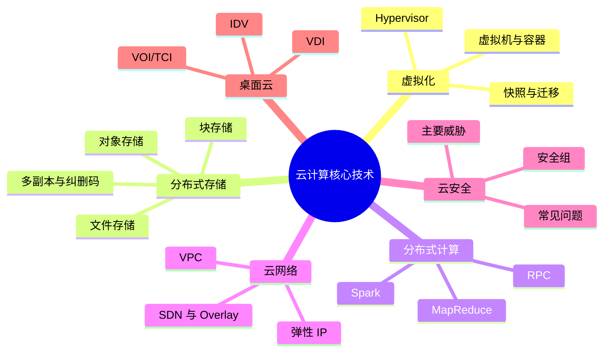

# 第 2 章 本章小结与练习

## 本章关键词

虚拟化技术、容器、分布式存储技术、分布式计算技术、MapReduce 基础、Spark 基础、云网络技术、私有网络、云安全技术、桌面云技术等。

## 本章小结

云计算是一场改变 IT 格局的划时代变革，正颠覆性地推动信息与通信产业发展，为企业和国家带来了突破式创新与跨越式发展的战略机遇。它以弹性伸缩、降低成本、提升资源利用率、按需自助服务等优势，成为 IT 领域的闪耀新星。

本章围绕云计算的核心把资源池化：虚拟化把 CPU、内存切成弹性块；分布式存储将数据切片冗余，节点再扩也不丢，秒级扩容在线完成；分布式计算让任务并行跑在千台主机，MapReduce 批处理、Spark 内存计算各负其责；云网络用 SDN、VPC、弹性 IP、虚拟网元设备把带宽、延迟做成可调参数，东西向流量可微分段；云安全以等级保护 2.0 标准为基础，满足云计算的合规要求，从镜像签名到流量加密，全程审计留痕；桌面云用流协议把画面搬到任何终端，物理机也能托管进云，显算分离不抢虚拟机资源。

把本章压缩成 6 句话：

1. **虚拟化**由 Hypervisor 把一台物理机分成多台虚拟机，分原生型和宿主型；**容器**共享宿主机内核，比虚拟机更轻、启动更快；VMware、KVM 是虚拟化代表，Docker 是容器代表；快照用于回滚，迁移用于在主机之间搬运运行中的虚拟机。
2. **分布式存储**靠分片、冗余（多副本或纠删码）、一致性、故障恢复和动态扩展把很多台机器的硬盘变成一个大存储；**对象存储**适合海量非结构化数据，**文件存储**适合共享目录，**块存储**适合数据库和虚拟机磁盘。
3. **分布式计算**把大任务拆给多台机器并行完成，机器之间靠进程间通信和 RPC 协作；**MapReduce** 按分片、Map、Shuffle、Reduce 处理批量数据，**Spark** 把中间结果放在内存中，更适合迭代计算。
4. **云网络**用 SDN 集中控制、用 Overlay（VXLAN）叠加虚拟网络；用户最常接触的是**私有网络 VPC**（自己的隔离网络）和**弹性 IP**（可换绑的公网地址）。
5. **云安全**实行责任共担，常见问题多源于配置错误、身份访问管理不足和内部人员；主要威胁有拒绝服务、恶意中介、流量窃听、授权不足、虚拟化攻击；安全组是云服务器的第一道“门卫”。
6. **桌面云**把桌面搬到服务器上，**VDI** 在云端计算、安全集中，**IDV**、**VOI/TCI** 在本地计算、可离线使用。



**下一章预告**：有了这些核心技术，云服务商把它们包装成一个个可以直接购买的产品。第 3 章介绍阿里云、华为云等主流云平台，讲解 IaaS、PaaS、SaaS 平台上的典型服务，以及云服务的配置、管理、监控和迁移工具，并亲手在云服务器上部署 Nginx。

## 参考文献

**教材与专著**

1. 埃尔. 云计算：概念、技术与架构[M]. 龚奕利，贺莲，胡创，译. 北京：机械工业出版社，2014.<br><span class="ref-note">虚拟化、云存储、云安全威胁（拒绝服务、恶意中介、流量窃听、授权不足、虚拟化攻击）的主要参考，对应 2.1 节和 2.5.3 节。</span>
2. 陈驰. 云计算安全体系[M]. 北京：科学出版社，2014.<br><span class="ref-note">云安全体系架构与关键技术，对应 2.5.4 节、2.5.5 节。</span>
3. 张振峰. 云上合规：深信服云安全服务平台等级保护 2.0 合规能力技术指南[M]. 北京：电子工业出版社，2020.<br><span class="ref-note">等级保护 2.0 与云安全合规，对应 2.5.6 节。</span>

**经典论文**

4. BARHAM P, DRAGOVIC B, FRASER K, et al. Xen and the art of virtualization[C]//Proceedings of the 19th ACM Symposium on Operating Systems Principles. New York: ACM, 2003: 164-177.<br><span class="ref-note">半虚拟化的代表性论文，对应 2.1.1.2 节。</span>
5. GHEMAWAT S, GOBIOFF H, LEUNG S T. The Google file system[C]//Proceedings of the 19th ACM Symposium on Operating Systems Principles. New York: ACM, 2003: 29-43.<br><span class="ref-note">分布式文件系统的奠基论文，HDFS 的设计源头，对应 2.2 节。</span>
6. DEAN J, GHEMAWAT S. MapReduce: simplified data processing on large clusters[C]//Proceedings of the 6th Symposium on Operating Systems Design and Implementation. San Francisco: USENIX, 2004: 137-150.<br><span class="ref-note">MapReduce 原始论文，对应 2.3.3 节和实验 2-4。</span>
7. ZAHARIA M, CHOWDHURY M, DAS T, et al. Resilient distributed datasets: a fault-tolerant abstraction for in-memory cluster computing[C]//Proceedings of the 9th USENIX Symposium on Networked Systems Design and Implementation. San Jose: USENIX, 2012: 15-28.<br><span class="ref-note">Spark 的核心 RDD 论文，对应 2.3.4 节。</span>

**标准与在线资源**

8. 全国信息安全标准化技术委员会. 信息安全技术 网络安全等级保护基本要求：GB/T 22239—2019[S]. 北京：中国标准出版社，2019.<br><span class="ref-note">等级保护 2.0 基本要求，含云计算安全扩展要求，对应 2.5.6.3 节。</span>
9. Docker Inc. Docker documentation[EB/OL]. [2026-11-01]. https://docs.docker.com/.<br><span class="ref-note">Docker 命令与概念，对应 2.1.2.2 节和实验 2-2。</span>
10. RustFS. RustFS 文档[EB/OL]. [2026-11-01]. https://docs.rustfs.com/.<br><span class="ref-note">实验 2-3 所用对象存储的安装与使用说明。</span>

## 课后练习

**一、单项选择题**

<div class="quiz" data-answer="B" markdown>

**1.** 在个人电脑的 Windows 上安装 VMware Workstation，再在里面运行 Linux 虚拟机，VMware Workstation 属于（　　）。

- A. 原生型 Hypervisor
- B. 宿主型 Hypervisor
- C. 容器引擎
- D. 分布式文件系统

</div>

??? tip "答案与解析"
    **答案：B**

    解析：宿主型 Hypervisor 运行在已有的操作系统（这里是 Windows）之上；原生型直接装在硬件上，如 ESXi。

    考查：Hypervisor 的类型 · 认知层次：应用 · [回看 2.1.1](2-1.md#2111)
    { .quiz-meta }

<div class="quiz" data-answer="C" markdown>

**2.** 需要修改客户操作系统、让它“知道”自己运行在虚拟机里，以减少虚拟化开销的技术是（　　）。

- A. 全虚拟化
- B. 基于硬件的虚拟化
- C. 半虚拟化
- D. 桌面虚拟化

</div>

??? tip "答案与解析"
    **答案：C**

    解析：半虚拟化要修改虚拟机中的操作系统，集成一些虚拟化代码，性能较好但兼容性较差；全虚拟化不修改客户操作系统，客户系统察觉不到自己在虚拟机里。

    考查：虚拟化技术分类 · 认知层次：理解 · [回看 2.1.1](2-1.md#2112)
    { .quiz-meta }

<div class="quiz" data-answer="D" markdown>

**3.** 在 Docker 中，用来“打包好的、只读的应用模板”，可以据此创建多个容器的是（　　）。

- A. 仓库
- B. 数据卷
- C. 端口映射
- D. 镜像

</div>

??? tip "答案与解析"
    **答案：D**

    解析：镜像是只读模板，容器是镜像运行起来的实例，仓库是存放镜像的地方（如 Docker Hub）。实验 2-2 中用同一个 nginx 镜像创建了两个容器。

    考查：Docker 主要部件 · 认知层次：理解 · [回看 2.1.2](2-1.md#2122)
    { .quiz-meta }

<div class="quiz" data-answer="A" markdown>

**4.** 运行中的虚拟机从一台物理主机搬到另一台，期间业务几乎不中断，这叫（　　）。

- A. 热迁移
- B. 冷迁移
- C. 快照回滚
- D. 镜像派生

</div>

??? tip "答案与解析"
    **答案：A**

    解析：热迁移在虚拟机持续运行的状态下，通过预拷贝内存和反复复制“脏页”完成，只在最后切换时有极短的停顿；冷迁移要先关机。

    考查：虚拟机迁移 · 认知层次：记忆 · [回看 2.1.3](2-1.md#2133)
    { .quiz-meta }

<div class="quiz" data-answer="B" markdown>

**5.** 为云服务器挂载一块“云硬盘”，在操作系统里分区、格式化后安装数据库。云硬盘属于（　　）。

- A. 对象存储
- B. 块存储
- C. 文件存储
- D. 键值存储

</div>

??? tip "答案与解析"
    **答案：B**

    解析：块存储提供的裸块设备对操作系统来说就像本地硬盘，可以直接分区、格式化，时延低，适合数据库和虚拟机磁盘。

    考查：块存储 · 认知层次：应用 · [回看 2.2.2](2-2.md#2223)
    { .quiz-meta }

<div class="quiz" data-answer="C" markdown>

**6.** 在“三副本”方式下，存 1 TB 的数据实际要占用多少存储空间？（　　）

- A. 1 TB
- B. 1.5 TB
- C. 3 TB
- D. 6 TB

</div>

??? tip "答案与解析"
    **答案：C**

    解析：三副本就是同一份数据存 3 份，空间利用率只有 1/3。纠删码（如 4+2）只需 1.5 倍空间就能容忍 2 块盘损坏，这也是对象存储常用纠删码的原因。可以在“多副本与纠删码”动画里验证。

    考查：数据冗余 · 认知层次：应用 · [回看 2.2.1](2-2.md#221)
    { .quiz-meta }

<div class="quiz" data-answer="D" markdown>

**7.** 下列 IPC 机制中，速度最快、允许多个进程直接访问同一块内存的是（　　）。

- A. 管道
- B. 消息队列
- C. 套接字
- D. 共享内存

</div>

??? tip "答案与解析"
    **答案：D**

    解析：共享内存把同一块物理内存映射到多个进程的地址空间，数据不用来回复制，是所有 IPC 机制中最快的，但需要配合信号量等做同步。

    考查：进程间通信 · 认知层次：记忆 · [回看 2.3.1](2-3.md#2312)
    { .quiz-meta }

<div class="quiz" data-answer="A" markdown>

**8.** 用户在云上创建的、与其他用户逻辑隔离、可以自定义 IP 地址范围和子网的网络是（　　）。

- A. 私有网络（VPC）
- B. 弹性 IP
- C. 互联网
- D. 内容分发网络

</div>

??? tip "答案与解析"
    **答案：A**

    解析：VPC 让用户完全控制网络配置，包括 IP 地址范围、子网、路由表和网关，并通过安全组和访问控制列表控制流量。

    考查：私有网络 · 认知层次：理解 · [回看 2.4.2](2-4.md#2422)
    { .quiz-meta }

<div class="quiz" data-answer="C" markdown>

**9.** 攻击者在用户与云服务之间截获并篡改通信内容，这种威胁是（　　）。

- A. 拒绝服务攻击
- B. 虚拟化攻击
- C. 恶意中介攻击
- D. 授权不足攻击

</div>

??? tip "答案与解析"
    **答案：C**

    解析：恶意中介攻击的特征是“截获并篡改”；只偷听不篡改的是流量窃听。

    考查：云安全的威胁 · 认知层次：理解 · [回看 2.5.3](2-5.md#2532)
    { .quiz-meta }

**二、多项选择题**

<div class="quiz quiz-multi" data-answer="ABD" markdown>

**10.** 与虚拟机相比，容器的特点有（　　）。

- A. 启动速度快，通常是秒级或更快
- B. 占用资源少
- C. 每个容器都运行一个完整的独立操作系统内核
- D. 镜像体积小，便于分发和部署

</div>

??? tip "答案与解析"
    **答案：ABD**

    解析：容器共享宿主机内核，不运行独立的内核，所以 C 错。实验 2-2 中 nginx 镜像压缩后仅约 22 MB，容器启动不到 0.5 秒。

    考查：虚拟机与容器的对比 · 认知层次：理解 · [回看 2.1.2](2-1.md#212)
    { .quiz-meta }

<div class="quiz quiz-multi" data-answer="ABCD" markdown>

**11.** 分布式存储技术的基本特征包括（　　）。

- A. 数据分片
- B. 数据冗余
- C. 故障检测和恢复
- D. 动态扩展

</div>

??? tip "答案与解析"
    **答案：ABCD**

    解析：2.2.1 节列出的特征有数据分片、数据冗余、一致性、故障检测和恢复、动态扩展、提供数据访问接口。

    考查：分布式存储的基本特征 · 认知层次：记忆 · [回看 2.2.1](2-2.md#221)
    { .quiz-meta }

<div class="quiz quiz-multi" data-answer="ACD" markdown>

**12.** 死锁发生的必要条件包括（　　）。

- A. 互斥条件
- B. 资源无限多
- C. 请求和保持条件
- D. 环路等待条件

</div>

??? tip "答案与解析"
    **答案：ACD**

    解析：死锁的 4 个必要条件是互斥、请求和保持、不剥夺、环路等待。资源无限多时根本不会争抢，不会发生死锁。

    考查：死锁和超时 · 认知层次：记忆 · [回看 2.3.1](2-3.md#2312)
    { .quiz-meta }

<div class="quiz quiz-multi" data-answer="ABC" markdown>

**13.** 下列做法中，能降低云上数据泄露风险的有（　　）。

- A. 存储桶默认设为私有，需要分享时使用有时效的临时链接
- B. 安全组只放行业务需要的端口和来源地址
- C. 为不同员工分配最小必要权限，离职及时回收账号
- D. 为了方便，所有员工共用一个管理员账号

</div>

??? tip "答案与解析"
    **答案：ABC**

    解析：A 对应配置错误问题，B 对应安全组配置，C 对应身份访问不足和恶意内部人员问题。共用管理员账号会导致无法追责，属于“弱认证”。

    考查：常见的云安全问题 · 认知层次：评价 · [回看 2.5.2](2-5.md#252)
    { .quiz-meta }

**三、判断题**

<div class="quiz quiz-judge" data-answer="√" markdown>

**14.** KVM 是 Linux 内核中的虚拟化模块，借助 CPU 的硬件虚拟化功能运行虚拟机。（　　）

- √
- ×

</div>

??? tip "答案与解析"
    **答案：√**

    解析：KVM（基于内核的虚拟机）集成在 Linux 内核中，需要 CPU 支持 Intel VT 或 AMD-V 等硬件虚拟化技术，常与 QEMU 配合使用。

    考查：KVM · 认知层次：记忆 · [回看 2.1.2](2-1.md#2123)
    { .quiz-meta }

<div class="quiz quiz-judge" data-answer="×" markdown>

**15.** 对象存储中的 `photos/2026/cat.jpg` 说明对象存储和文件存储一样，有真正的多层目录结构。（　　）

- √
- ×

</div>

??? tip "答案与解析"
    **答案：×**

    解析：对象存储采用扁平命名空间，斜杠只是对象名的一部分，控制台把它显示成“文件夹”只是为了方便浏览。实验 2-3 中可以观察到这一点。

    考查：对象存储 · 认知层次：理解 · [回看 2.2.2](2-2.md#2221)
    { .quiz-meta }

<div class="quiz quiz-judge" data-answer="√" markdown>

**16.** 在 MapReduce 中，同一个键的所有中间结果一定会被交给同一个 Reduce 任务处理。（　　）

- √
- ×

</div>

??? tip "答案与解析"
    **答案：√**

    解析：这是 Shuffle 阶段的保证，否则同一个词的计数会被分散在不同 Reduce 中，结果就不对了。

    考查：MapReduce 工作流程 · 认知层次：理解 · [回看 2.3.3](2-3.md#2332)
    { .quiz-meta }

<div class="quiz quiz-judge" data-answer="×" markdown>

**17.** 弹性 IP 一旦绑定到某台云服务器，就不能再更换绑定对象。（　　）

- √
- ×

</div>

??? tip "答案与解析"
    **答案：×**

    解析：弹性 IP 的特点正是可以动态分配，故障或维护时可以快速解绑并重新绑定到其他实例，保持对外地址不变。

    考查：弹性 IP · 认知层次：记忆 · [回看 2.4.2](2-4.md#2423)
    { .quiz-meta }

<div class="quiz quiz-judge" data-answer="√" markdown>

**18.** 采用 VDI 架构的桌面云，网络中断后用户将无法继续使用虚拟桌面。（　　）

- √
- ×

</div>

??? tip "答案与解析"
    **答案：√**

    解析：VDI 的桌面在云端服务器上运行，终端只负责显示，网络依赖程度高；IDV、VOI 支持断网使用。

    考查：桌面云架构 · 认知层次：理解 · [回看 2.6.2](2-6.md#2624)
    { .quiz-meta }

**四、简答题**

**19.** 用“公寓”和“酒店房间”的比喻说明虚拟机和容器的区别，并各说一个适合的使用场景。

??? tip "参考答案"
    虚拟机像独立的公寓，每套都有自己完整的水电系统（独立的操作系统内核），隔离彻底，但装修入住慢、占地大；容器像酒店房间，共用大楼的水电系统（宿主机内核），拎包入住、退房快、占用少，但隔离程度不如公寓。需要运行不同操作系统（如在 Linux 服务器上跑 Windows）或对隔离要求高时用虚拟机；需要快速部署、频繁更新的 Web 应用和微服务用容器。

    评分要点：说清共享内核与独立内核的区别（2 分）；启动速度和资源占用（1 分）；场景各 1 分。

**20.** 对象存储、文件存储、块存储各适合什么场景？各举一个例子。

??? tip "参考答案"
    对象存储适合海量非结构化数据，通过 HTTP 按对象名访问，例如网站图片、短视频、数据备份归档；文件存储有目录树，可被多台机器同时挂载，适合共享文件，例如企业共享盘、AI 训练数据集共享；块存储像本地硬盘，时延低，适合数据库和虚拟机磁盘，例如为 MySQL 服务器挂载的云硬盘。

**21.** 某公司的云数据库因安全组规则设置为“允许所有入站流量”而遭到入侵。请分析原因，并提出至少三条改进措施。

??? tip "参考答案"
    原因：安全组对 0.0.0.0/0 开放了所有端口，数据库端口（如 3306）直接暴露在互联网上，攻击者可以扫描并暴力破解，属于配置错误问题。改进措施：①安全组遵循最小开放原则，数据库端口只允许应用服务器的内网地址访问；②数据库使用强密码，禁用默认账号；③数据库放在私有网络的内网子网中，不分配公网 IP；④开启操作审计和异常登录告警；⑤定期用云平台的安全检查工具扫描配置风险。

    评分要点：原因分析 2 分；每条有效措施 1 分，满分 5 分。

**五、实操题**

**22.** 参照实验 2-2，用 Docker 运行一个 nginx 容器，把主机的 8088 端口映射到容器的 80 端口，并让它显示一个写有你的姓名和学号的网页。写出完整命令，提交访问截图。

??? tip "参考思路"
    ```bash
    mkdir -p ~/me && echo "<h1>姓名：张三 学号：2026001</h1>" > ~/me/index.html
    docker run -d --name me -p 8088:80 -v ~/me:/usr/share/nginx/html:ro nginx:1.27-alpine
    curl http://localhost:8088
    ```

    网页若显示乱码，在 HTML 中加入 `<meta charset="utf-8">`。
