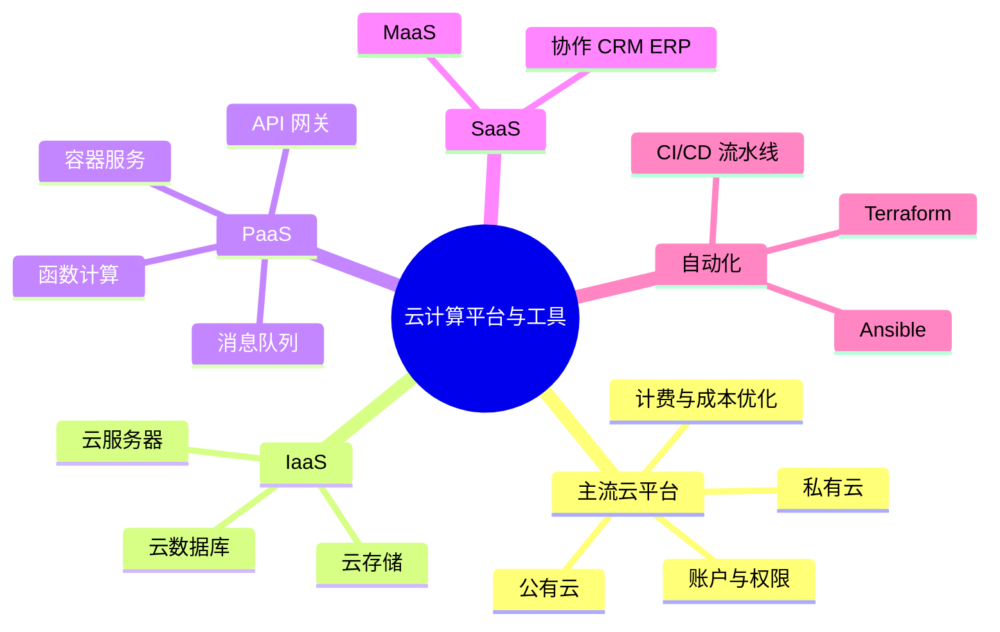

# 第 3 章 本章小结与练习

## 本章关键词

公有云、私有云、云服务器、云中间件、MaaS、自动化运维工具。

## 本章小结

本章介绍了云计算平台与工具的基本内容，涵盖主流云平台、IaaS、PaaS、SaaS 及自动化与持续集成技术。主流云平台如阿里云、腾讯云、华为云、AWS 和信服云（深信服云业务品牌），提供丰富的服务，帮助用户高效使用云计算资源。IaaS 层提供虚拟化基础设施，如虚拟机、存储和网络，实现资源的按需使用与弹性扩展，典型服务包括阿里云 ECS 和云数据库服务等。PaaS 层为开发者提供应用开发与部署平台，简化了底层基础设施管理，提升了云中间件的使用、应用托管及弹性伸缩能力。SaaS 层通过网络提供软件服务，用户无须安装维护，典型应用如协作工具、客户关系管理系统和人力资源管理系统等。此外，自动化工具如 Jenkins 和 GitLab CI 支持代码的自动构建、测试与部署，提升开发效率与质量。云计算平台与工具在不同层次满足用户需求，推动信息技术的发展与创新。

把本章压缩成 6 句话：

1. 国内主流**公有云**有阿里云、腾讯云、华为云，国外以 AWS 为代表；**私有云**平台有信服云、H3C 云等；注册后要做实名认证，并用子账号和权限管理团队成员。
2. 选择云服务要看计费模式：**按量付费**适合波动大、时间短的业务，**包年包月 / 预留实例**适合长期稳定的业务，**抢占式（竞价）实例**适合可中断的任务；存储用生命周期规则把冷数据转到低价存储。
3. **IaaS 层**的典型服务是云服务器 ECS、对象存储 OSS 和云数据库，使用云服务器要经过创建、登录、监控、扩缩容、安全和费用管理等环节。
4. **PaaS 层**的典型服务有消息队列（异步解耦）、API 网关（统一入口、路由、鉴权、限流）、容器服务和函数计算（应用托管与弹性伸缩）。
5. **SaaS 层**有协作、CRM、ERP、项目管理、HRM、在线教育等各类应用；**MaaS** 把大模型做成服务，按调用量计费，由模型平台层、模型服务层、模型应用开发层组成。
6. **Terraform** 用代码创建云资源，**Ansible** 通过 SSH 批量配置服务器；**CI/CD 流水线**让代码提交后自动构建、测试、部署，云上的实现有 AWS CodePipeline、Azure DevOps、阿里云云效等。

**下一章预告**：第 4 章把前面的知识用起来：在云服务器上搭一个网站，用 Docker Compose 一次启动“网站 + 缓存”两个容器，了解容器编排；再看云计算在政务、教育、医疗、金融等行业的应用，以及云计算与大数据、人工智能、物联网的结合。

## 参考文献

**教材与专著**

1. 埃尔. 云计算：概念、技术与架构[M]. 龚奕利，贺莲，胡创，译. 北京：机械工业出版社，2014. 云服务的计费模型与成本度量，对应 3.1.3 节。
2. 崔升广. 云计算技术应用基础：微课版[M]. 北京：人民邮电出版社，2023. 公有云平台操作的入门实例，可与实验 3-1 对照。
3. 汤兵勇，徐亭，章瑞. 云图·云途：云计算技术演进及应用[M]. 北京：机械工业出版社，2021. 云平台与 DevOps 的发展，对应 3.5 节。

**在线资源**

4. 阿里云. 云服务器 ECS 产品文档[EB/OL]. [2026-11-01]. https://help.aliyun.com/zh/ecs/. 实例创建、安全组、计费方式，对应 3.2.1 节和实验 3-1。
5. 阿里云. 大模型服务平台百炼 文档[EB/OL]. [2026-11-01]. https://help.aliyun.com/zh/model-studio/. API Key 创建与 OpenAI 兼容调用方式，对应实验 3-2。
6. GitHub. GitHub Actions documentation[EB/OL]. [2026-11-01]. https://docs.github.com/actions. 工作流文件语法，对应实验 3-3。
7. HashiCorp. Terraform documentation[EB/OL]. [2026-11-01]. https://developer.hashicorp.com/terraform/docs. 基础设施即代码的概念与用法，对应 3.5.1.1 节。
8. Red Hat. Ansible documentation[EB/OL]. [2026-11-01]. https://docs.ansible.com/. Playbook 与无代理架构，对应 3.5.1.2 节。

## 课后练习

**一、单项选择题**

**1.** 新华三的私有云产品中，负责云资源管理和分配、提供自服务门户的是（　　）。

- A. CVK
- B. CVM
- C. CIC
- D. CMP

??? tip "答案与解析"
    **答案：C**

    解析：H3C 云的技术架构中，CVK 是虚拟化内核平台，CVM 是虚拟化管理系统，CIC（云业务管理中心）负责云资源的管理和分配，提供自服务门户和运营管理功能。

    考查：私有云平台 · 认知层次：记忆 · [回看 3.1.1](3-1.md#3112)
    { .quiz-meta }

**2.** 企业有一套全年 7×24 小时运行、负载稳定的核心业务系统，从成本角度最合适的计费方式是（　　）。

- A. 包年包月或预留实例
- B. 按量付费
- C. 抢占式实例
- D. 免费试用

??? tip "答案与解析"
    **答案：A**

    解析：长期稳定运行的业务，预付费方式单价更低；按量付费适合波动大的业务；抢占式实例可能被回收，不适合核心业务。

    考查：选择合适的计费模式 · 认知层次：应用 · [回看 3.1.3](3-1.md#3131)
    { .quiz-meta }

**3.** 登录 Linux 云服务器最常用的方式是（　　）。

- A. 远程桌面（RDP）
- B. SSH
- C. FTP
- D. 电子邮件

??? tip "答案与解析"
    **答案：B**

    解析：Linux 实例通常用 SSH 工具（如 PuTTY、终端）通过公网 IP 和密码或密钥登录；Windows 实例用远程桌面。

    考查：登录云服务器 · 认知层次：记忆 · [回看 3.2.1](3-2.md#3211)
    { .quiz-meta }

**4.** 关于云服务器的安全管理，下列做法**错误**的是（　　）。

- A. 定期检查安全组规则，只允许必要的流量
- B. 使用强密码或 SSH 密钥
- C. 定期更新操作系统和软件包
- D. 为了方便同事登录，把 root 密码设为 123456 并对全网开放 22 端口

??? tip "答案与解析"
    **答案：D**

    解析：弱密码加上对全网开放 22 端口，极易被暴力破解。A、B、C 都是 3.2.1.1 节推荐的做法。

    考查：云服务器的安全管理 · 认知层次：评价 · [回看 3.2.1](3-2.md#3211)
    { .quiz-meta }

**5.** 消息队列在“生产者产生消息太快、消费者来不及处理”时，起到的主要作用是（　　）。

- A. 加密
- B. 负载均衡
- C. 缓冲
- D. 存储备份

??? tip "答案与解析"
    **答案：C**

    解析：即使暂时没有读取操作，新消息仍可放入队列，消息队列发挥了缓冲区的作用，让生产和消费解耦。

    考查：消息队列使用 · 认知层次：理解 · [回看 3.3.1](3-3.md#3312)
    { .quiz-meta }

**6.** 阿里云容器服务 Kubernetes 版的简称是（　　）。

- A. ACK
- B. ECS
- C. OSS
- D. RDS

??? tip "答案与解析"
    **答案：A**

    解析：ACK 是阿里云容器服务 Kubernetes 版；ECS 是云服务器，OSS 是对象存储，RDS 是云数据库。

    考查：容器服务 · 认知层次：记忆 · [回看 3.3.2](3-3.md#3321)
    { .quiz-meta }

**7.** 字节跳动推出的、具备即时通信、智能日历、云文档等功能的一站式协作平台是（　　）。

- A. 钉钉
- B. 飞书
- C. 企业微信
- D. Jira

??? tip "答案与解析"
    **答案：B**

    解析：钉钉属于阿里巴巴，企业微信属于腾讯，Jira 是项目管理工具。

    考查：常见的 SaaS 应用 · 认知层次：记忆 · [回看 3.4.1](3-4.md#3411)
    { .quiz-meta }

**8.** CI/CD 流水线中，“开发者提交代码后，CI 工具自动编译代码、运行单元测试”属于（　　）阶段。

- A. 源码管理
- B. 监控与反馈
- C. 部署到生产环境
- D. 持续集成

??? tip "答案与解析"
    **答案：D**

    解析：持续集成包括代码提交、自动化构建（编译、单元测试）和代码质量检查。

    考查：CI/CD 关键阶段 · 认知层次：理解 · [回看 3.5.2](3-5.md#3521)
    { .quiz-meta }

**二、多项选择题**

**9.** 降低云服务成本的有效做法有（　　）。

- A. 定期清理闲置的云服务器和云硬盘
- B. 对稳定业务购买预留实例
- C. 利用自动扩展，低谷期减少实例
- D. 把很少访问的数据转到归档存储

??? tip "答案与解析"
    **答案：ABCD**

    解析：四项都是 3.1.3.2 节介绍的成本优化方法：资源管理与调整、合理利用折扣、提高资源利用率、优化存储策略。

    考查：云服务的成本优化 · 认知层次：应用 · [回看 3.1.3](3-1.md#3132)
    { .quiz-meta }

**10.** 阿里云云数据库 RDS 提供的数据库引擎包括（　　）。

- A. MySQL
- B. SQL Server
- C. PostgreSQL
- D. Excel

??? tip "答案与解析"
    **答案：ABC**

    解析：3.2.2.1 节介绍了云数据库 MySQL 版、SQL Server 版、PostgreSQL 版。Excel 是电子表格软件，不是数据库引擎。

    考查：云数据库的使用 · 认知层次：记忆 · [回看 3.2.2](3-2.md#3221)
    { .quiz-meta }

**11.** 下列关于 Terraform 和 Ansible 的说法，正确的有（　　）。

- A. Terraform 适合创建和管理 VPC、云服务器等云资源
- B. Ansible 必须在每台被管理的服务器上安装代理程序
- C. Ansible 使用 YAML 格式编写 Playbook
- D. 两者结合可以实现从创建基础设施到部署应用的全面自动化

??? tip "答案与解析"
    **答案：ACD**

    解析：Ansible 是无代理架构，通过 SSH 执行任务，B 错误。

    考查：自动化运维工具 · 认知层次：理解 · [回看 3.5.1](3-5.md#3513)
    { .quiz-meta }

**12.** 下列工具中，属于 CI/CD 工具的有（　　）。

- A. Prometheus
- B. Jenkins
- C. GitLab CI
- D. GitHub Actions

??? tip "答案与解析"
    **答案：BCD**

    解析：Prometheus 是监控工具。Jenkins、GitLab CI、GitHub Actions 都用于自动化构建、测试和部署。

    考查：CI/CD 关键组件 · 认知层次：记忆 · [回看 3.5.2](3-5.md#3521)
    { .quiz-meta }

**三、判断题**

**13.** 云平台的主账号权限很大，日常工作应为团队成员创建子账号，并按需授予最小权限。（　　）

- √
- ×

??? tip "答案与解析"
    **答案：√**

    解析：阿里云的 RAM 访问控制、华为云的 IAM、AWS 的 IAM 都支持创建子用户并授权，避免多人共用主账号带来的风险。

    考查：云服务的账户管理 · 认知层次：理解 · [回看 3.1.2](3-1.md#3122)
    { .quiz-meta }

**14.** 抢占式（竞价）实例价格低，适合运行银行核心交易系统。（　　）

- √
- ×

??? tip "答案与解析"
    **答案：×**

    解析：竞价实例可能被云服务商回收，只适合对时效性要求不高、可以中断的任务。

    考查：合理利用折扣与优惠 · 认知层次：评价 · [回看 3.1.3](3-1.md#3132)
    { .quiz-meta }

**15.** 用弹性负载均衡实现同步解耦一般不需要修改代码，而用消息队列实现异步解耦需要调整代码。（　　）

- √
- ×

??? tip "答案与解析"
    **答案：√**

    解析：这是 3.3.1.2 节的原话。异步解耦要求程序改为“发消息、取消息”的方式工作。

    考查：消息队列使用 · 认知层次：记忆 · [回看 3.3.1](3-3.md#3312)
    { .quiz-meta }

**16.** 使用 MaaS 调用大模型，用户需要先自己下载模型、购买 GPU 服务器并完成部署。（　　）

- √
- ×

??? tip "答案与解析"
    **答案：×**

    解析：MaaS 的意义就是“即开即用”，模型的训练、部署、运行都由服务商负责，用户通过 API 调用、按量付费。实验 3-2 只需要十几行代码。

    考查：MaaS · 认知层次：理解 · [回看 3.4.2](3-4.md#342)
    { .quiz-meta }

**17.** 蓝绿部署同时保留新旧两套环境，切换出现问题时可以迅速切回旧环境，降低部署风险。（　　）

- √
- ×

??? tip "答案与解析"
    **答案：√**

    解析：蓝绿部署是 3.5.2.2 节列出的 CI/CD 最佳实践之一，“蓝”“绿”两套环境轮流承担线上流量，实现无缝切换和快速回退。

    考查：CI/CD 最佳实践 · 认知层次：理解 · [回看 3.5.2](3-5.md#3522)
    { .quiz-meta }

**四、简答题**

**18.** 某初创公司准备上线一个网站，预计白天访问多、夜里很少，促销时访问量是平时的 5 倍。请为它设计云服务器的计费和扩缩容方案。

??? tip "参考答案"
    保底部分：用 1～2 台包年包月的云服务器承担全天的基本访问，单价较低；弹性部分：配置弹性伸缩，CPU 利用率超过阈值（如 70%）时自动增加按量付费实例，低于阈值（如 30%）时自动释放；促销前可以提前设置定时扩容。这样既保证高峰可用，又避免全天按高峰配置造成浪费。

    评分要点：包年包月承担基本负载（2 分）；按量付费 + 弹性伸缩应对波动（2 分）；提到阈值或定时扩容（1 分）。

**19.** 说明 API 网关在微服务架构中的作用，至少写出四项功能。

??? tip "参考答案"
    API 网关是所有微服务的统一流量入口，把系统内部架构封装起来，调用方只需知道网关对外暴露的接口。主要功能：路由转发（把请求转到正确的后端服务）、负载均衡（在多个实例间分配流量）、限流熔断（防止服务被压垮）、统一鉴权（身份认证和权限检查）、协议转换、API 配置管理与文档生成。

**20.** 用自己的话说明 CI/CD 流水线的四个关键阶段。

??? tip "参考答案"
    源码管理：用 Git 等工具管理代码版本；持续集成：代码提交后自动构建、运行单元测试和质量检查；持续交付：自动化测试后部署到测试环境，测试通过后部署到生产环境；监控与反馈：监控线上运行状态，发现问题反馈给开发团队修复。

**五、实操题**

**21.** 参照实验 3-1，在云服务器（或实验 2-2 的 Docker 环境）上部署 Nginx，网页内容为“姓名 + 学号 + 今天的日期”，并说明你在安全组中添加了哪条规则。提交浏览器访问截图。

??? tip "参考思路"
    安装 Nginx 后，执行 `echo "<meta charset='utf-8'><h1>张三 2026001 $(date +%F)</h1>" > /var/www/html/index.html`；安全组入方向添加“TCP 80，授权对象 0.0.0.0/0，允许”；浏览器访问 `http://公网IP`。
