# 4.1 云计算应用案例 {#41}

!!! info "学前导读"

    前三章讲的是云计算“是什么”“靠什么”“有哪些服务”，本节开始动手“用起来”。三个案例由浅入深：

    1. **搭一个简单的网站**（4.1.1）：把第 3 章学过的云服务器、对象存储、云数据库、域名和 SSL 证书串成一条完整的流程；
    2. **构建一个数据分析平台**（4.1.2）：数据从上传、存储到分析，每一步都有对应的云服务；
    3. **用容器部署微服务应用**（4.1.3）：从选容器平台、拆分微服务，到写 Dockerfile、构建镜像、运行容器，再到用 Kubernetes 编排。

    4.1.1 和 4.1.3.3 是本节重点，[实验 4-1](labs.md#4-1) 和 [实验 4-2](labs.md#4-2) 会分别带你完成。4.1.2 中出现的大数据工具名称较多，知道它们分别属于“采集、存储、分析”哪一步即可，不必记忆。

## 4.1.1 搭建一个简单的网站 {#411}

搭建一个简单的网站可以分为以下关键步骤：选择云服务提供商、配置云服务器、配置云存储、设置云数据库、开发网站代码、部署网站到云服务器、域名绑定和 SSL 证书配置等。

### 4.1.1.1 选择云服务提供商 {#4111}

目前有许多知名的云服务提供商，如阿里云、腾讯云、华为云等。首先需要注册一个账号，然后根据自己的需求和预算选择合适的套餐。具体注册界面如图 4-1~ 图 4-3 所示。

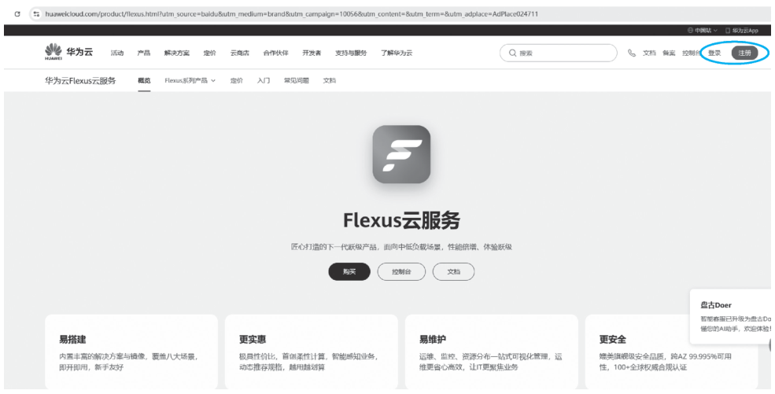{ loading=lazy }

图 4-3 华为云注册页面
{ .fig-caption }

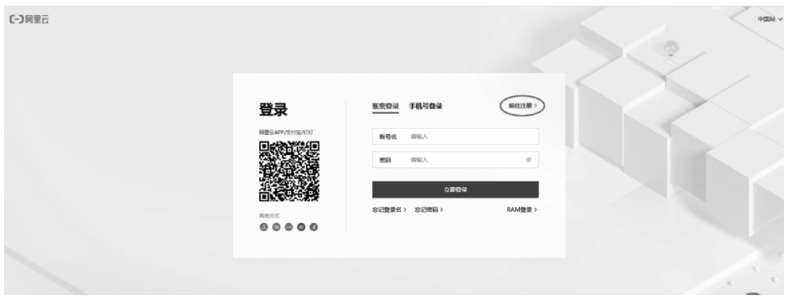{ loading=lazy }

图 4-1 阿里云注册页面
{ .fig-caption }

阿里云地址：https://www.aliyun.com/。

腾讯云地址：https://cloud.tencent.com/。

华为云地址：https://www.huaweicloud.com/。

### 4.1.1.2 配置云服务器 {#4112}

步骤一：登录云服务提供商的管理控制台，选择“云服务器”服务。

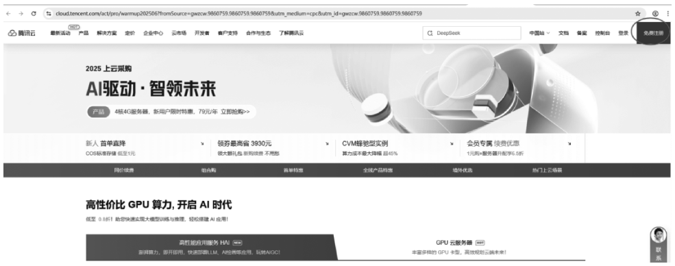{ loading=lazy }

图 4-2 腾讯云注册页面
{ .fig-caption }

步骤二：创建云服务器实例。选择操作系统（如 Linux 的 Ubuntu、CentOS，或者 Windows Server），配置服务器的 CPU、内存、磁盘等资源。

步骤三：等待云服务器创建完成。创建完成后，可以获得服务器的 IP 地址、用户名和密码等信息。

#### 1. 阿里云

以阿里云为例，以下是配置云服务器的步骤。

（1）创建 ECS 实例。

①登录阿里云控制台。

②在“精选产品”中选择“云服务器 ECS”，如图 4-4 所示。

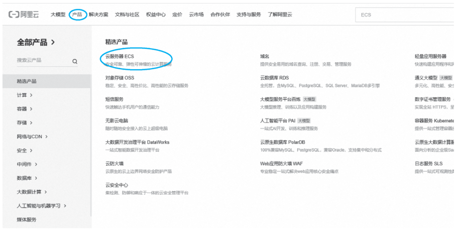{ loading=lazy }

图 4-4 选择“云服务器 ECS”
{ .fig-caption }

③单击“创建实例”。

④选择操作系统镜像（如 Ubuntu Server）。

⑤选择实例规格（如入门级或企业级）。

⑥配置网络和安全组。

⑦创建密钥对，用于 SSH 访问实例。

**说明**

若要配置一台云服务器，建议选择大平台云服务器，推荐阿里云、信服云的云服务器或物理服务器。这些大平台云服务器提供优惠活动，性价比高，运行稳定，安全能力强，非常适合中小企业或个人开发者部署。配置建议如下。

（1）系统：Ubuntu 22.04 / 24.04 或 Alibaba Cloud Linux 3。

（2）CPU：2 核。

（3）内存：4 GB。

（4）带宽：1 Mbps 以上。

（2）连接到 ECS 实例。

使用 SSH 连接到实例。如果使用的是 Linux 或 Mac 系统，可以在终端运行以下命令：格式为 `ssh root@你的服务器IP地址`，使用密钥对登录时如 `ssh -i /path/to/your-key-pair.pem ubuntu@your-server-ip-address`。

服务商会提供一个公网 IP 地址和登录账户信息（如 root 用户密码），可使用 SSH 连接（Windows 用户可以用 Xshell 或 PuTTY），如图 4-5 所示。

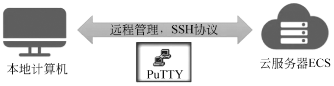{ loading=lazy }

图 4-5 SSH 连接 ECS 主机
{ .fig-caption }

首次登录时，系统可能提示你确认连接，输入 yes 即可。

#### 2. 华为云

以华为云为例，表 4-1 是配置云服务器的步骤。

表 4-1 配置云服务器的步骤
{ .tab-caption }

| 步骤 | 具体操作 | 图示/备注 |
|---|---|---|
| 购买 ECS | 产品→计算→弹性云服务器 ECS→“购买弹性云服务器” | 图 4-6 弹性云服务器 |
| 选择计费模式与规格 | 计费模式选“包年/包月”或“按需”→区域就近选（如华东-上海）→实例规格选“通用计算型 S7” | 图 4-7 镜像与规格页 |
| 配置网络与安全组 | 网络选默认 VPC→安全组手动添加规则：业务访问的入方向 TCP 22、80、443 开放；出方向：根据实例的实际需求配置规则，确保实例能够正常访问外部网络。例如，允许访问特定的云服务地址或互联网地址 | 图 4-8 安全组规则页 |
| 获取登录信息 | 实例列表→对应 ECS→“远程登录/密码”→重置 root 密码并下载私钥 | 按照指引登录（请牢记 ECS 用户登录密码） |
| 部署应用 | SSH 登录后执行 | 图 4-9 登录云服务器 |

### 4.1.1.3 配置云存储 {#4113}

云存储可以根据需求来配置。在生产业务中，存储是必需的模块。配置云存储的步骤如下。

（1）在云服务提供商的控制台中找到云存储服务（如对象存储），如图 4-10 所示。

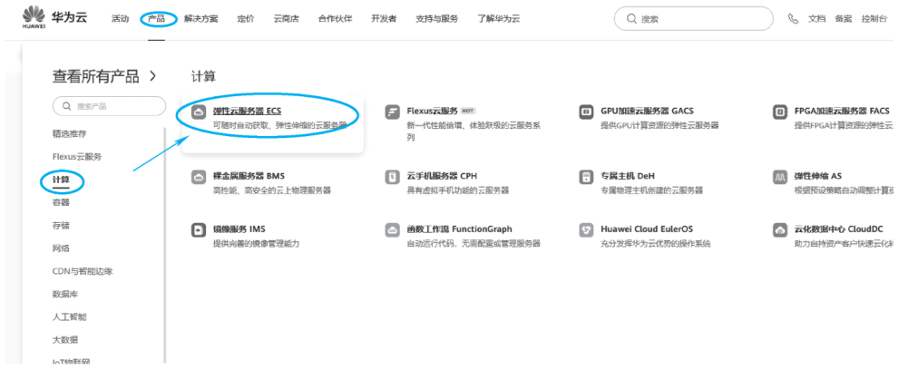{ loading=lazy }

图 4-6 弹性云服务器
{ .fig-caption }

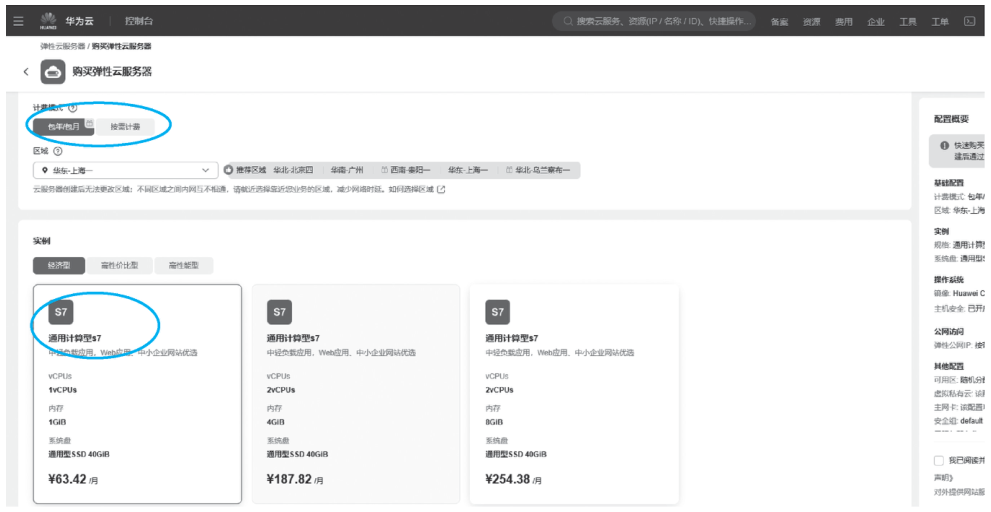{ loading=lazy }

图 4-7 镜像与规格页
{ .fig-caption }

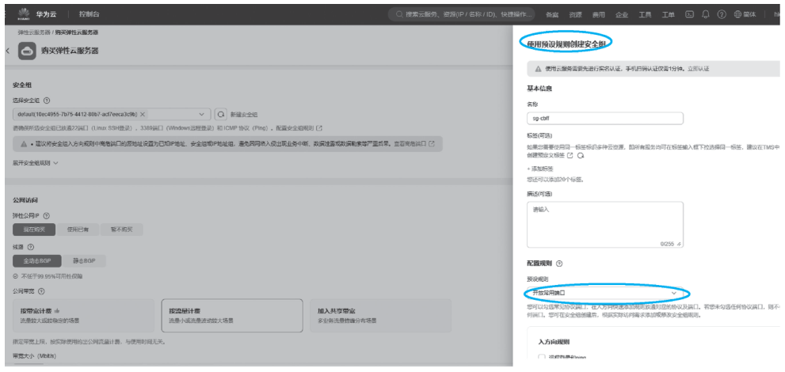{ loading=lazy }

图 4-8 安全组规则页
{ .fig-caption }

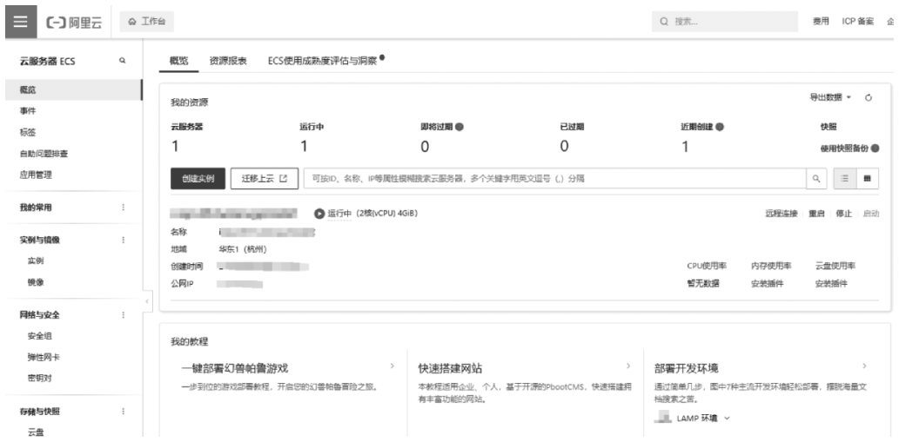{ loading=lazy }

图 4-9 登录云服务器
{ .fig-caption }

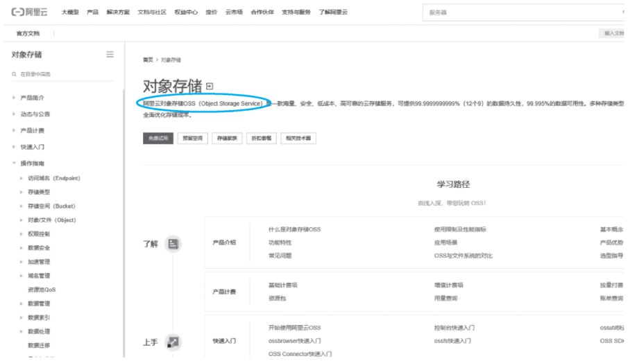{ loading=lazy }

图 4-10 阿里云对象存储
{ .fig-caption }

（2）创建一个存储桶（Bucket）。存储桶是云存储中的基本容器，用于存储网站文件（如图片、视频、静态页面等）。

（3）配置存储桶的权限。通常需要将其设置为公开读取，以便网站用户可以访问存储在其中的文件。

（4）将网站的静态文件上传到存储桶中。可以通过控制台的文件上传功能或者使用云服务提供商提供的 API 工具进行上传。

### 4.1.1.4 设置云数据库 {#4114}

在购买和部署好 ECS 后，需要搭建 LAMP（Linux、Apache、MySQL、PHP）环境，选择合适的数据库。阿里云数据库类型如图 4-11 所示。

（1）在云服务提供商控制台中选择云数据库服务（如关系数据库 RDS）。

（2）创建一个数据库实例。选择数据库类型（如 MySQL、PostgreSQL 等），并配置数据库的参数，如数据库名称、用户名、密码等。

（3）等待数据库创建完成。

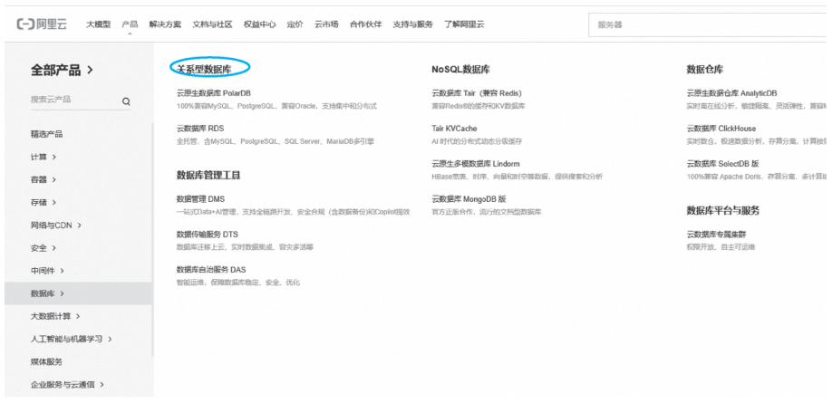{ loading=lazy }

图 4-11 阿里云数据库类型
{ .fig-caption }

### 4.1.1.5 开发网站代码 {#4115}

（1）根据网站需求，使用合适的编程语言和框架进行开发。例如，若要创建一个简单的博客网站，可以使用 PHP 和 WordPress 框架。

（2）在开发过程中，连接云数据库来存储和管理网站数据（如用户信息、文章内容等）。

（3）对于网站中的静态资源（如图片、CSS 文件等），可以从云存储中引用。

### 4.1.1.6 部署网站到云服务器 {#4116}

（1）将开发好的网站代码打包成一个可部署的格式，如将 PHP 文件、HTML 文件等打包成一个压缩包。

（2）使用 SSH 或其他远程连接工具连接到云服务器。

（3）在云服务器上安装必要的软件环境（如 Web 服务器软件 Apache 或 Nginx，以及相应的编程语言运行环境）。

（4）将网站代码上传到云服务器，并解压到合适的目录下（如 Web 服务器的网站根目录）。

（5）配置 Web 服务器，使其能够正确地访问和运行网站代码。

（6）测试网站是否能够正常运行。可以在浏览器中输入云服务器的 IP 地址来访问网站。

### 4.1.1.7 域名绑定和 SSL 证书配置 {#4117}

（1）若使网站有一个易于记忆的域名，可以购买一个域名并通过域名解析将域名指向云服务器 IP 地址。

（2）为了提高网站的安全性，可以为网站配置 SSL 证书。许多云服务提供商都提供免费的 SSL 证书服务。阿里云配置方法如图 4-12 所示，阿里云 SSL 证书管理如图 4-13 所示。

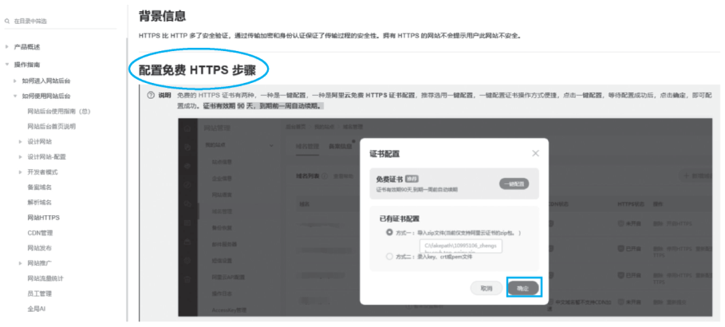{ loading=lazy }

图 4-12 阿里云配置方法
{ .fig-caption }

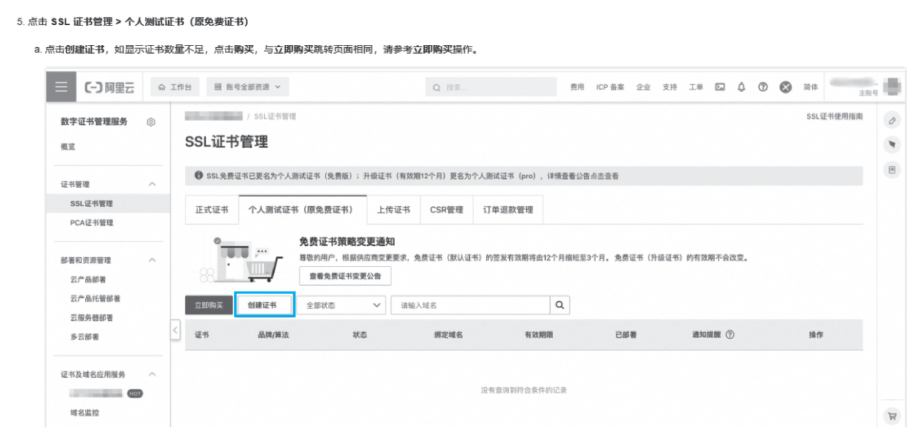{ loading=lazy }

图 4-13 阿里云 SSL 证书管理
{ .fig-caption }

需要注意的是，在整个搭建过程中，要确保各个组件之间的网络连接是正常的，并且要按照云服务提供商的文档和指南进行操作。同时，要定期备份网站数据和配置，以防止数据丢失。

下面的动画把 4.1.1 的各个步骤放到一次网页访问中：每一项配置都对应请求经过的一个环节，漏了哪一项，浏览器就会出现不同的错误。

<iframe class="sim-frame" src="../../sims/website-on-cloud/main.html" height="620" loading="lazy" title="云上网站的一次访问"></iframe>

先按默认配置点“访问网站”，根据浏览器显示的错误判断漏了哪一步；逐项补上配置，直到网页和图片都能正常显示、地址栏出现小锁。[全屏打开](../../sims/website-on-cloud/main.html){ target=_blank } · [教学说明](../../sims/website-on-cloud/index.md)
{ .sim-caption }

## 4.1.2 构建一个简单的数据分析平台 {#412}

### 4.1.2.1 数据上传 {#4121}

使用云存储服务：可以选择云服务提供商的存储服务，如 AWS S3、Azure Blob Storage 或阿里云 OSS，用于存储上传的数据文件。

自动化上传：通过编写脚本或使用云服务提供的软件开发工具包，可以实现数据的自动上传。例如，使用 AWS SDK 将数据文件上传到 S3 存储桶。

若数据来源多样且复杂，可选择 Apache Kafka、Apache Flume 等分布式数据采集工具，能够实时或批量地从不同数据源采集数据；对于简单的数据库数据采集，也可以使用像 canal 这样的工具来获取增量数据。

### 4.1.2.2 数据存储 {#4122}

根据数据类型和分析需求选择合适的云存储服务或数据库。例如，结构化数据可存储在阿里云 RDS、腾讯云数据库等关系数据库中；大规模的非结构化数据和半结构化数据则适合存储在阿里云 OSS、腾讯云对象存储等分布式存储系统中，或者使用 Hadoop 分布式文件系统 HDFS。存储方案如下。

结构化数据：可以使用关系数据库（如 MySQL、PostgreSQL）或 NoSQL 数据库（如 MongoDB、Cassandra）。

非结构化数据：对于日志文件、图片等非结构化数据，云存储服务（如 S3、Blob Storage）是理想的选择。

数据湖架构：对于大规模数据分析，可以采用数据湖架构，将数据以原始格式存储在分布式文件系统中，通过数据虚拟化技术实现跨数据源分析。

### 4.1.2.3 数据分析 {#4123}

对于离线批量数据处理，可使用 Hadoop MapReduce 或 Apache Spark；实时数据处理则可选用 Apache Flink 或 Spark Streaming。此外，还可利用云厂商提供的数据仓库服务如阿里云 AnalyticDB、腾讯云数据仓库等，来支持复杂的数据分析和查询。

#### 1. 使用数据分析工具

（1）BI 工具：如 Tableau、Power BI 等，用于数据可视化和报表生成。

（2）大数据处理框架：如 Apache Spark、Flink 等，用于处理大规模数据集。

#### 2. 云服务集成

（1）AWS：可以使用 AWS Glue 进行数据提取、转换和加载，并结合 Amazon Athena 进行交互式查询。

（2）Azure：利用 Azure Databricks 进行数据分析，结合 Azure Functions 实现自动化数据处理。

（3）阿里云：可以使用阿里云 Data Lake Formation（DLF）和 MaxCompute 进行数据湖管理和分析。

以下是一个基于 Spring Boot 的数据分析平台的简单实现示例。

（1）数据导入与存储。

使用 Spring Boot 集成云存储服务（如阿里云 OSS）来存储上传的数据文件；将数据导入数据库（如 MySQL）中进行持久化存储。

（2）数据处理与分析。

利用 Spring Boot 集成 Apache Spark 进行数据处理和分析；通过 REST API 暴露数据处理和分析的功能，允许用户上传数据并获取分析结果。

（3）数据展示与可视化。

使用前端框架（如 React 或 Vue.js）与 Spring Boot 后端集成，实现数据的动态展示和交互。

云服务提供商的解决方案如下。

（1）AWS：提供全面的分析服务，如 Amazon Redshift（数据仓库）、Amazon QuickSight（BI 工具）。

（2）Azure：提供 Azure Synapse Analytics（数据仓库）、Azure Machine Learning（机器学习服务）。

（3）阿里云：提供 DataV-Board（数据可视化工具）（见图 4-14）、AnalyticDB（分析型数据库）。

{ loading=lazy }

图 4-14 阿里云 DataV-Board（数据看板）示例
{ .fig-caption }

借助云服务提供商的强大功能和开源工具的灵活性，可以构建一个高效、可扩展的数据分析平台，以满足不同业务场景的需求。

## 4.1.3 使用容器技术部署微服务应用 {#413}

### 4.1.3.1 选择合适的容器化平台 {#4131}

选择合适的容器化平台需要根据项目的具体需求、团队的技术能力、预算和未来的扩展计划决定。以下是一些常见的容器化平台及其技术优势和适用场景的介绍。

#### 1. Docker

Docker 是一种轻量级的容器化平台，适合将应用程序及其依赖项打包成独立的容器，便于在不同环境中快速部署和运行。

（1）技术优势。

①轻量级、启动快、资源占用少。

②易于使用，适合初学者和小型团队。

③适合微服务架构和持续集成/持续部署。

（2）适用场景。

开发和测试环境、小规模的应用部署和快速迭代。

#### 2. Kubernetes（K8s）

Kubernetes 是一个开源的容器编排平台，能够自动部署、扩展和管理容器化应用程序。它是目前最流行的容器编排工具。

（1）技术优势。

①功能强大，支持自动化部署、扩展和故障恢复。

②适合大规模生产环境，具有高可用性和可扩展性。

③具有丰富的生态系统和社区支持。

（2）适用场景。

①大规模企业应用。

②需要高可用性和自动扩展的生产环境。

③云原生应用和微服务架构。

#### 3. Docker Swarm

Docker Swarm 是 Docker 官方提供的容器编排工具，能够将多个 Docker 引擎集群化，形成一个虚拟的集群。

（1）技术优势。

①与 Docker 引擎深度集成，使用简单。

②满足中小规模的容器编排需求。

（2）适用场景。

①中小规模企业的应用。

②对容器编排要求不高的场景。

#### 4. OpenShift

OpenShift 是基于 Kubernetes 的企业级容器化平台，能够提供额外的开发者友好功能。

（1）技术优势。

①具备企业级安全性、多租户支持和管理工具集成功能。

②适合快速迭代和交付的团队。

（2）适用场景。

①大型企业级应用。

②需要企业级安全性和管理工具的应用。

#### 5. Rancher

Rancher 是一个开源的容器管理平台，支持多种容器编排引擎，如 Kubernetes 和 Docker Swarm。

（1）技术优势。

①易用性强，适合初学者。

②支持多种云平台和容器编排引擎。

（2）适用场景。

①初创公司和小型团队。

②对容器编排和管理有简单需求的应用。

#### 6. Amazon ECS

Amazon ECS 是 Amazon Web Services 提供的容器服务，与 Docker 紧密集成。

（1）技术优势。

与 AWS 生态系统紧密集成，提供自动扩展和负载均衡功能。

（2）适用场景。

①在 AWS 云环境中运行的应用。

②需要自动扩展和负载均衡的应用。

综上所述，选择容器化平台时，需要综合考虑技术需求、团队能力、预算和未来的扩展性。小型团队或初创公司可以选择 Docker 或 Docker Swarm，因为它们易于使用，适合快速开发和部署。中型企业如果需要更强大的编排功能，可以选择 Kubernetes 或 Rancher。大型企业适合选择 Kubernetes、OpenShift 或 Amazon ECS，以满足高可用性、扩展性和企业级安全性的需求。

### 4.1.3.2 设计微服务架构 {#4132}

设计微服务架构旨在通过将单一应用程序划分为多个小型、独立且松散耦合的服务来提高系统的可扩展性、可维护性和灵活性。以下是设计微服务架构的一些关键步骤和微服务架构设计示例。

#### 1. 关键步骤

（1）明确业务需求和目标。

确定业务目标：明确希望通过微服务架构实现的目标，如提高系统的可扩展性、减少部署时间、提高团队效率等。

识别业务能力：将业务流程拆分为独立的业务能力，如订单管理、用户认证、支付处理等。

（2）服务拆分与设计。

基于业务域拆分服务：按照业务域或功能模块拆分服务，每个服务专注于单一业务功能，如订单服务、用户服务、支付服务等。

确定服务粒度：确定服务的粒度大小，既要避免服务过于细小（导致复杂的通信和管理），也要避免服务过于庞大（失去微服务的优势）。

服务接口设计：为每个服务设计清晰的 API 接口，遵循 RESTful 等标准，确保服务之间的通信简单。

（3）技术选型。

选择编程语言：选择适合团队和业务需求的编程语言，可以为不同的服务选择不同的语言（多语言支持是微服务的优势之一）。

选择框架和工具：选择适合微服务的技术框架，如 Spring Boot、Node.js、Go 等。

选择通信协议：选择合适的通信协议，如 HTTP/REST、gRPC、消息队列（RabbitMQ、Kafka）等。

选择数据存储类型：每个服务可以使用独立的数据库，根据服务需求选择适合的数据库类型（关系数据库、NoSQL 数据库等）。

（4）服务独立开发与部署。

独立开发：每个服务可以由独立的团队开发，团队可以独立选择技术栈和开发流程。

容器化与 CI/CD：使用 Docker 容器化服务，结合 CI/CD 工具（如 Jenkins、GitLab CI、GitHub Actions）实现自动化构建、测试和部署。

自动化测试：为每个服务编写自动化测试，确保服务的稳定性和正确性。

（5）服务编排与管理。

使用 API 网关：使用 API 网关（如 Kong、Spring Cloud Gateway）来管理服务的入口流量，提供路由、负载均衡、认证等功能。

服务发现：使用服务发现工具（如 Eureka、Consul）来动态注册和发现服务实例。

负载均衡：实现负载均衡机制，确保请求均匀分配到不同的服务实例。

引入熔断器与重试机制：引入熔断器（如 Hystrix）和重试机制，处理服务之间的失败和重试逻辑。

（6）数据管理。

服务独立的数据库：每个服务拥有独立的数据库，避免数据耦合。

确保数据一致性：采用适当的策略（如最终一致性模型、Saga 模式等）确保数据一致性。

事件驱动架构：使用事件驱动架构来实现服务之间的异步通信和数据同步。

（7）服务版本化与兼容性。

API 版本化：确保服务的 API 有版本管理，允许不同版本的 API 同时运行。

考虑向后兼容性：设计 API 时考虑向后兼容性，避免对客户端造成影响。

（8）持续优化与迭代。

反馈循环：建立快速反馈机制，通过监控、用户反馈等不断优化服务。

技术债务管理：定期评估和处理技术债务，保持系统的健康和可持续性。

#### 2. 架构设计示例

设计一个电商应用，可以按照以下方式拆分服务。

（1）用户服务：负责用户注册、登录、信息管理。

（2）订单服务：处理订单创建、订单状态更新、订单查询。

（3）商品服务：管理商品信息、库存、价格。

（4）支付服务：处理支付流程、支付结果通知。

（5）通知服务：发送邮件、短信等通知。

（6）推荐服务：基于用户行为推荐商品。

### 4.1.3.3 构建容器镜像 {#4133}

构建容器镜像并运行容器，主要基于 Docker 平台实现。Docker 是一个开源的应用容器引擎，允许开发者将应用程序及其依赖打包到一个可移植的容器中。以下是详细的构建步骤及代码实例。

#### 1. 安装 Docker

（1）目标：确保开发或生产环境具备运行容器的基础设施。安装 Docker 是进行容器化部署的前提，它使得用户能够在隔离的环境中运行应用程序，同时简化应用程序的部署和管理流程。

（2）确保已安装 Docker。可以通过以下命令检查是否已安装 Docker：

```bash
docker --version
```

如果未安装，可前往 Docker 官方网站 https://docs.docker.com/get-started/get-docker/ 下载并安装适合操作系统的版本。

#### 2. 编写 Dockerfile

（1）目标：定义容器镜像的构建流程，确保镜像包含应用程序运行所需的一切。Dockerfile 是一个文本文件，其中包含一系列指令，用于自动化构建 Docker 镜像。编写 Dockerfile 的目标是明确镜像的构建步骤（包括选择基础镜像、安装依赖、复制文件等），从而确保构建出的镜像包含应用程序及其所有依赖项，实现应用程序的“一次构建，到处运行”。

（2）以下是一个简单的 Dockerfile 示例，用于构建一个运行 Python Web 应用的容器镜像。

```dockerfile
# 使用官方 Python 基础镜像
FROM python:3.9-slim

# 设置工作目录
WORKDIR /app

# 将当前目录下的 requirements.txt 文件复制到容器的 /app 目录下
COPY requirements.txt .

# 安装 Python 依赖
RUN pip install --no-cache-dir -r requirements.txt

# 将当前目录下的所有文件复制到容器的 /app 目录下
COPY . .

# 暴露容器的 80 端口
EXPOSE 80

# 定义容器启动时运行的命令
CMD ["python", "app.py"]
```

（3）命令解释。

`FROM python:3.9-slim`：指定基础镜像为 Python 3.9 的 slim 版本，这是一个精简的镜像，适合生产环境。

`WORKDIR /app`：设置容器内的工作目录为 /app。

`COPY requirements.txt .`：将宿主机的 requirements.txt 文件复制到容器内的 /app 目录下。

`RUN pip install --no-cache-dir -r requirements.txt`：在容器内安装 Python 依赖。

`COPY . .`：将宿主机当前目录下的所有文件复制到容器的 /app 目录下。

`EXPOSE 80`：暴露容器的 80 端口，以便外部可以访问。

`CMD ["python", "app.py"]`：定义容器启动时运行的命令，即运行 app.py 文件。

#### 3. 构建 Docker 镜像

（1）目标：根据 Dockerfile 中的指令，自动化构建出包含应用程序及其依赖的容器镜像。构建 Docker 镜像的过程是将 Dockerfile 中的指令转化为实际的容器镜像的过程。这一步骤的目标是生成一个可移植、自包含的镜像文件，该文件包含了应用程序运行所需的所有组件，如代码、运行时、库、环境变量和配置文件等。

（2）在包含 Dockerfile 的目录下，运行以下命令来构建 Docker 镜像：

```bash
docker build -t my-python-app .
```

（3）命令解释。

`docker build`：Docker 构建镜像的命令。

`-t my-python-app`：指定构建的镜像名称为 my-python-app。

`.`：指定构建上下文为当前目录，Docker 会在此目录下查找 Dockerfile。

#### 4. 运行 Docker 容器

（1）目标：从构建的镜像启动容器实例，使应用程序在隔离的环境中运行。运行 Docker 容器是基于构建好的镜像创建并启动一个或多个容器实例的过程。这一步骤的目标是使应用程序在隔离的环境中运行，同时通过端口映射、卷挂载等方式与外部进行交互，实现应用程序的部署和运行。

（2）构建镜像后，可以使用以下命令来运行容器：

```bash
docker run -d -p 4000:80 my-python-app
```

（3）命令解释。

`docker run`：Docker 运行容器的命令。

`-d`：以 detached 模式运行容器，即容器在后台运行。

`-p 4000:80`：将宿主机的 4000 端口映射到容器的 80 端口。

`my-python-app`：指定要运行的镜像名称。

#### 5. 验证容器运行

（1）目标：确认容器已成功启动，并且确保应用程序在容器内正常运行。验证容器运行是确保应用程序在容器内部署成功的关键步骤。这一步骤的目标是通过访问应用程序提供的服务、查看容器日志或执行其他验证操作，确认容器已成功启动，并且应用程序在容器内按照预期运行。

（2）可以通过以下命令查看正在运行的容器：

```bash
docker ps
```

此外，还可以通过访问 http://localhost:4000（或服务器 IP 和端口）来验证 Web 应用是否正在运行。

#### 6. 停止和删除容器

（1）目标：在不需要容器运行时，安全地停止并清理容器资源。当容器不再需要运行时，停止和删除容器是释放系统资源、保持环境整洁的重要步骤。这一步骤的目标是安全地停止正在运行的容器，并删除其占用的资源，如 CPU、内存、磁盘空间等。

（2）如果需要停止正在运行的容器，可以使用以下命令：

```bash
docker stop <container_id>
```

其中 `<container_id>` 是要停止的容器的 ID，可以通过 docker ps 命令获取。

要删除容器，可以使用以下命令：

```bash
docker rm <container_id>
```

#### 7. 删除镜像

（1）目标：在不再需要镜像时，从系统中删除镜像，以节省存储空间。随着项目的推进和镜像的更新，可能不再需要旧的镜像。删除这些镜像可以释放存储空间，保持系统的整洁和高效。这一步骤的目标是识别并删除不再需要的镜像文件，避免存储空间的浪费。

（2）要删除镜像，可以使用以下命令：

```bash
docker rmi my-python-app
```

### 4.1.3.4 配置容器化平台 {#4134}

Kubernetes 配置：使用 Kubernetes 配置文件（如 YAML）定义服务、部署、存储等资源。

服务发现：使用 Kubernetes 服务发现机制，简化服务之间的通信。

部署微服务到 Kubernetes 集群：创建 Deployment 和 Service 资源文件，如 my-service-deployment.yaml 和 my-service-service.yaml。使用 `kubectl apply -f my-service-deployment.yaml` 和 `kubectl apply -f my-service-service.yaml` 命令将资源配置到 Kubernetes 集群。

Kubernetes 最重要的思想是“声明期望状态”：你只告诉它“我要 3 个副本”，它会持续检查并自动修复。下面的动画演示 Pod 崩溃、节点宕机、扩缩容和滚动更新时，Kubernetes 是怎样保持期望状态的。

<iframe class="sim-frame" src="../../sims/k8s-self-healing/main.html" height="600" loading="lazy" title="Kubernetes 自愈与扩缩容"></iframe>

点击一个绿色 Pod 让它“崩溃”，或关闭一台节点，观察几秒后 Pod 数量自动恢复；拖动滑块改变副本数，再试试“升级到 v2”。[全屏打开](../../sims/k8s-self-healing/main.html){ target=_blank } · [教学说明](../../sims/k8s-self-healing/index.md)
{ .sim-caption }

### 4.1.3.5 实施自动化部署 {#4135}

#### 1. CI/CD 与自动化部署

（1）CI/CD 工具：使用 CI/CD 工具，如 Jenkins、GitLab CI/CD 等，实现自动化部署。CI/CD 工具通过自动化软件开发和部署流程，节省时间和人力，降低错误发生的可能性，并确保代码变更能够快速部署并交付给用户。

Jenkins 是一个广泛用于软件开发和部署中持续集成和持续交付自动化的开源自动化服务器。Jenkins 的功能可以通过多种插件进行扩展，从而构建支持不同语言和技术栈的 CI/CD 流水线。

GitLab CI/CD 是 GitLab 内置的 CI/CD 工具，与源代码管理紧密集成，可自动化软件集成、测试和部署。

（2）自动化部署的优势：自动化部署通过 CI/CD 工具显著减少部署时间，与手动部署相比，部署时间可减少高达 98%。同时，自动化部署减少了人为错误，通过自动化测试和一致的部署环境，能够在部署前彻底验证代码稳定性，主动发现并修复可能在部署后出现的错误，使软件交付更加可靠。

#### 2. 容器编排与容器网络

（1）容器编排工具：使用 Kubernetes 等容器编排工具，进行自动化容器的部署、扩展和管理。容器编排工具可有效管理和部署大量容器，有助于降低运营成本，提高系统可靠性。

Kubernetes 可自动配置和管理容器化应用程序的部署、扩展和管理，确保应用程序的高可用性和可扩展性。

（2）容器网络配置：

overlay 网络模式：用于跨多台宿主机的容器网络通信，实现不同宿主机上的容器之间能够像在同一局域网内一样进行通信。

Docker Compose 编排：对于简单的微服务应用，可以使用 Docker Compose 进行容器编排。创建 docker-compose.yml 文件，管理 MySQL、Redis 等依赖服务。执行 `docker compose up -d` 命令，所有服务自动拉起。

通过以上步骤，可以使用容器技术（如 Docker 和 Kubernetes）高效地部署微服务应用，确保环境一致性，实现快速扩缩容和资源隔离。

## 随堂小测

<div class="quiz" data-answer="C" markdown>

**1.** 网站已经部署在云服务器上，在服务器本机用 `curl localhost` 能看到网页，但在自己电脑的浏览器里访问公网 IP 一直“响应时间过长”。最可能的原因是（　　）。

- A. 网站代码写错了
- B. 没有配置 SSL 证书
- C. 安全组没有放行 80 端口
- D. 云数据库没有创建

</div>

??? tip "答案与解析"
    **答案：C**

    解析：本机能访问，说明 Web 服务器和网站代码都正常；外部访问超时，说明请求在到达服务器之前被挡住了，这正是安全组的作用。安全组要在入方向放行 TCP 80（HTTPS 还要 443）。

    考查：搭建网站的步骤 · 认知层次：应用 · [回看 4.1.1](#4112)
    { .quiz-meta }

<div class="quiz" data-answer="B" markdown>

**2.** 在 Dockerfile 中，指定基础镜像的指令是（　　）。

- A. `RUN`
- B. `FROM`
- C. `COPY`
- D. `CMD`

</div>

??? tip "答案与解析"
    **答案：B**

    解析：`FROM` 指定基础镜像，如 `FROM python:3.9-slim`；`RUN` 在构建时执行命令（如安装依赖）；`COPY` 复制文件到镜像；`CMD` 定义容器启动时运行的命令。

    考查：编写 Dockerfile · 认知层次：记忆 · [回看 4.1.3.3](#4133)
    { .quiz-meta }

<div class="quiz" data-answer="A" markdown>

**3.** 执行 `docker run -d -p 4000:80 my-python-app` 后，应在浏览器中访问（　　）。

- A. `http://localhost:4000`
- B. `http://localhost:80`
- C. `http://my-python-app`
- D. `http://localhost:4000:80`

</div>

??? tip "答案与解析"
    **答案：A**

    解析：`-p 4000:80` 的意思是“宿主机的 4000 端口 → 容器的 80 端口”，冒号前面是宿主机端口，后面是容器端口。从宿主机访问要用 4000 端口。

    考查：运行 Docker 容器 · 认知层次：应用 · [回看 4.1.3.3](#4133)
    { .quiz-meta }

<div class="quiz quiz-judge" data-answer="×" markdown>

**4.** 设计微服务架构时，服务拆得越细越好。（　　）

- √
- ×

</div>

??? tip "答案与解析"
    **答案：×**

    解析：教材在“确定服务粒度”中指出，既要避免服务过于细小（导致复杂的通信和管理），也要避免服务过于庞大（失去微服务的优势）。通常按业务域拆分，如用户服务、订单服务、支付服务。

    考查：设计微服务架构 · 认知层次：理解 · [回看 4.1.3.2](#4132)
    { .quiz-meta }
