# 4.2 行业场景应用 {#42}

## 4.2.1 云计算在电子政务中的应用 {#421}

### 4.2.1.1 政务云概述与特点 {#4211}

#### 1. 政务云概述

政务云是基于云计算技术，专门为电子政务打造的信息化基础设施服务平台。它整合了计算、存储、网络等多种资源，通过互联网或专用网络为政府部门提供灵活、高效的信息技术服务。电子政务在目标上以“政府职能转变”为基本出发点和立足点，侧重于政府行政管理信息化。新时代数字政府建设在核心目标上提升为服务于国家治理体系和治理能力现代化，是对“运用大数据提升国家治理现代化水平”要求的落实。“最多跑一次”“不见面办事”等形象地概括了各级政府以人民为中心，运用新技术完善治理体系、提高治理能力的具体模式和方法。我国电子政务起步于 20 世纪 80 年代末，其行业发展共经历了四个阶段，如图 4-15 所示。

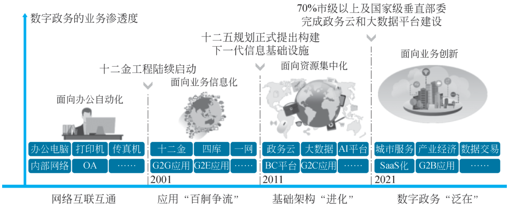{ loading=lazy }

图 4-15 我国电子政务行业发展的阶段
{ .fig-caption }

#### 2. 政务云的特点

（1）资源整合与共享：打破传统政务信息化建设中各部门各自为政、资源分散的局面，将分散在不同部门的硬件资源进行集中整合，实现资源的统一管理与调配，提高资源利用率，避免重复建设带来的资源浪费。

（2）灵活性与可扩展性：能够根据政府部门业务的变化和需求，灵活调整资源配置。无论是应对突发的业务高峰，还是随着业务发展逐步增加资源需求，政务云都可以快速响应，通过增加或减少计算、存储等资源来满足实际需要。

（3）成本效益优势：采用云计算模式，政府部门无须大规模投资建设和维护自有数据中心，降低了硬件采购、机房建设、运维人员等方面的成本。同时，按照实际使用量付费的模式，进一步提高了资金的使用效率。

▶ 配套微课 V4-1《政务云建设历史》（纸质书中为二维码，网络版视频待上线）

（4）安全性与可靠性：政务云高度重视数据安全和系统可靠性，通过多重安全防护机制，如数据加密、访问控制、安全审计等，保障政务数据的保密性、完整性和可用性。同时，具备冗余备份和容错能力，确保系统在部分硬件或软件出现故障时仍能正常运行，减少业务中断风险。

### 4.2.1.2 政务云建设模式 {#4212}

构建统一的智能集约平台支撑体系，是建设数字政府的重要基础，是促进数据共享汇聚、推进业务整体协同的重要前提，平台支撑体系的技术水平在一定程度上决定了数字政府的建设水准。《国务院关于加强数字政府建设的指导意见》（以下简称《指导意见》）对构建智能集约的平台支撑体系做出了明确部署，对提升数字政府建设水平具有先导性、基础性作用。《指导意见》提出构建全国一体化政务云平台体系，实现政务云资源统筹建设、互联互通、集约共享；国务院各部门政务云纳入全国一体化政务云平台体系统筹管理，各地区按照省级统筹原则开展政务云建设，集约提供政务云服务。《全国一体化政务大数据体系建设指南》（以下简称《建设指南》）提出形成全国政务大数据算力“一本账”，强化全国政务云监测分析，探索建立政务云资源统一调度机制，编制政务云建设管理规范、政务云监测指南等规范。

《指导意见》 《建设指南》作为数字政府建设的首个国家层面指导意见和实施指南，在推进“一云、一网”方面做出了明确指示。各省在数字经济发展规划和数字政府发展规划中均提出“1+M+N”的“一朵云”体系，在技术实现上最常见的是使用多云管理平台进行纳管。以下是三种常见的政务云建设模式。

#### 1. 集中统建型（省级主导）

集中统建型由政府部门自行投资、建设和运维政务云平台。这种模式适用于对数据安全和自主性要求极高，且具备较强技术实力和资金保障的政府部门。这种模式能够完全按照自身需求定制平台架构和功能，但建设周期长、成本高，需要持续投入大量的人力和物力进行维护和升级。

#### 2. 购买服务型（区县适用）

政府部门将政务云平台的建设、运营和维护全部委托给专业的云计算服务提供商。外包模式可以充分利用服务商的专业技术和经验，快速搭建政务云平台并投入使用，降低建设成本和技术风险。然而，这种模式对服务商的依赖度较高，政府部门在数据安全管理和控制权方面可能面临一定挑战，需要在合作合同中明确双方的权利和义务，加强对服务商的监管。

#### 3. 混合云模式（敏感业务+公共服务分离）

混合云模式结合了集中统建型和购买服务型的优点。政府部门将核心业务系统和敏感数据部署在自建的政务云平台上，以确保数据安全和自主可控；将一些非核心业务系统和通用应用服务外包给专业服务商，借助其资源和技术优势降低成本和提高效率。混合云模式既能满足政府部门对数据安全和业务自主性的要求，又能充分利用外部资源实现资源优化配置。

!!! tip "小贴士"

    1. 集中统建型

    案例：浙江省政务云，由浙江省大数据发展管理局统一建设，承载全省 78 个厅局、1 100 多个业务系统。

    成本：较分散建设降低了 42% 的运维费用。

    2. 购买服务型

    模式：向电信、浪潮等厂商采购云服务，按 vCPU/存储量计费。

    成效：某地级市年 IT 支出从 3 200 万元降至 1 700 万元。

    3. 混合云模式

    架构：核心数据部署私有云，公共服务使用公有云弹性扩展。

    示例：国家政务服务平台，疫情期间通过公有云快速扩容健康码服务，支撑日均 10 亿次查询。

### 4.2.1.3 政务云通用架构 {#4213}

传统电子政务架构在性能和安全方面能力有限，各级政府自建政务信息系统会导致重复建设，且以职能部门为中心的建设思路会造成各自为政、条块分割、信息孤岛等问题。政务云能够解决垂直应用的信息孤岛问题，向共享协同的创新应用迈进，不仅具有节省经费、弹性伸缩和系统安全的优势，更为数据的集中、共享和开放创造有利条件，因而在政务信息化从垂直应用向共享协同演进的过程中扮演着重要的角色。在政务云实践过程中，政府部门往往以发展智慧政务、智慧城市、数字政府等为导向建设集约化政务云平台，通过整合利用各类信息资源，融合大数据和人工智能技术，实现电子政务相关的创新型应用。

#### 1. 通用政务云建设

政务云的建设依赖于政务网络，政务网络分为政务内网、政务外网和部门专网。

（1）政务内网：承载各级党委和政府涉密信息系统。涉密信息系统包括国家保密局、公安局、检察院、法院等单位（此类单位一般既存在涉密信息，也存在非涉密信息，因此涉密信息需要接入电子政务内网，非涉密信息需要接入电子政务外网）系统。

（2）政务外网：承载各级党委和政府非涉密信息系统。非涉密信息系统包括政府单位门户网站，以及教育、卫生等公共服务系统。非涉密的业务专网原则上要迁移整合到政务外网或与政务外网安全互联。

政务外网基础网络由覆盖中央、省、地、县四级的广域骨干网和各级城域网、接入网构成，总体呈树状网络结构。从行政关系上，全国政务外网可以分为中央政务外网和地方政务外网，其中中央政务外网主要包括中央城域网和连接中央到 31 个省（自治区、直辖市）与新疆生产建设兵团的广域骨干网，地方政务外网主要包括联通省、地、县的广域骨干网以及相关城市城域网及其部门接入网，如图 4-16 所示。

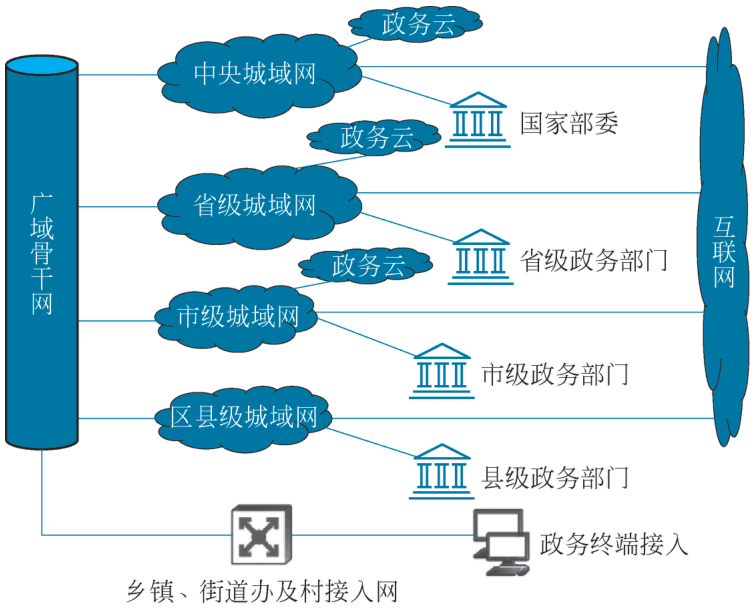{ loading=lazy }

图 4-16 政务外网网络结构
{ .fig-caption }

（3）部门专网：部门专网是国家电子政务基础体系架构中的重要组成部分，主要来源于十二金工程建设，是实现各级政府机关之间政务信息资源共享和网络协同办公、建立统一的应急指挥信息系统的基础网络平台，如应急专网、税务专网等。

政务云的总体任务是完成省、市两级政务云平台，以及联通省、市、县（市、区）三级的政务云网络建设，形成完善的云安全保障、云灾难备份和云运维管理体系。根据各个省政务外网标准，全省政务云分为资源共享专区和公众服务专区，资源共享专区主要承载数据交换、资源共享、行政审批等服务，公众服务专区主要承载公众服务类业务，首选部署在公有云，也可部署在政务云内。省级政务总体架构如图 4-17 所示。

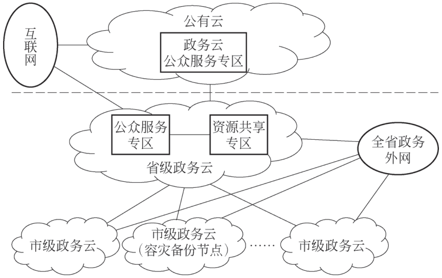{ loading=lazy }

图 4-17 省级政务总体架构
{ .fig-caption }

#### 2. 信创政务云建设

信创政务云是指在信息技术应用创新的背景下，基于云计算技术，自主研发，适配国产

CPU 技术架构和国产操作系统等自主可靠技术及设备，发挥云计算高可靠性、高通用性、高可扩展性，以及敏捷快速、弹性灵活等特征，为政府行业提供 IaaS、PaaS、SaaS 等服务的综合性云产品。其实现政务业务全生命周期管理、跨域协同办理、高效安全运行，使政务数据资源能够充分整合、开放共享、高效利用。

信创政务云架构以国产化、安全可控、分层解耦为核心，根据电子政务网建设标准，按“公共区—互联网区—政务外网”三域划分，通过分区分域建设，形成“云+网+端”一体化体系。典型信创政务云架构如图 4-18 所示。

具体建设内容如下。

（1）网络层。

①多链路负载均衡（含抗 DDoS），实现互联网/政务外网双出口冗余。

②前置安全网关（FW+IPS+vWAF+VPN）+安全资源池（vAD/vAF/vWAF/vAC）统一纳管流量，形成纵深防御。

（2）资源层。

①信创超融合资源池：基于鲲鹏+麒麟的国产化超融合节点，承载生产业务。

②开发测试区：独立超融合池，用于应用灰度验证。

③共享资源池：通用计算与存储资源池，支持弹性伸缩。

④管理与备份区：进行集中运维、日志审计及同城异地备份。

（3）数据层。

①跨网数据隔离交换系统：在互联网区、政务外网间实现物理隔离、单向导入导出，配合态势感知探针实时检测威胁。

②堡垒机+态势感知平台：对所有运维操作进行 4A 审计，异常行为秒级告警。

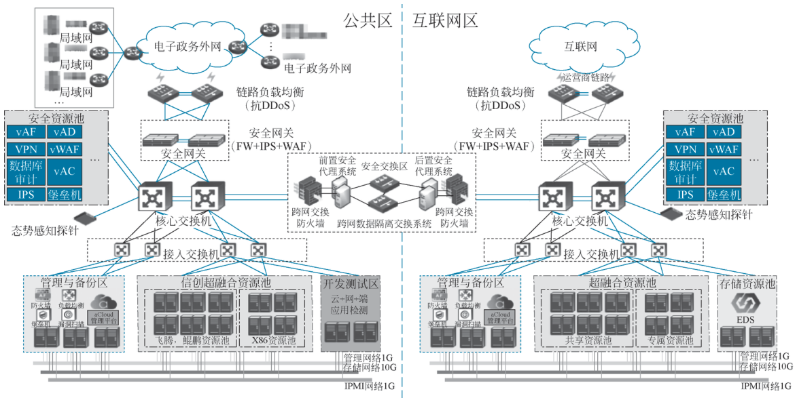{ loading=lazy }

图 4-18 典型信创政务云架构
{ .fig-caption }

（4）应用层。

①应用检测网关：上线前进行自动化漏洞扫描与合规基线核查。

②典型应用：政务 OA、一网通办、网格化管理等，全部容器化部署，支持灰度发布与秒级回滚。

整体信创政务云平台建设，采用 10 Gbps 或 100 Gbps 速率业务网络与千兆管理网络双平面，确保高性能转发与运维隔离；所有组件均通过信创生态兼容性认证，实现端到端国产化替代。

### 4.2.1.4 典型案例 {#4214}

（1）浙江省政务云：阿里云提供两地三中心服务，支撑医保云、政务云等核心业务，通过资源池化降低 47% 的总体拥有成本。

（2）广州白云智慧城管：华为云基于“3+N+3”架构（物联网感知、AI 分析、事件处置引擎），实现违规线索智能抓拍，综合治理效率提升 30%。

（3）贵安新区政务服务：融合“云、数、网、算、模”能力，构建智能化政务体系，如通过大模型实现森林防火事件分钟级响应。

## 4.2.2 云计算在电商行业中的应用 {#422}

### 4.2.2.1 电商云行业特点 {#4221}

电商云平台通过弹性伸缩、数据存储、多渠道管理等功能，支持电商企业高效运营，降低 IT 成本，提升系统稳定性与业务扩展能力，优化用户体验，典型的特点如下：

（1）多级缓存与静态化：电商网站会采用多级缓存机制，包括客户端页面缓存、反向代理缓存（如使用 Nginx 或 HA Proxy）、应用端缓存（如 Memcache）和内存数据库等，以此减少对后端数据库的访问压力，提高响应速度。例如，对于商品详情页等静态内容，可以通过设置合适的 HTTP 缓存头，使浏览器缓存这些内容，减少服务器请求；对于动态内容，可利用反向代理缓存将频繁访问的页面缓存起来，直接返回给客户端，减轻后端应用服务器的负担。

（2）基于 Spark 机器学习的推荐系统：利用 Spark SQL 进行统计推荐，使用 Spark MLlib 实现协同过滤算法等，进行个性化智能推荐。通过对海量用户数据的分析和挖掘，构建用户画像，了解用户的兴趣爱好和购买行为模式，从而为用户提供清晰、准确的个性化商品推荐。

（3）用户画像与聚类分析：在推荐系统中，对用户进行聚类分析，给每位用户构建一个虚拟的“模型”，提升推荐系统的准确度。同时，利用用户画像技术在用户首次注册时收集用户的购物偏好标签，解决推荐系统的“冷启动”问题，使系统能更快地为新用户提供更符合其兴趣的推荐。

（4）实时推荐与流式计算：采用 Flume-ng 对用户评分行为数据进行采集，使用 Kafka 作为流式消息缓冲，将数据推送到 Spark Streaming 进行实时推荐。这种实时推荐机制能够根据用户的即时行为及时调整推荐内容，提高推荐的时效性和相关性。例如，当用户浏览某类商品时，系统可立即推荐与之相关的热门商品或搭配商品。

### 4.2.2.2 电商云建设模式 {#4222}

电商云建设模式，是指面向电商行业典型业务场景，以“云”为载体，将计算、存储、网络、大数据、AI、安全等能力进行一体化设计和交付，支撑电商平台在高并发、大流量、弹性伸缩、数据智能、全域安全等方面的核心诉求。根据企业自身资源、业务规模、技术积累与战略定位的差异，业界普遍将电商云的建设路径归纳为以下三种模式：

（1）公有云原生化建设模式：电商平台从建设日起即基于公有云体系进行架构设计与开发，全部业务系统、数据资产、运维体系均托管于第三方公有云，通过“云即业务底座”实现快速上线、按需付费、弹性伸缩。

适用场景：初创型电商、新锐 DTC 品牌、直播电商、独立站卖家，以及业务峰值波动剧烈、对现金流敏感的企业。

（2）专有云/混合云可控建设模式：电商企业将核心交易、支付、会员、库存等强一致性系统置于自建或租用的专有云（私有云、行业云、专属 Region），将秒杀、搜索、推荐、图片及视频处理、边缘节点等高并发、无状态业务弹性延伸至公有云，形成“稳态+敏态”双轮驱动模式。

适用场景：腰部及以上电商平台、品牌方自营商城、零售商，既要求“数据主权”与“系统可控”，又需借助公有云应对突发流量的电商企业。

（3）行业云/共同体云共享模式：由头部电商、零售品牌、行业协会或地方政府牵头，联合云厂商共建“电商行业云”，面向产业链上下游（品牌、仓储、物流、支付、质检等机构）提供共享的云基础设施、业务中台与数据空间，通过“多租户+专属隔离”实现成本分摊、能力复用、生态协同。

适用场景：产业带集群、跨境电商综合试验区、直播电商基地、区域公共服务平台。

### 4.2.2.3 电商云通用架构 {#4223}

云原生架构在电商平台中的应用越来越广泛，它通过微服务、容器化和 Kubernetes 等技术，提升系统的灵活性、可维护性和弹性。

微服务架构：将电商平台的各个功能模块拆分为独立的微服务，每个服务可以独立开发、部署和扩展，提高了开发效率和系统的容错能力。

容器化和 Kubernetes: 使用 Docker 等容器技术封装应用程序及其依赖项，通过 Kubernetes 等编排工具自动分配资源、调度任务和处理故障转移。

云计算在电商行业的应用不仅提升了系统的稳定性和性能，还通过数据分析和智能推荐技术优化用户体验。随着技术的不断进步，云计算将继续推动电商行业的创新和发展，为电商企业提供更强大的技术支持和竞争优势。

### 4.2.2.4 典型案例 {#4224}

唯品会作为重要的电商平台，2021 年通过构建混合云架构实现 IT 基础设施的全面升级。其核心电商系统采用“私有云+公有云”双模架构。

私有云承载核心交易：部署于自建数据中心，支撑订单处理、支付等关键业务，确保数据主权与合规性。

公有云应对流量洪峰：通过阿里云弹性扩容，在“6·18”“双 11”大促期间，单日峰值订单处理量达 2 000 万单，处理能力较传统架构提升 3 倍。

关键成效如下。

成本优化：通过公有云按需付费模式，资源利用率从 35% 提升至 78%，年度 IT 成本降低 27%。

业务连续性：采用跨云双活架构，故障切换时间从 2 小时缩短至 5 分钟，历史宕机事件减少 92%。

创新加速：基于云原生技术栈，新业务上线周期从 6 周压缩至 9 天，支撑唯品会推出“最后疯抢”等高频营销活动。

数据驱动：通过云上大数据平台，提升用户行为分析时效，推荐系统转化率提升 18%。该案例揭示了云计算对电商行业的价值：通过混合云模式平衡成本、安全与弹性需求，使企业能专注于核心业务创新，同时借助云原生技术实现敏捷开发与数据赋能，最终提升市场竞争力。

## 4.2.3 云计算在教育行业中的应用 {#423}

教育信息化 2.0 是教育信息化 1.0 的升级，由专用资源服务向大资源服务转变，以软件和数据为驱动，突出自下而上的资源建设和共建共享，以提升效率、普及使用和体验为根本，加快实现教育现代化。云计算在教育行业的应用广泛且深入，为教育机构和师生提供高效、灵活和创新的支持。

### 4.2.3.1 教育云概述与特点 {#4231}

云教室与实时教学：通过云教室，教师可以进行在线实时教学，结合云端资源和学习平台完成课程。学生可以在不同地点，如教室、家中，通过 PC 或 PAD 收看网络直播课程，并与教师实时互动、提问和交流。云教室还可以实现不同学校之间的远程实时教学，教师在任何地方都能完成教学任务。

实时授课：教师可以通过视频会议软件（如腾讯会议、Teams 等）进行实时授课，学生可以在任何地方参加课程。

学习管理系统（LMS）：云计算支持的学习管理系统（如 Moodle、Blackboard 等）可以帮助教师管理课程内容、布置作业、进行评估和提供反馈，学生可以随时访问学习资料和提交作业。

虚拟课堂与互动教学：利用云计算建立虚拟课堂，教师通过视频、音频和共享屏幕等方式进行授课，学生参与课堂讨论，提升学习的参与感。例如，某中学通过云计算建立虚拟课堂，学生在家中也能参与到课堂中。

### 4.2.3.2 教育云建设模式 {#4232}

在线学习平台与资源共享：云计算为在线学习平台提供了强大的技术支撑，平台可以承载大量的在线课程和学习资源，支持多种学习模式，如点播、直播、互动问答等。学生可以随时随地访问课程内容，进行自主学习。同时，平台还可以实现对学生学习进度的跟踪和评估，为教师提供教学管理和数据分析工具。例如，某知名在线教育平台利用云计算技术，为学生提供丰富的学习资源，包括视频课程、电子书和在线测验，学生可以根据自己的学习进度选择适合的内容，极大地提高了学习的灵活性。

云计算使得学生能够在不同地点进行协作学习。工具如 Google Docs、Microsoft OneDrive 等允许学生共同编辑文档，进行项目合作。

（1）数据分析与个性化学习：教育机构可以利用云计算进行数据分析，跟踪学生的学习进度和表现，进而提供个性化的学习建议和资源。

（2）虚拟实验室：在科学和工程等领域，云计算可以提供虚拟实验室环境，让学生在没有实体实验室的情况下进行实验和模拟。

（3）资源共享与存储：教师和学生可以将学习资料、课件、作业等存储在云端，方便随时访问和共享，减少了对物理存储的依赖。

（4）教育管理与行政支持：教育机构可以利用云计算管理学生信息、财务、课程安排等，提高管理效率，降低成本。

（5）增强现实与虚拟现实（AR/VR）：云计算为 AR/VR 技术的应用提供了强大的支持，使得学生能够通过沉浸式体验进行学习，特别是在医学、工程等专业领域。

通过以上方式，云计算不仅提高了教育的可及性和灵活性，还促进了教学质量的提升和学习体验的丰富。随着技术的不断进步，云计算在教育行业的应用将会更加广泛和深入。如发布课程内容、布置作业、进行在线测验等。例如，某大学通过云计算平台实现了 LMS 的全面应用，教师可以实时跟踪学生的学习进度，及时给予反馈，促进学生的学习效果。

### 4.2.3.3 教育云建设架构 {#4233}

（1）教育云建设历程。

在教育行业中，随着教育信息化、数字化的发展，云建设大致经历了 3 个阶段，分别是，第一阶段计算资源池化：通过虚拟化和资源优化，实现资源的分级分类和共享；第二阶段提升运维效率：完善云平台管理，增强自动化和智能化，提高业务可用性和连续性；第三阶段增强服务运营能力：实现服务化和组件化，提升业务敏捷性和跨 DC 资源整合。随着技术和管理复杂度的增加，云服务能力逐步提升，从资源和能力的关注，到管理和运维效率，再到算力和能力共享。在今年年初大模型应用爆发后，学习都在探索 AI+教育的应用，这就对传统的数据中心提出挑战，需要将原有的通用算力逐步补齐智能算力的短板。具体发展如图 4-19 所示。

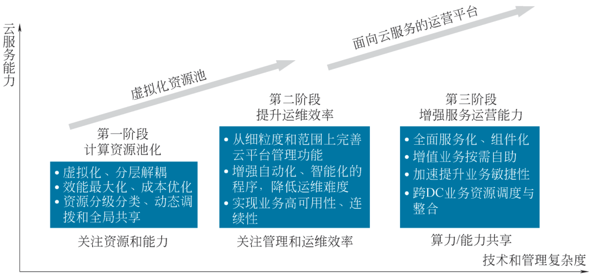{ loading=lazy }

图 4-19 教育数据中心发展阶段
{ .fig-caption }

（2）教育云建设架构。

教育行业云平台架构需贴合教育场景特性，以教育数字化转型为核心，基于云平台底座，向上提供丰富的 IaaS、PaaS、SaaS 资源及服务，为用户提供稳定可靠、性能卓越、安全有效、智能便捷的云计算集成平台。同时以分层架构为基座，融合教育业务逻辑与数据服务，形成资源整合、教学支撑、管理优化、安全保障体系等，其核心架构可归纳为如图 4-20 所示。

①基础设施层（IaaS）。基于虚拟化技术构建计算、存储、网络资源池，采用分布式架构实现资源弹性调度，支撑科研教学多场景需求。

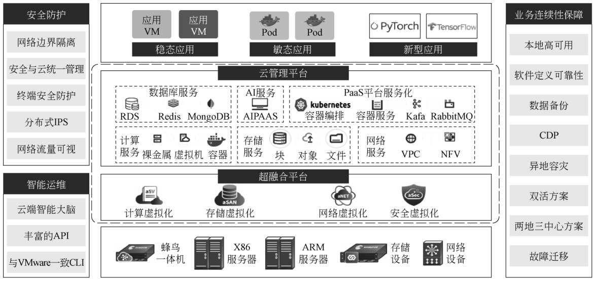{ loading=lazy }

图 4-20 教育行业云化数据中心整体架构图
{ .fig-caption }

②平台服务层（PaaS）。作为架构核心，该层集成三类关键组件：

A. 基础公用服务：提供统一身份认证（SSO）、权限管理、消息推送等共性能力。

B. 教育业务组件：封装教学质量测评、学生综合素质评价等教育专用服务。通过教学质量分析组件驱动差异化教学，形成学生画像并支持精准辅导。

C. 数据服务层：建立教育数据仓库，提供数据交换、清洗、分析等全流程服务。教育云平台通过课堂行为数据采集，结合数据服务组件生成教学反馈报告，支撑教学评一体化改革。

③应用服务层（SaaS）。部署标准化教育应用矩阵，涵盖：

A. 教务管理系统：实现排课、选课、成绩管理等核心流程数字化，如闵行区通过云平台整合 5 类用户基础数据，消除信息孤岛。

B. 在线教学平台：支持直播、录播、互动课堂等教学模式，新疆霍尔果斯利用智慧课堂采集教学过程数据，为综合评价提供依据。

C. 资源服务平台：构建电子图书、课件、题库等资源库，结合 CDN 加速技术实现跨区域资源共享，助力教育均衡化。

在教育云平台建设的实践过程中，通过云管理中心搭建面向多校区多数据中心统一运营管理体系，搭建云化数据中心，进而构建智慧校园分布式“一朵云”混合云架构。具体如图 4-21 所示。

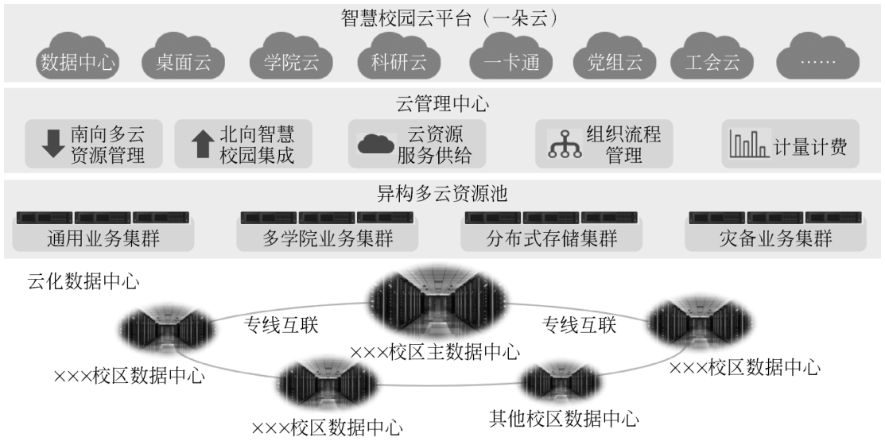{ loading=lazy }

图 4-21 教育一朵云示意图
{ .fig-caption }

### 4.2.3.4 典型案例 {#4234}

（1）云端虚拟实验室：在传统教学中，实验室资源有限且受制于时间和地点。云计算可以搭建云端虚拟实验室，使学生通过云端进行实验操作，无须实际接触实验设备，以此节省实验资源和成本，提高学生的实践能力和创新意识。

（2）智能教室管理系统：云计算可以构建智能教室管理系统，实现对教室资源的智能调度和管理。系统自动控制教室的照明、温度等环境参数，提供适宜的学习环境。教室内的设备互联互通，师生通过智能终端互动交流。

（3）数据分析与个性化学习：云计算集中存储和管理海量教育数据，通过数据分析工具对学生学习行为、成绩表现等进行分析，帮助教师理解学生需求，制订个性化教学计划。云计算还可通过大数据分析实现教学内容优化和个性化推荐。

## 4.2.4 云计算在医疗行业中的应用 {#424}

随着数字经济的发展，各个行业都在部署数字化转型，医疗行业的医疗信息化从以收费为核心的单机时代，历经系统林立、数据孤岛的集成阶段，如今已迈入“云+大数据+AI”驱动的智慧时代：HIS 升级为核心管理平台，临床业务全面数字化，医院集成平台打通数据壁垒，电子病历互联互通；借助 Docker、Hadoop、5G 和人工智能等技术，实现智慧管理、智慧服务与智慧医疗一体化闭环，推动辅助诊断、科研创新和无人医院落地，让数据真正服务于临床、患者与决策。医疗行业信息化发展阶段如图 4-22 所示。

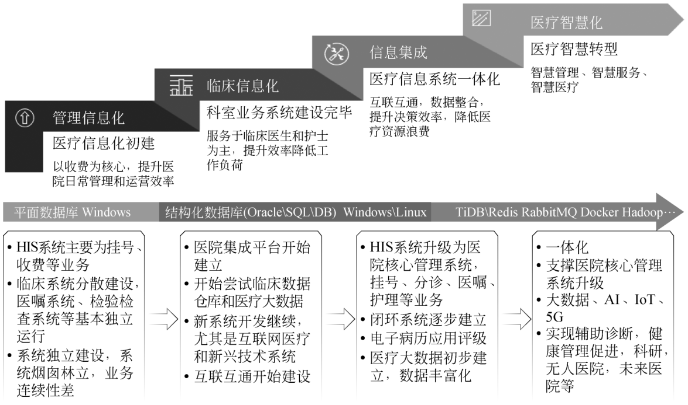{ loading=lazy }

图 4-22 医疗行业信息化发展阶段
{ .fig-caption }

### 4.2.4.1 医疗云概述与特点 {#4241}

医疗云是以云计算技术为依托的医疗信息化方案，通过整合医疗资源为各方提供服务。其核心特点如下：

在资源整合上，医疗云打破信息孤岛，统一存储管理电子病历、影像等医疗数据，实现机构间信息共享，避免重复检查；强大的存储能力可满足海量数据增长需求。

灵活性与扩展性强，医疗机构能按需调配云端资源，业务高峰时快速扩容，基层医院也无须大量硬件投入，按需租用即可，有效降低建设成本。

在安全方面，医疗云运用数据加密、访问控制和容灾备份，保障患者隐私；即使遇故障也能快速恢复数据，且有专业团队运维，减少机构 IT 压力。

在协作共享上，医疗云助力开展远程医疗、分级诊疗，支持专家远程会诊，促进上下级医院协作，推动医疗资源均衡分配。医疗云以技术革新医疗行业，推动服务提质增效。

### 4.2.4.2 医疗云建设模式 {#4242}

高效存储与管理：医院和医疗机构会产生大量的医学影像数据，如 CT 扫描、MRI 扫描等，云计算提供了几乎无限的存储空间，可以安全可靠地存储这些海量影像资料，方便医生随时访问和调用。

远程诊断与会诊支持：医生可以通过云计算平台远程访问患者的影像数据，进行诊断和分析，打破了地域限制，实现了优质医疗资源的共享，尤其对于偏远地区或医疗资源匮乏的地方，患者也能获得专家的诊疗意见。

智能化分析与辅助诊断：借助云计算的强大计算能力，可以运行复杂的图像分析算法，对医学影像进行自动识别和分析，辅助医生更快速、准确地发现病变和异常，提高诊断效率和准确性。

### 4.2.4.3 医疗云建设架构 {#4243}

根据 IDC 2019 年《中国数据及存储发展研究报告》及同期医疗行业调研，医疗数据中心架构在 2019 年完成了从“传统机房”向“新数据时代”的三级跃迁，其核心特征可概括为“云-边-端分层、分布式存储、闪存加速、多云灾备”。传统数据中心“紧耦合、纵向扩展、硬件昂贵、运维割裂”，导致扩容慢、资源利用率低；而新一代基础架构以“资源池化、分布式存储、软件定义网络、统一管控”为核心，实现横向扩展、按需扩容、自动化运维和集成灾备，成本低、性能线性增长，可用性与敏捷性大幅提升，如图 4-23 所示。

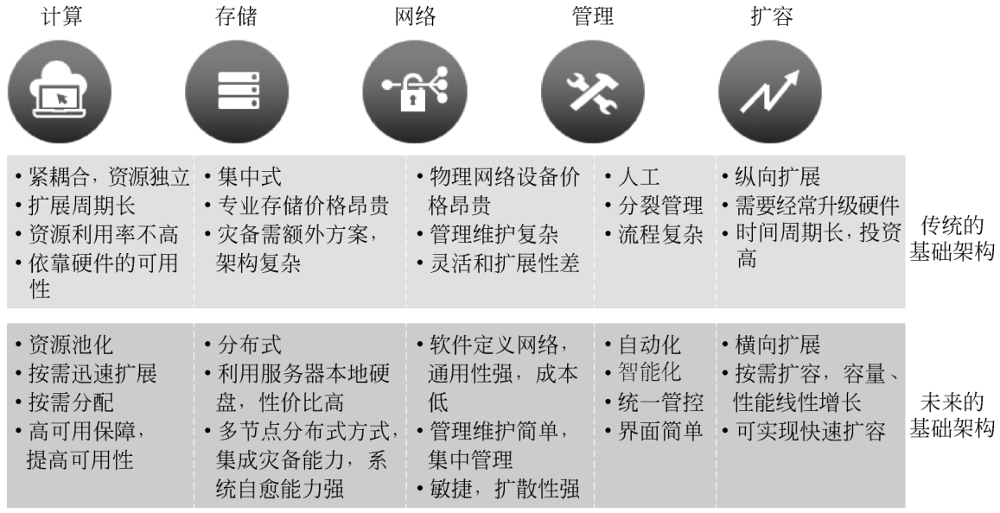{ loading=lazy }

图 4-23 医院数据中心基础架构的基本解析
{ .fig-caption }

### 4.2.4.3.1 医疗数据分析 {#42431}

临床决策支持：云计算平台可以收集、存储和分析大量的医疗数据，包括电子病历、临床试验数据、医学文献等，通过数据挖掘和机器学习技术，发现潜在的疾病模式和规律，为医生制定个性化治疗方案提供科学依据，提高医疗质量和治疗效果。

疾病预测与预防：通过对人群健康数据和医疗历史数据的分析，预测疾病的暴发趋势、流行范围等，帮助医疗机构提前做好防控措施，合理分配医疗资源，降低疾病的发生率和传播风险。

医疗质量评估与管理：利用数据分析可以对医疗服务的质量、效率、安全性等进行评估和监测，找出存在的问题和不足，为医院管理决策提供数据支持，促进医疗服务质量的持续改进。

### 4.2.4.3.2 电子病历管理 {#42432}

数据共享与协同：云计算使得医疗机构能够将病历数据集中存储在云端，实现跨部门、跨医院的共享和访问，方便医生快速了解患者的病史和诊疗记录，提高医疗服务的连续性和协调性，减少因信息不完整或重复检查导致的医疗资源浪费。

### 4.2.4.3.3 远程医疗服务 {#42433}

远程诊疗与咨询：患者可以通过云计算平台与医生进行视频会诊、在线咨询等，无须亲自前往医院，节省了时间和交通成本，尤其对于行动不便的患者或慢性病患者的日常随访和咨询，提供了极大的便利。

远程健康监测：借助可穿戴设备和物联网技术，患者的健康数据如心率、血压、血糖等可以实时上传到云端，医生可以远程监测患者的健康状况，及时发现异常并给予干预指导，提高患者的自我管理能力和疾病控制效果。

### 4.2.4.3.4 医疗资源共享与协同 {#42434}

医疗设备共享：通过云计算平台，不同医疗机构之间可以实现医疗设备的共享和调配，提高设备的利用率，降低设备采购和维护成本，尤其对于一些昂贵的大型医疗设备，如 MRI、CT 等，可以避免重复购置，实现资源的优化配置。

专家资源共享：云计算打破地域限制，使得不同地区的医疗专家能够通过云平台共同参与病例讨论、会诊和治疗方案制定，促进医疗技术和经验的交流与共享，提高医疗服务的整体水平。

医疗云典型的架构图如图 4-24 所示。

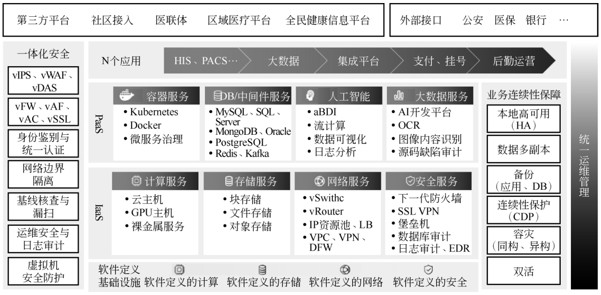{ loading=lazy }

图 4-24 医疗云典型架构图
{ .fig-caption }

### 4.2.4.3.5 医疗信息化建设 {#42435}

2018 年 4 月 13 日，国家卫生健康委员会（简称卫健委）发布《全国医院信息化建设标准与规范（试行）》，该标准与规范根据目前医院信息化建设现状，并着眼未来 5~10 年全国医院信息化应用发展要求，针对二级及以上医院的临床业务、医院管理等工作，覆盖医院信息化建设的主要业务和建设要求，从软硬件建设、安全保障、新兴技术应用等方面规范医院信息化建设的主要内容和要求。

《全国医院信息化建设标准与规范（试行）》以“一张图、五个一级指标、若干二级与三级指标”的形式，为各级各类医院提供了可落地的信息化建设标尺。结合指标体系图，医院信息化建设可按“基础设施-业务应用-信息资源-信息安全-管理体系”五大维度统筹规划，分三级医院、二级医院及基层机构差异化实施，最终实现“以电子病历为核心、以患者为中心”的智慧医疗目标。具体架构如图 4-25 所示。

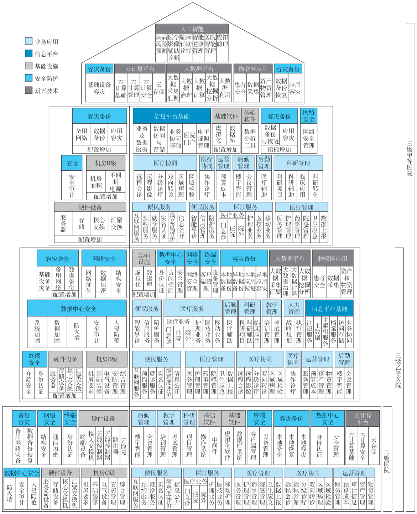{ loading=lazy }

图 4-25 《全国医院信息化建设标准与规范（试行）》
{ .fig-caption }

云技术被视为“基础设施”与“业务应用”两大维度的底座，贯穿了弹性计算、云存储、云安全、云灾备、云协同五个关键环节。以下结合规范指标，聚焦医院信息化中的云技术落地要点。

#### 1. 云基础设施：从“机房”走向“云原生”

规范把机房、网络、服务器、存储全部纳入“基础设施”一级指标，并给出“双活云数据中心”三级要求。医院不再自建传统机房，而是采用“两地三中心”云架构：

（1）生产中心：基于超融合的信创云集群（鲲鹏 CPU+麒麟 OS），国产化率≥80%，支持虚拟机+容器双栈，满足电子病历 4 级并发需求。

（2）同城灾备：通过云同步复制，RPO≤10 min、RTO≤15 min。

（3）异地灾备：公有云对象存储+冷备云主机，按日/周/月自动转储影像数据，节省 60% 机房能耗。

云资源池通过 VPC+SD-WAN 与院区千兆网打通，医生工作站、PACS、LIS 等系统全部“云化”部署，实现“按需扩缩、按量付费”。

#### 2. 云存储：影像数据“冷热分级”

规范要求影像存储≥5 年、访问延迟≤2 s。医院采用“云存储三级分层”：

（1）热数据：云盘 SSD，存放 30 天内 CT/MR 原始 DICOM。

（2）温数据：云盘高效盘，存放 30~180 天压缩影像。

（3）冷数据：对象存储低频包月，180 天后自动归档。

通过云厂商内网直传，影像数据跨院区秒级共享，同时利用云盘快照+对象存储版本控制，满足法规“不可篡改”要求。

#### 3. 云安全：国密+零信任

指标明确“SM4/SM9 国密算法、零信任、数据不落地”。医院在云侧部署：

（1）零信任网关：所有终端先认证后接入，基于身份+设备+行为动态授权，防止“删库”事件。

（2）国密 SSL：云 WAF+CDN 节点统一启用国密证书，HTTPS 握手时间<30 ms。

（3）云堡垒机：运维人员通过云堡垒机单点登录，所有操作录屏+指令审计，满足《中华人民共和国网络安全法》留痕要求。

#### 4. 云灾备：一键切换的“云容灾”

规范对三级甲等医院提出“应用级容灾”要求。医院在云端采用“双活+容灾”组合：

（1）核心 HIS、EMR 在云侧做跨可用区双活，数据库层用云 RDS 主备+只读实例，读写分离支撑峰值 5000 并发；

（2）非核心业务（OA、人事）采用云容灾服务，平时冷备，灾时一键拉起，10 分钟内恢复业务。

#### 5. 云协同：跨机构“云网格”

规范鼓励“医疗联合体信息互通”。医院通过“云协同平台”把三甲本部、二级分院、基层卫生所连成一张“云网格”：

（1）远程会诊：云端 GPU 算力实时渲染三维影像，延迟<50 ms。

（2）双向转诊：患者电子病历云同步，基层拍片→三甲云端 AI 读片→结果秒级回传。

（3）药品共享：云端 SPD 系统对接药房、药企，实现库存可视化、自动补货。

### 4.2.4.4 典型案例 {#4244}

临床数据分析：云计算可以处理和分析大量的临床数据，帮助医生做出更准确的诊断和治疗决策。

预测分析：通过机器学习和数据挖掘技术，云平台可以识别疾病模式，预测患者的健康风险，支持早期干预。

电子健康记录：医疗机构可以将患者的电子健康记录存储在云端，实现不同机构之间的数据共享，提高患者信息的可用性和流动性。

远程医疗：云计算支持远程医疗服务，患者可以通过视频与医生进行沟通，特别是在偏远地区，提升了医疗服务的可及性。

移动健康应用：通过云计算，开发者可以创建移动健康应用，帮助患者管理健康状况、记录症状、提醒服药等，促进患者自我管理。

临床试验管理：云平台可以用于管理临床试验的数据收集、分析和报告，提高试验的效率和透明度，促进新药研发。

设备连接与物联网：医疗设备（如心率监测仪、血糖仪等）可以通过云计算连接，实现数据实时上传和监控，帮助医生及时掌握患者的健康状况。

资源管理与优化：医疗机构可以利用云计算进行资源管理，包括人力资源管理、设备调度管理等，提高运营效率，降低成本。

## 4.2.5 云计算在制造行业中的应用 {#425}

### 4.2.5.1 工业云概述与特点 {#4251}

工业云基于云计算技术构建，旨在为制造业企业提供高效服务。它整合工业生产全流程资源，打破企业内部及企业间的信息壁垒，实现生产设备监控、供应链管理、产品设计等系统的云端集成。这使得不同车间、工厂乃至产业链上下游企业能够实时共享生产数据和物料库存信息，优化生产流程，提升供应链协同效率。同时，工业云借助云端的强大存储与计算能力，有效应对工业物联网设备产生的海量数据，如设备运行参数和传感器监测数据。

工业云的灵活性和扩展性是其显著优势。企业能够根据订单量变化和生产计划，灵活调配计算、存储和网络资源。在生产旺季，企业可以迅速扩充云端算力，以满足生产线自动化控制和仿真模拟等任务的需求。对于中小企业而言，无须自建大型数据中心，通过按需租用工业云服务，即可部署 ERP、MES 等系统，有效降低了信息化建设成本。

在安全性与可靠性方面，工业云采用严格的数据加密、身份认证和访问控制机制，确保生产工艺和核心技术等敏感数据的安全。通过分布式存储和多地域容灾备份，工业云即使遭遇网络攻击或自然灾害，也能保障数据不丢失、业务不停摆。此外，专业运维团队提供全天候的技术支持，确保系统稳定运行。

工业云还支持跨地域、跨企业的研发设计协同。工程师团队可以通过云端平台实时协作，共同修改产品图纸，模拟工艺流程。同时，工业云汇聚丰富的行业经验和大量的技术资源，形成工业知识库和模型库，有助于企业快速创新，加速新技术和新产品的落地，推动整个工业领域向智能化和高效化迈进。

### 4.2.5.2 工业云建设模式 {#4252}

#### 1. 分层建设模式

基础设施即服务（IaaS）模式：云服务提供商搭建计算、存储、网络等基础设施，通过虚拟化技术进行资源整合和管理，为企业提供可灵活租用的基础设施资源。例如，企业可以根据自身业务需求，租用云服务器、存储空间等，用于运行各类工业应用系统。在这种模式下，企业无须自行购置大量硬件设备，降低了基础设施建设成本和运维难度。

平台即服务（PaaS）模式：在 IaaS 的基础上，进一步提供软件开发、数据管理、应用部署等平台服务，为工业应用开发者提供一个集开发、测试、部署于一体的环境，具备开发简便、易于部署、可扩展性强等特点。例如，一些工业云平台提供的开发框架和工具，帮助企业快速开发和部署工业应用程序，如生产计划调度系统、设备故障诊断系统等。

软件即服务（SaaS）模式：通过网络向企业提供各种工业应用软件服务，如 CAD/CAM、ERP、MES 等。企业无须安装和维护软件，只需通过订阅等方式使用，即可获取所需的功能和服务，降低软件采购成本和维护工作量，且能够及时获得软件更新和升级服务。

#### 2. 区域级工业云建设模式

这种模式通常以地方政府为主导，依托区域内的超算中心或大型数据中心等基础设施，结合当地的产业特点和资源优势，构建服务于区域经济的工业云创新服务中心。例如，北京、天津、河北等 16 个省（直辖市）开展首批工业云创新服务试点，根据自身产业情况建设了不同特色的工业云平台。区域级工业云能够整合区域内的制造资源和创新资源，为当地企业提供资源共享、协同创新、产业协同等服务，推动区域经济的整体发展。

#### 3. 行业级工业云建设模式

由行业内的大型企业或行业协会牵头，针对特定行业的特点和需求，构建覆盖全产业链的工业云平台。例如，航天云网平台的 CMSS 云制造支持系统，通过搭建工业领域的云平台，打造云制造产业集群生态，实现资源配置与业务流程优化。行业级工业云平台能够汇聚行业内的专业知识、技术和资源，提供具有行业特色的应用服务，如汽车制造行业的数字化设计仿真云服务、机械加工行业的工艺设计与优化云服务等，促进整个行业的协同创新和转型升级。

#### 4. 企业级工业云建设模式

企业根据自身业务发展和数字化转型的需要，自主建设或与云服务提供商合作建设专属的工业云平台。企业可以将自身的生产设备、业务流程、数据资源等进行整合和云化，实现企业内部的资源优化配置和高效协同。例如，美的集团打造的美的工业云，通过整合企业内部的各类资源和业务系统，实现了研发设计、生产制造、供应链管理等全流程的数字化和智能化，提高企业的生产效率和市场竞争力。

#### 5. 混合建设模式

混合建设模式结合多种建设模式的特点，根据企业的实际需求和业务场景，灵活选择和整合不同的云服务模式和部署方式。例如，企业可以将一些非核心的业务系统部署在公有云上，利用其强大的计算、存储资源以及丰富的应用服务；将核心业务系统和敏感数据部署在私有云上，确保数据安全和业务的自主可控。同时，企业还可以借助行业级或区域级工业云平台的资源和能力，实现与产业链上下游企业的协同创新和发展。

### 4.2.5.3 工业云的建设架构 {#4253}

工业云的问题领域包括设备端和云端两个大的领域。在设备端，工业云需要解决设备的接入、边缘侧计算和安全保障问题；在云端，工业云需要解决连接管理、设备管理、开发平台和工业应用问题。工业云的建设架构如图 4-26 所示。

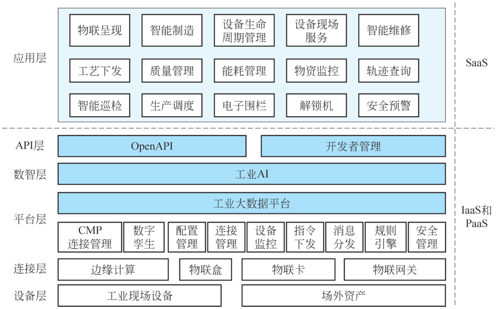{ loading=lazy }

图 4-26 工业云的建设架构
{ .fig-caption }

（1）设备层和连接层：设备层和连接层包含工业现场的物理制造设备资源，包括加工生产设备、工具、供能设备等，以及在场外运行的设备，如卡车、起重机等。这些设备的运行数据需要能够被采集并传输到云端。在大多数情况下，这些设备也需要具备接收云端下发指令并做出响应的能力。根据设备所支持的网络协议的不同，需要适配不同的物联盒、物联卡、物联 SDK 或物联网关，再通过 MOTT、COAP、HTTPS 等协议，将数据上传到云端。

连接层的边缘计算部分用于就近计算，解决数据传输和存储的时延、成本问题。边缘计算通常适用于无须统一进行集中处理的数据类型。例如，在使用高清摄像机进行质量检测的场景中，每秒所拍摄的照片数据量较大，大多数的画面帧里拍摄到的是正常的产品，若将每一帧都传输到云端处理，则效率较低。通过在边缘侧部署人工智能机器视觉组件，可以快速地在本地边缘侧进行视觉识别，在边缘侧识别出存在质量瑕疵的图片并传输到云端，在云端进行模式优化，之后云端可以把优化后的模型和控制数据下发到边缘计算节点上，进一步提升视觉识别的效率和质量。

（2）平台层：由 CMP 连接管理和 IoT Hub 组成，CMP 连接管理用于对网络接入开通、下线费用进行管理，IoT Hub 提供完整的设备生命周期管理功能，支持物模型定义、设备注册数据解析、在线调试、远程配置、固件升级、远程维护、实时监控、分组管理、设备删除等。

（3）数智层：提供物联大数据的接入、流控、存储、查询、展示、分析等功能。

（4）API 层：提供工业云平台能力的 OpenAPI 封装、开发者管理、应用接入管理等功能；面向特定制造应用领域，提供不同的专业应用接口以及用户注册、验证等通用管理接口。

（5）应用层：面向制造业的各个领域和行业。不同行业用户只需要通过云服务门户网站、各种用户界面（包括移动终端、PC 终端、专用终端等）就可以使用云制造服务中心的云服务。生产需求模型，从而指导供应链的管理，协助供应商优化生产计划，实现减少库存，保障供应，提升供应链效率。智慧供应链管理云服务是对 ERP、物联网、人工智能、大数据等技术的综合应用。

### 4.2.5.4 典型案例 {#4254}

三一重工长沙 18 号工厂作为全球重工行业首座“灯塔工厂”，通过工业云技术实现了制造流程的全面数字化与智能化升级，成为工业互联网赋能传统制造业的标杆。其核心应用场景如下。

（1）智能生产线与数字孪生。

工厂部署数字孪生系统，实时映射泵车生产全流程，实现从订单到入库的透明化管理。通过 5G-A 网络（时延 4 毫秒、可靠性 99.999%），自动导向车精准配送物料，员工通过“三维工作岛”监控焊接机器人，阀块生产中心 163 种阀块实现全流程自动化，生产效率提升 30%。泵车下线周期缩短至 45 分钟，零部件从上线到产出仅需 1 分钟，较传统生产线效率提升 4 倍。

（2）柔性制造与远程运维。

基于工业云平台，工厂支持多品种、小批量订单快速切换。5G-A 技术使新设备入网时间从 2 周压缩至 2 小时，生产线改造成本降低 40%。

远程运维系统接入 361 家企业的 2 218 台设备，通过故障模型库提前预警设备异常，维修成本降低 5% ~8%，设备故障率下降 28%。

（3）能源互联与绿色生产。

能源互联岛整合天然气、地热、余热回收系统，依据实时数据优化能源供给。例如，空气压缩机余热被用于循环水供暖，厂区能效提升 18%。

项目投运以来累计减少二氧化碳排放 6 400 吨，若算上销售的智能产品，每年节约标煤 6 100 万吨，相当于减排 1.6 亿吨。
