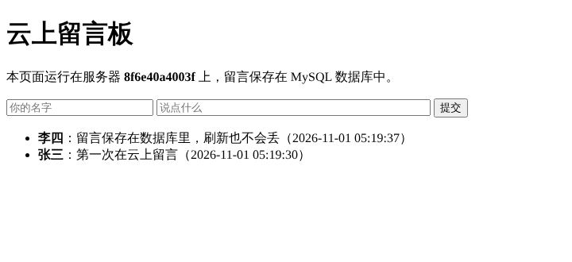
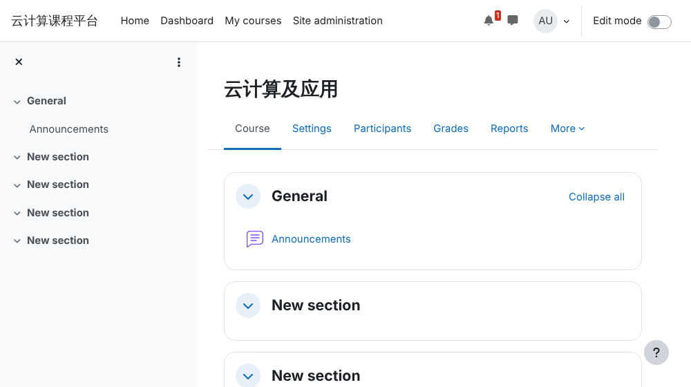

# 第 4 章 本章实验

!!! abstract "实验总览"

    | 实验 | 难度 | 环境 | 时长 | 对应小节 |
    |---|---|---|---|---|
    | [实验 4-1 在云服务器上搭建 LAMP 留言板网站](#4-1) | ★ 基础 | 阿里云 ECS（或任意 Ubuntu 22.04） | 45 分钟 | [4.1.1](4-1.md#411) |
    | [实验 4-2 用 Dockerfile 和 Docker Compose 部署“网站 + 缓存”](#4-2) | ★ 基础 | 装有 Docker 的电脑或云服务器 | 40 分钟 | [4.1.3](4-1.md#4133) |
    | [实验 4-3 用 Docker Compose 部署 Moodle 在线教学平台](#4-3) | ☆ 拓展 | 装有 Docker 的云服务器（2 vCPU 4 GiB 以上） | 40 分钟 | [4.2.3](4-2.md#423) |
    | [原书实训活动](#book-practice) | 课后 | 阿里云 ECS | 课后 | 全章 |

    本章实验学时为 2 学时，建议课内完成实验 4-1 和 4-2。实验 4-3 就是纸质教材本章实训活动“搭建在线教学平台”的一种快速做法，可作为课后实训。

## 实验 4-1 ★ 在云服务器上搭建 LAMP 留言板网站 { #4-1 }

**实验目的**

1. 按 [4.1.1](4-1.md#411) 的流程，在云服务器上搭建 LAMP（Linux + Apache + MySQL + PHP）环境；
2. 部署一个会读写数据库的动态网站，理解“网页程序 + 数据库”的网站结构；
3. 体会实验 3-1 的静态网页和本实验的动态网站有什么不同。

**实验环境**

- 运行环境：**云算力**。阿里云 ECS 2 vCPU 2 GiB，镜像 Ubuntu 22.04，可以继续使用实验 3-1 的实例（先执行 `systemctl stop nginx` 停掉 Nginx，把 80 端口让给 Apache）。
- 编者实测：在 Ubuntu 22.04 环境中完整运行了步骤 2～6，软件版本为 Apache 2.4.52、PHP 8.1.2、MariaDB 10.6.23；阿里云控制台部分为待实测。
- 费用：按量付费约每小时几角钱，实验后释放。

**实验数据**：留言板程序 `labs/ch04/lab4_1_lamp/guestbook.php` 和建库脚本 `init.sql`，都已写好。

**实验步骤与代码**

1. **准备实例并放行端口**。按实验 2-1、3-1 创建（或沿用）Ubuntu 22.04 实例，安全组入方向放行 TCP 80。登录：`ssh root@公网IP`。
2. **安装 LAMP**。MariaDB 是 MySQL 的开源分支，命令和用法与 MySQL 基本相同：

    ```bash
    apt update
    apt install -y apache2 php libapache2-mod-php php-mysql mariadb-server
    apache2 -v; php -v; mysql --version
    systemctl enable --now apache2 mariadb
    ```

3. **创建数据库、表和网站专用账号**。把 `init.sql` 上传到服务器（或用 `nano init.sql` 粘贴内容），然后执行：

    ```sql
    -- init.sql 的内容
    CREATE DATABASE IF NOT EXISTS guestbook DEFAULT CHARACTER SET utf8mb4;
    CREATE USER IF NOT EXISTS 'webuser'@'localhost' IDENTIFIED BY 'Web@2026';
    GRANT ALL PRIVILEGES ON guestbook.* TO 'webuser'@'localhost';
    FLUSH PRIVILEGES;
    USE guestbook;
    CREATE TABLE IF NOT EXISTS messages (
      id INT AUTO_INCREMENT PRIMARY KEY,
      name VARCHAR(50) NOT NULL,
      msg VARCHAR(500) NOT NULL,
      created TIMESTAMP DEFAULT CURRENT_TIMESTAMP
    );
    ```

    ```bash
    mysql < init.sql
    ```

    网站程序用专门的 `webuser` 账号连接数据库，而不用 root，这是 [2.5 节](../02-core-technologies/2-5.md) “最小权限原则”的应用。

4. **部署网站代码**。把 `guestbook.php` 复制到网站根目录：

    ```bash
    cp guestbook.php /var/www/html/
    curl -s -o /dev/null -w "%{http_code}\n" localhost/guestbook.php
    ```

    输出 `200` 表示网页正常。程序的核心只有三步：连接数据库 → 有新留言就 `INSERT` → `SELECT` 最近 20 条显示出来：

    ```php
    $db = new mysqli("localhost", "webuser", "Web@2026", "guestbook");
    // 提交表单时写入数据库（用预处理语句防止 SQL 注入）
    $stmt = $db->prepare("INSERT INTO messages (name, msg) VALUES (?, ?)");
    // 读出最近 20 条留言
    $rows = $db->query("SELECT name, msg, created FROM messages ORDER BY id DESC LIMIT 20");
    ```

5. **浏览器访问**。打开 `http://公网IP/guestbook.php`，提交两条留言，刷新页面，留言仍在。
6. **到数据库里查看**：

    ```bash
    mysql --default-character-set=utf8mb4 -e "SELECT * FROM guestbook.messages"
    ```

7. **（选做）把图片放到对象存储**。按 [4.1.1.3](4-1.md#4113) 创建一个 OSS 存储桶，上传一张图片并设为公共读，在 `guestbook.php` 的标题下面加一行 ``。
8. **（选做）域名和 HTTPS**。如果你有已备案的域名，按 [4.1.1.7](4-1.md#4117) 添加 A 记录指向公网 IP，并在“数字证书管理服务”中申请免费证书。

!!! warning "待实测"
    步骤 1、7、8 涉及阿里云控制台和域名备案，编者环境无法访问，依据阿里云公开文档编写；任课教师上课前请实测并补充截图。步骤 2～6 的命令编者已在 Ubuntu 22.04 中实际运行验证。

**运行结果**

编者在 Ubuntu 22.04 中提交两条留言后的页面如下（“服务器”一栏显示的是主机名，你看到的会不同）：

{ loading=lazy }

步骤 6 查询数据库的输出：

```text
id	name	msg	created
1	张三	第一次在云上留言	2026-11-01 05:19:30
2	李四	留言保存在数据库里，刷新也不会丢	2026-11-01 05:19:37
```

**实验记录表**

| 项目 | 记录 |
|---|---|
| Apache、PHP、MariaDB 的版本 |  |
| 浏览器访问留言板的截图 |  |
| 数据库中查到的留言记录 |  |
| 停止再启动实例后，留言是否还在 |  |
| （选做）OSS 图片地址 |  |

**常见问题排查**

| 现象 | 原因与处理 |
|---|---|
| 浏览器显示 Nginx 欢迎页 | 实验 3-1 的 Nginx 还在占用 80 端口。执行 `systemctl disable --now nginx` 后再 `systemctl restart apache2`。 |
| 网页显示 PHP 源代码 | 没装 `libapache2-mod-php`，或装完没有重启 Apache：`systemctl restart apache2`。 |
| 页面空白或 500 错误 | 查看错误日志 `tail /var/log/apache2/error.log`。最常见的是数据库账号密码与 `init.sql` 不一致，或忘记执行 `init.sql`。 |
| `Class "mysqli" not found` | 没装 `php-mysql`，安装后重启 Apache。 |
| 命令行查询时中文显示成 `??` | 查询时加 `--default-character-set=utf8mb4`；网页上显示正常就说明数据没问题。 |

**思考与练习**

1. 本实验把网站和数据库装在同一台服务器上。如果改用云数据库 RDS（[4.1.1.4](4-1.md#4114)），`guestbook.php` 中哪一行要改？RDS 的“白名单”要加入什么？
2. 用动画“云上网站的一次访问”解释：浏览器显示“数据库连接错误”时，请求已经通过了哪些环节？

**实验报告要求**

提交实验记录表和留言板截图，回答思考题第 1 题。

## 实验 4-2 ★ 用 Dockerfile 和 Docker Compose 部署“网站 + 缓存” { #4-2 }

**实验目的**

1. 按 [4.1.3.3](4-1.md#4133) 的步骤，亲手编写 Dockerfile、构建镜像、运行容器；
2. 体会一个应用依赖其他服务（这里是 Redis 缓存）时，单独运行一个容器为什么不够；
3. 用 Docker Compose 一条命令启动多个容器，理解 [4.1.3.5](4-1.md#4135) 所说的“所有服务自动拉起”。

**实验环境**

- 运行环境：**本机或云算力**。任意装有 Docker 的电脑或云服务器（安装方法见 [附录 A](../../appendix/a-labs-env.md)），可以沿用实验 2-2 的环境。
- 编者实测：Docker 29.9.2、Docker Compose v5.6.1，镜像 `python:3.12-slim`（Python 3.12.16）和 `redis:7-alpine`，步骤 2～7 全部实际运行验证。
- 费用：本机 0 元。

**实验数据**：示例程序在 `labs/ch04/lab4_2_compose/` 中，共 4 个文件：

| 文件 | 作用 |
|---|---|
| `app.py` | 用 Flask 写的网页，每访问一次就让 Redis 中的计数加 1 |
| `requirements.txt` | 依赖：flask、redis |
| `Dockerfile` | 与教材 4.1.3.3 的示例相同，只把基础镜像换成仍在维护的 Python 3.12 |
| `docker-compose.yml` | 声明 web 和 redis 两个服务 |

**实验步骤与代码**

1. **看懂程序**。`app.py` 的核心只有几行：

    ```python
    cache = redis.Redis(host="redis", port=6379)   # 主机名 redis 就是 Compose 里的服务名

    @app.route("/")
    def hello():
        count = cache.incr("hits")                 # 访问次数加 1
        return f"<h1>你好，云计算！</h1><p>本页已被访问 {count} 次。</p>"
    ```

2. **按教材的方法构建并运行**（进入 `lab4_2_compose` 目录）：

    ```bash
    docker build -t my-python-app .
    docker run -d -p 4000:80 my-python-app
    curl -s -o /dev/null -w "%{http_code}\n" localhost:4000
    ```

    输出 `500`：网页报错了。用 `docker logs <容器ID>` 查看，最后一行是 `Error -2 connecting to redis:6379. Name or service not known`，即找不到 Redis。**一个应用往往依赖数据库、缓存等其他服务，只运行一个容器是不够的。**删掉这个容器：`docker rm -f <容器ID>`。

3. **看懂 Compose 文件**：

    ```yaml
    services:
      web:
        build: .            # 用当前目录的 Dockerfile 构建
        ports:
          - "4000:80"       # 宿主机 4000 → 容器 80
        depends_on:
          - redis           # 先启动 redis
      redis:
        image: redis:7-alpine
        volumes:
          - redis-data:/data   # 计数保存在数据卷里，容器删了也不丢
    volumes:
      redis-data:
    ```

4. **一条命令启动全部服务**：

    ```bash
    docker compose up -d --build
    docker compose ps
    ```

5. **访问三次**：浏览器打开 `http://localhost:4000`（云服务器上用 `http://公网IP:4000`，并在安全组放行 4000 端口），或者：

    ```bash
    for i in 1 2 3; do curl -s localhost:4000; echo; done
    ```

6. **验证数据持久化**。直接查 Redis，再把所有容器删掉重建：

    ```bash
    docker compose exec redis redis-cli get hits
    docker compose down
    docker compose up -d
    curl -s localhost:4000
    ```

7. **模拟缓存故障**：

    ```bash
    docker compose stop redis
    curl -s -o /dev/null -w "%{http_code}\n" localhost:4000
    docker compose start redis
    curl -s localhost:4000
    ```

8. **清理**：`docker compose down -v`（`-v` 会连数据卷一起删除，计数清零）。

**运行结果**

编者实测的输出（容器 ID 每次不同）：

```text
$ docker compose ps
SERVICE   IMAGE            STATUS         PORTS
redis     redis:7-alpine   Up 3 seconds   6379/tcp
web       l42-web          Up 3 seconds   0.0.0.0:4000->80/tcp

$ for i in 1 2 3; do curl -s localhost:4000; echo; done
<meta charset='utf-8'><h1>你好，云计算！</h1><p>本页已被访问 1 次。</p><p>处理本次请求的容器：85cb4bbafd1c</p>
<meta charset='utf-8'><h1>你好，云计算！</h1><p>本页已被访问 2 次。</p><p>处理本次请求的容器：85cb4bbafd1c</p>
<meta charset='utf-8'><h1>你好，云计算！</h1><p>本页已被访问 3 次。</p><p>处理本次请求的容器：85cb4bbafd1c</p>
```

步骤 6：`redis-cli get hits` 输出 `3`；`down` 再 `up` 之后访问显示“本页已被访问 4 次”，说明数据卷保住了数据。步骤 7：停掉 Redis 后返回 `500`，重新启动 Redis 后恢复正常，显示“访问 5 次”。构建出的 web 镜像约 202 MB，`redis:7-alpine` 约 58 MB。

**实验记录表**

| 项目 | 记录 |
|---|---|
| 步骤 2 单独运行容器时的 HTTP 状态码和日志最后一行 |  |
| `docker compose ps` 的输出 |  |
| `down` 再 `up` 后的访问次数 |  |
| 停掉 Redis 后的状态码 |  |
| web 镜像的大小（`docker images`） |  |

**常见问题排查**

| 现象 | 原因与处理 |
|---|---|
| `docker compose` 提示命令不存在 | 旧版本 Docker 用的是独立的 `docker-compose` 命令（中间有短横线），或按附录 A 安装 Compose 插件。 |
| 构建时 `pip install` 很慢或超时 | 在 Dockerfile 的 `RUN pip install` 一行加上 `-i https://mirrors.aliyun.com/pypi/simple/` 使用国内镜像源。 |
| 拉取 `python`、`redis` 镜像超时 | 配置镜像加速器，见附录 A。 |
| `port is already allocated` | 4000 端口被占用（比如步骤 2 的容器没删），用 `docker ps` 找到并删除，或把 Compose 文件中的 `4000` 改成别的端口。 |

**思考与练习**

1. 步骤 2 失败、步骤 4 成功，Compose 多做了哪些事？（提示：同时启动 redis、建立同一个网络、让服务名可以当主机名用。）
2. 4.2.2.1 节说电商网站用“应用端缓存和内存数据库”减轻数据库压力。本实验中的 Redis 起到了什么作用？

**实验报告要求**

提交实验记录表和浏览器访问截图，回答两道思考题。

## 实验 4-3 ☆ 用 Docker Compose 部署 Moodle 在线教学平台 { #4-3 }

**实验目的**

1. 完成纸质教材本章实训活动“在线教学平台搭建”的核心部分：在云服务器上部署 Moodle；
2. 体会“用现成镜像部署开源软件”比手工安装快在哪里；
3. 完成创建课程、添加学生账号等平台管理操作。

**实验环境**

- 运行环境：**云算力**。阿里云 ECS 2 vCPU 4 GiB 以上，Ubuntu 22.04，已装 Docker（见附录 A）；安全组放行 TCP 8080。也可以在内存 8 GB 以上的个人电脑上做。
- 镜像：`bitnamilegacy/moodle:4.5`（Moodle 4.5.4）和 `bitnamilegacy/mariadb:11.4`。
- 编者实测：在 Docker 29.9.2 中完整运行，从 `up` 到网站可访问约 1.5 分钟；运行时 moodle 容器占内存约 370 MB，mariadb 约 190 MB；两个镜像合计约 1.7 GB。
- 费用：按量付费约每小时几角钱，实验后释放。

!!! note "关于镜像"
    Bitnami 公司 2025 年起把免费镜像移到了 `bitnamilegacy` 仓库，不再更新，用于教学演示没有问题；正式上线的平台应使用 Moodle 官方安装包或持续更新的镜像，并定期打安全补丁。

**实验数据**：Compose 文件 `labs/ch04/lab4_3_moodle/docker-compose.yml`，已写好数据库和管理员的初始设置。

**实验步骤与代码**

1. **看懂 Compose 文件**。两个服务：`mariadb` 保存课程、用户等数据；`moodle` 是网站本身（Apache + PHP + Moodle）。关键设置：

    ```yaml
    moodle:
      image: bitnamilegacy/moodle:4.5
      ports:
        - "8080:8080"
      environment:
        - MOODLE_DATABASE_HOST=mariadb      # 数据库地址就是服务名
        - MOODLE_USERNAME=admin             # 管理员账号
        - MOODLE_PASSWORD=Admin@2026        # 管理员密码（正式使用务必修改）
        - MOODLE_SITE_NAME=云计算课程平台
    ```

2. **启动**：

    ```bash
    cd lab4_3_moodle
    docker compose up -d
    docker compose logs -f moodle
    ```

    看到 `** Starting Apache **` 后按 Ctrl+C 退出日志（不会停止容器）。第一次启动要初始化数据库，约 1～3 分钟。

3. **登录**。浏览器打开 `http://公网IP:8080`，右上角“Log in”，用 `admin` / `Admin@2026` 登录。
4. **安装中文语言包**。依次进入 Site administration → Language → Language packs，选择“简体中文 (zh_cn)”并安装，然后在右上角用户菜单 → Language 切换为中文。
5. **创建课程**。站点管理 → 课程 → 添加新课程：课程全称“云计算及应用”，简称“CLOUD2026”，保存。
6. **添加学生账号并选课**。站点管理 → 用户 → 添加新用户，建立 `student01`；进入课程 → 参与者 → 添加用户，把 `student01` 以“学生”身份加入课程。
7. **上传教学资源**。在课程页打开“编辑模式”，在第一个章节添加“文件”资源（上传一份课件 PDF）和一个“作业”活动。
8. **用学生账号验证**。换一个浏览器（或无痕窗口）用 `student01` 登录，确认能看到课程、下载课件、提交作业。
9. **备份与清理**。体会实训“定期备份数据”的要求：数据都在 Compose 声明的三个数据卷里（`docker volume ls`）。实验结束后执行 `docker compose down -v` 删除容器和数据。

!!! warning "待实测"
    编者在 Docker 中实测了步骤 1～3、5、6（建课程、建学生账号、学生登录）。编者环境无法访问 Moodle 官方下载站，步骤 4 的语言包安装未实测，所以下面的截图是英文界面；在能访问外网的云服务器上可正常安装。阿里云控制台部分也请任课教师实测。

**运行结果**

管理员创建课程后的课程页面（未安装中文语言包时的英文界面）：

{ loading=lazy }

**实验记录表**

| 项目 | 记录 |
|---|---|
| 从 `docker compose up` 到能打开网页用了多久 |  |
| Moodle 版本（站点管理 → 通知页面底部） |  |
| 创建的课程名称和学生账号 |  |
| 学生账号登录后看到的课程截图 |  |
| `docker volume ls` 中与本实验有关的数据卷 |  |

**常见问题排查**

| 现象 | 原因与处理 |
|---|---|
| 浏览器打不开 8080 端口 | 安全组没放行 8080；或 Moodle 还在初始化，用 `docker compose logs moodle` 查看进度。 |
| moodle 容器反复重启 | 内存不足。实例至少 4 GiB 内存，用 `docker stats` 查看占用。 |
| 日志一直停在 `Trying to connect to the database server` | 数据库还没启动好，稍等；或两个服务中数据库密码不一致。 |
| 语言包安装失败 | 服务器无法访问 download.moodle.org。检查服务器能否访问外网，或先用英文界面完成实验。 |
| 登录提示 `Invalid login` | 账号密码以 Compose 文件中的 `MOODLE_USERNAME`、`MOODLE_PASSWORD` 为准；如果改过 Compose 文件，要先 `docker compose down -v` 删除旧数据再重新 `up`。 |

**思考与练习**

1. 对照原书实训活动的 7 个步骤，本实验完成了哪几步？还有哪些（如域名、性能优化、监控）没有做？
2. 如果全校 1 万名学生同时在线考试，只有一台云服务器够吗？可以用本书学过的哪些云服务扩展？（提示：负载均衡、弹性伸缩、云数据库、对象存储。）

**实验报告要求**

提交实验记录表、管理员和学生两个视角的截图，回答两道思考题。

## 原书实训活动 { #book-practice }

下面是纸质教材本章的实训活动。实验 4-3 完成了其中第（2）～（5）步的核心操作，实验 4-1 补充了 Web 服务器和数据库的手工搭建方法；第（6）、（7）步的测试优化和监控备份可结合 [3.2.1](../03-platforms-tools/3-2.md#321) 节云监控的内容完成，再按“实训总结”要求撰写报告。

题目：基于云计算的教育行业在线教学平台搭建与管理。

1. 实训目标

本次实训旨在帮助学生掌握云计算在教育行业中的应用，通过实际操作云服务平台，搭建并管理一个在线教学平台，提升学生对云计算技术在教育领域应用的理解和实践能力。

2. 实训步骤

（1）需求分析与规划。

明确在线教学平台的功能需求，如课程发布、学生管理、在线互动等。

规划所需的云计算资源，包括计算、存储和网络资源。

（2）云服务器（ECS）创建。

选择合适的云服务提供商（如阿里云、腾讯云等）。

创建云服务器实例，配置合适的实例类型、存储容量和网络设置。

（3）Web 服务器搭建。

在云服务器上安装和配置 Web 服务器软件（如 Apache 或 Nginx）。

配置域名解析，确保可以通过域名访问在线教学平台。

（4）教学平台搭建。

选择合适的在线教学平台软件或框架（如 Moodle、Sakai 等）。

在云服务器上安装和配置教学平台软件，进行初始化设置。

（5）资源管理与配置。

上传和管理教学资源，如课程视频、课件、作业等。

配置用户管理系统，添加教师和学生账户。

（6）平台测试与优化。

进行功能测试，确保平台各项功能正常运行。

优化平台性能，提高用户体验。

（7）平台管理与维护。

监控平台运行状态，确保高可用性和安全性。

定期备份数据，进行系统更新和维护。

3. 实训总结

总结报告：撰写实训总结报告，记录实训过程中的关键步骤、遇到的问题及解决方案。

经验分享：分享在搭建和管理在线教学平台过程中的经验和体会。

技术探讨：探讨云计算技术在教育行业的应用优势和未来发展趋势。
