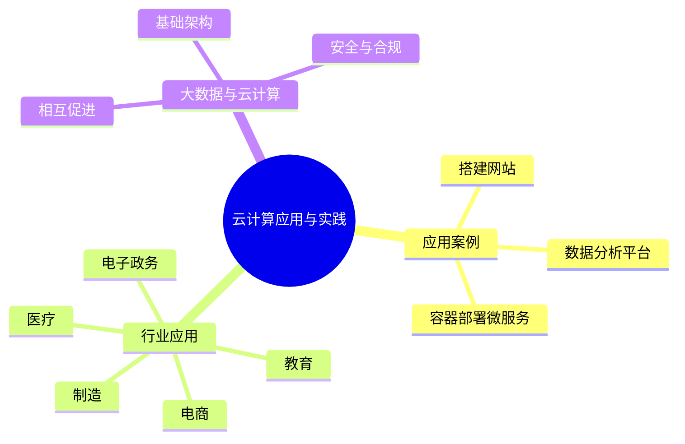

# 第 4 章 本章小结与练习

## 本章关键词

数据分析平台、微服务应用、政务云、教育云、医疗云、工业云、大数据等。

## 本章小结

本章主要是讲解云计算应用和实践，云计算凭借强大的适应性与扩展性，广泛应用于各领域。在网站搭建中，支持弹性部署与高效资源管理，快速响应需求变化；容器技术结合微服务架构，显著提升资源利用率与应用部署效率。

在行业场景应用中，电子政务领域云计算推动信息系统整合，实现基础设施资源池化与统一运维，提升安全防护与协同能力。电商行业云计算为其提供强大的支持，帮助它们应对流量高峰，降低成本，加快创新，可在全球范围内扩展业务。教育行业利用云计算为在线教育提供强大算力与存储支持，提升教学互动性与资源可及性。医疗领域通过云平台建设区域医疗系统，促进数据共享与资源优化配置。制造行业中通过建设工业云或利用云计算通过按需付费模式降低 IT 成本，提高运营效率。

同时，大数据与云计算深度融合，云为大数据提供弹性存储与计算能力，大数据则拓展云应用场景。企业可在云上高效处理海量数据，实现精准营销、风险预测与智能决策，提升竞争力。

总之，云计算已成为数字经济发展的重要基石，持续赋能各行各业智能化升级与创新转型。

把本章压缩成 6 句话：

1. 在云上**搭建网站**的流程是：选择云服务商 → 配置云服务器 → 配置云存储 → 设置云数据库 → 开发网站代码 → 部署到云服务器 → 域名绑定和 SSL 证书，每一步对应一种云服务。
2. 云上的**数据分析平台**分为数据上传（Kafka、Flume、SDK）、数据存储（RDS、OSS、HDFS、数据湖）、数据分析（Spark、Flink、数据仓库、BI 工具）三步。
3. 用**容器部署微服务**：按项目规模选择 Docker、Kubernetes 等平台，按业务域拆分服务，用 Dockerfile 构建镜像、`docker run` 运行容器，用 Kubernetes 或 Docker Compose 编排，用 CI/CD 自动部署。
4. **政务云**有集中统建、购买服务、混合云三种建设模式，依托政务内网、政务外网和部门专网，信创政务云强调国产化和安全可控。
5. **电商、教育、医疗、制造**行业分别用云应对流量洪峰、支撑在线教学、实现病历和影像共享、连接工业设备与供应链，各自形成了典型的建设模式和架构。
6. **云计算是大数据的基础架构**，提供计算、分布式存储与处理和弹性伸缩能力；大数据又推动云计算的需求增长、技术创新和 DaaS 等新商业模式；处理大数据必须做好加密、访问控制和合规。

**下一章预告**：第 5 章展望云计算的未来：边缘计算、无服务器计算、云原生、AI 与云的融合等趋势，以及云计算相关的职业岗位、技能要求和认证路径。

## 参考文献

**教材与专著**

1. 崔升广. 云计算技术应用基础：微课版[M]. 北京：人民邮电出版社，2023. 云服务器上部署网站的入门实例，可与实验 4-1 对照。
2. 汤兵勇，徐亭，章瑞. 云图·云途：云计算技术演进及应用[M]. 北京：机械工业出版社，2021. 云计算在政务、金融、制造等行业的应用，对应 4.2 节。
3. 林子雨. 大数据技术原理与应用[M]. 3 版. 北京：人民邮电出版社，2021. Hadoop、Spark 与云计算的关系，对应 4.3 节。

**在线资源**

4. Docker Inc. Docker Compose 文档[EB/OL]. [2026-11-01]. https://docs.docker.com/compose/. Compose 文件格式和常用命令，对应实验 4-2、4-3。
5. The Kubernetes Authors. Kubernetes 文档：Deployments[EB/OL]. [2026-11-01]. https://kubernetes.io/zh-cn/docs/concepts/workloads/controllers/deployment/. 副本数、自愈和滚动更新，对应动画“Kubernetes 自愈与扩缩容”。
6. Moodle HQ. Moodle 文档[EB/OL]. [2026-11-01]. https://docs.moodle.org/. 课程、用户和语言包管理，对应实验 4-3 和原书实训活动。
7. 国务院. 国务院关于加强数字政府建设的指导意见[EB/OL]. (2022-06-23)[2026-11-01]. https://www.gov.cn/zhengce/content/2022-06/23/content_5697299.htm. 全国一体化政务云平台体系，对应 4.2.1.2 节。

## 课后练习

**一、单项选择题**

**1.** 搭建网站时，用来存放图片、视频等静态文件，并可以设置为“公共读”的云服务是（　　）。

- A. 云服务器 ECS
- B. 对象存储 OSS
- C. 云数据库 RDS
- D. 安全组

??? tip "答案与解析"
    **答案：B**

    解析：对象存储的基本容器是存储桶（Bucket），适合存放网站的静态文件；设为公共读后浏览器可以直接访问。

    考查：搭建网站：配置云存储 · 认知层次：记忆 · [回看 4.1.1.3](4-1.md#4113)
    { .quiz-meta }

**2.** LAMP 环境中的“M”指的是（　　）。

- A. Memcache
- B. MongoDB
- C. MaxCompute
- D. MySQL

??? tip "答案与解析"
    **答案：D**

    解析：LAMP 即 Linux、Apache、MySQL、PHP。实验 4-1 使用的 MariaDB 是 MySQL 的开源分支。

    考查：搭建网站：设置云数据库 · 认知层次：记忆 · [回看 4.1.1.4](4-1.md#4114)
    { .quiz-meta }

**3.** 为网站配置 SSL 证书的主要目的是（　　）。

- A. 让网站访问速度更快
- B. 让网站可以通过域名访问
- C. 加密浏览器与服务器之间传输的数据，提高安全性
- D. 自动备份网站数据

??? tip "答案与解析"
    **答案：C**

    解析：SSL 证书用于 HTTPS 加密传输，防止数据被窃听和篡改；通过域名访问靠的是域名解析。

    考查：域名绑定和 SSL 证书配置 · 认知层次：理解 · [回看 4.1.1.7](4-1.md#4117)
    { .quiz-meta }

**4.** 在数据分析平台中，需要实时地从多种数据源采集数据，可以选用（　　）。

- A. Apache Kafka、Apache Flume
- B. Tableau、Power BI
- C. MySQL、PostgreSQL
- D. Nginx、Apache

??? tip "答案与解析"
    **答案：A**

    解析：Kafka、Flume 是分布式数据采集工具；Tableau、Power BI 是 BI 可视化工具；MySQL、PostgreSQL 是关系数据库；Nginx、Apache 是 Web 服务器。

    考查：构建数据分析平台：数据上传 · 认知层次：理解 · [回看 4.1.2.1](4-1.md#4121)
    { .quiz-meta }

**5.** 大型企业需要高可用、可扩展、自动故障恢复的容器编排平台，教材首推的是（　　）。

- A. 只用单机 Docker
- B. Kubernetes
- C. Docker Swarm
- D. 虚拟机

??? tip "答案与解析"
    **答案：B**

    解析：Kubernetes 支持自动化部署、扩展和故障恢复，适合大规模生产环境；Docker Swarm 适合中小规模、对编排要求不高的场景。

    考查：选择合适的容器化平台 · 认知层次：理解 · [回看 4.1.3.1](4-1.md#4131)
    { .quiz-meta }

**6.** Dockerfile 中的 `EXPOSE 80` 表示（　　）。

- A. 把宿主机的 80 端口映射到容器
- B. 容器启动时运行 80 号程序
- C. 声明容器内的应用使用 80 端口，以便外部访问
- D. 删除 80 端口

??? tip "答案与解析"
    **答案：C**

    解析：EXPOSE 只是声明容器使用的端口；真正把宿主机端口映射到容器端口，要在 docker run 时用 -p 参数，如 -p 4000:80。

    考查：编写 Dockerfile · 认知层次：理解 · [回看 4.1.3.3](4-1.md#4133)
    { .quiz-meta }

**7.** “核心数据部署在私有云，公共服务使用公有云弹性扩展”，这是政务云的（　　）。

- A. 混合云模式
- B. 集中统建型
- C. 购买服务型
- D. 社区云模式

??? tip "答案与解析"
    **答案：A**

    解析：教材的小贴士以国家政务服务平台为例：核心数据在私有云，健康码等公共服务在公有云快速扩容。

    考查：政务云建设模式 · 认知层次：理解 · [回看 4.2.1.2](4-2.md#4212)
    { .quiz-meta }

**8.** 医院同城灾备要求 RPO≤10 min，这里的 RPO 指的是（　　）。

- A. 恢复业务所需的最长时间
- B. 每秒处理的请求数
- C. 服务器的 CPU 利用率
- D. 灾难发生时最多可能丢失多长时间的数据

??? tip "答案与解析"
    **答案：D**

    解析：RPO（恢复点目标）衡量最多丢失多少数据；RTO（恢复时间目标）衡量多久能恢复业务。

    考查：医疗云灾备 · 认知层次：理解 · [回看 4.2.4.3](4-2.md#42435)
    { .quiz-meta }

**二、多项选择题**

**9.** 下列属于 4.1.1 节“搭建一个简单的网站”步骤的有（　　）。

- A. 选择云服务提供商
- B. 配置云服务器
- C. 训练大模型
- D. 域名绑定和 SSL 证书配置

??? tip "答案与解析"
    **答案：ABD**

    解析：网站搭建的关键步骤是：选择云服务提供商、配置云服务器、配置云存储、设置云数据库、开发网站代码、部署网站到云服务器、域名绑定和 SSL 证书配置。

    考查：搭建网站的步骤 · 认知层次：记忆 · [回看 4.1.1](4-1.md#411)
    { .quiz-meta }

**10.** 设计微服务架构时，属于“服务编排与管理”的措施有（　　）。

- A. 使用 API 网关管理入口流量
- B. 使用服务发现工具动态注册服务实例
- C. 引入熔断器与重试机制
- D. 所有服务共用一个数据库

??? tip "答案与解析"
    **答案：ABC**

    解析：微服务主张每个服务拥有独立的数据库，避免数据耦合，D 错误。

    考查：设计微服务架构 · 认知层次：理解 · [回看 4.1.3.2](4-1.md#4132)
    { .quiz-meta }

**11.** 工业云的建设模式包括（　　）。

- A. 区域级工业云
- B. 个人级工业云
- C. 行业级工业云
- D. 企业级工业云

??? tip "答案与解析"
    **答案：ACD**

    解析：教材列出分层建设、区域级、行业级、企业级和混合建设五种模式。

    考查：工业云建设模式 · 认知层次：记忆 · [回看 4.2.5.2](4-2.md#4252)
    { .quiz-meta }

**12.** 确保大数据安全处理的措施包括（　　）。

- A. 建立清晰的数据管理策略
- B. 选择合适的云服务提供商
- C. 数据加密与访问控制
- D. 跨境数据传输符合法规

??? tip "答案与解析"
    **答案：ABCD**

    解析：4.3.3 节共列出七项措施，还包括加强数据安全管理体系建设、提升技术防护能力、推动政府与企业和个人协同发力。

    考查：大数据安全与合规 · 认知层次：记忆 · [回看 4.3.3](4-3.md#433)
    { .quiz-meta }

**三、判断题**

**13.** 执行 `docker run -d -p 4000:80 my-python-app` 时，`-d` 表示让容器在后台运行。（　　）

- √
- ×

??? tip "答案与解析"
    **答案：√**

    解析：-d 即 detached 模式，容器在后台运行，终端可以继续输入其他命令。

    考查：运行 Docker 容器 · 认知层次：记忆 · [回看 4.1.3.3](4-1.md#4133)
    { .quiz-meta }

**14.** `docker rmi` 命令用于删除容器。（　　）

- √
- ×

??? tip "答案与解析"
    **答案：×**

    解析：删除容器用 docker rm，删除镜像用 docker rmi（i 即 image）。

    考查：停止和删除容器、删除镜像 · 认知层次：记忆 · [回看 4.1.3.3](4-1.md#4133)
    { .quiz-meta }

**15.** Docker Compose 适合用一个 YAML 文件管理一个应用的多个容器，如“网站 + MySQL + Redis”。（　　）

- √
- ×

??? tip "答案与解析"
    **答案：√**

    解析：教材 4.1.3.5 指出，简单的微服务应用可以用 Docker Compose 编排，执行 docker compose up -d 所有服务自动拉起；实验 4-2 就是这样做的。

    考查：容器编排 · 认知层次：理解 · [回看 4.1.3.5](4-1.md#4135)
    { .quiz-meta }

**16.** 政务外网承载各级党委和政府的涉密信息系统。（　　）

- √
- ×

??? tip "答案与解析"
    **答案：×**

    解析：涉密信息系统接入政务内网；政务外网承载非涉密信息系统，如政府门户网站和教育、卫生等公共服务系统。

    考查：通用政务云建设 · 认知层次：理解 · [回看 4.2.1.3](4-2.md#4213)
    { .quiz-meta }

**17.** 大数据推动了云计算向云原生架构转变，Flink、Spark 等大数据框架已能运行在 Kubernetes 集群上。（　　）

- √
- ×

??? tip "答案与解析"
    **答案：√**

    解析：这是 4.3.2.2 节“大数据促进云计算与相关技术融合”中的例子。

    考查：大数据推动云计算的发展 · 认知层次：理解 · [回看 4.3.2.2](4-3.md#4322)
    { .quiz-meta }

**四、简答题**

**18.** 网站部署到云服务器后，用户访问时浏览器提示“无法访问此网站”。请按请求经过的顺序，列出至少四个需要检查的环节。

??? tip "参考答案"
    按顺序检查：① 域名解析是否指向了正确的公网 IP；② 安全组是否放行了 80/443 端口（表现为连接超时）；③ Web 服务器（Nginx/Apache）是否已启动（表现为拒绝连接）；④ 网站代码是否放在了网站根目录；⑤ 网站程序能否连上数据库（表现为数据库连接错误）。

    评分要点：每个环节 1 分，答出四个及以上且顺序合理得满分（5 分）。

**19.** 说明 Dockerfile、镜像、容器三者的关系，并写出构建镜像和运行容器的命令。

??? tip "参考答案"
    Dockerfile 是描述如何构建镜像的文本文件；镜像是按 Dockerfile 构建出来的、包含应用及其全部依赖的只读模板；容器是镜像运行起来的实例，一个镜像可以启动多个容器。构建镜像：`docker build -t my-python-app .`；运行容器：`docker run -d -p 4000:80 my-python-app`。

**20.** 以电子政务为例，说明集中统建型、购买服务型和混合云三种建设模式各适合什么情况。

??? tip "参考答案"
    集中统建型由政府自行投资建设和运维，适合对数据安全和自主性要求极高、技术和资金实力强的单位，一般由省级主导；购买服务型把建设和运维委托给云服务商，上线快、成本低，适合技术力量较弱的区县，但要加强对服务商的监管；混合云模式把核心业务和敏感数据放在自建平台、非核心业务交给服务商，兼顾安全与效率。

**五、实操题**

**21.** 参照实验 4-2，修改 `app.py`，让网页在显示访问次数的同时显示你的姓名和学号，重新构建并启动，提交浏览器截图和 `docker compose ps` 的输出。

??? tip "参考思路"
    在 `hello()` 的返回值中加入一行 `
姓名：张三 学号：2026001
`；修改代码后要执行 `docker compose up -d --build` 重新构建镜像，只执行 `docker compose up -d` 不会用到新代码。
