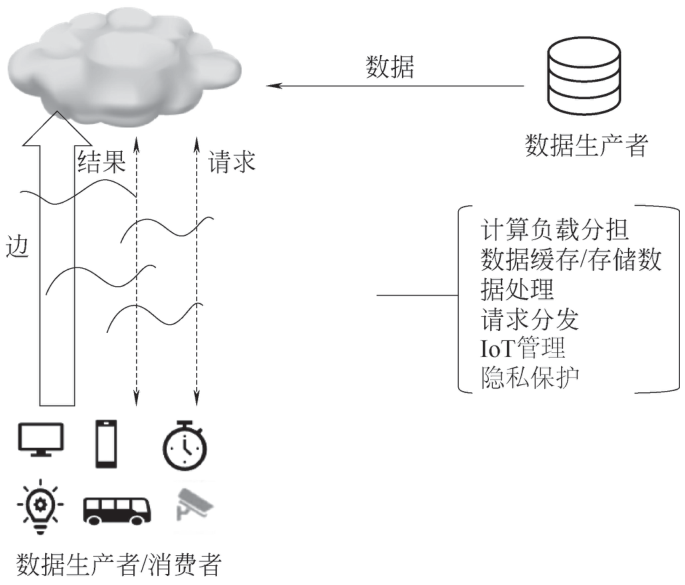
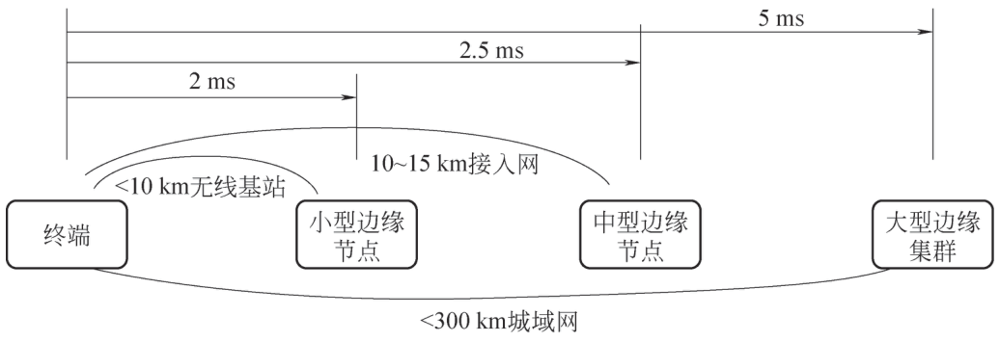
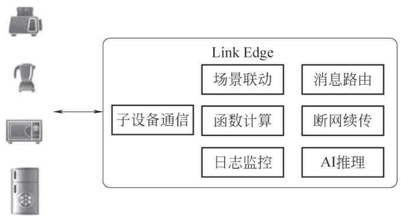
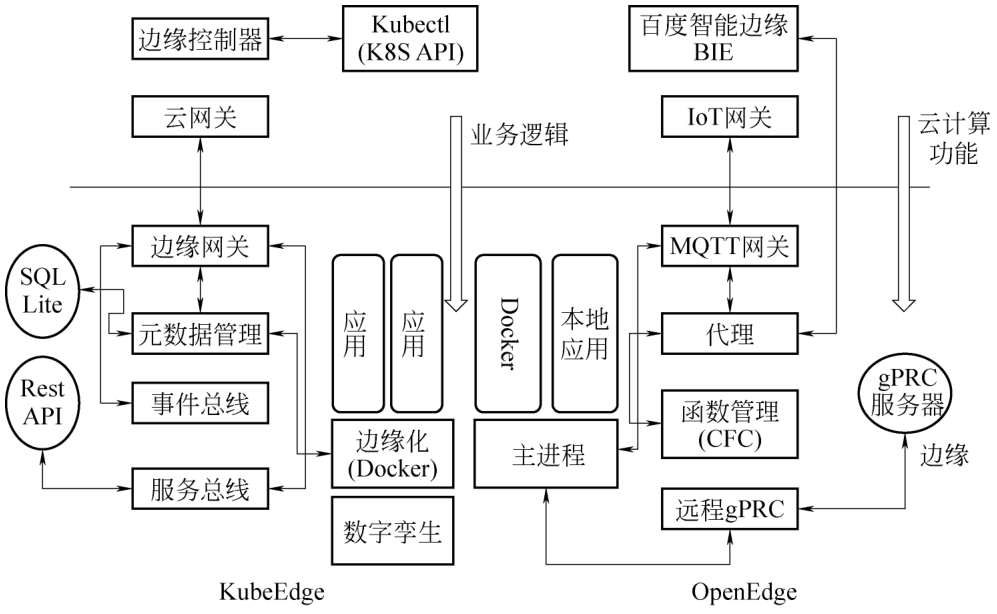

# 5.1 云计算未来趋势 {#51}

!!! info "学前导读"

    本节展望云计算的四个发展方向，它们都在回答“云计算下一步往哪里走”：

    1. **边缘计算与物联网**（5.1.1）：把一部分计算从遥远的云数据中心“下沉”到离设备更近的地方，解决延迟和带宽问题；
    2. **人工智能与云计算的结合**（5.1.2）：云为人工智能提供算力、数据和部署平台；
    3. **无服务器计算 Serverless**（5.1.3）：开发者只写函数，服务器完全交给云平台，按调用计费；
    4. **大模型与云计算的结合**（5.1.4）：[大模型](../../appendix/glossary.md#g-大模型 "参数规模巨大、在海量数据上预训练的人工智能模型"){ .term }的训练和推理离不开云上的 GPU 集群，云厂商也把大模型做成了服务。

    5.1.4 节案例很多，涉及大量产品名和数字，**不要求记忆**，读懂“大模型需要云提供什么、云为大模型提供了什么”即可。本节的两个动画分别对比“边缘处理与云端处理”“函数计算与云服务器”，建议动手调一调参数。

## 5.1.1 边缘计算与物联网（IoT） {#511}

[边缘计算](../../appendix/glossary.md#g-边缘计算 "在靠近数据源头的网络边缘就近处理数据，以降低延迟、节省带宽"){ .term }与[物联网](../../appendix/glossary.md#g-物联网 "通过传感器和网络把各种物体连接起来，实现信息交换和智能控制"){ .term }紧密相连，边缘计算通过在网络边缘对物联网设备产生的数据进行实时处理和分析，减少数据传输延迟，提高系统响应速度，增强数据安全性和隐私性，从而实现物联网应用的高效、智能和可靠运行。

### 5.1.1.1 边缘计算在物联网中的作用 {#5111}

#### 1. 实现数据的高效处理与分析

物联网设备会产生海量的数据，若这些数据都传输到云端进行处理和分析，会带来巨大的网络带宽压力和较长的延迟。边缘计算在靠近物联网设备的边缘端对数据进行初步处理和筛选，只将关键数据发送到云端，大大减少了数据传输量，降低了延迟，提高了数据处理的实时性和效率。

#### 2. 支持本地决策和自主性

在一些需要快速响应的应用场景中，如工业自动化、智能交通等，边缘计算可以在本地进行实时决策，无须等待云端指令。这使得物联网系统能够更快速地对环境变化做出反应，提高系统的自主性和可靠性，减少因网络故障或延迟导致的风险。

#### 3. 增强物联网系统的可扩展性

随着物联网设备数量的不断增加，边缘计算可以分散处理任务，避免云端资源的过度集中和拥堵。新的物联网设备可以方便地连接到边缘计算节点，实现即插即用，易于扩展和管理，降低系统的整体成本和复杂性。

#### 4. 实现物联网设备的协同工作

边缘计算可以实现物联网设备之间的本地协同和通信，使得设备之间能够更快速地进行数据共享和任务协作。例如，在智能家居场景中，边缘计算可以协调不同设备的工作状态，实现设备之间的联动控制，提高整个智能家居系统的智能化水平。

#### 5. 促进人工智能在物联网中的应用

边缘计算为人工智能在物联网中的应用提供了基础支持。通过在边缘端部署人工智能算法，可以更快速地实现本地智能决策，如故障诊断、预测性维护等。这不仅提高了物联网系统的智能化水平，还降低了对云端计算资源的依赖，使得人工智能技术能够更广泛地应用于各种物联网场景，推动物联网向智能化方向发展。

### 5.1.1.2 边缘计算的应用场景 {#5112}

#### 1. 5G 车联网

为应对 5G 网络下的多种技术挑战，将原本运行于云端的计算下沉至靠近设备的网络边缘节点逐渐成为趋势。边缘计算是指在靠近物或数据源头的一侧，采用集网络、计算、存储、应用核心能力于一体的开放平台，就近提供最近端服务。其应用程序在边缘侧发起，能产生更快的网络服务响应，满足行业在实时业务、应用智能、安全与隐私保护等方面的基本需求，如图 5-1 所示。

{ loading=lazy }

图 5-1 车联网边缘计算架构
{ .fig-caption }

低时延、高可靠场景是 5G 核心场景之一，借助边缘计算，车联网将成为低时延、高可靠场景的典型应用领域。当前，随着智能驾驶、自动驾驶等汽车智能化技术的蓬勃发展，联网汽车越来越多，针对用户的新功能也越来越多。随着车联网传输数据量的不断增大，其对通信延迟/时延的需求也越来越高，尤其是汽车在高速行驶中，通信延迟应在几毫秒以内，而网络的可靠性对满足行车安全需求至关重要。那么，在这个过程中如何满足车联网对传输速率的高要求？传统中央云计算由于经过多层级计算处理，延迟高、效率低，现在已不再能满足车联网的传输需求。而基于边缘计算的解决方案，能够在近点边缘层完成对数据的过滤、筛选、分析和处理，传输距离短、延迟低、效率更高。

#### 2. 智慧交通

在智慧交通领域，海量数据的实时处理需求对网络带宽和响应时间提出了更高要求。边缘计算通过将计算能力下沉至数据源附近，可显著降低网络负载，提升系统响应速度，同时减少数据传输过程中的能源消耗。

智能信号灯系统是边缘计算在智慧交通中的典型应用。该系统融合了传统信号灯、各类传感器、摄像头以及网络传输技术。借助边缘计算，系统能够实现更实时、高效的交通控制。当与人工智能技术相结合时，智能信号灯系统能够为车辆和行人提供更加智能、动态的交通指引。交通基础设施，如监控摄像头、信号灯、测速仪以及道路传感器，与行人手机和联网汽车等移动设备通过 4G、5G、Wi-Fi 或有线网络等方式相互连接，共同构成了边缘计算的分布式节点。这些节点之间紧密协作，形成了一个有机的整体，为智能信号灯系统提供全方位、实时的数据支持。例如，当一辆载有危重病人的救护车紧急行驶时，智能信号灯系统能够实时获取救护车的位置和行驶方向。通过各节点间的高效协作，系统可以迅速为救护车开辟出一条畅通无阻的“生命通道”。摄像头负责监测道路状况和行人动态，测速仪精准计算车辆速度，信号灯之间实时协调，及时调整信号灯时序，同时向周边行人和车辆发出警报。这种多设备协同工作的模式，不仅保障了紧急车辆的优先通行权，还有效提升了城市交通的智能化管理水平，为构建安全、高效的智慧交通体系提供了强有力的技术支撑。

#### 3. 智慧农业

智慧农场系统是物联网技术在农业领域的典型应用，其融合了计算机与网络技术、物联网技术、音视频技术、传感器技术、虚拟现实技术及无线通信技术等多种技术手段。通过这些技术的综合集成，智慧农场系统能够实现对农场的全面数字化和可视化管理。

精准监测与控制：系统利用部署在农场各处的传感器实时收集环境数据，如温度、湿度、光照强度等，以及作物生长状况和牲畜活动数据。通过无线通信技术将这些数据传输至云端平台进行分析处理，实现对农场生产环境的精准监测与智能控制，从而提高农作物产量和牲畜养殖效率，降低生产成本。

自动化管理：借助先进的计算机与网络技术，智慧农场系统能够实现农业生产过程的自动化管理。例如，自动灌溉系统可根据土壤湿度数据自动启停灌溉设备，精准施肥系统依据作物需求自动投放肥料，畜牧养殖中的自动喂养系统和环境控制系统能够根据牲畜生长状况与环境参数自动调节饲料投放量及养殖环境条件，减少人工干预，提高生产效率和管理水平。

质量追溯与安全保障：通过物联网技术和数据库管理系统，智慧农场系统能够对农产品从种植、养殖到加工配送的全过程进行详细记录和追溯。消费者可以通过扫描产品二维码等方式获取农产品的产地、种植养殖过程、施肥用药情况、采摘加工时间等信息，实现对农产品质量的全程追溯，确保消费者购买到安全、绿色、可信赖的农产品，增强消费者对农产品质量和食品安全的信心。

可视化服务与客户参与：利用虚拟现实技术和音视频技术，智慧农场系统可以为消费者提供农场生产的实时可视化服务。消费者可以远程查看农作物生长状况、畜牧养殖环境、农事操作过程等，增加对农业生产过程的了解和关注，提高参与度和满意度。同时，这种透明化的生产方式也有助于增强消费者对农场的信任，促进农产品的销售和品牌形象的提升，推动农业的可持续发展。

#### 4. 智慧医疗

在智慧医疗建设中，边缘计算发挥着至关重要的作用，为医疗服务的便捷性、高效性和精准性提供了有力支持。

远程医疗诊断：医疗传感器借助边缘计算的快速数据处理和分析能力，能够实时监测患者的生理数据，如心率、血压、血糖水平等，并将这些数据通过网络传输至远程医疗中心或医生的工作站。医生可以基于这些实时数据进行远程诊断，及时为患者提供治疗建议，特别是在偏远地区或医疗资源匮乏的地方，这种远程医疗诊断方式能够有效提高医疗服务的可及性和及时性，使更多患者受益于优质的医疗资源。

可穿戴设备与健康监测：随着可穿戴设备的不断普及，基于这些设备的远程医疗服务得到快速发展。智能手环、智能手表等可穿戴设备通常具备计算、存储和网络传输功能，可以作为边缘计算节点，实时收集和处理用户的健康数据。例如，老年人佩戴的智能手表能够检测是否发生摔倒等紧急情况，并在检测到异常时立即向预设的紧急联系人发送警报信号，使患者能够及时获得救助，为挽救生命争取宝贵时间。

医疗数据共享与协作：边缘计算在医疗协作方面具有显著优势。例如，在流感暴发期间，医院作为边缘节点，可以与药房、医药公司、政府机构、保险公司等多个相关节点进行实时数据共享。

### 5.1.1.3 边缘计算的技术方案 {#5113}

前面的章节中已介绍了在边缘节点部署计算能力、存储能力可以解决 5G、物联网场景下数据、时延等诸多技术问题。在风力、光伏新能源、电力物联网、工业物联网等专业领域，不少 IT 公司研发了针对本行业应用的边缘计算平台，另外还有公司提供了通用边缘计算服务。从推动主体来看，提供边缘计算技术方案的公司大体可以分为以下两类：

（1）以电信、移动、联通为主的网络运营商。

（2）提供云计算服务的 IT 公司，如阿里、百度、华为等。

由于公司所处行业和拥有的硬件设施存在较大差异，公司使用的技术栈也有较大区别。本节将围绕这两类公司的通用边缘计算技术方案进行介绍。

#### 1. 网络运营商移动边缘计算方案

网络运营商在硬件设施方面的投入非常大，为保持采购设备的兼容性，各种软硬件产品的标准化做得非常好。欧洲电信标准化协会在 2014 年就提出移动边缘运算（mobile edge computing，[MEC](../../appendix/glossary.md#g-移动边缘计算-MEC "在离用户最近的无线接入网中部署计算和存储能力的边缘计算方案"){ .term }）的草案，目标是在离用户最近的无线接入网中部署 IT 基础设施，向外提供计算、存储、网络等服务。

依据网络时延、空间距离两个因素，运营商 MEC 建议部署不同的边缘节点。边缘节点与传输距离的延时关系示意如图 5-2 所示。

{ loading=lazy }

图 5-2 边缘节点与传输距离的延时关系示意
{ .fig-caption }

不同边缘节点的硬件能力、软件架构、承载业务都有所区别，如小型边缘节点最小配置为单台 4 核 Xeon CPU、8 GB 内存的服务器，可以运行极低时延的边缘应用，而大型边缘节点可以部署 100 台以上的服务器集群，同时运行 CDN、SAE-GW、UPF、CPE 等高带宽、低时延的运营商业务。

英特尔拥有成熟的软硬件生态，其主导开发的可以高效地处理网络数据报文的数据平面开发套件 DPDK、基于 Wind River（风河）公司的高扩展 NFV 方案、X86 架构服务器在运营商网络中被大量应用。

#### 2. 云服务商边缘计算产品

提供云计算服务的信息技术公司也发布了边缘计算产品，如阿里云的 Link Edge、百度云的 OpenEdge、华为开源的 KubeEdge、Rancher 开源的 K3s 等。OpenEdge 和 KubeEdge 的架构设计比较类似，功能略有区别：OpenEdge 提供本地函数式引擎，可将云端配置的计算单元下发至边缘执行，而 KubeEdge 支持将容器化的业务逻辑下发至边缘部署。

阿里云的 Link Edge（见图 5-3）并没有开源，根据产品介绍来判断，其功能和上面两个开源项目有类似之处。Link Edge 按照硬件算力，提供专业、标准、轻量三个产品版本，不同版本功能区别较大，其本地设备联动、边缘自主工作是亮点，同时边缘网关能无缝对接阿里云的云监控、对象存储、日志、权限审核服务。

{ loading=lazy }

图 5-3 Link Edge 示意图
{ .fig-caption }

这几个项目的目标都是实现云计算与边缘计算的融合，云端编排好的容器和计算能无缝流动到边缘节点执行，从而避免由于边缘硬件平台不同而进行二次开发的投入。

云服务商的边缘计算方案系统主要运行于智能网关这一类计算、存储、带宽资源都比较有限的硬件上，能够对采集的数据进行简单预处理、协议转换等，定位与运营商使用的 MEC 技术方案大相径庭，同时在成熟度方面也有较大差距。值得注意的是，这些开源项目的迭代非常快，如 KubeEdge 2.0 的版本就规划了 Istio 微服务 mesh 架构、高可用的容灾机制以及小规模的集群管理等新特性。由于边缘计算的应用场景多样、边缘节点的配置多样，可以预见边缘计算技术在不久的将来会出现百花齐放的局面。KubeEdge 与 OpenEdge 框架比较如图 5-4 所示。

{ loading=lazy }

图 5-4 KubeEdge 与 OpenEdge 框架比较
{ .fig-caption }

### 5.1.1.4 边缘计算与物联网的结合优势 {#5114}

缩短通信延迟：边缘计算缩短了物联网设备和中央 IT 网络之间的通信延迟，加快了响应速度，提升了运维效率。

提高网络带宽：通过在本地进行数据处理和存储，边缘计算减少了直接传输到云端的数据量，优化了网络带宽。

离线运行能力：在网络连接丢失时，边缘计算系统可以离线继续运行，确保系统的稳定性。

本地数据处理：通过分析算法和机器学习，在本地进行数据处理、聚合和快速决策，减少对云端的依赖。

边缘计算到底快多少、省多少？下面的动画以路口的智能信号灯为例，比较“全部上传云端识别”和“边缘节点就近识别”两种做法。

<iframe class="sim-frame" src="../../sims/edge-latency/main.html" height="560" loading="lazy" title="边缘计算与云端计算对比"></iframe>

拖动摄像头数量和上行带宽，观察两种方案的延迟与流量；勾选“模拟到云端的网络中断”，对照 5.1.1.4 节的“离线运行能力”。[全屏打开](../../sims/edge-latency/main.html){ target=_blank } · [教学说明](../../sims/edge-latency/index.md)
{ .sim-caption }

### 5.1.1.5 技术发展与挑战 {#5115}

技术演进：边缘计算技术从云计算的补充角色逐渐走向主流，5G、物联网、AI 等技术的实践应用推动了边缘计算的快速发展。

软硬一体化：软硬一体化边缘基础设施呈现高度集成架构，能够将计算能力扩展到生产现场，满足快速灵活部署的需求。

协议兼容性：物联网设备类型众多，接入方式复杂，边缘计算平台需要解决终端设备的异构连接场景难点，支持多种连接协议。

边缘计算与物联网的结合为各行业带来了显著的便利，具体体现为低延迟、数据隐私保护、带宽优化和高可靠性。随着技术的不断发展，边缘计算将在物联网领域发挥越来越重要的作用，推动更多创新应用的落地。

## 5.1.2 人工智能与云计算的结合 {#512}

云计算和人工智能的结合可以带来很多好处。首先，云计算提供了大量的计算资源，能够为人工智能提供强大的计算支持。其次，云计算能够提供更加灵活的计算资源，这使得人工智能可以根据需要调整计算资源。最后，云计算还提供了可扩展的存储资源，这使得人工智能能够处理和存储大量的数据。

▶ 配套微课 V5-1《AI-RAG搭建演示》（纸质书中为二维码，网络版视频待上线）

人工智能和云计算的结合可以实现很多应用场景。例如，人工智能可以在云计算平台上运行，从而能够处理和分析大量的数据。此外，云计算还可以提供虚拟机、容器等技术，使得人工智能能够更加高效地运行。最后，云计算还可以提供 API 和开发工具，使得开发人员能够更加方便地构建和部署人工智能应用程序，特别是搭建一个 RAG 应用。

### 5.1.2.1 应用场景 {#5121}

云计算和人工智能结合的应用场景有很多。以下是几个典型的应用场景。

（1）智能客服：利用人工智能技术实现智能客服，能够帮助企业提高客户满意度和服务质量。

（2）智能物流：通过人工智能技术优化物流配送路线，提高配送效率和准确性。

（3）智能金融：利用人工智能技术分析大量金融数据，提供风险评估和投资建议。

（4）智慧城市：通过人工智能技术和云计算平台，实现城市治理和服务的智能化，提高城市居民的生活质量。

（5）智能制造：利用人工智能技术和云计算平台，实现制造过程的智能化，提高生产效率和产品质量。

（6）医疗健康：通过云计算平台，人工智能可以处理医疗影像、电子病历等数据，辅助医生进行诊断和治疗方案制定。

这些应用场景都需要大量的计算和存储资源，同时也需要人工智能的技术支持。云计算和人工智能的结合，为这些应用场景提供了强大的支持。云计算和人工智能的结合是未来发展的方向，将为企业和个人创造不可估量的价值。因此，企业和个人应积极探索云计算和人工智能的结合，以便更好地应对未来的挑战和机遇。

### 5.1.2.2 互补性协同工作制 {#5122}

数据存储与管理：云计算提供了海量数据存储平台，支持结构化和非结构化数据管理。人工智能则从这些数据中提取有价值的信息，驱动智能决策。

计算与模型训练：云计算提供了高性能计算资源（如 GPU 和 TPU 集群），支持大规模人工智能模型的训练。人工智能利用这些资源快速构建和优化复杂模型。

智能应用部署与服务：云计算提供全球范围的应用部署平台，实现跨地域的应用交付。人工智能则部署智能服务（如语音助手、推荐系统）并实现实时响应。

### 5.1.2.3 技术优势 {#5123}

数据存储与处理能力提升：云计算通过分布式数据存储和计算框架（如 Hadoop、Spark），支持海量数据的批处理与流处理。人工智能利用这些数据进行模型训练和推理，实现快速洞察与智能决策。

人工智能模型快速训练与部署：云计算提供高性能 GPU 和 TPU 资源，用于深度学习模型的训练和部署。模型训练完成后，可以直接在云端部署，快速交付到应用系统中。

成本优化与资源弹性扩展：云计算的按需付费模式和自动扩展功能，降低了企业的 IT 成本，同时支持高并发的智能应用。

### 5.1.2.4 未来发展趋势 {#5124}

技术融合：随着硬件技术的进步，如新型芯片的研发和应用，算力将大幅提升，同时降低能耗。量子计算、光子计算等新兴技术也可能与人工智能、云计算深度融合。

产业重构：从“上云”到“用云”的转变，云服务将成为企业创新和发展的核心驱动力。制造业等传统行业将通过人工智能、云计算实现数字化转型。

边缘计算与人工智能的结合：在实时性要求较高的场景，如工业监控、自动驾驶和智能家居，边缘计算与人工智能结合的架构将发挥重要作用。

人工智能与云计算的结合正在开启一个智能化的新时代。通过这种结合，企业不仅能够快速处理海量数据，还能借助智能化模型做出更准确、更高效的决策，从而在数据驱动的市场竞争中赢得先机。未来，随着技术的不断进步，人工智能与云计算的结合将为社会和经济的发展注入更多动力。

## 5.1.3 无服务器计算（Serverless） {#513}

### 5.1.3.1 发展历程 {#5131}

早期探索：2006 年，伦敦的 Zimki 平台首次提出了“按实际调用付费”的概念，但当时并未使用“Serverless”这个术语。

概念提出：2012 年，Iron.io 的副总裁在文章中首次提出“Serverless”这个概念。

商业化落地：2014 年，AWS 推出了 Lambda，这是首个商业化的 Serverless FaaS（Function as a Service，[函数即服务](../../appendix/glossary.md#g-函数即服务 "Serverless 的主要形式，以函数为单位部署代码，事件触发执行、按调用计费"){ .term }），标志着 Serverless 技术的正式诞生。

国内发展：2017 年，阿里云和腾讯云先后推出自己的 Serverless 平台——阿里云的函数计算（FC）和腾讯云的云函数。同年，谷歌也发布 Cloud Functions for Firebase，提供多端一体化开发的 Serverless 解决方案。

生态扩展：2018 年，阿里云推出 Serverless 容器服务 ASK 和 Serverless 应用引擎 SAE。腾讯云也发布了小程序·云开发产品，提供基于小程序的多端 Serverless 开发方案。

市场普及：2019 年，Serverless 被 Gartner 评为最有潜力的云计算技术发展方向之一。同年，字节跳动也开始探索 Serverless 技术。

大规模应用：2020 年，阿里云在天猫“双 11”中实现了 Serverless 在核心业务场景下的大规模落地，创造了 Serverless 落地应用的里程碑。

持续增长：2023 年，Datadog 发布的报告显示，Serverless 的采用率大幅增长，尤其是在基于容器的解决方案中。

### 5.1.3.2 技术优势 {#5132}

无须管理服务器：开发者无须关注底层服务器的部署、配置和运维，只需专注于业务逻辑的实现。

弹性伸缩：Serverless 平台能够根据实际业务需求自动调整资源分配，确保应用在高并发场景下的稳定运行。

按需计费：用户只需为实际使用的计算资源付费，避免了资源浪费，降低了成本。

快速开发与部署：Serverless 提供了丰富的开发工具和模板，支持快速开发和部署，提高了开发效率。

### 5.1.3.3 市场现状与趋势 {#5133}

市场规模增长：Serverless 市场在全球范围内持续增长，中国作为全球最大的云计算市场之一，Serverless 的应用也在不断增加。

技术融合：Serverless 与容器、[DevOps](../../appendix/glossary.md#g-DevOps "打通开发和运维、通过自动化工具实现快速、可靠交付的理念和实践"){ .term }、低代码/无代码、AI/ML、边缘计算等技术不断融合，带来了更丰富的应用场景。

行业认可：Serverless 被广泛认为是未来云计算的重要趋势之一，越来越多的企业开始采用 Serverless 架构来实现敏捷创新。

挑战与问题：尽管 Serverless 具有诸多优势，但在实际应用中也面临一些挑战，如[冷启动](../../appendix/glossary.md#g-冷启动 "函数长时间未被调用后再次触发时，需要重新创建运行环境，导致响应变慢"){ .term }问题、可移植性问题和可观测性问题。

### 5.1.3.4 未来发展趋势 {#5134}

全面 Serverless 化：未来，云计算将全面 Serverless 化，更加接近“电网”模式，按计算的调用次数付费。

技术创新：Serverless 将继续与新兴技术（如量子计算、光子计算）融合，推动技术的进一步发展。

行业应用拓展：Serverless 将在更多行业（如智能制造、金融科技、医疗健康）中得到广泛应用，助力企业实现数字化转型。

[无服务器计算](../../appendix/glossary.md#g-无服务器计算 "开发者只编写业务代码，服务器的部署、运维和伸缩全部由云平台负责的计算模式"){ .term }（Serverless）作为一种新兴的云计算模式，已经在全球范围内得到了广泛的关注和应用。其具有无须管理服务器、弹性伸缩、按需计费等优势，成为企业实现敏捷创新和降本增效的重要选择。随着技术的不断进步和市场的持续增长，Serverless 将在未来发挥越来越重要的作用。

Serverless “按需计费”是不是总比租服务器便宜？下面的动画用同样的业务量比较函数计算和云服务器的月费用。

<iframe class="sim-frame" src="../../sims/serverless-billing/main.html" height="560" loading="lazy" title="Serverless 与云服务器费用对比"></iframe>

依次点三个“典型场景”，比较两种方案的月费用；拖动“每次执行时间”，观察临界点怎样移动。[全屏打开](../../sims/serverless-billing/main.html){ target=_blank } · [教学说明](../../sims/serverless-billing/index.md)
{ .sim-caption }

## 5.1.4 大模型与云计算的结合 {#514}

### 5.1.4.1 大模型的发展历程 {#5141}

大模型的发展历程大致经历了以下阶段。

#### 1. 早期探索阶段（1943—1969 年）

1943 年，麦卡洛克和皮茨提出首个 MP 神经元模型，为连接主义奠定了基础；1957 年，罗森布拉特提出了感知机；1969 年，明斯基和派普特发现其无法处理异或问题，暴露单层神经网络局限性。

#### 2. 基础架构突破阶段（2017—2019 年）

2017 年，谷歌提出 [Transformer](../../appendix/glossary.md#g-Transformer "2017 年提出的基于自注意力机制的神经网络架构，是当今大模型的基础"){ .term } 架构，该架构具有自注意力机制、并行计算、位置编码、多头注意力等优势。2018 年，OpenAI 发布 GPT-1，谷歌发布 BERT。2019 年，百度发布 ERNIE 1.0。这些产品均采用 Transformer 架构，推动大模型发展。

#### 3. 规模化发展阶段（2020—2022 年）

此阶段模型参数量和训练数据规模大幅提升，OpenAI 在 2020 年发布的 GPT-3 展现了规模化带来的涌现能力。2021 年，百度发布 ERNIE 3.0 Titan，成为全球首个知识增强千亿大模型。

#### 4. 多模态融合与智能体开源崛起阶段（2023—2025 年）

2023 年，OpenAI 发布 GPT-4，它是能同时理解文本和图像的多模态大模型，同期谷歌发布 Gemini。2024 年，OpenAI 推出 Sora 等产品。DeepSeek 在 2023 年 11 月开源 670 亿参数 DeepSeek LLM，后续迭代多模态模型（如 Coder、Math、VL 系列）；2024 年底推出 DeepSeek-V3 等升级版本。2025 年，阿里开源 Qwen2.5-Omni，采用 Thinker-Talker 双核架构，支持多模态输入/输出，多模态智能体成为发展主流。

▶ 配套微课 V5-2《安全大模型技术》（纸质书中为二维码，网络版视频待上线）

### 5.1.4.2 大模型与云计算技术应用 {#5142}

#### 1. 大模型与云计算技术应用表现

大模型（如大规模预训练语言模型、多模态模型等）的发展对计算资源、存储能力和部署灵活性提出了极高要求，而云计算凭借弹性扩展、资源池化和按需付费等特性，成为支撑大模型落地的核心基础设施。两者的融合主要体现在以下层面：

（1）大模型对云计算的需求。

超大规模算力需求：大模型训练（如 GPT-4）需消耗数千块 GPU/TPU，依赖云计算的分布式计算集群（如 AWS 的 P3 实例、阿里云的 GPU 云服务器）。

海量数据存储与处理：训练数据量达 TB 级，需云计算提供分布式存储（如 HDFS、对象存储 S3）和实时数据处理框架（Spark、Flink）。

灵活部署与成本优化：企业无须自建数据中心，通过云计算按需获取资源，降低固定成本（如使用 Serverless 架构部署大模型推理服务）。

（2）云计算对大模型的技术支撑。

IaaS 层：提供高性能计算实例（GPU/TPU 集群）、低延迟网络（RDMA）和存储资源（SSD/NVMe）。

PaaS 层：集成大模型开发框架（TensorFlow、PyTorch）、自动化训练工具（如 AWS SageMaker、腾讯云 TI-ONE 和模型管理平台）。

SaaS 层：封装大模型能力为 API 服务（如 OpenAI 的 GPT API、百度文心一言等云服务），支持企业快速调用。

#### 2. 大模型与云计算技术应用案例分析

以下是大模型与云计算技术应用的扩展案例及技术细节分析，结合最新行业实践与技术动态，对各领域的典型场景、云计算支撑技术及案例进行补充说明：

（1）智能客服：垂直领域深度优化与实时响应能力提升。

①应用场景：多轮对话机器人、智能工单分类、跨渠道客户服务。

②云计算技术支撑。

容器化部署与弹性伸缩：通过 Kubernetes 实现大模型推理服务的自动化扩缩容，支持毫秒级响应峰值流量（如百万级并发咨询）。

实时数据处理与反馈闭环：结合 Flink 等流式计算框架，实时分析用户交互数据并迭代优化模型，提升服务个性化与准确性。

高性能 GPU 集群：阿里云 PAI 平台提供 GPU 集群资源，实现近 100% 的计算利用率，支持复杂语义理解与生成任务。

案例：

阿里云智能客服与深言科技合作：基于阿里云 PAI 训练的“深言达意”平台，通过自研大模型结合检索增强技术，实现精准的词句定位与复杂表达关联（如将“天气炎热”智能匹配到“火伞高张”等文学表述），并通过数据反馈循环积累近百万条用户数据优化模型。

AWS Bedrock 与 Claude 3.5 集成：企业可通过 Bedrock 平台快速部署 Claude 3.5 模型，利用其长上下文理解能力处理多轮对话，同时结合 Amazon Q Business 实现跨数据源（如邮件、知识库）的智能检索，提升客服工单处理效率。

（2）企业知识管理：向量数据库与[检索增强生成](../../appendix/glossary.md#g-检索增强生成 "先从知识库中检索相关资料，再交给大模型生成回答的技术"){ .term }（RAG）技术革新。

①应用场景：企业文档智能检索、内部问答系统、跨部门知识图谱构建。

②云计算技术支撑。

向量数据库与分布式索引：腾讯云 Vector DB 采用分布式存储与 GPU 加速技术，支持千亿级向量数据的高效检索（单卡 QPS 达 4 000，多卡可扩展至数万），并通过 HNSW、IVF 等索引算法实现 99% 以上的召回率。

RAG 架构与大模型协同：将企业私有数据（如合同、手册）向量化后存储在向量数据库，通过大模型生成自然语言查询，结合语义检索与生成式回答，解决传统检索的“语义鸿沟”问题。

联邦学习与隐私保护：跨机构知识共享时，采用联邦学习技术在本地训练模型子模块（如法律术语编码器、逻辑解码器），仅聚合参数更新以保护数据隐私。

案例：

腾讯云 Vector DB 赋能企业知识库：某集团通过 Vector DB 存储 1 600 亿次/天的请求数据，利用余弦相似度算法实现商品推荐与文档检索，内容召回率提升 20%，推理速度显著优化。

AWS Bedrock Guardrails 与企业 BI 整合：通过 Bedrock 的自动化 RAG 工作流程，企业可将私有数据（如办公软件文档、数据库）与 Amazon Q index 集成，生成结构化分析报告，并结合 QuickSight 实现商业智能可视化，降低人工分析成本。

（3）智能制造：边缘云协同与实时工业数据分析。

①应用场景：生产流程预测、设备故障诊断、供应链优化。

②云计算技术支撑。

边缘计算与工业物联网（industrial internet of things，IIoT）：华为云通过边缘智能网关实时采集传感器数据，进行本地预处理（如异常行为识别、周界警戒），并将关键指标上传至云端进行深度分析。

分布式训练与模型更新：采用联邦学习技术，在多个工厂节点上训练设备故障预测模型，仅上传梯度更新至中央服务器，避免生产数据泄露。

实时流式处理与可视化：利用 Flink、Kafka 等框架实现 TB 级工业数据的秒级处理，并通过 EasyCVR 平台生成设备状态监控大屏，支持远程运维与决策。

案例：

华为云与某钢铁集团合作：通过边缘计算节点实时分析高炉传感器数据，结合云端大模型预测设备磨损趋势，故障预警准确率提升 40%，维护成本降低 25%。

联想车计算与 AWS 的混合云平台：基于 SOAFEE 架构与 SOCA 调度系统，将 NVIDIA Drive AGX Orin 边缘算力与 AWS 云端资源结合，实现自动驾驶算法的 HiL（硬件在环）验证与大规模训练，降低开发周期与硬件投入。

（4）医疗健康：隐私计算与跨机构数据协作。

①应用场景：电子病历分析、医学影像诊断、临床试验匹配。

②云计算技术支撑。

联邦学习与同态加密：微软 Azure Health Data Services 支持医疗机构在本地加密数据上训练模型（如疾病预测、影像识别模型），仅共享模型参数至云端聚合，满足《健康保险流通与责任法案》（HIPAA）等合规要求。

高性能存储与检索：Amazon S3 Metadata 服务支持从 PB 级医疗影像数据中快速定位关键病例，结合 Bedrock 的多模态模型（如 Claude 3.5、Llama 3）实现自然语言查询与诊断建议生成。

AI 辅助决策工具链：百度智能云千帆平台为全诊通构建医疗大模型，整合电子病历、检验报告与医学指南，推荐智能分诊与治疗方案，提升基层医疗机构决策效率。

案例：

微软 Azure 与梅奥诊所合作：通过 Azure Health Data Services，梅奥诊所联合多家医院训练跨机构的心血管疾病预测模型，模型性能提升 30%，同时保护患者隐私数据不泄露。

腾讯云联邦学习框架：针对法律领域，将大模型拆分为术语编码器、逻辑解码器等子模块，由不同律所分别训练，中央服务器聚合参数生成全局模型，实现跨机构知识共享与合规协作。

（5）自动驾驶：超大规模训练与云边端一体化部署。

①应用场景：多传感器融合、复杂场景感知、路径规划优化。

②云计算技术支撑。

超算集群与专用芯片：小鹏汽车“扶摇”智算中心基于阿里云智能计算平台，算力达 600 PFlop/s，通过 GPU 资源细粒度切分与网络优化（延迟降低至 2 微秒），将自动驾驶模型训练时间从 7 天缩短至 1 小时。

边缘推理与车云协同：车企利用云上 GPU 实例训练自动驾驶模型，再把压缩后的轻量化模型部署到车载芯片上进行边缘推理，实现实时障碍物识别与决策。

仿真与数据闭环：AWS 提供 Synthetic Data Generator 生成合成驾驶场景数据，结合 SageMaker Ground Truth 进行标注，构建百万级标注数据集以提升模型泛化能力。

案例：

小鹏汽车与阿里云合作：“扶摇”智算中心支持城市 NGP 系统的复杂场景（如无保护左转、施工路段）训练，处理数据规模较高速场景扩大百倍，模型收敛速度提升 170 倍。

AWS Trainium2 芯片与 Claude 模型训练：Amazon 与 Anthropic 合作的 Rainier 项目，使用数十万 Trainium2 芯片组成的 UltraServer 集群，提供超过当前 5 倍的算力（EP 级），用于训练下一代 Claude 模型。自动驾驶等超大规模训练任务同样依赖这类云上专用芯片集群。

（6）新兴领域与技术趋势。

金融科技：招商银行联合阿里云推出“招银智库 AI 小研”，基于通义千问大模型实现智能投研、热点解读与风险预警，覆盖零售、对公等业务线，提升决策效率与数据洞察能力。

能源管理：固德威与阿里云合作构建新能源资产运营大模型，通过边缘计算实时监控光伏电站与储能设备状态，云端分析发电预测与能碳管理策略，助力虚拟电厂与新型电力系统建设。

绿色计算：微软承诺 2030 年实现“负碳”计算，通过液冷技术与可再生能源降低大模型训练的碳排放；AWS Trainium3 芯片采用 3 纳米工艺，能效比提升 40%，减少算力成本与环境影响。

#### 3. 大模型与云计算技术应用挑战

数据安全与合规：联邦学习、同态加密等技术需进一步优化效率，以支持对实时性要求高的场景（如医疗影像分析、自动驾驶决策）。

成本控制与资源优化：通过竞价实例（Spot Instances）、模型蒸馏、参数高效微调（如 LoRA）降低训练与推理成本，同时探索 Chiplet、存算一体等硬件创新。

大模型与云计算的深度融合正推动各行业智能化升级，未来需在技术创新（如专用芯片、自动化并行框架）、生态合作（如开源社区、行业联盟）与可持续发展（如绿色计算、数据伦理）之间寻求平衡，释放更大的产业价值。

### 5.1.4.3 未来发展趋势 {#5143}

大模型与云计算应用的未来趋势将围绕技术架构革新、行业深度渗透、可持续发展三大主线展开，具体可归纳为以下核心方向。

#### 1. 云边端协同架构深度重构计算范式

随着实时性需求激增（如自动驾驶决策、工业质检响应），云边端三级算力网络将成为主流架构。云计算提供大规模训练与全局数据整合能力，边缘节点（如智能终端、工业网关）则承担轻量化推理与本地数据预处理任务，终端设备通过硬件加速实现毫秒级决策。

技术突破：阿里云的云原生云边一体化平台已实现百万级边缘节点管理，通过动态负载调度算法将任务响应延迟压缩至 10 毫秒内；NVIDIA A100 GPU 通过第三代 Tensor Core 与 NVLink 3.0 技术，在工业质检场景中实现 8 毫秒级端到端响应延迟。

典型场景：自动驾驶领域，车企在云端用 GPU 集群训练模型，把推理服务部署到车载芯片上，实现实时障碍物识别；工业场景中，边缘 AI 推理芯片通过异构计算架构在边缘节点完成焊接图像缺陷检测，处理时间从云端的秒级缩短至 5 毫秒。

#### 2. 多云与混合云架构成为企业刚需

为规避厂商锁定、优化成本、达到合规性要求，企业将加速采用多云管理平台实现跨云资源协同。DaoCloud（道客）的多云解决方案通过服务网格、GitOps 运维与弹性扩缩技术，支持跨云容器集群统一编排与应用透明互访，降低迁移成本并提升业务连续性。

技术特性：多云架构支持声明式资源编排（如 Karmada）、跨云流量治理（如 Istio 服务网格）与全局负载均衡，同时通过混合云容灾机制保障业务高可用。例如，某跨国企业通过多云策略将训练任务分配至 AWS、Azure 与阿里云，利用各厂商竞价实例降低 30%~50% 成本。

行业影响：多云生态推动云厂商从“资源竞争”转向“生态合作”，如微软 Azure 与阿里云联合推出混合云解决方案，支持企业数据跨域合规流动。

#### 3. 绿色计算与能效优化成核心竞争力

大模型训练的高能耗（如 GPT-4 训练耗电相当于千户家庭年用电量）推动行业向低碳化、高效化转型。《绿色计算产业发展白皮书（2024 版）》提出六大趋势，包括绿色计算支撑智能计算新模式、数据中心架构重构与 AI PC 能效升级。

技术创新：微软通过液冷技术与可再生能源把数据中心 PUE 降到 1.1 左右，承诺 2030 年实现“负碳”，AWS 推出 3 纳米工艺的 Trainium3 芯片，能效比提升 40%，减少算力成本与碳排放。

政策驱动：中国多省市出台政策，对绿色智算中心给予建设补贴（如湖南省对 PUE≤1.3 的项目按设备费用 10% 补助），并推动算力网络纳入“东数西算”工程，通过跨域资源调度降低整体能耗。

#### 4. 生成式 AI 与云原生技术深度融合

云原生架构（容器、Serverless、微服务）将成为大模型应用落地的“基础设施层”。阿里云数据显示，2024 年 Serverless 应用引擎调用量增长超 4 倍，函数计算与 AI 推理服务结合实现按需弹性扩展。

开发范式变革：开发者通过云原生工具链（如 AWS SAM、阿里云函数计算）可快速构建“模型即服务”（MaaS），将大模型能力嵌入业务流程。例如，通义灵码通过 Serverless 部署实现编程助手的实时响应，14 个月下载量超 900 万。截至 2025 年 2 月底，DeepSeek 系列模型的安装量（含本地部署与 App 下载）已突破 1.6 亿次。

运营模式创新：云厂商提供“模型工厂”平台（如 Azure AI Studio、阿里云 PAI），支持从数据标注、训练到部署的全流程自动化，并通过 A/B 测试与监控服务优化模型性能。

#### 5. 边缘推理硬件与算法协同突破

边缘计算从“数据中转站”升级为“智能决策节点”，专用硬件加速与轻量化模型压缩技术成为关键。边缘 AI 推理芯片通过动态资源调度与硬件级安全隔离，在智能制造产线实现 3 毫秒级异常检测，较传统方案效率提升 4 倍；NVIDIA A100 GPU 通过稀疏计算与混合精度技术，在 1080P 视频流中实现每秒 150 帧数的实时人脸识别，功耗降低 38%。

生态协同：边缘 AI 工具链（如 ONNX Runtime、TensorRT）与云平台深度集成，支持模型从云端训练到边缘部署的无缝迁移。

场景扩展：边缘推理将覆盖更复杂的多模态任务，如智能安防中的视频流分析与行为识别、智慧零售中的 AR 试穿与实时推荐，推动“端侧智能”从单点突破走向规模化应用。

#### 6. 行业深度渗透与垂直领域大模型崛起

大模型将从通用能力转向行业定制化，结合云计算的垂直解决方案释放产业价值。

金融科技：招商银行“招银智库 AI 小研”。基于通义千问大模型构建，应用于宏观经济分析、行业研究和投资建议生成，已实现研究报告自动摘要、关键词提取和智能问答，显著提升研究员信息处理效率（据招商银行 2023 年金融科技发布会及《中国银行业》期刊报道）。

医疗健康：微软 Azure Health Data Services 支持医疗机构通过联邦学习训练跨机构的心血管疾病预测模型，性能提升 30% 的同时保护患者隐私。

智能制造：华为云通过边缘智能网关采集工厂传感器数据，结合云端大模型预测设备磨损趋势，维护成本降低 25%。

网络安全：随着行业深度渗透与垂直领域大模型的崛起，网络安全加速向智能化、场景化演进。在网络安全领域安全编排自动化与响应、扩展检测与响应与大模型深度融合，实现跨平台威胁情报联动与自动化处置。例如，网络安全龙头企业深信服“安全 GPT”是国内首个企业级安全垂直领域大模型，专注于网络安全场景的智能化防御与运营效率提升。

#### 7. 前沿技术驱动的长期演进方向

存算一体与 Chiplet 架构：存算一体技术通过将计算逻辑嵌入存储单元，大幅降低数据搬运能耗，适用于边缘端轻量化推理；Chiplet 技术通过异构集成（如 CPU+GPU+NPU）优化算力密度，可能重塑云端服务器设计。

可解释性 AI 与伦理治理：云平台将内置模型可解释性工具（如 SHAP 值分析、注意力可视化），并通过联邦学习、差分隐私等技术保障数据合规性，应对医疗、金融等领域的伦理挑战。

算力网络与 AI 原生基础设施：算力网络将整合分散的云、边缘、超算资源，通过智能调度算法实现跨域协同；AI 原生数据库（如向量数据库、时序数据库）与中间件（如 Ray、DVC）将成为云计算的标准配置，支撑大模型全生命周期管理。

未来，大模型与云计算的融合将呈现“硬件加速、软件开源、生态协同”的特征：硬件层面通过专用芯片与先进封装提升能效；软件层面依托开源社区（如 Hugging Face）降低应用门槛；生态层面通过多云管理、边缘云原生等技术打破厂商壁垒。同时，行业需共同应对数据安全、伦理合规与成本控制等挑战，通过政策引导、标准制定与产业协作，推动 AI 从技术红利期迈向可持续发展期。

## 随堂小测

**1.** 在物联网场景中使用边缘计算，可以带来的好处有（　　）。

- A. 缩短通信延迟，加快响应速度
- B. 减少上传到云端的数据量，节省带宽
- C. 网络中断时边缘节点可以离线继续工作
- D. 不再需要云计算

??? tip "答案与解析"
    **答案：ABC**

    解析：边缘计算是云计算的延伸和补充，模型训练、全局分析和长期存储仍然在云端完成，两者形成“云边协同”，D 错误。

    考查：边缘计算与物联网的结合优势 · 认知层次：理解 · [回看 5.1.1.4](#5114)
    { .quiz-meta }

**2.** 2014 年推出、被认为是首个商业化 FaaS 的产品是（　　）。

- A. 阿里云函数计算
- B. AWS Lambda
- C. 腾讯云云函数
- D. Kubernetes

??? tip "答案与解析"
    **答案：B**

    解析：AWS 在 2014 年推出 Lambda，标志着 Serverless 技术的正式诞生；阿里云函数计算和腾讯云云函数在 2017 年推出。

    考查：Serverless 发展历程 · 认知层次：记忆 · [回看 5.1.3.1](#5131)
    { .quiz-meta }

**3.** 使用 Serverless 时，无论业务量多大都一定比租用云服务器便宜。（　　）

- √
- ×

??? tip "答案与解析"
    **答案：×**

    解析：Serverless 按调用次数和执行时间计费，业务量小或时有时无时很省钱；但请求量大且持续稳定时，费用可能超过包月的云服务器。可以用动画“Serverless 与云服务器费用对比”验证。

    考查：Serverless 技术优势与挑战 · 认知层次：分析 · [回看 5.1.3.2](#5132)
    { .quiz-meta }

**4.** 2017 年谷歌提出、成为 GPT、BERT 等大模型共同基础的架构是（　　）。

- A. 感知机
- B. MP 神经元模型
- C. Transformer
- D. MapReduce

??? tip "答案与解析"
    **答案：C**

    解析：Transformer 具有自注意力机制、可并行计算等优势，此后的 GPT-1、BERT、ERNIE 都采用 Transformer 架构。

    考查：大模型的发展历程 · 认知层次：记忆 · [回看 5.1.4.1](#5141)
    { .quiz-meta }
