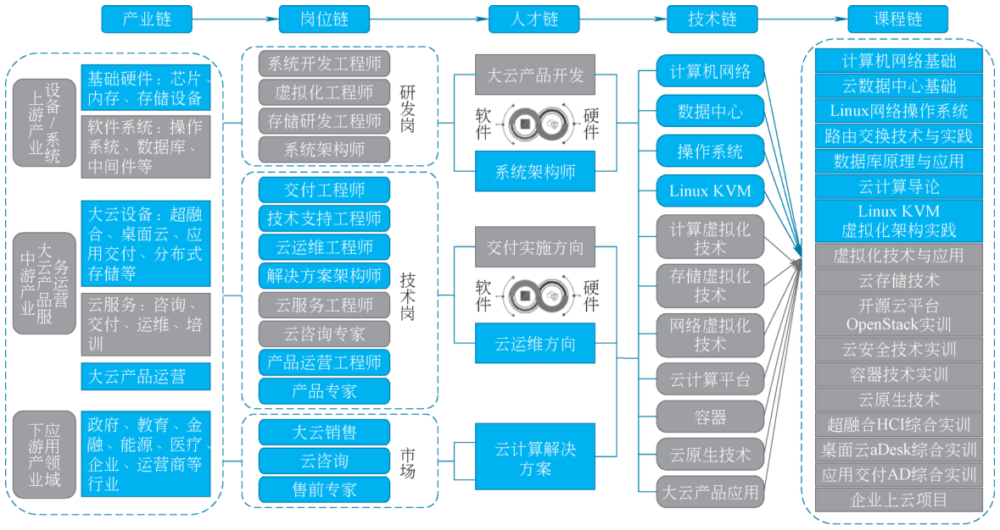
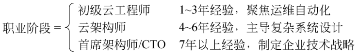
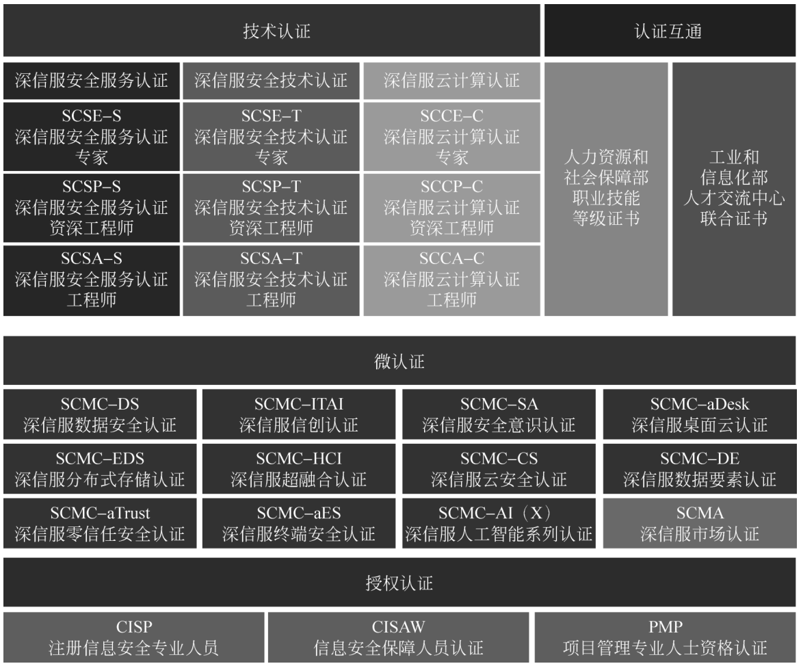

# 5.2 职业发展路径 {#52}

!!! info "学前导读"

    学了一学期云计算，毕业后能做什么？本节回答三个问题：

    1. **有哪些岗位**（5.2.1）：云架构师、云运维工程师、DevOps 工程师、云计算产品售后工程师，每个岗位都按“职责—技能—发展路径”介绍；
    2. **要学什么、考什么证**（5.2.2）：学生必备的云计算技能，以及阿里云、AWS、华为、深信服等认证和微认证；
    3. **做人做事的底线**（5.2.3）：职业道德规范、职业素养，以及两个“删库”的反面案例。

    对专科同学来说，**云运维工程师**是最常见的起点岗位，可以重点阅读 5.2.1.2 节，对照表 5-2 看看自己已经掌握了哪些技能。认证部分先了解体系，不必记住每个认证的名称；入门可以从阿里云 ACA、华为 HCIA 或深信服 SCCA 开始。

## 5.2.1 云计算相关职业 {#521}

结合前面的学习内容，我国云计算正向三个重要的方向发展，一是信息处理的集中化、云化；二是大数据的发展对云计算基础建设提出了更高的要求，云计算需要具备扩展性、弹性、资源池化、自助服务、可度量、低成本、按需支付和故障容错的能力；三是混合云/托管云的发展受到重视，云端的融合成为一种必然的趋势，在技术上这不仅需要一个深度软件定义的云计算管理平台，还需要云端的良好感知，同时云计算技术一定要适应各行各业的应用开发需要，使大众可以通过不同的终端使用丰富的云端应用。

当前教育领域以教育体制改革为核心，基本解决了市场需求与高学历人才的供需矛盾，建立了院校自我积累、自我发展的健康发展机制。但是随着虚拟化技术的成熟、云计算在企业数据中心的普及，社会对云计算相关的建设人才、管理人才和运营人才有大量的需求，对人才的技术素质的要求也有很大的提高。因此，学校为了使学生能更好地学习和掌握技术知识，必须加强相关专业的教学和科研环境的建设与改造。学校在提高计算机专业、云计算专业、数据通信专业的教学质量的同时还需要加开与云计算相关的课程，改进教学手段，加强实践环节，使学生尽快掌握新一代数据中心的技术知识，具备较强的理论和实践相结合的能力，从而更好地服务社会。

当前在云计算技术领域，我们通过对产业的调研和分析，整理了产业链、岗位链、人才链、技术链、课程链等维度的分析，以下将以私有云及托管云领域龙头企业深信服的人才培养模式为例进行讲解。深信服以核心就业岗位为标准，以应用型课程为基础，研发了多套完整的课程体系，课程以技能点为开发单元，采取模块化设计，可根据不同院校培养目标进行个性化修订，深信服云计算课程设计如图 5-5 所示。

{ loading=lazy }

图 5-5 深信服云计算课程设计
{ .fig-caption }

### 5.2.1.1 云架构师 {#5211}

#### 1. 职责范畴

（1）云解决方案设计。

负责规划企业级云架构，设计高可用、可扩展的分布式系统；需平衡性能、成本与安全性，如通过服务等级协议等指标量化系统可靠性。

（2）成本优化与资源治理。

使用 TCO 模型分析云资源利用率，制定自动化伸缩策略，如基于 AWS Lambda 实现无服务器架构的动态资源分配。

（3）安全合规实施。

设计安全模型，整合身份访问管理、虚拟私有云等技术，确保符合法规。

（4）跨团队协作。

作为技术纽带协调开发、运维与业务部门，如通过 DevOps 流水线实现持续集成/持续交付流程标准化。

#### 2. 技能要求

云架构师技能要求见表 5-1。

表 5-1 云架构师技能要求
{ .tab-caption }

| 内容 | 技术能力 | 非技术能力 |
|---|---|---|
| 核心技能 | 云平台专精（AWS/Azure/GCP，至少精通其中 1~2 个）；容器化技术：Docker 容器管理与 Kubernetes 编排；基础设施即代码：Terraform 自动化部署、CloudFormation 模板编写 | 业务需求分析能力：将业务目标转化为技术解决方案；技术方案商业价值论证：评估技术投入与业务收益的匹配度 |
| 高阶技能 | 混合云/多云架构设计：跨云资源调度与灾备方案；云原生技术栈：Service Mesh 服务治理、Serverless 无服务器架构；性能监控与优化：Prometheus+Grafana 监控体系、ELK 日志分析 | 技术路线图规划：制订短期实施计划与长期技术演进路径；团队技术赋能：通过培训、文档共享提升团队整体技术水平；跨部门协作能力：与产品、运维、安全等团队高效沟通 |

#### 3. 权威认证体系

（1）基础认证。

基础认证包括 AWS Certified Solutions Architect-Associate、Microsoft Certified: Azure Administrator Associate。

认证价值：验证云平台基础架构设计能力，涉及 VPC 配置、负载均衡算法等。

（2）进阶认证。

进阶认证包括 Microsoft Certified: Azure Solutions Architect Expert、Google Cloud Professional Cloud Architect、信息系统安全专家认证（CISSP）。

侧重领域：多云安全策略设计、PCI DSS 合规实施。

（3）专项认证。

专项认证有 Certified Kubernetes Administrator（CKA）等。

技术聚焦：容器集群的 RBAC 权限控制、Helm Chart 部署优化。

#### 4. 职业发展路径

云技术领域的职业发展路径涵盖不同阶段，各阶段有着明确的经验要求与核心职责。初级云工程师（1~3 年经验）：此阶段主要聚焦于运维自动化工作，通过熟练掌握相关工具和技术，实现运维任务的自动化执行，提升运维效率和稳定性。

云架构师（4~6 年经验）：在积累一定经验后，晋升为云架构师，主导复杂系统设计。需要综合考虑业务需求、技术架构、性能优化等多方面因素，设计出高效、可靠且具有扩展性的云系统架构。

首席架构师/CTO（7 年以上经验）：处于职业发展的高级阶段，主要负责制定技术战略。需站在行业前沿，洞察技术发展趋势，结合企业自身发展目标，规划长期的技术发展方向，引领企业在技术领域保持竞争力。

行业数据显示，顶级云架构师年薪可达 $200k+（北美地区），如云财务管理（FinOps）、人工智能与机器学习（AI/ML）在云环境中的集成、绿色计算与可持续架构等新兴领域。云计算职业阶段如图 5-6 所示。

{ loading=lazy }

图 5-6 云计算职业阶段
{ .fig-caption }

### 5.2.1.2 云运维工程师 {#5212}

#### 1. 核心职责

（1）云环境运维监控。

实时监控云资源使用状态（CPU/内存/存储/网络），通过 Prometheus、Grafana 等工具构建监控体系，确保满足服务等级协议要求；分析日志数据，定位性能瓶颈，如优化 Nginx 虚拟主机的并发处理能力。

（2）自动化运维与持续交付。

设计 CI/CD 流水线，集成 Jenkins、GitLab CI 等工具，实现容器化应用的自动部署与回滚；编写 Ansible、Terraform 脚本管理云基础设施，降低人工操作风险；实施多云/混合云容灾方案，设计数据库和应用的跨可用区部署策略；定期执行备份验证，确保恢复点目标和恢复时间目标达标。

（3）安全合规与成本优化。

配置 IAM 权限、VPC 网络隔离、WAF 防火墙，定期扫描云环境漏洞；分析云资源账单，通过弹性伸缩和预留实例优化总拥有成本。

#### 2. 技能要求

云运维工程师技能要求见表 5-2。

表 5-2 云运维工程师技能要求
{ .tab-caption }

| 内容 | 技术能力 | 非技术能力 |
|---|---|---|
| 基础能力 | 精通至少一种云平台的核心服务；熟练掌握 Linux 系统调优及脚本开发；熟悉容器技术栈； | 具备高效的故障排查与应急响应能力；拥有良好的文档编写能力以及流程标准化意识； |
| 高阶能力 | 深入理解云原生监控体系；熟练掌握分布式数据库运维；熟悉 Service Mesh 的流量治理 | 具备出色的跨团队协作能力；拥有敏锐的技术趋势洞察能力 |

#### 3. 典型工作场景示例

（1）故障应急。

某云上 MySQL 实例突发 CPU 飙升至 95%，通过查询日志分析定位到未使用索引的 SQL 语句，协同开发团队优化后性能恢复。

（2）容量规划。

预测“双 11”流量峰值，基于历史数据调整 K8s 集群的节点自动扩缩容策略，将资源闲置率从 40% 降至 15%。

（3）迁移实施。

主导本地 IDC 到阿里云的迁移项目，使用 rsync 同步数据，并通过 DNS 灰度切换验证服务连续性。

#### 4. 职业发展路径

初级云运维工程师（1~2 年）：此阶段重点在于掌握基础运维工具链，能够熟练运用这些工具处理工单级任务，熟悉云运维的基本流程和操作，为后续的职业发展打下坚实基础。

资深云运维工程师（3~5 年）：随着经验的积累，开始主导复杂系统的运维工作。不仅要保障系统的稳定运行，还需从架构层面进行考量，设计高可用架构，提升系统的可靠性和容错能力，以应对更为复杂的业务场景。

云架构师/技术经理（6 年以上）：在积累了丰富的云运维经验后，可晋升至云架构师或技术经理岗位。此时需要具备更宏观的技术视野和管理能力，参与企业整体云架构的规划与设计，领导团队开展技术工作，推动技术创新与业务发展。

### 5.2.1.3 DevOps 工程师 {#5213}

#### 1. 核心职责

（1）持续集成与交付（CI/CD）。

设计并维护自动化流水线，集成 Jenkins、GitLab CI 等工具，实现代码从提交到生产环境的全流程自动化（包括构建、测试、部署）。

优化部署策略（如蓝绿部署、金丝雀发布），确保零宕机更新，如通过 Kubernetes 滚动升级控制服务变更风险。

（2）基础设施即代码（IaC）。

使用 Terraform、Ansible 或 CloudFormation 定义云资源，实现环境快速重建与版本控制（如开发、测试、生产环境一致性保障）。

容器化技术栈管理（如 Docker 镜像构建、K8s 集群编排），支持微服务架构的弹性伸缩。

（3）系统监控与可观测性。

搭建 Prometheus+Grafana 监控体系，实时追踪应用性能指标（如 APM 链路追踪、日志聚合分析 ELK 栈），快速定位故障原因。

设计告警规则（如 Alertmanager），通过 Slack 或 PagerDuty 触发自动化响应流程，减少人工干预。

（4）协作与流程优化。

推动开发、测试、运维团队协作，建立 DevSecOps 文化，如在流水线中集成安全扫描工具（如 SonarQube、Trivy）。

优化敏捷开发流程，缩短迭代周期（如从月度发布到每日多次部署）。

#### 2. 技能要求

DevOps 工程师技能要求见表 5-3。

表 5-3 DevOps 工程师技能要求
{ .tab-caption }

| 内容 | 技术能力 | 非技术能力 |
|---|---|---|
| 核心技能 | 至少掌握一门编程或脚本语言（如 Python、Go、Shell）；熟悉主流云平台（AWS/Azure/GCP）核心服务；精通 CI/CD 工具链（如 Jenkins、GitLab CI、ArgoCD）；掌握容器化技术（Docker）与编排系统（Kubernetes） | 具备跨团队沟通与协作能力，推动开发、运维、安全协同；树立“自动化优先”思维，持续优化交付流程；具备快速学习新技术的能力与实践意愿 |
| 进阶技能 | 理解分布式系统架构设计原则，具备高可用、容错机制设计能力；熟悉基础设施即代码（Terraform、Pulumi）与配置管理工具（Ansible）；掌握性能调优、日志聚合（ELK）与监控告警体系（Prometheus + Alertmanager）；了解 DevSecOps 实践，集成安全扫描于流水线中 | 具备故障复盘与根因分析能力，推动知识沉淀与流程改进；能预判技术趋势，评估新工具在组织内的适用性与落地路径 |

#### 3. 典型工作场景示例

（1）自动化流水线构建。

为 Java 微服务项目设计 GitLab CI 流水线，集成单元测试、镜像构建、K8s 部署，将发布耗时从 2 小时缩短至 15 分钟。

（2）云资源成本优化。

分析 AWS 账单，利用 Spot 实例+自动伸缩组降低 30% 计算资源成本，同时保障 SLA 稳定性。

（3）生产环境故障处理。

某线上服务因数据库连接池耗尽导致延迟飙升，通过 Grafana 仪表盘快速定位瓶颈，临时扩容并优化连接池配置。

#### 4. 职业发展路径

DevOps 工程师的职业发展路径多元，通常可分为以下三大方向：

技术专家路线：深耕核心技术领域，如 Kubernetes 集群运维、CI/CD 流水线架构设计、自动化测试与部署平台开发，成为特定工具链或系统的权威专家；管理与变革推动路线：转向技术管理岗位，如 DevOps 团队负责人或工程效能总监，主导企业级 DevOps 转型，推动流程标准化、文化协同与跨部门协作；跨界融合发展路线：向相关高阶角色演进，如云架构师、SRE（站点可靠性工程师）或平台工程师，融合开发、运维与安全能力，构建高可用、自愈性强的云原生系统。

随着经验积累，DevOps 工程师可通过持续学习云原生生态、AIOps、FinOps 等新兴技术，拓展职业边界，在技术深度与广度上实现双重突破。DevOps 工程师与传统运维工程师的差异见表 5-4。

表 5-4 DevOps 工程师与传统运维工程师的差异
{ .tab-caption }

| 维度 | DevOps 工程师 | 传统运维工程师 |
|---|---|---|
| 工作重心 | 自动化流程与协作（开发到运维的无缝衔接） | 手动维护基础设施稳定性 |
| 技术栈 | 容器化、云原生、IaC（如 Terraform） | 物理服务器、脚本化运维 |
| 目标指标 | 部署频率、故障恢复速度（MTTR） | 系统可用性、故障预防 |

### 5.2.1.4 云计算产品售后工程师 {#5214}

#### 1. 核心职责

（1）熟悉业务所涉及的公有云、私有云产品以及云管理服务，进行项目的售前咨询工作，与销售团队共同配合，进行客户沟通交流，梳理与引导客户的需求，设计组合客户所需的云产品或服务方案。

（2）不断设计与优化围绕行业的解决方案，配合销售团队共同推广与销售解决方案。

（3）运营支持：负责网络安全产品技术运营支撑工作，包括客户交流、培训、答疑、方案讲解、招投标等工作。

（4）需求分析：负责安全产品的需求对接，并能详细分析、引导客户需求，解决客户痛点，识别合作机会点，协助立项重点工作。

（5）方案编写：结合用户市场的准确定位，负责安全产品的售前方案编写，并有针对性地定期整理、完善技术方案，使方案满足客户需求。

#### 2. 技能要求

▶ 配套微课 V5-3《云计算岗位实践》（纸质书中为二维码，网络版视频待上线）

（1）具备网络、安全、云计算、服务器、存储等领域基础知识，熟悉数据通信产品或服务器存储产品及方案。

（2）具有数据通信领域或服务器存储领域从事产品营销、售前技术支持、方案规划等工作经验，有重大项目规划及支持经验者优先。

（3）有较强的敬业精神和工作责任心，具有项目协调能力，良好的学习能力，有较强的口头表达能力和演讲能力。

## 5.2.2 学生应具备的技能与认证 {#522}

### 5.2.2.1 学生应具备的技能 {#5221}

#### 1. 学生必备云计算技能

（1）基础能力。

Linux 操作系统：熟悉常用命令、Shell 脚本编写（如 grep、awk 等工具）。

网络基础：TCP/IP 协议、VPC（虚拟私有云）、CIDR 地址规划。

虚拟化技术：KVM/Xen 原理、容器化技术（Docker/Kubernetes）。

（2）云平台核心技能。

云服务模型：IaaS/PaaS/SaaS 的区别与应用场景。

资源管理：ECS 实例创建、对象存储（如阿里云 OSS/AWS S3）、负载均衡配置。

自动化运维：Terraform 基础设施即代码（IaC）、Ansible 配置管理编程与工具。

Python/Go 语言：编写自动化脚本、调用云平台 API（如 AWS Boto3 库）。

监控与日志：Prometheus/Grafana 监控、ELK 日志分析。

数据库管理：云数据库（RDS、NoSQL）的备份与恢复。

!!! tip "本书内容与必备技能对照"

    | 必备技能 | 本书对应内容 |
    |---|---|
    | 云服务模型 IaaS/PaaS/SaaS | [1.1.3](../01-cloud-basics/1-1.md#113)、第 3 章 |
    | 虚拟化与容器 | [2.2 节](../02-core-technologies/2-2.md)、[实验 2-2](../02-core-technologies/labs.md#2-2)、[实验 4-2](../04-applications/labs.md#4-2) |
    | VPC、安全组 | [2.4 节](../02-core-technologies/2-4.md)、[2.5 节](../02-core-technologies/2-5.md) |
    | 云服务器、对象存储 | [实验 2-1](../02-core-technologies/labs.md#2-1)、[实验 2-3](../02-core-technologies/labs.md#2-3)、[实验 3-1](../03-platforms-tools/labs.md#3-1) |
    | Terraform、Ansible、CI/CD | [3.5 节](../03-platforms-tools/3-5.md)、[实验 3-3](../03-platforms-tools/labs.md#3-3) |
    | 云数据库 | [3.2.2 节](../03-platforms-tools/3-2.md#322)、[实验 4-1](../04-applications/labs.md#4-1) |

### 5.2.2.2 云计算相关认证 {#5222}

#### 1. 阿里云 ACP 认证

（1）认证类型与含金量。

阿里云 ACP（Alibaba Cloud Certified Professional）覆盖云计算、大数据、安全等领域，是专业级认证，适合有一定基础的从业者，国内企业认可度高；零基础学习者可先考入门级的 ACA（Alibaba Cloud Certified Associate）。

考试内容：云服务器 ECS、SLB 负载均衡、OSS 对象存储、安全组策略等。

（2）适合人群与价值。

学生/转行者：快速掌握阿里云生态技术栈，提升简历竞争力。

职业优势：阿里生态企业优先录用，部分企业提供技术津贴。

#### 2. AWS 认证

（1）认证层级与方向。

基础级：AWS Certified Cloud Practitioner（云计算基础概念）。

助理级：AWS Certified Solutions Architect-Associate（架构设计）。

专业级：AWS Certified DevOps Engineer-Professional（自动化与运维）。

（2）国际认可度与薪资。

企业需求：跨国企业（如 Netflix、Spotify）优先招聘 AWS 认证工程师。

薪资水平：持证者平均年薪可达 12 万美元，部分岗位溢价 30%。

#### 3. 华为云计算认证

华为云计算认证是华为公司推出的一套面向云计算领域的专业认证体系，旨在培养和验证个人在云计算技术、解决方案设计、部署、运维等方面的专业能力。以下是三个主要认证级别的详细介绍。

（1）HCIA-Cloud Computing。

定位：入门级认证，适合初学者，考查考生对华为云基础知识和基本技能的掌握。

考试内容：涵盖云基础设施（云计算理论、虚拟化技术、存储技术、网络技术、安全技术等）、云计算服务（IaaS、PaaS、SaaS、容器化等）、云计算管理（云计算平台管理、云计算用户管理等）。

职业发展方向：通过认证后可从事云计算工程师，负责云计算项目的部署和维护工作。

（2）HCIP-Cloud Computing。

定位：中级认证，面向有一定实践经验的人员，考查云计算领域的专业知识和技能。考试内容：包括华为服务器虚拟化技术、计算虚拟化技术、网络虚拟化技术、存储虚拟化技术、服务器虚拟化产品运维和故障处理、桌面云解决方案、桌面云系统运维和故障处理等。

职业发展方向：通过认证后可从事云计算高级工程师，负责云计算项目的架构设计、部署实施以及部分运维工作。

（3）HCIE-Cloud Computing。

定位：专家级认证，面向经验丰富的专业人士，考查其在云计算领域的综合能力和高级技能。

考试内容：包括云数据中心级别的运营和运维、云计算灾备、云计算业务迁移、云计算故障处理、云计算规划设计和最佳实践等。

职业发展方向：通过认证后可从事云计算专家工作，负责企业云计算战略规划、复杂云计算项目的架构设计与实施、团队技术指导等工作。

#### 4. 深信服云计算认证

深信服云计算认证（Sangfor Certified Cloud Computing）定位于普适性的云计算运维技术，考核内容涵盖云计算平台安装部署、运维与故障处理、云原生技术等相关知识，共分为 A、P、E、M 四个等级。

（1）认证等级。

认证工程师（SCCA-C）：适合应届毕业生或具备 1~3 年工作经验的初级从业人员，重点培养云计算平台运维人才，使其掌握云计算基础、虚拟化技术、云数据中心基础等知识。

认证资深工程师（SCCP-C）：面向有一定实践经验的云计算工程师，侧重于考查云计算平台的架构设计、优化与管理，考核内容包括云计算解决方案、云平台性能优化、分布式存储进阶等。

认证专家（SCCE-C）：专注于考查企业云计算数据中心场景下的智能运维与性能优化能力，考核内容涵盖 AIOps 智能运维、云平台性能优化、开源云平台进阶、分布式存储进阶、云原生关键技术、深信服云计算产品等数据中心智能运维的核心知识点。

▶ 配套微课 V5-4《云计算认证体系》（纸质书中为二维码，网络版视频待上线）

认证大师（SCCM-C）：代表云计算领域的顶尖水平，考查在复杂云计算项目中的架构设计、实施与管理能力，以及对行业前沿技术的掌握和应用。

（2）认证内容。

云计算基础：包括云计算概述、发展趋势、关键技术（如虚拟化技术、分布式存储、容器技术等）。

云数据中心：涉及 IaaS 原理与构建、网络虚拟化、存储虚拟化、计算虚拟化等。

云原生技术：涵盖容器技术（如 Docker、Kubernetes）、持续交付（CI/CD）、微服务架构、DevOps 等。

深信服云计算产品：包括超融合（HCI）、桌面云（aDesk）、分布式存储（EDS）、应用交付（AD）等产品的安装部署、管理维护与排障。

深信服认证体系如图 5-7 所示。

{ loading=lazy }

图 5-7 深信服认证体系
{ .fig-caption }

（3）认证价值。

权威认证：与教育部、人力资源和社会保障部、工业和信息化部人才交流中心实现标准互通，具备高含金量和社会认可度。

就业支持：通过认证的学员可获得相应就业支持服务，包括职业规划、求职技能提升及职场提升课程，更好地提升就业竞争力。

多证书互认：通过“1+X”高级认证的学员可同时获得深信服技术认证 A 级和合作伙伴 PT1 认证，实现“一考三证”。

重认证机制：认证有效期为 3 年，超过有效期需重新认证或升级，确保认证人员的专业能力与行业最新发展趋势保持一致。

#### 5. 其他云计算认证推荐

其他云计算认证推荐见表 5-5。

表 5-5 其他云计算认证推荐
{ .tab-caption }

| 认证名称 | 适用场景 | 含金量 | 难度 |
|---|---|---|---|
| CKA（Kubernetes 认证） | 云原生开发/运维岗 | ★★★★☆ | ★★★★☆ |
| 微软 AZ-104 | Azure 平台管理员岗位 | ★★★☆☆ | ★★★☆☆ |
| 软考（中级） | 国企/事业单位职称评定 | ★★★★☆ | ★★★☆☆ |
| Google Cloud ACE | 谷歌云平台部署与运维岗 | ★★★☆☆ | ★★★☆☆ |

### 5.2.2.3 云计算相关微认证 {#5223}

#### 1. 华为微认证

华为微认证提供丰富的微认证课程，采用在线学习、试验和考试一体化模式，覆盖云计算、大数据、人工智能、物联网等前沿技术场景。代表课程包括“华为云计算服务实践”“CCE 网络与存储实战”“云原生基础设施之容器入门”等，满足不同层次学习者的需求。

#### 2. 深信服微认证

深信服微认证覆盖云计算、网络安全等多领域，包括安全技术认证、安全服务认证和云计算认证，针对在校学生、行业从业者及爱好者，具有权威性，提供完善的课程体系，助力个人职业发展与技能提升。持证者可享免费换取合作伙伴 PT1 证书等福利。

具体的微认证如下：SCMC-DS（数据安全）微认证、SCMC-aDesk（桌面云）微认证、SCMC-aDesk+aES（信创终端安全）微认证、HCI（超融合）微认证、EDS（分布式存储）微认证、云安全运维认证、深信服安全开发微认证、数据要素微认证、深信服 AI 系列认证-AIC、人工智能安全微认证、AI 技术与安全应用微认证。

#### 3. 阿里云微服务认证

阿里云微服务认证内容涵盖云原生微服务概述、企业级分布式应用服务、消息队列、Serverless 应用引擎、函数计算、MSE&GTS、业务实时监控服务、性能测试、应用高可用服务等。阿里云微服务认证含金量较高，分为多个等级，适合有一定云计算基础和项目经验的技术人员。其考试内容包括微服务架构设计原则，阿里云微服务相关产品，微服务开发、部署、运维和监控，以及实际业务场景下的微服务解决方案。

## 5.2.3 职业道德规范与职业素养 {#523}

党的二十大报告明确提出，要加快发展数字经济，推动数字产业化和产业数字化，赋能传统产业转型升级。在此背景下，云计算作为数字技术的关键支撑，正发挥着越来越重要的作用。

与此同时，随着云计算技术的快速发展，对高素质专业人才的需求也日益旺盛。然而，行业在技术创新与应用落地过程中，也面临着数据隐私保护、网络安全治理、责任边界模糊等道德与法律挑战。因此，构建完善的职业道德规范体系，强化从业人员的责任意识与法治观念，不仅是保障行业健康发展的内在要求，更是落实总体国家安全观、服务国家治理体系和治理能力现代化的重要体现。

### 5.2.3.1 职业道德规范要点 {#5231}

（1）诚实守信与责任担当：作为云计算从业人员，诚实守信是职业立足之本。例如，在数据管理过程中，技术人员应当确保所存储和处理的数据真实可靠，不得为了个人私利或迎合不正当要求而篡改或删除关键数据。在出现问题或故障时，应及时、准确地向上级和相关管理部门汇报，并积极采取措施解决问题，而不是隐瞒或推卸责任。

（2）保密义务与数据保护：在云计算环境中，数据的安全和隐私至关重要。从业人员必须严格遵守保密协议，对接触到的企业和客户的敏感信息进行严格保密。无论是在数据存储、传输还是处理的环节，都要采取先进的加密技术、访问控制机制等安全措施，防止数据泄露、被篡改或遭受未授权访问。例如，某医疗云服务提供商的工程师在处理患者的病历数据时，应确保只有经过授权的医护人员和相关管理人员能够在合法合规的前提下访问这些数据，同时采用加密算法对数据进行加密存储和传输，以保护患者的隐私。

（3）遵守法律法规：增强法律意识是每个云计算从业人员的必修课。在数据隐私保护方面，我国出台了《中华人民共和国网络安全法》《中华人民共和国数据安全法》《中华人民共和国个人信息保护法》等相关法律法规，对数据的收集、存储、使用、加工、传输、提供、公开等处理活动进行了严格规范。从业人员应深入学习并严格遵守这些法律法规，确保云服务的合法合规运营。例如，在进行跨境数据传输时，要按照法律规定履行相应的审批程序，采取合适的数据保护措施，避免因违法违规行为导致企业遭受处罚，同时也应维护国家的数据安全和用户的合法权益。

### 5.2.3.2 职业素养要求 {#5232}

（1）具备爱岗敬业精神：爱岗敬业是职业道德的基础。云计算从业人员应热爱自己的工作岗位，对工作充满热情，并认真负责地对待每一项任务。例如，在日常的云平台维护工作中，运维人员应定期对服务器、存储设备、网络设备等进行巡检，及时发现并处理潜在的故障隐患，确保云平台的稳定运行。

（2）遵守企业规章制度：企业为了保障自身的正常运营和信息安全，都会制定一系列的规章制度，如员工行为守则、信息安全管理制度、项目开发流程规范等。云计算从业人员应深入了解并严格遵守这些制度，维护企业的利益和形象。例如，在企业的信息安全管理制度中，明确规定了员工在访问和使用企业内部云资源时的操作规范，包括账号密码的管理、数据下载与上传的审批流程等。从业人员应自觉遵守这些规定，避免因违规操作导致信息安全事件的发生，同时也为企业的稳定发展贡献自己的一份力量。

（3）专业能力与持续学习：云计算行业技术迭代迅速，从业人员应具备扎实的专业知识基础，并持续关注行业动态和新技术发展。例如，随着容器技术、AI 计算、大模型等新兴技术的广泛应用，技术人员应积极参加相关培训、研讨会或在线课程，通过实践项目不断提升自己在这些领域的应用能力，以满足企业和客户对云计算服务的多样化需求。

（4）团队合作与沟通：云计算项目通常规模庞大、复杂度高，需要多个部门、多个专业背景的人员协同合作。在这个过程中，良好的团队合作精神和沟通能力至关重要。例如，在开发部署一个大型企业的云计算解决方案时，云架构师、开发工程师、测试人员、运维人员以及销售人员等不同角色需要紧密配合。开发工程师应及时与云架构师沟通技术实现的可行性，测试人员在发现问题后要准确地反馈给开发团队并协同解决，运维人员则需要与开发和测试团队共同确保系统的稳定运行。

### 5.2.3.3 行业案例分析 {#5233}

以某知名云服务提供商的云工程师删库事件为例，该工程师在离职后，利用其在公司期间仍有效的账户访问权限，恶意删除了某银行的重要业务数据库，导致银行系统瘫痪数小时，给银行带来了巨大的经济损失和不良社会影响。这一行为严重违背了职业道德规范，不仅给企业带来了巨大的损失，也对整个云计算行业的声誉造成了负面影响。最终，该工程师因涉嫌破坏计算机信息系统罪等被依法追究刑事责任，受到了法律的严厉制裁。

另一个案例是大厂程序员删库被判刑，据金某某本人供述，自己毕业后就在百度负责测试开发，工作内容就是测试公司的平台和写程序。2020 年 8 月、9 月，公司派其他员工来接手项目，金某某对这个安排感到不满，为了显示自己在这个项目里还有作用，就对平台的数据进行了破坏。因为一时冲动，最后金某某被一审法院判以破坏计算机信息系统罪，判处有期徒刑九个月，缓刑一年。

这两个案例深刻警示我们，云计算从业人员在工作中必须时刻保持清醒的头脑，增强法律意识和职业道德观念。企业也应加强内部管理，严格控制用户权限的分配和回收机制，定期对员工进行法律法规和职业道德培训，建立健全的监督和审计制度，以防止类似事件的再次发生，从而保障云计算行业的健康稳定发展。

## 随堂小测

**1.** 负责实时监控云资源使用状态、编写自动化运维脚本、执行备份验证的岗位是（　　）。

- A. 云架构师
- B. 云运维工程师
- C. 云计算产品售后工程师
- D. 首席技术官

??? tip "答案与解析"
    **答案：B**

    解析：云运维工程师的核心职责包括云环境运维监控、自动化运维与持续交付、安全合规与成本优化。云架构师侧重解决方案设计。

    考查：云运维工程师 · 认知层次：理解 · [回看 5.2.1.2](#5212)
    { .quiz-meta }

**2.** 华为云计算认证中，面向初学者的入门级认证是（　　）。

- A. HCIA-Cloud Computing
- B. HCIP-Cloud Computing
- C. HCIE-Cloud Computing
- D. CKA

??? tip "答案与解析"
    **答案：A**

    解析：华为认证分 HCIA（入门级）、HCIP（中级）、HCIE（专家级）三个级别；CKA 是 Kubernetes 管理员认证。

    考查：华为云计算认证 · 认知层次：记忆 · [回看 5.2.2.2](#5222)
    { .quiz-meta }

**3.** 员工离职时，只要办完交接手续，原来的系统账号权限可以先保留，方便以后咨询。（　　）

- √
- ×

??? tip "答案与解析"
    **答案：×**

    解析：5.2.3.3 节的删库案例中，工程师正是利用离职后仍有效的账户权限删除了数据库。企业应严格控制权限的分配和**回收**，员工离职时立即停用其账号。

    考查：职业道德规范与行业案例 · 认知层次：应用 · [回看 5.2.3.3](#5233)
    { .quiz-meta }
