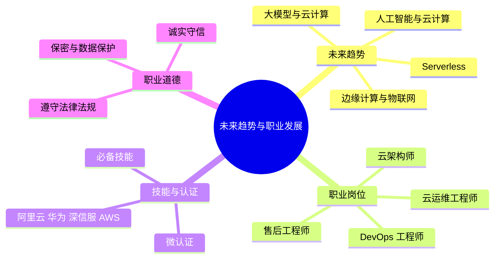

# 第 5 章 本章小结与练习

## 本章关键词

云计算职业、云架构师、阿里云认证、华为云计算认证、深信服云计算认证等。

## 本章小结

本章深入探讨云计算的未来趋势与职业发展，着重剖析了边缘计算、人工智能与云计算的结合、无服务器计算等前沿技术方向，阐述了这些技术如何推动云计算向更高效、智能和灵活的形态演进。在职业发展层面，详细梳理了云计算相关职业，包括云架构师、云运维工程师、DevOps 工程师、云计算产品售后工程师等，分析了各岗位所需的技能要求，强调持续学习和技术更新在云计算从业者职业规划中的重要性，并指出了云计算领域的广阔就业前景和职业晋升路径。本章旨在帮助学生清晰认知未来技术与职业发展趋势，助力其在云计算领域把握机遇，做好职业规划，以适应行业快速发展和变革的需求。

把本章压缩成 6 句话：

1. **边缘计算**把计算下沉到靠近设备的网络边缘，缩短延迟、节省带宽、支持离线运行，广泛用于车联网、智慧交通、智慧农业和智慧医疗，与云计算形成“云边协同”。
2. **人工智能与云计算**互补：云提供存储、GPU 算力和部署平台，人工智能从数据中提取价值，应用于智能客服、物流、金融、城市、制造和医疗。
3. **Serverless** 让开发者只写函数、不管服务器，平台自动伸缩、按调用计费；2014 年 AWS Lambda 是首个商业化 FaaS，主要挑战是冷启动、可移植性和可观测性。
4. **大模型**的训练和推理依赖云上的 GPU 集群、分布式存储和弹性部署，云厂商又把大模型做成 API 服务；未来趋势是云边端协同、多云混合云、绿色计算和行业大模型。
5. 云计算相关岗位有**云架构师、云运维工程师、DevOps 工程师、售后工程师**等，专科毕业生通常从云运维起步；可以通过阿里云、华为、深信服、AWS 等认证证明能力。
6. 从业者要**诚实守信、保守秘密、遵守法律**，企业要严格管理权限的分配与回收，“删库”事件说明职业道德和法律意识是从业底线。

**全书回顾**：第 1 章认识云计算，第 2 章打开“黑盒”看虚拟化、存储、分布式计算、网络和安全，第 3 章熟悉云平台的各层服务和工具，第 4 章动手搭网站、部署容器，并了解各行业的应用，第 5 章展望趋势、规划职业。建议做一做[期末模拟卷](../../mock-exam.md)检验学习效果。

## 参考文献

**教材与专著**

1. 施巍松，刘芳，孙辉，等. 边缘计算[M]. 2 版. 北京：科学出版社，2021. 边缘计算的概念、架构与应用，对应 5.1.1 节。

**在线资源**

2. 阿里云. 函数计算 FC 产品文档[EB/OL]. [2026-11-01]. https://help.aliyun.com/zh/functioncompute/. 创建函数、触发器与计费方式，对应实验 5-1。
3. KubeEdge 项目. KubeEdge 文档[EB/OL]. [2026-11-01]. https://kubeedge.io/docs/. 云边协同的容器编排，对应 5.1.1.3 节。
4. 阿里云. 阿里云认证[EB/OL]. [2026-11-01]. https://edu.aliyun.com/certification/. ACA、ACP、ACE 认证的等级与考试大纲，对应 5.2.2.2 节。
5. 华为. 华为认证[EB/OL]. [2026-11-01]. https://e.huawei.com/cn/talent/. HCIA、HCIP、HCIE 云计算认证，对应 5.2.2.2 节。

## 课后练习

**一、单项选择题**

**1.** 在靠近物或数据源头的一侧，就近提供计算、存储等服务的计算模式是（　　）。

- A. 边缘计算
- B. 网格计算
- C. 集中式计算
- D. 批处理计算

??? tip "答案与解析"
    **答案：A**

    解析：教材在 5G 车联网部分给出了边缘计算的定义：在靠近物或数据源头的一侧，采用集网络、计算、存储、应用核心能力于一体的开放平台，就近提供最近端服务。

    考查：边缘计算的概念 · 认知层次：记忆 · [回看 5.1.1.2](5-1.md#5112)
    { .quiz-meta }

**2.** 欧洲电信标准化协会在 2014 年提出的、在离用户最近的无线接入网中部署 IT 基础设施的方案是（　　）。

- A. CDN
- B. NFV
- C. MEC（移动边缘计算）
- D. SaaS

??? tip "答案与解析"
    **答案：C**

    解析：MEC 即 mobile edge computing，由网络运营商主导，在无线接入网中部署计算、存储、网络能力。

    考查：网络运营商移动边缘计算方案 · 认知层次：记忆 · [回看 5.1.1.3](5-1.md#5113)
    { .quiz-meta }

**3.** 华为开源、支持把容器化业务逻辑下发到边缘部署的边缘计算项目是（　　）。

- A. Link Edge
- B. OpenEdge
- C. Lambda
- D. KubeEdge

??? tip "答案与解析"
    **答案：D**

    解析：KubeEdge 由华为开源，基于 Kubernetes，把容器化应用下发到边缘；OpenEdge 是百度开源的，提供本地函数式引擎；Link Edge 是阿里云的产品，未开源。

    考查：云服务商边缘计算产品 · 认知层次：记忆 · [回看 5.1.1.3](5-1.md#5113)
    { .quiz-meta }

**4.** 下列关于 Serverless 的说法，正确的是（　　）。

- A. Serverless 意味着程序运行时根本不需要服务器
- B. 开发者不用管理服务器，平台按实际调用计费并自动伸缩
- C. Serverless 只能运行 Java 程序
- D. Serverless 没有任何缺点

??? tip "答案与解析"
    **答案：B**

    解析：Serverless 不是没有服务器，而是服务器由云平台管理，开发者只关注业务逻辑；它也面临冷启动、可移植性、可观测性等挑战。

    考查：Serverless 技术优势与挑战 · 认知层次：理解 · [回看 5.1.3.2](5-1.md#5132)
    { .quiz-meta }

**5.** 函数一段时间没有被调用，再次调用时需要重新创建运行环境，响应变慢，这种现象称为（　　）。

- A. 冷启动
- B. 热迁移
- C. 负载均衡
- D. 弹性伸缩

??? tip "答案与解析"
    **答案：A**

    解析：冷启动是 Serverless 的主要挑战之一，实验 5-1 的第 5 步就是观察冷启动。

    考查：Serverless 的挑战 · 认知层次：理解 · [回看 5.1.3.3](5-1.md#5133)
    { .quiz-meta }

**6.** 大模型训练需要数千块 GPU，企业一般通过（　　）获取这些算力，而不必自建数据中心。

- A. 购买个人电脑
- B. 只用 CPU 服务器
- C. 云计算平台的 GPU 集群
- D. 手机终端

??? tip "答案与解析"
    **答案：C**

    解析：云计算凭借弹性扩展、资源池化和按需付费，成为支撑大模型落地的核心基础设施。

    考查：大模型对云计算的需求 · 认知层次：理解 · [回看 5.1.4.2](5-1.md#5142)
    { .quiz-meta }

**7.** 通过 Prometheus、Grafana 构建监控体系，确保满足服务等级协议要求，这主要是（　　）的工作。

- A. 售后工程师
- B. 云运维工程师
- C. 前端设计师
- D. 财务人员

??? tip "答案与解析"
    **答案：B**

    解析：云环境运维监控是云运维工程师的第一项核心职责。

    考查：云运维工程师 · 认知层次：理解 · [回看 5.2.1.2](5-2.md#5212)
    { .quiz-meta }

**8.** 深信服云计算认证分为 A、P、E、M 四个等级，其中适合应届毕业生的是（　　）。

- A. 认证大师（SCCM-C）
- B. 认证专家（SCCE-C）
- C. 认证资深工程师（SCCP-C）
- D. 认证工程师（SCCA-C）

??? tip "答案与解析"
    **答案：D**

    解析：SCCA-C 适合应届毕业生或具备 1~3 年工作经验的初级从业人员。

    考查：深信服云计算认证 · 认知层次：记忆 · [回看 5.2.2.2](5-2.md#5222)
    { .quiz-meta }

**二、多项选择题**

**9.** Serverless 的技术优势包括（　　）。

- A. 无须管理服务器
- B. 弹性伸缩
- C. 函数可以永久保持运行状态，不会冷启动
- D. 按需计费

??? tip "答案与解析"
    **答案：ABD**

    解析：教材列出的四项优势是：无须管理服务器、弹性伸缩、按需计费、快速开发与部署。冷启动恰恰是 Serverless 面临的挑战。

    考查：Serverless 技术优势 · 认知层次：记忆 · [回看 5.1.3.2](5-1.md#5132)
    { .quiz-meta }

**10.** 云计算与人工智能互补协同，体现在（　　）。

- A. 云计算提供海量数据存储，人工智能从数据中提取价值
- B. 云计算提供 GPU 等高性能计算资源，支持模型训练
- C. 云计算提供应用部署平台，人工智能部署智能服务
- D. 人工智能可以完全取代云计算

??? tip "答案与解析"
    **答案：ABC**

    解析：这是 5.1.2.2 节“互补性协同工作制”的三个方面。

    考查：人工智能与云计算的结合 · 认知层次：理解 · [回看 5.1.2.2](5-1.md#5122)
    { .quiz-meta }

**11.** DevOps 工程师常用的工具有（　　）。

- A. Jenkins、GitLab CI
- B. Photoshop
- C. Terraform、Ansible
- D. Prometheus、Grafana

??? tip "答案与解析"
    **答案：ACD**

    解析：DevOps 工程师负责 CI/CD、基础设施即代码和系统监控，对应 A、C、D 三类工具。

    考查：DevOps 工程师 · 认知层次：理解 · [回看 5.2.1.3](5-2.md#5213)
    { .quiz-meta }

**12.** 我国在数据隐私保护方面出台的法律包括（　　）。

- A. 《中华人民共和国网络安全法》
- B. 《中华人民共和国数据安全法》
- C. 《中华人民共和国个人信息保护法》
- D. 以上法律都要求规范数据的收集、存储、使用、传输等处理活动

??? tip "答案与解析"
    **答案：ABCD**

    解析：5.2.3.1 节列出了这三部法律，它们对数据的收集、存储、使用、加工、传输、提供、公开等处理活动进行了严格规范。

    考查：遵守法律法规 · 认知层次：记忆 · [回看 5.2.3.1](5-2.md#5231)
    { .quiz-meta }

**三、判断题**

**13.** 边缘计算与云计算是互补关系，常见的架构是“云边协同”。（　　）

- √
- ×

??? tip "答案与解析"
    **答案：√**

    解析：边缘负责实时处理和本地决策，云端负责全局分析、模型训练和长期存储，两者协同工作。

    考查：边缘计算与云计算 · 认知层次：理解 · [回看 5.1.1](5-1.md#511)
    { .quiz-meta }

**14.** 2014 年阿里云推出了函数计算，这是首个商业化的 FaaS 产品。（　　）

- √
- ×

??? tip "答案与解析"
    **答案：×**

    解析：首个商业化 FaaS 是 2014 年 AWS 推出的 Lambda；阿里云函数计算 2017 年推出。

    考查：Serverless 发展历程 · 认知层次：记忆 · [回看 5.1.3.1](5-1.md#5131)
    { .quiz-meta }

**15.** DevOps 工程师关注部署频率和故障恢复速度，传统运维工程师更关注系统可用性和故障预防。（　　）

- √
- ×

??? tip "答案与解析"
    **答案：√**

    解析：见表 5-4“DevOps 工程师与传统运维工程师的差异”的“目标指标”一行。

    考查：DevOps 与传统运维 · 认知层次：理解 · [回看 5.2.1.3](5-2.md#5213)
    { .quiz-meta }

**16.** 云计算认证一旦获得就终身有效，不需要更新。（　　）

- √
- ×

??? tip "答案与解析"
    **答案：×**

    解析：以深信服认证为例，有效期为 3 年，超过有效期需重新认证或升级；AWS 等认证也有有效期。云计算技术迭代快，需要持续学习。

    考查：认证的重认证机制 · 认知层次：理解 · [回看 5.2.2.2](5-2.md#5222)
    { .quiz-meta }

**17.** 工程师在处理患者病历数据时，应确保只有经过授权的人员才能访问，并对数据加密存储和传输。（　　）

- √
- ×

??? tip "答案与解析"
    **答案：√**

    解析：这是 5.2.3.1 节“保密义务与数据保护”中的例子。

    考查：职业道德规范 · 认知层次：应用 · [回看 5.2.3.1](5-2.md#5231)
    { .quiz-meta }

**四、简答题**

**18.** 以智慧交通的智能信号灯为例，说明为什么要用边缘计算，而不是把所有视频都传到云端处理。

??? tip "参考答案"
    ① 延迟：边缘节点就在路口，识别结果几十毫秒内就能控制信号灯，云端处理要经过接入网、骨干网往返，延迟更高；② 带宽：几十路高清视频全部上传需要很大的上行带宽，边缘节点只上传异常片段，流量可减少九成以上；③ 可靠性：网络中断时边缘节点仍能离线工作。云端仍负责跨路口的全局优化和模型训练。

    评分要点：延迟、带宽、离线运行各 1～2 分，提到云边协同加分（共 5 分）。

**19.** 某高校开发了一个“查成绩”小程序，平时几乎没人用，只在每学期出成绩的几天访问量很大。用云服务器还是 Serverless 更合适？说明理由。

??? tip "参考答案"
    更适合 Serverless（函数计算）。理由：① 平时几乎没有请求，按调用计费几乎不花钱，而云服务器无论有没有请求都要全天计费；② 出成绩时访问量突增，函数计算自动弹性伸缩，不用提前扩容；③ 不用管理服务器，运维工作量小。需要注意冷启动可能让第一次访问稍慢。

**20.** 对照 5.2.1 节，选择一个你感兴趣的云计算岗位，说明它的主要职责、需要的技能，以及你打算考取的认证。

??? tip "参考答案"
    （开放题）示例：云运维工程师。职责：监控云资源、编写自动化运维脚本、做备份与容灾、配置安全权限、优化成本；技能：熟悉一种云平台的核心服务、Linux 和 Shell 脚本、Docker 与 Kubernetes、Prometheus 和 Grafana 监控；认证：先考阿里云 ACA 或华为 HCIA-Cloud Computing，工作后再考 ACP 或 HCIP。

**五、实操题**

**21.** 参照实验 5-1，修改函数代码，让它在返回月费的同时，比较按量付费与给定的包月价格（作为输入参数 `monthly_price`），返回更省钱的方式，并提交测试结果截图。

??? tip "参考思路"
    读取 `monthly_price = float(data.get("monthly_price", 200))`，在 `result` 中加入 `"cheaper": "按量付费" if result["monthly_cost"] < monthly_price else "包年包月"`；测试参数为 `{"price_per_hour": 0.5, "hours_per_day": 4, "monthly_price": 200}`，应返回“按量付费”。逻辑与实验 3-3 的 `cheaper_plan()` 相同。
